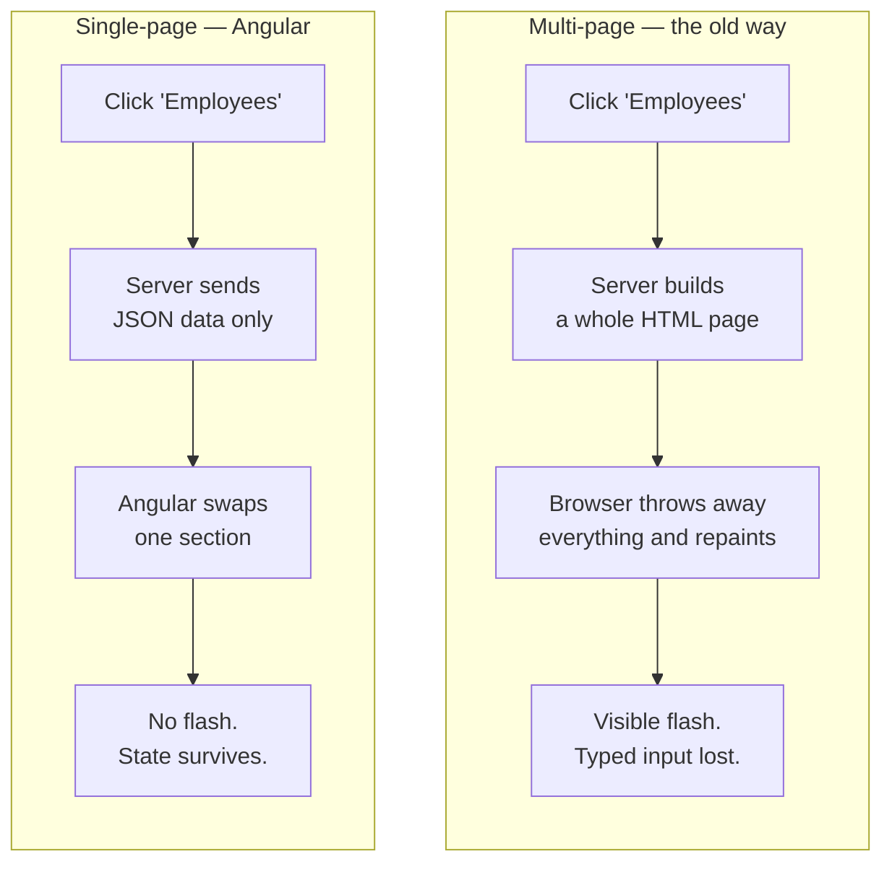
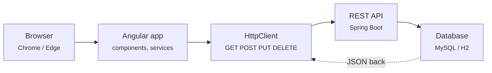
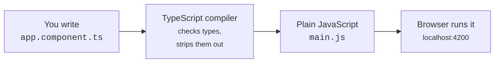
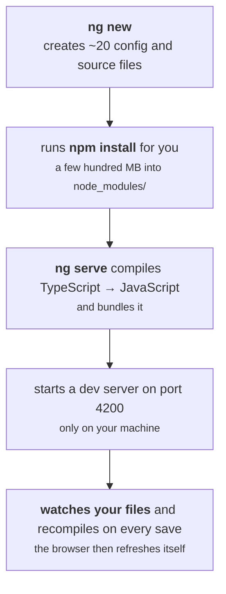
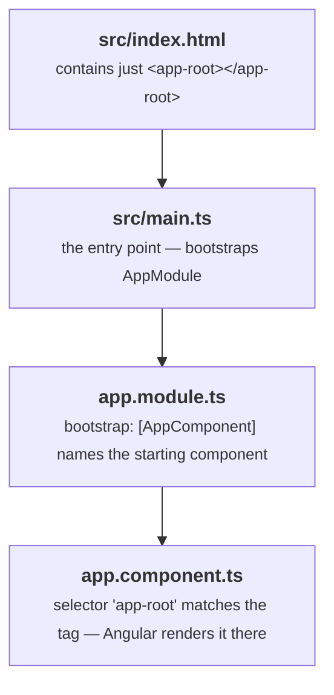

# Angular Session 1 — Study Guide

## TypeScript & Angular Basics

**Learn it first, then teach it.**

This guide pairs with `angular-session1-theory.html` (43 slides) and `angular-session1-lab.html`.

| | |
|---|---|
| **Who this is for** | Someone who knows Java and a little HTML, and has never written front-end code |
| **What you'll be able to do after** | Explain what Angular and TypeScript are, write TypeScript confidently, and create and run an Angular project |
| **Time to read and absorb** | About 90 minutes, plus an hour trying the code yourself |
| **Time to deliver as a session** | 3 hours including the lab |

---

## How to use this document

Read it **twice**, with different goals each time.

**First pass — learn it.** Read straight through, in order. Type every code example out yourself rather than just reading it; put them in the [TypeScript Playground](https://www.typescriptlang.org/play), which needs no installation. Do not skip the *Check yourself* questions — the answers are hidden behind a click so you can genuinely test yourself instead of accidentally reading ahead.

**Second pass — prepare to teach it.** Read only the 🎓 **Teaching notes** boxes and the [Delivery plan](#delivery-plan) at the end. Each teaching note tells you how to explain that idea out loud, what learners reliably get wrong, and what to demonstrate live.

> **On the diagrams.** They're written in Mermaid, which GitHub renders automatically. If you're reading this somewhere that shows the raw code instead, the surrounding text always explains the same thing in words — you won't miss anything.

**A note on honesty while teaching:** you will be asked questions you can't answer. "I don't know, let me check and come back to you" costs you nothing and buys you a great deal of credibility. Guessing costs you both.

---

## Contents

1. [The vocabulary you need first](#1-the-vocabulary-you-need-first)
2. [What Angular is](#2-what-angular-is)
3. [Framework vs library](#3-framework-vs-library)
4. [Single-page applications](#4-single-page-applications)
5. [Where Angular sits in your stack](#5-where-angular-sits-in-your-stack)
6. [AngularJS vs Angular — a naming trap](#6-angularjs-vs-angular--a-naming-trap)
7. [What TypeScript is, and why](#7-what-typescript-is-and-why)
8. [TypeScript, step by step](#8-typescript-step-by-step)
9. [Setting up your machine](#9-setting-up-your-machine)
10. [Your first Angular app](#10-your-first-angular-app)
11. [What all those files do](#11-what-all-those-files-do)
12. [The boot chain](#12-the-boot-chain)
13. [Cheat sheet](#cheat-sheet)
14. [Errors you'll hit, and their fixes](#errors-youll-hit-and-their-fixes)
15. [Check yourself](#check-yourself)
16. [Delivery plan](#delivery-plan)

---

## 1. The vocabulary you need first

Front-end development has a lot of jargon, and it compounds — miss one word and the next twenty minutes stop making sense. So here is every term this session uses, defined before we need it. Don't memorise this; just know it's here.

| Term | What it means |
|---|---|
| **JavaScript** | The one programming language every web browser can run. If you want code to execute in a browser, it ends up as JavaScript. |
| **TypeScript** | JavaScript with types added. You write TypeScript; a tool converts it to JavaScript. |
| **Compile / transpile** | Converting code from one language to another. TypeScript → JavaScript. |
| **Framework** | A large toolkit that gives your application its structure. Angular is one. So is Spring Boot. |
| **Node.js** | A program that runs JavaScript on your machine instead of in a browser. Angular's tools need it. |
| **npm** | Node Package Manager — downloads libraries. It is Maven, for JavaScript. |
| **Package / library** | Reusable code published by someone else. Same idea as a JAR. |
| **CLI** | Command Line Interface — a tool you type commands at. |
| **Component** | One reusable piece of screen, with its own logic, markup and styling. |
| **Template** | The HTML belonging to a component. |
| **SPA** | Single-Page Application. Covered in section 4. |
| **JSON** | A plain-text data format — what your Spring Boot API already returns. |
| **Bundle** | All your source files squashed into a few big files, so the browser downloads fewer things. |
| **localhost:4200** | The address of the small web server Angular runs on your own machine while you develop. |

> 🎓 **Teaching notes**
>
> Cover this properly rather than rushing it — five minutes here saves an hour of confusion later. Don't read the table aloud; that's deadly. Instead put it on screen and say: *"I'm not going to read all of this. I want you to know the slide exists, because when a word goes past that you don't recognise, this is where you look — or you just interrupt me."*
>
> Then explicitly invite interruption, and mean it: *"If I use a word you don't know, stop me. Front-end has a lot of jargon and it stacks up. One missed word and you lose the next twenty minutes."*
>
> The four rows worth saying out loud are **Node = the JVM of this world**, **npm = Maven**, **package.json = pom.xml**, and **node_modules = your .m2 folder**. For a room of Java developers those four mappings do more work than everything else on the slide.

---

## 2. What Angular is

Angular is an **open-source front-end framework**, written in TypeScript and maintained by Google, used to build single-page applications — rich, app-like websites that run inside the browser.

Four things characterise it:

**It's written in TypeScript**, and so is your code. The framework and your application speak the same language, which is why error messages and editor autocomplete are genuinely useful rather than vague.

**It's backed by Google**, used inside Google's own products, with a predictable release every six months and long-term support. This matters commercially: choosing Angular is a low-risk decision that a client or an architect will accept without argument.

**It's component-based.** From Angular 2 onwards, everything is a component. Your application is a tree of them.

**It's batteries-included.** Routing, forms, HTTP, testing and a command-line tool all ship as part of Angular. You don't research and glue together ten separate libraries and then maintain that decision.

The single sentence to hold onto:

> In Angular you never build "a page". You build small, self-contained **components**, and nest them inside one another until they add up to a page.

> 🎓 **Teaching notes**
>
> Open with a question rather than a definition: *"Has anyone used a website that felt more like an app than a website? Gmail, a banking dashboard, a flight booking site? What felt different about it?"* You're fishing for "it didn't reload", "it was fast", "it felt smooth". Whatever they say, you can build on it.
>
> The point to hammer is **component-based**, because it's the one that changes how they think. Everything in sessions 2, 3 and 4 assumes it.
>
> A useful physical demo if you have a projector: open Gmail, click between folders, and point at the browser's reload spinner *not* spinning. Then open any old government or university website and click a link — the whole page flashes white and rebuilds. That contrast lands better than any slide.

---

## 3. Framework vs library

People use these words loosely, but the difference explains why Angular feels the way it does.

| | Library | Framework |
|---|---|---|
| Who calls whom | **You** call it, when you choose | **It** calls your code, when it decides |
| Structure | You design your app's structure | It provides the structure; you fill in the blanks |
| Size | Small, focused, does one job | Large, covers the whole application |
| Examples | A date-formatting library, a charting library | Angular — and, on the Java side, Spring Boot |

**Analogy.** A library is a **power drill**: you pick it up when you need a hole. A framework is a **house being built around you**: the walls, wiring and plumbing are already decided, and you decide what goes in each room.

Why this is good news: because Angular is opinionated, **every Angular project looks the same**. Join a new team, open their repository, and you already know where things are. That's exactly the benefit you already get from Spring Boot's conventions.

> 🎓 **Teaching notes**
>
> This is a two-minute slide, not a ten-minute one. Its only job is to pre-empt the complaint *"why is Angular so rigid, React lets me do what I want"* — which someone in the room will have read online.
>
> The honest framing: rigidity is a **feature for teams**. Say it in terms of their own careers: *"In three years you'll join a project someone else started. Would you rather it followed a structure you already know, or one that developer invented on a Friday afternoon?"*
>
> The Spring Boot parallel does the heavy lifting here. They've already lived the benefit — they just haven't named it.

---

## 4. Single-page applications

This is the idea Angular is built around, so it's worth getting exactly right.

In a **traditional multi-page application** — JSP, Servlets, PHP — every click asks the server for a brand-new HTML page. The browser throws away everything it had and repaints from scratch. That's the flash you see, the spinner, the scroll position jumping back to the top.

In a **single-page application**, the browser loads *one* HTML file — literally one, called `index.html` — exactly once. After that, JavaScript swaps pieces of the screen in and out. When new data is needed, only the **data** travels over the network as JSON, never a whole new page.



**Analogy.** Multi-page is **replacing the whole newspaper** every time one headline changes. Single-page is **a whiteboard** — you wipe one corner and rewrite just that bit.

### What actually changes for you as a Java developer

This isn't cosmetic. It's a redistribution of responsibility, and it changes what your Spring Boot code does.

| Question | Multi-page (JSP) | Single-page (Angular) |
|---|---|---|
| Who builds the HTML? | The server, on every request | The browser, once, then edits it in place |
| What travels over the network? | Whole HTML pages, repeatedly | Small JSON payloads — just data |
| What does your controller return? | `ModelAndView` / a JSP name | A Java object, serialised to JSON |
| Can a mobile app reuse the backend? | No — it returns HTML | Yes — JSON suits any client |
| Who owns the user interface? | The backend team, mostly | The front-end team, entirely |

That last column is the real payoff. Your Spring Boot application stops producing HTML and starts producing **JSON**. The same API then serves a web app, an Android app and an iOS app **without a single change**. That's why the industry moved this way — not because reloads were ugly.

> 🎓 **Teaching notes**
>
> This is the most important concept in the first hour. Everything else today is detail; this is the shift in worldview.
>
> Teach it in this order: **the pain first, then the fix.** Ask them to describe what happens when you click something on an old JSP application. Let them say "the page reloads" themselves. Then introduce the SPA as the answer to a problem they've just articulated. If you present the solution first, it's abstract.
>
> The table is the part to spend time on, specifically the row *"What does your controller return?"* — because it's the moment this stops being a front-end topic and becomes something that affects **their** code. Many will be quietly wondering "why am I in an Angular training". That row answers it.
>
> **Expect this question:** *"So is JSP dead?"* Honest answer: no, plenty of internal tools and older systems still use it and work fine, and server-side rendering is genuinely having a comeback for public websites that need to be fast on first load and visible to search engines. But for the app-like screens most business software needs, SPA is the default. Don't oversell.

---

## 5. Where Angular sits in your stack

Angular is a **front-end** framework: it runs in the user's browser, not on your server. Your Spring Boot application becomes a pure JSON API sitting behind it.



Angular sends an HTTP request; Spring Boot answers with JSON; Angular turns that JSON into what the user sees.

**Notice what's missing.** Angular never talks to the database. It has no credentials and no SQL — all of that stays on the server, where the user can't read it. Anyone can open browser developer tools and read every line of your Angular code, so **never put a secret in it**.

> 🎓 **Teaching notes**
>
> Draw this diagram on a whiteboard rather than showing the slide, and draw it **right to left** — start with the database and the Spring Boot API, because that's the part they already own. Then say *"everything we've built so far is this half. Today we start on the other half."* Physically pointing at the boundary makes the whole series click into place for people.
>
> Then cover the security point deliberately, because it prevents a real and common mistake. Open developer tools on any live site, show them the Sources tab with readable JavaScript in it, and say: *"this is your code, on their machine. Anything you put in it is public. No API keys, no passwords, no database connection strings — ever."* Freshers put secrets in front-end code all the time. Ten seconds now prevents it.

---

## 6. AngularJS vs Angular — a naming trap

This confuses everyone once, and it wastes real time, so learn it now.

**"AngularJS" means version 1.x only.** **"Angular"** with no "JS" means version 2 and everything after it. They are *different frameworks* with different architectures. Code does not port between them.

| Aspect | AngularJS 1.x | Angular 2+ |
|---|---|---|
| Language | JavaScript | TypeScript |
| Architecture | MVC — controllers, `$scope` | Component-based — a tree of components |
| Performance | Slower — two-way binding everywhere | Much faster — one-way data flow by default |
| Tooling | No official CLI | Angular CLI |
| Structure | Loose — every team invents its own | Opinionated — same layout everywhere |

A short history, so high version numbers don't alarm you:

- **2010** — AngularJS 1.x, the original. Now end-of-life.
- **2016** — Angular 2, a *complete rewrite*. This is where modern Angular begins.
- **2016–17** — Angular 4 and 5. *(There's no Angular 3 — the router package had already reached v3, so they skipped the number to keep everything aligned.)*
- **2020** — Angular 9 and 10, when the Ivy renderer became the default.
- **2023+** — Angular 15 to 17 and beyond: standalone APIs, signals, new template syntax.

Angular ships a major version roughly every six months. The core concepts in these four sessions — components, binding, directives, services, routing — have been stable since Angular 2.

> 🎓 **Teaching notes**
>
> The practical reason this matters is **searching for help**. Make that concrete: *"If you Google an Angular problem and the answer mentions `$scope`, close the tab. It's AngularJS, it's a different framework, and it will not work. Always put a version number in your search — 'Angular 17 ngFor', not 'Angular ngFor'."*
>
> That one habit will save each of them hours over the next month, and it's the kind of advice they'll actually remember you for.
>
> **Expect this question:** *"We're on Angular 15 at work but the tutorial says 17 — am I learning the wrong thing?"* Reassure them firmly: everything in these four sessions works identically on 15, 16, 17 and 18. The differences are in newer optional features they won't touch yet.
>
> Don't dwell on the version timeline. Its only job is to stop them panicking at the number.

---

## 7. What TypeScript is, and why

Before we can write Angular, we need the language Angular is written in. Start with the problem it solves.

JavaScript is **loosely typed**: a variable has no fixed type and can silently change from a number to a string to a boolean. The language permits it and says nothing.

```javascript
// Plain JavaScript — all three of these lines are legal
let age = 42;        // a number
age = "Anoop";       // now a string  (?!)
age = true;          // now a boolean (?!)
```

That flexibility is convenient in a five-line script and **disastrous** in a fifty-thousand-line application. A variable named `age` holding `true` will not crash where the mistake was made. It will crash somewhere far away, much later, in front of a user.

**TypeScript**, released by Microsoft in 2012, is a **superset of JavaScript**: every valid JavaScript program is also valid TypeScript, and TypeScript adds **static typing** on top. The same code now fails immediately, in your editor, before you've even saved:

```typescript
let age = 42;
age = "Anoop";
// ✖ Error: Type 'string' is not assignable to type 'number'.
```

"Superset" means you are **not** learning a new language from scratch. TypeScript is JavaScript plus type annotations.

### How TypeScript becomes JavaScript

A browser has never heard of TypeScript. Something must translate your `.ts` files into `.js` files first — the TypeScript compiler. In an Angular project the CLI runs it for you, automatically, every time you save.



Here's the same code before and after. The types simply **vanish** — they were only ever instructions to the compiler:

```typescript
// What you write — greet.ts
function greet(name: string): string {
  return "Hello, " + name;
}
```

```javascript
// What the browser gets — greet.js
function greet(name) {
  return "Hello, " + name;
}
```

**Analogy.** Types are the **scaffolding** on a building. Essential while you're constructing it, checked carefully by an inspector, then taken away completely before anyone moves in.

This is the detail that surprises everyone: types exist **only at development time**. They cost you *nothing* at runtime — no performance penalty, no extra download — and save you enormous amounts of debugging.

> 🎓 **Teaching notes**
>
> Do not start with the definition. Start by **typing the broken JavaScript live** and letting them watch it be accepted. Type `let age = 42;` then `age = "Anoop";` then `age = true;` and say *"the language is completely fine with this. Nobody is going to stop me."* Let that sit for a second.
>
> Then ask: *"in a fifty-thousand-line codebase, where does that bug show up?"* Somebody will say "somewhere else" or "much later". That's the answer — and now TypeScript is obviously desirable rather than extra work.
>
> The before/after compilation example is worth its own minute, because a surprising number of learners quietly believe types make the app slower or bigger. Point at the output and say *"the types are gone. Zero cost at runtime."*
>
> **Expect this question:** *"If it all becomes JavaScript anyway, why not just write JavaScript?"* The answer is the whole argument in one line: *"Because the compiler reads your code more carefully than you do, and it does it every time you save."*

---

## 8. TypeScript, step by step

Twelve small steps. Type every one of these into the [TypeScript Playground](https://www.typescriptlang.org/play) — reading them is not the same as writing them.

### 8.1 Variables: `let`, `const`, and inference

There are two ways to give a variable a type.

**Declare it yourself.** The pattern is `name: type = value` — note the order is the *opposite* of Java, with the name first.

```typescript
let empName: string = "Anoop";
let empAge: number = 40;
let isActive: boolean = true;
```

**Or let TypeScript work it out** — this is called *inference*:

```typescript
let empName = "Anoop";     // TypeScript infers: string
let empAge = 40;           // infers: number

empAge = 41;               // ✔ fine, still a number
empAge = "forty-one";      // ✖ Error: 'string' is not assignable to 'number'
```

Because you gave it an initial value, TypeScript already knows the type. **Inference means safety for free** — which is why real Angular code often looks untyped when it's fully type-checked. Hover over any variable in VS Code and it will tell you the type it inferred.

| Keyword | Meaning | Java equivalent |
|---|---|---|
| `let` | Can be reassigned later | `String x = ...;` |
| `const` | Can **never** be reassigned. Prefer this by default. | `final String x = ...;` |
| `var` | Old, badly-behaved JavaScript keyword. **Never use it.** | — |

One subtlety that catches everyone: `const` locks the **variable**, not the object's contents.

```typescript
const emp = { name: "Anoop", salary: 25000 };
emp.salary = 30000;      // ✔ allowed! we changed a property
// emp = { name: "Ajay" }; // ✖ NOT allowed — reassigning the variable
```

### 8.2 The types you'll actually use

| Type | Holds | Example |
|---|---|---|
| `string` | Text. Single or double quotes both work. | `let a: string = 'hi';` |
| `number` | Any number, whole or decimal. There's no separate `int`/`float`/`double`. | `let b: number = 3.5;` |
| `boolean` | `true` or `false`. | `let c: boolean = true;` |
| `null` | "Deliberately empty." | `let d: string \| null = null;` |
| `undefined` | "Never given a value." Different from `null`. | `let e;` |
| `any` | "Turn type checking off." Avoid. | `let f: any = 5;` |
| `void` | A return type meaning "returns nothing". | `function g(): void { }` |
| `Date` | A point in time. | `let h = new Date();` |

Two things trip up Java developers: there is only `number`, no `int`/`long`/`float`/`double`; and `null` and `undefined` are *two different things* — `undefined` means "never set", `null` means "set to empty on purpose".

### 8.3 The `any` escape hatch — and why to resist it

`any` means "this can be anything; stop checking". It makes every error disappear, which is exactly why it's dangerous.

```typescript
// ❌ With any — TypeScript has been told to look away
let loose: any = { name: "Anoop" };
loose.nmae;          // no error — but it's a typo, prints undefined
loose.doAnything();  // no error — crashes at runtime

// ✅ With a real type — three bugs caught in your editor
let tight: { name: string } = { name: "Anoop" };
tight.nmae;          // ✖ Property 'nmae' does not exist
tight.doAnything();  // ✖ Property 'doAnything' does not exist
```

You may use `any` when you're stuck and want to keep moving — but treat it as a **note to come back to**, never a solution. Every `any` is a place where TypeScript has stopped protecting you.

### 8.4 Interfaces — giving an object a shape

This one matters a lot. Real applications move **objects** around, and an *interface* describes what such an object must look like.

```typescript
// src/app/models/employee.ts
export interface Employee {
  id: number;
  name: string;
  designation: string;
  salary: number;
}
```

Now TypeScript can check every employee object you create anywhere in the app:

```typescript
const e1: Employee = {
  id: 1001, name: "Anoop", designation: "Software Engineer", salary: 25000
};                          // ✔ all four properties, correct types

const e2: Employee = { id: 1002, name: "Ajay" };
// ✖ Error: 'designation' and 'salary' are missing

const e3: Employee = { id: "1003", name: "Rekha",
                       designation: "Tester", salary: 22000 };
// ✖ Error: 'string' is not assignable to 'number'
```

**Analogy.** An interface is a **form with required fields**. It doesn't fill anything in — it just refuses to accept your submission if a field is missing or the wrong kind of thing.

`export` means "other files may import this". Without it, the interface is private to its file.

You'll use these constantly. When JSON arrives from your Spring Boot API in Session 3, you'll tell Angular "this response is an `Employee[]`" — and from that moment your editor autocompletes `emp.designation` and flags `emp.designtaion` as a typo. An interface is how you make server data trustworthy.

### 8.5 Optional properties — the `?` marker

Sometimes a field genuinely might not be there. A single `?` means **"this one is allowed to be missing"**.

```typescript
export interface Employee {
  id: number;
  name: string;
  email?: string;        // ← optional
}

const e1: Employee = { id: 1001, name: "Anoop" };              // ✔ valid
const e2: Employee = { id: 1002, name: "Ajay",
                       email: "ajay@example.com" };            // ✔ also valid
```

Because `email` might be missing, TypeScript won't let you use it carelessly. That's a *good* thing — it's forcing you to think about the empty case, which is exactly the bug you'd otherwise ship.

```typescript
console.log(e1.email.toUpperCase());
// ✖ Error: 'e1.email' is possibly 'undefined'

// Fix 1 — check first
if (e1.email) { console.log(e1.email.toUpperCase()); }

// Fix 2 — optional chaining: "if it exists, then call it"
console.log(e1.email?.toUpperCase());     // prints: undefined

// Fix 3 — nullish coalescing: supply a fallback
console.log(e1.email ?? "no email on file");
```

Remember these two operators, because you'll use them constantly:

- `?.` means **"only carry on if the thing on the left exists"**
- `??` means **"use the right-hand value if the left is null or undefined"**

In Session 3 your template will render *before* the server has replied, so your data will briefly be undefined. `?.` is what stops that half-second from throwing an error.

### 8.6 Union types — "one of these"

A *union type* uses `|` to say a value may be one of several types. Read `|` as the word **"or"**.

```typescript
let empId: number | string;
empId = 1001;        // ✔
empId = "EMP-1001";  // ✔
empId = true;        // ✖ not assignable to 'number | string'
```

The genuinely useful version restricts a value to **specific allowed words**. This is TypeScript's answer to a Java `enum`:

```typescript
type Status = "Active" | "Inactive" | "OnLeave";

let s: Status = "Active";      // ✔
let t: Status = "active";      // ✖ wrong case, caught immediately
let u: Status = "Retired";     // ✖ not one of the three
```

Why is this better than a plain `string`? Because `"Actve"` would compile happily, and in Session 2 you'll colour table rows green or red based on this exact field. A one-letter typo would silently show the wrong colour with no error anywhere. As a union, it's a red squiggle before you save — and your editor **autocompletes the three valid values**, so you can't get them wrong.

### 8.7 Arrays

Write the element type, then `[]`.

```typescript
let names: string[] = ["Anoop", "Ajay", "Rekha"];
names.push("Suresh");     // ✔ fine
names.push(42);           // ✖ 'number' is not assignable to 'string'

let employees: Employee[] = [
  { id: 1001, name: "Anoop", designation: "Software Engineer", salary: 25000 },
  { id: 1002, name: "Ajay",  designation: "Team Lead",         salary: 45000 }
];
console.log(employees[0].name);       // Anoop — and autocomplete works here
```

**These six methods are the most valuable thing in this section.** Learn them properly.

| Method | What it does |
|---|---|
| `filter(fn)` | Returns a **new** array of items where `fn` is true. This is how search boxes work. |
| `find(fn)` | Returns the **first** match, or `undefined`. This is how "edit row 1002" works. |
| `findIndex(fn)` | Returns the position of the first match, or `-1`. Needed for update and delete. |
| `map(fn)` | Returns a new array with every item transformed. |
| `push(item)` | Adds to the end. This is how "insert" works. |
| `splice(i, 1)` | Removes 1 item at position `i`. This is how "delete" works. |

In Session 4 you'll build a complete CRUD screen, and it is **literally these six methods**. Learn them now and Session 4 feels like revision.

### 8.8 Tuples

An ordinary array holds many of *one* type. A *tuple* holds a fixed number of values, each with its own type, in a fixed order.

```typescript
let emp: [number, string] = [1001, "Anoop"];
console.log(emp[0] + 1);              // 1002 — knows [0] is a number
console.log(emp[1].toUpperCase());    // ANOOP — and [1] is a string

let wrong: [number, string] = ["Anoop", 1001];  // ✖ order matters
```

**Analogy.** An array is a **shopping bag** — put in as many apples as you like. A tuple is an **egg carton** — fixed slots, each expecting a specific thing.

**Honest guidance:** you won't use these much. Tuples appear in exam questions far more often than in real Angular code, because an interface is almost always clearer. Compare `[1001, "Anoop"]`, which tells you nothing, with `{ id: 1001, name: "Anoop" }`, which explains itself. Recognise tuples when you see them; reach for interfaces when you write.

### 8.9 Three ways to loop

```typescript
let names: string[] = ["Anoop", "Ajay", "Rekha"];

// 1 — classic for: when you need the index
for (let i = 0; i < names.length; i++) {
  console.log(i + " → " + names[i]);        // 0 → Anoop, 1 → Ajay, ...
}

// 2 — for...OF: gives you each VALUE  (use this one)
for (const n of names) {
  console.log(n);                          // Anoop, Ajay, Rekha
}

// 3 — for...IN: gives you each INDEX, as a STRING
for (const i in names) {
  console.log(i);                          // "0", "1", "2"  ← strings!
}
```

**Memorise this line:** `for...`**`of`** gives you the **o**bject / value. `for...`**`in`** gives you the **i**ndex / key. For arrays you almost always want `of`.

Using `in` by mistake gives you the strings `"0"`, `"1"`, `"2"` — so `i + 1` produces `"01"` instead of `1`. That's a famously confusing bug, and it's worth causing it once on purpose so you recognise it.

### 8.10 Functions

Type the parameters *and* the return value. The return type goes after the parameter list, following a colon.

```typescript
function add(a: number, b: number): number {
  return a + b;
}
add(5, 3);          // 8
add("5", 3);        // ✖ 'string' is not assignable to 'number'
add(5);             // ✖ Expected 2 arguments, but got 1

// Returns nothing — void
function logEmployee(e: Employee): void {
  console.log(e.name + " earns " + e.salary);
}

// Optional parameter, and a default value
function greet(name: string, greeting?: string): string {
  return (greeting ?? "Hello") + ", " + name;
}
function raise(salary: number, percent: number = 10): number {
  return salary + (salary * percent / 100);
}
raise(20000);        // 22000 — used the default
raise(20000, 25);    // 25000
```

One rule: every optional parameter must come **after** all the required ones.

### 8.11 Arrow functions

A compact way to write a function. You'll meet these constantly in Angular — inside `.filter()`, inside `.subscribe()`, inside every event handler.

| Form | Note |
|---|---|
| `function (a, b) { return a + b; }` | The traditional form. Works, just wordy. |
| `(a, b) => { return a + b; }` | Arrow form. `function` is gone. |
| `(a, b) => a + b` | One expression, no braces — the value is **returned automatically**. |
| `n => n * 2` | A single parameter needs no brackets either. Most common form. |

The real use case:

```typescript
// "give me employees earning over 30000"
const rich = employees.filter(e => e.salary > 30000);

// "give me just their names"
const names = employees.map(e => e.name);

// "find the one with id 1002"
const one = employees.find(e => e.id === 1002);
```

Read `e => e.salary > 30000` as the sentence *"given an employee `e`, is its salary greater than 30000?"* If you've used Java streams, this is exactly a lambda — Java writes `->` where TypeScript writes `=>`.

**Also: always compare with `===`, never `==`.** `===` compares value *and* type, which is what you want. `==` converts types first, giving nonsense like `0 == ""` being `true`.

### 8.12 Classes, and the constructor shorthand

If you know Java classes you already know this. Three differences: `public` is the default, the type comes after a colon, and the constructor is always literally called `constructor`.

```typescript
export class Employee {
  id: number;
  name: string;
  salary: number;

  constructor(id: number, name: string, salary: number) {
    this.id = id;
    this.name = name;
    this.salary = salary;
  }

  getDetails(): string {
    return this.id + " — " + this.name;
  }
}

const e = new Employee(1001, "Anoop", 25000);
console.log(e.getDetails());     // 1001 — Anoop
```

| Modifier | Visible where | Note |
|---|---|---|
| `public` | Everywhere | The **default** — you rarely type it |
| `private` | Only inside this class | Use it to protect internal data |
| `protected` | This class and subclasses | Uncommon in Angular |
| `readonly` | Everywhere, but can't be reassigned | Like Java's `final` |

**Now the shorthand — and this is the one you must recognise.** Put an access modifier on a constructor parameter and it becomes a field automatically:

```typescript
// The long way
class Employee {
  private id: number;
  private name: string;
  constructor(id: number, name: string) {
    this.id = id;
    this.name = name;
  }
}

// Identical, using the shorthand
class Employee {
  constructor(private id: number, private name: string) { }
}
```

**Why this matters:** in Session 3 you'll write `constructor(private http: HttpClient) { }` and wonder where the `http` field came from. *This is where.* The word `private` on that parameter silently declared and assigned it. If you've used Spring's constructor injection, it's the same pattern with less typing.

### Interface or class — which do I use?

An **interface** is a shape check only; it disappears at compile time and can't hold logic. A **class** is real code that exists at runtime and can have methods.

Rule of thumb: **interface for data** coming from your API, **class when you need behaviour**. Every Angular component you write will be a class.

> 🎓 **Teaching notes**
>
> This is the longest part of the session and the easiest place to lose the room. Three rules for delivering it:
>
> **1. Never present more than one concept before they type something.** The lab has twelve drills matching these twelve steps precisely. Explain one, then say *"go and do Drill E, you've got four minutes"*, then move on. If you explain all twelve and then release them to the lab, half the room will have forgotten the first six.
>
> **2. Say out loud which ones actually matter.** Not all twelve are equal, and pretending otherwise wastes their attention. Rank them explicitly: **interfaces, the six array methods, and the constructor shorthand are the three that everything else depends on.** Tuples are nearly irrelevant to real work — say so, and they'll trust your emphasis everywhere else.
>
> **3. Break things on purpose, every time.** Don't just show the code that works. Show the error too. The learning is in seeing `Type 'string' is not assignable to type 'number'` appear under their own cursor. Get them into the habit of *reading* error messages today, and Sessions 2 to 4 get dramatically easier.
>
> **Where to slow down:**
>
> - **Interfaces (8.4)** — the single highest-value idea here. Demo the autocomplete: type `e1.` and pause so they see the four suggestions appear. That visible payoff sells it better than any explanation.
> - **`?.` and `??` (8.5)** — they'll think this is fussy detail. Tell them straight: *"in Session 3 your page draws before the server replies. Without `?.` your app throws an error every single time it loads."* Now it's not fussy.
> - **The six array methods (8.7)** — say explicitly *"Session 4 is these six methods and nothing else. Fifteen minutes here saves you two hours in three weeks."*
> - **The constructor shorthand (8.12)** — flag it as a forward reference: *"You will see `constructor(private http: HttpClient)` in Session 3 and wonder where `http` came from. Write this slide down."*
>
> **Where to move fast:** tuples (8.8), and the full type table in 8.2. Mention them, note they're reference material, move on.
>
> **The `for...in` / `for...of` demo is worth doing live.** Print `i + 1` in a `for...in` loop over an array and let them watch `01`, `11`, `21` appear. Someone always laughs. It sticks permanently, which is the point.
>
> **Expect this question:** *"Do I have to write types everywhere?"* No — show inference again and say *"write types on function parameters, return values, and interfaces. Let inference handle local variables."* That's genuinely what good TypeScript looks like.

---

## 9. Setting up your machine

Angular's tooling — the compiler, the dev server, the bundler — is itself written in JavaScript. To run JavaScript on your own machine rather than in a browser, you need **Node.js**.

| Tool | What it is | Java equivalent |
|---|---|---|
| **Node.js** | A JavaScript runtime for your computer | The JVM |
| **npm** | Node Package Manager — downloads libraries. Installed with Node. | Maven |
| **package.json** | Your dependency list and scripts | `pom.xml` |
| **node_modules/** | The folder of downloaded libraries | Your `~/.m2` folder |

### Step 1 — Node.js

1. Go to `nodejs.org` and download the **LTS** build. LTS means "Long Term Support" — the stable one. Do *not* take "Current".
2. Run the installer, accept every default. On Windows leave "Add to PATH" ticked.
3. **Close your terminal and open a new one.** This step is skipped constantly and it's why the next command appears to fail.
4. Check both tools respond:

```bash
node -v      # want v18.x or higher
npm -v
```

### Step 2 — the Angular CLI

```bash
npm install -g @angular/cli
```

| Part | Meaning |
|---|---|
| `npm install` | Download a package |
| `-g` | **Globally** — available from any folder. Without this, the `ng` command won't exist. |
| `@angular/cli` | The package name. The `@angular/` prefix marks it as officially published by the Angular team. |

Then confirm:

```bash
ng version
```

You should see an ASCII Angular logo and a table of versions. From now on, every Angular command starts with `ng`.

> 🎓 **Teaching notes**
>
> **Do this before the session, not during it.** Send the two install commands out a day ahead and ask people to arrive with `ng version` working. Otherwise you will lose forty minutes to a room of proxy errors and PATH problems, and the people who succeed in two minutes will be bored and drift.
>
> If you can't do that, at least run the installs during a break rather than presenting to a room watching progress bars.
>
> **The three problems you will actually hit, in order of frequency:**
>
> 1. **`ng` is not recognised.** The terminal was already open when the install finished. *Close it and open a new one.* This fixes it the large majority of the time. Say it before anyone asks, because it feels too simple to be the answer.
> 2. **Corporate proxy.** `npm ERR! ETIMEDOUT`. They need `npm config set proxy http://your-proxy:port` and the matching `https-proxy`. Have your own organisation's proxy address written on a slide — you will need it.
> 3. **PowerShell script execution blocked.** `Set-ExecutionPolicy -Scope CurrentUser RemoteSigned`, or just use Command Prompt.
>
> **Pair people up.** The moment someone gets `ng version` working, give them a neighbour to help. It halves your support load and the helper learns more than you'd expect from explaining it.
>
> The four-row Java mapping table is worth reading aloud here. It converts an intimidating new toolchain into four things they already understand.

---

## 10. Your first Angular app

Three commands.

```bash
ng new hello-world
cd hello-world
ng serve -o
```

| Command | What it does |
|---|---|
| `ng new hello-world` | Creates a complete, working project in a new folder. Asks two or three questions, then downloads dependencies. Two to four minutes. |
| `cd hello-world` | Move into it. Every `ng` command after this must be run from inside the project. |
| `ng serve -o` | Compiles, starts a dev server on port **4200**, and `-o` opens your browser. |

**The questions `ng new` asks:**

| Question | Answer for this series | Why |
|---|---|---|
| Which stylesheet format? | **CSS** | Plain CSS. SCSS is excellent but it's one more thing to learn today. |
| Enable Server-Side Rendering (SSR)? | **No** | Adds a server layer we don't need and extra files that would confuse the tour. |
| Share pseudonymous usage data? | **No** | Entirely your choice; changes nothing about the app. |

*Older CLI versions (15, 16) ask "Would you like to add Angular routing?" instead. Answer **No** — we add routing deliberately, by hand, in Session 4, so you understand what it actually does.*

### What those three commands actually did



That last step changes how you work. Leave `ng serve` running in its own terminal **all day**. Edit a file, press save, glance at the browser — it has already updated. You never manually rebuild and never manually refresh. Open a *second* terminal for other `ng` commands.

Two things beginners do here:

- Pressing <kbd>Ctrl</kbd>+<kbd>C</kbd> in that terminal **stops the server**, and then `localhost:4200` goes blank. That's not a bug — restart with `ng serve`.
- Running `ng serve` twice gives "Port 4200 is already in use". You already have one running. Use the tab you have, or `ng serve --port 4300`.

> 🎓 **Teaching notes**
>
> This is the **emotional high point of the session** — the moment it stops being theory. Treat it that way. When the welcome page appears, stop and say so: *"That's Angular. Running. On your machine. Everything from here is just adding to it."* People need that marker.
>
> **Type the three commands live and slowly**, narrating each one. Then wait for the room. Don't talk over the download.
>
> **Live-reload is the thing to demo, not describe.** Put your editor and browser side by side, change a heading, save, and let them watch the browser update without you touching it. Then do it again with something obvious like a colour. There is usually an audible reaction, and it's the moment people start wanting to try things.
>
> **Warn them about Ctrl+C before it happens.** Someone always does it, panics, and thinks they've broken their project. Thirty seconds of prevention.
>
> Also tell them plainly: **the welcome page is placeholder content and we're about to delete all of it.** Otherwise a few people will treat it as precious and be nervous about the next task.

---

## 11. What all those files do

Twenty files appeared. That's intimidating for about ten minutes, and then you realise you only ever touch three.

```
hello-world/
├── node_modules/          every downloaded library — never edit, never commit
├── src/                   ★ YOUR CODE LIVES HERE
│   ├── app/               ★ your components, services and models
│   ├── assets/            images, fonts, static JSON files
│   ├── index.html         the ONE page of your single-page application
│   ├── main.ts            the entry point — the first code that runs
│   └── styles.css         global styles, applied to the whole app
├── angular.json           CLI configuration — build options, file paths
├── package.json           dependency list + npm scripts (your pom.xml)
├── package-lock.json      exact resolved versions, so every machine matches
├── tsconfig.json          TypeScript compiler settings, including strict mode
└── .gitignore             tells git to skip node_modules/ and dist/
```

**The 90% rule:** ninety percent of your work happens inside `src/app/`. Everything above that line is configuration you won't touch for months.

About `node_modules/` — it's huge, often hundreds of megabytes, and it is **never committed to git**. It can always be recreated by running `npm install`, because `package.json` lists everything needed. If a teammate's project won't start after they clone it, "did you run `npm install`?" is the first question.

### Inside `src/app/`

```
src/app/
├── app.component.ts       ★ the CLASS — your logic and data
├── app.component.html     ★ the TEMPLATE — what the user sees
├── app.component.css      ★ the STYLES — scoped to this component only
├── app.component.spec.ts  unit tests — ignore for this series
└── app.module.ts          the app's registry of components and features
```

Those first three files are **one component split three ways**: behaviour, markup, appearance. Every component you ever generate follows this identical pattern, which is why Angular projects are so easy to navigate.

```typescript
// src/app/app.component.ts
import { Component } from '@angular/core';

@Component({
  selector: 'app-root',                   // the HTML tag that renders this
  templateUrl: './app.component.html',    // where its markup lives
  styleUrls: ['./app.component.css']      // where its styles live
})
export class AppComponent {
  title = 'hello-world';                  // data the template can display
}
```

| Part | What it is |
|---|---|
| `@Component({...})` | A **decorator** — extra information attached to the class. It tells Angular "this is a component, and here's how to render it". It's Angular's `@RestController`. |
| `selector: 'app-root'` | The custom HTML tag name. Wherever `<app-root></app-root>` appears, Angular puts this component. |
| `title = 'hello-world'` | An ordinary class field. The template displays it with `{{ title }}` — that's Session 2's first topic. |

### `app.module.ts` — the app's registry

An **NgModule** is a list: "here is everything my application is made of". Angular will not use a component it hasn't been told about, and that single fact explains most beginner errors.

```typescript
@NgModule({
  declarations: [
    AppComponent          // ← every component of MINE goes in this list
  ],
  imports: [
    BrowserModule         // ← features from Angular or other libraries
  ],
  providers: [],          // ← services (Session 3)
  bootstrap: [AppComponent]  // ← the component to start the app with
})
export class AppModule { }
```

| Section | What goes in it |
|---|---|
| `declarations` | **Your own** components, directives and pipes. Miss one and you get "is not a known element". |
| `imports` | Whole feature modules from elsewhere — `FormsModule`, `HttpClientModule`, `RouterModule`. Sessions 2, 3 and 4 each add one. |
| `providers` | Services, registered the older way. Session 3 explains why you usually don't need this. |
| `bootstrap` | The single root component. Only `AppModule` has this, and it never changes. |

Good news, twice over: when you create a component with `ng generate`, the CLI adds it to `declarations` **for you** — which is the single biggest reason to always use the CLI. And Angular 15+ offers "standalone components" that skip modules entirely; this series uses modules because they're what you'll find in existing corporate projects, and because `declarations` makes the "Angular must be told about everything" rule *visible* rather than magical.

> 🎓 **Teaching notes**
>
> **Do not read the file tree aloud.** It's reference material. Instead, do it as an exercise — this is Task 3 in the lab, and it works much better as a quiz than a lecture.
>
> Put the tree on screen, then say: *"I'm going to give you eight minutes. Open each of these files and write one line on what you think it's for. Then we'll compare."* People remember what they discovered; they forget what they were told.
>
> When you review the answers, the only three that matter are `app.component.ts`, `.html` and `.css`. Say explicitly: *"Ignore everything else for now. Three files. That's your world for the next two sessions."* Reducing twenty files to three visibly relieves the room.
>
> **The `node_modules` size reveal is worth doing.** Right-click, Properties, and show them 300 MB and 40,000 files. Then: *"never commit this. It's in .gitignore already. `npm install` rebuilds it from package.json."* It's memorable because the number is absurd.
>
> On `app.module.ts` — keep it brief and concrete. The takeaway is just **"Angular must be told about every component you write, and the CLI does that for you."** Don't teach module theory today; it'll mean nothing yet. It becomes real in Session 2 when they generate their first component and see `UPDATE app.module.ts` scroll past.
>
> **Expect this question:** *"I read that modules are outdated and standalone is the new way."* Correct, and answer it straight: standalone is where Angular is heading and is worth learning next. We teach modules because (a) most existing corporate code uses them, and (b) `declarations` makes an important rule visible instead of automatic. Everything transfers.

---

## 12. The boot chain

You never wrote a line linking `index.html` to `AppComponent`, yet it works. There's a four-step chain, and it's worth being able to recite.



The whole body of `index.html`:

```html
<body>
  <app-root></app-root>
</body>
```

That is genuinely all of it. Your entire application is injected into that one empty tag.

And `main.ts`:

```typescript
platformBrowserDynamic()
  .bootstrapModule(AppModule)
  .catch(err => console.error(err));
```

"Start Angular in a browser, beginning from `AppModule`." You'll almost never edit this file.

**Learn this sentence:** `index.html` → `main.ts` → `AppModule` → `AppComponent` → the tag `<app-root>`.

It's a standard interview question, and more usefully it's how you debug a blank white page: check each link in the chain, in order.

> 🎓 **Teaching notes**
>
> There's a 20-second experiment here that teaches this better than the diagram does, and it's in the lab as well — do it live first.
>
> Change `selector: 'app-root'` to `selector: 'app-rooot'` and save. **The page goes blank.** Let the silence sit for a moment, then ask *"why?"* Someone will work it out: `index.html` is still asking for `<app-root>` and nothing answers to that name any more. Press F12, show them the console message, change it back, and the page returns.
>
> That single experiment does three jobs at once: it proves the chain is real, it shows them what a blank page actually *means*, and it teaches them that the browser console is where errors live. Worth five minutes.
>
> Then make the debugging use explicit: *"When your page is blank — and it will be, several times in the next three sessions — walk this chain in order. Nine times out of ten it's a selector typo or a wrong `templateUrl`."*
>
> Do ask them to memorise the four-step sentence. It genuinely comes up in interviews.

---

## Cheat sheet

Everything from section 8, on one page, to revise from.

```typescript
// ── Variables ───────────────────────────────────────────────
let   mutable: string = "can be reassigned";
const fixed:   number = 42;                    // prefer const

// ── Interfaces: the shape of an object ──────────────────────
export interface Employee {
  id: number;
  name: string;
  status: "Active" | "Inactive";               // union of literals
  email?: string;                              // optional
}

// ── Arrays & tuples ────────────────────────────────────────
let names: string[]         = ["Anoop", "Ajay"];
let staff: Employee[]       = [];
let pair:  [number, string] = [1001, "Anoop"];

// ── Loops ───────────────────────────────────────────────────
for (let i = 0; i < names.length; i++) { }     // index, manual
for (const n of names) { }                     // VALUE   ← usual choice
for (const i in names) { }                     // INDEX, as a string

// ── Functions ───────────────────────────────────────────────
function add(a: number, b: number): number { return a + b; }
function log(msg: string): void { console.log(msg); }
const double = (n: number): number => n * 2;   // arrow function

// ── The six array methods you'll use daily ─────────────────
staff.filter(e => e.salary > 30000);           // search
staff.find(e => e.id === 1002);                // fetch one
staff.findIndex(e => e.id === 1002);           // position, or -1
staff.map(e => e.name);                        // transform
staff.push(newEmployee);                       // insert
staff.splice(index, 1);                        // delete

// ── Classes ─────────────────────────────────────────────────
export class EmployeeService {
  private staff: Employee[] = [];              // private field
  constructor(private http: HttpClient) { }    // declares + assigns
  getAll(): Employee[] { return this.staff; }
}

// ── Safety operators ────────────────────────────────────────
emp.email?.toUpperCase();                      // only if email exists
emp.email ?? "none";                           // fallback if null/undefined
if (a === b) { }                               // ALWAYS ===, never ==
```

### CLI commands

| Command | What it does | Short form |
|---|---|---|
| `ng new my-app` | Create a project | — |
| `ng serve -o` | Run it and open the browser | `ng s -o` |
| `ng serve --port 4300` | Run on a different port | — |
| `ng generate component employee-list` | Create a component — 4 files, and registers it | `ng g c` |
| `ng generate service employee` | Create a service (Session 3) | `ng g s` |
| `ng generate interface models/employee` | Create an interface | `ng g i` |
| `ng build` | Produce deployable files in `dist/` | `ng b` |
| `ng version` | Show versions — first thing to check when stuck | `ng v` |
| `ng g c x --dry-run` | Show what *would* be created, without creating it | `-d` |

---

## Errors you'll hit, and their fixes

None of these mean you're doing badly. Every one is normal on day one.

| What you see | What it means, and the fix |
|---|---|
| `'ng' is not recognized` | The CLI isn't on your PATH. **Close the terminal and open a new one** — that fixes it nine times out of ten. Otherwise re-run `npm install -g @angular/cli`. |
| `cannot be loaded because running scripts is disabled` | Windows PowerShell blocking scripts. Run `Set-ExecutionPolicy -Scope CurrentUser RemoteSigned`, or use Command Prompt. |
| `Port 4200 is already in use` | `ng serve` is already running. Use the tab you have, or `ng serve --port 4300`. |
| `The serve command requires to be run in an Angular project` | Wrong folder. `cd hello-world` first — you must be where `angular.json` is. |
| `Cannot find module '@angular/core'` | `node_modules/` is missing or incomplete. Run `npm install`. |
| `has no exported member 'Employee'` | You forgot `export` in front of `interface Employee`, or the import path is wrong. Note it's relative and has no `.ts`: `'./models/employee'`. |
| `Type '"active"' is not assignable to type '"Active" \| "Inactive"'` | Working as designed — your literal union caught a case mismatch. |
| `Property 'salary' is missing in type` | Also working as designed — an object is missing a property the interface requires. |
| A blank white page, no error on screen | Press <kbd>F12</kbd> and open the **Console** tab. The real error is always there. Usually a mismatched `selector` or a typo in `templateUrl`. |
| The page never updates when I save | Either `ng serve` has stopped (check its terminal), or you edited a file outside the project. The terminal prints a build line on every successful save. |
| `{{ myField }}` shows nothing | Angular renders a missing field as an empty string, with no error. Almost always a spelling or capitalisation mismatch. |
| Tutorials use `$scope` and nothing works | You're reading **AngularJS 1.x** docs. Different framework. Search again with a version number. |
| `npm ERR! ETIMEDOUT` / proxy errors | Corporate network. `npm config set proxy http://your-proxy:port` plus the matching `https-proxy`. |
| Everything is bizarrely slow, files lock randomly | Your project is in a OneDrive / Google Drive synced folder. Move it somewhere local. |

**The single most useful habit:** read the error message before reacting to it. Angular's messages name the file and the line, and usually state the fix outright. The instinct to immediately re-run the command, or start deleting things, is what turns a thirty-second fix into a lost afternoon.

---

## Check yourself

Answer these before looking. If one stumps you, the section number tells you where to go back to.

**1.** What does SPA stand for, and what's the single biggest difference from a JSP application? *(§4)*

<details><summary>Answer</summary>

Single-Page Application. In a JSP app, every click asks the server for a whole new HTML page and the browser repaints from scratch. In an SPA the browser loads one HTML file once, then JavaScript swaps sections of it; only **data** (JSON) travels afterwards. The consequence: your server stops producing HTML and becomes a pure JSON API that a mobile app could also use.
</details>

**2.** Why is AngularJS not simply "an older Angular"? *(§6)*

<details><summary>Answer</summary>

They're different frameworks. AngularJS 1.x is JavaScript-based with an MVC architecture using `$scope` and controllers. Angular 2+ is a complete rewrite: TypeScript, component-based, one-way data flow by default, with an official CLI. Code does not port between them — which is why an answer online mentioning `$scope` won't help you.
</details>

**3.** TypeScript's types vanish when compiled. So what are they *for*? *(§7)*

<details><summary>Answer</summary>

They're checked at **development time**, so mistakes surface in your editor instead of in production. They also power autocomplete, safe renaming and jump-to-definition. Because they're stripped out before the browser sees the code, they cost nothing at runtime — no performance penalty, no extra download.
</details>

**4.** What's the difference between `for...of` and `for...in`? Which do you want for an array? *(§8.9)*

<details><summary>Answer</summary>

`for...of` gives you each **value**. `for...in` gives you each **index/key**, and as a **string**. For arrays you almost always want `of`. Using `in` by mistake means `i + 1` produces `"01"` instead of `1`, because `"0" + 1` joins strings.
</details>

**5.** What does the `?` in `email?: string` mean, and what must you then do before using `email`? *(§8.5)*

<details><summary>Answer</summary>

It marks the property **optional** — the object is valid without it. TypeScript then won't let you use `email` directly, because it might be `undefined`. You must either check it (`if (e.email)`), use optional chaining (`e.email?.toUpperCase()`), or supply a fallback (`e.email ?? 'none'`).
</details>

**6.** Why is `status: 'Active' | 'Inactive'` better than `status: string`? *(§8.6)*

<details><summary>Answer</summary>

It restricts the value to exactly those two strings. With a plain `string`, a typo like `'Actve'` compiles happily and silently breaks logic that depends on the value — for example, the row colouring you'll build in Session 2. As a literal union it's an error before you save, and your editor autocompletes the valid values.
</details>

**7.** What does `constructor(private http: HttpClient) { }` actually do? *(§8.12)*

<details><summary>Answer</summary>

The access modifier on a constructor parameter makes TypeScript **declare a field and assign it automatically**. It's shorthand for declaring `private http: HttpClient;` and writing `this.http = http;` in the constructor body. You'll rely on this in Session 3 for dependency injection.
</details>

**8.** Which six array methods will you use to build a CRUD screen, and what does each do? *(§8.7)*

<details><summary>Answer</summary>

`filter` — search, returns a new array. `find` — fetch one item or `undefined`. `findIndex` — its position, or `-1`. `map` — transform every item. `push` — insert. `splice(i, 1)` — delete one item at a position.
</details>

**9.** Recite the boot chain from `index.html` to your component. *(§12)*

<details><summary>Answer</summary>

`index.html` (contains `<app-root>`) → `main.ts` (bootstraps `AppModule`) → `app.module.ts` (`bootstrap: [AppComponent]`) → `app.component.ts` (whose `selector: 'app-root'` matches the tag, so Angular renders it there).
</details>

**10.** What goes in `declarations` versus `imports` in `app.module.ts`? *(§11)*

<details><summary>Answer</summary>

`declarations` is for **your own** components, directives and pipes. `imports` is for whole feature **modules** from Angular or a library — `FormsModule`, `HttpClientModule`, `RouterModule`. Putting a module in `declarations` produces a long, unhelpful error.
</details>

**11.** Why should you always use `ng generate` rather than creating component files by hand? *(§11)*

<details><summary>Answer</summary>

Because it doesn't only create the files — it creates them with the right names and boilerplate **and registers the component in `app.module.ts`'s `declarations`**. Hand-created components are where beginners lose an hour to "`app-x` is not a known element".
</details>

**12.** Your page is blank and you see no error. What's the very first thing you do? *(§12, errors table)*

<details><summary>Answer</summary>

Press <kbd>F12</kbd> and open the browser's **Console** tab. Angular doesn't print errors onto the page. Then walk the boot chain — a mismatched `selector` or a typo in `templateUrl` accounts for most cases.
</details>

---

## Delivery plan

A 3-hour session including the lab. Adjust the numbers, keep the shape.

| Time | What | Slides | Lab |
|---|---|---|---|
| 0:00–0:10 | Welcome, the four-session journey, how today works | 1–4 | — |
| 0:10–0:15 | Jargon buster | 5 | Pre-requisites check |
| 0:15–0:40 | What Angular is · framework vs library · **SPA** · where it sits | 6–9, 13 | — |
| 0:40–0:50 | AngularJS vs Angular · why Angular (the JSP comparison) | 10–12 | — |
| 0:50–1:00 | **Break** — and get installs finished | — | — |
| 1:00–1:15 | What TypeScript is · TS vs JS · the compile step | 14–16 | — |
| 1:15–2:00 | **TypeScript, one concept at a time** — explain, then they drill | 17–30 | Task 1, drills A–L |
| 2:00–2:15 | Node, npm, the CLI | 31–32 | Task 2 (install) |
| 2:15–2:35 | `ng new` → `ng serve`, live-reload demo | 33–34 | Task 2 (scaffold) |
| 2:35–2:50 | Project tour as a quiz · the boot chain | 35–38 | Tasks 3, 4 |
| 2:50–3:00 | CLI commands · day-one errors · recap · what's next | 39–43 | Task 5 if time |

### Rules for running this session well

**Interleave, don't lecture.** The TypeScript block is 45 minutes and twelve concepts. Explain one, send them to the matching drill, bring them back. Never explain more than one concept before they type something.

**Do the installs before the session if you possibly can.** Send the two commands out a day ahead. If you can't, use the break for it.

**Break things on purpose, repeatedly.** The selector typo (blank page), the wrong-type assignment, the missing interface property. Every deliberate error you cause is an error they'll recognise instead of fear.

**Say which topics matter.** Interfaces, the six array methods, the constructor shorthand. Tell them tuples are nearly irrelevant. Honest emphasis buys you trust.

### If you're short on time

Cut in this order:

1. Tuples (§8.8) — mention in one line and move on
2. The version history detail (§6) — keep only the AngularJS naming warning
3. The full type table (§8.2) — say it's reference material
4. Lab Task 5 — set it as homework

**Never cut:** SPA (§4), interfaces (§8.4), the array methods (§8.7), or getting `ng serve` running. Those four are what Session 2 depends on.

### Questions you should expect

| Question | Short answer |
|---|---|
| "Is JSP dead?" | No. Still fine for internal tools, and server-side rendering is having a comeback for public sites. But SPA is the default for app-like screens. |
| "Why not just write JavaScript?" | Because the compiler reads your code more carefully than you do, every time you save. |
| "Do I have to write types everywhere?" | No. Types on parameters, return values and interfaces; let inference handle local variables. |
| "React or Angular?" | Both are fine choices. Angular gives you more out of the box and more consistency across teams; React is more flexible and assembles more from libraries. The concepts transfer either way. |
| "We're on Angular 15, not 17." | Everything in these four sessions works identically on 15 through 18. |
| "I read modules are outdated." | Correct — standalone components are the direction. We teach modules because most existing code uses them and because they make an important rule visible. Everything transfers. |
| "Why is `node_modules` so huge?" | Because every dependency brings its own dependencies. It's never committed; `npm install` rebuilds it. |

### Your own preparation checklist

- [ ] Run through the lab yourself, start to finish, on the machine you'll present from
- [ ] Have `ng version` working and a scratch project ready to demo
- [ ] Have the TypeScript Playground open in a tab
- [ ] Know your organisation's proxy settings, on a slide
- [ ] Arrange the editor and browser side by side for the live-reload demo
- [ ] Read §8's teaching notes once more — that's where sessions go wrong

---

**Next:** `angular-session2-study-guide.md` — Components & Data Binding, where things start appearing on screen.
