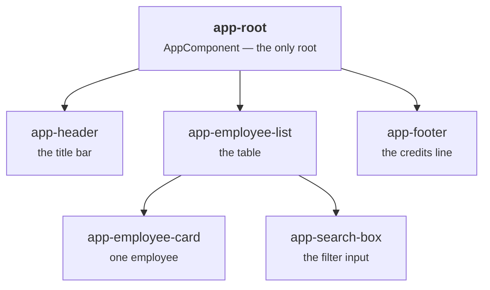
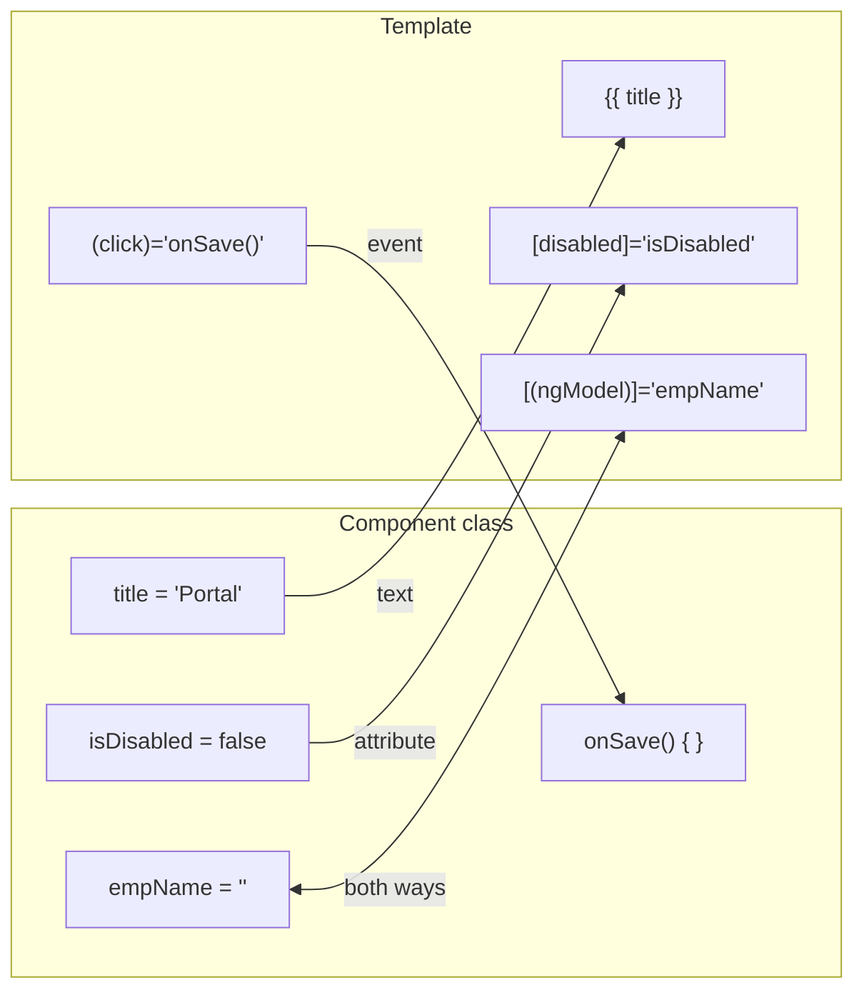
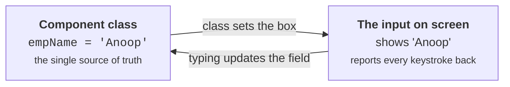
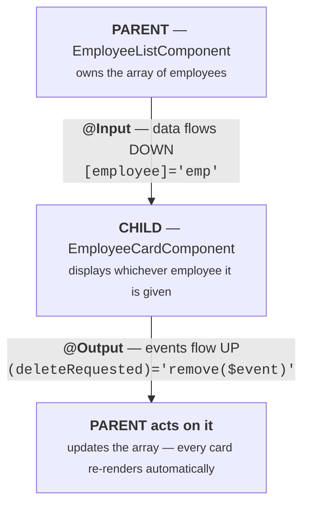

# Angular Session 2 — Study Guide

## Components & Data Binding

**Learn it first, then teach it.**

This guide pairs with `angular-session2-theory.html` (45 slides) and `angular-session2-lab.html`.

| | |
|---|---|
| **Who this is for** | Anyone who has finished Session 1 and has a running Angular project |
| **What you'll be able to do after** | Build components, nest them, and make the screen react to your data |
| **Time to read and absorb** | About 90 minutes, plus 90 minutes building |
| **Time to deliver as a session** | 3 hours including the lab |

---

## How to use this document

Read it **twice**, with different goals.

**First pass — learn it.** Read in order and build as you go. Unlike Session 1, you can't practise this in a playground — you need the `hello-world` project from Session 1 running with `ng serve`. Keep your editor and browser side by side.

**Second pass — prepare to teach it.** Read only the 🎓 **Teaching notes** and the [Delivery plan](#delivery-plan).

> **On the diagrams.** They're Mermaid, which GitHub renders automatically. If you see raw code instead, the surrounding text explains the same thing in words.

**The theme of this session:** you will stop writing code that *manipulates the page* and start writing code that *changes data*. Angular updates the page for you. If a learner walks away with only that, the session succeeded.

---

## Contents

1. [What a component is](#1-what-a-component-is)
2. [The three parts of every component](#2-the-three-parts-of-every-component)
3. [Your app is a tree](#3-your-app-is-a-tree)
4. [How a component gets on screen](#4-how-a-component-gets-on-screen)
5. [Generating a component](#5-generating-a-component)
6. [Component styles cannot leak](#6-component-styles-cannot-leak)
7. [Data binding — the whole picture](#7-data-binding--the-whole-picture)
8. [Binding 1 — interpolation](#8-binding-1--interpolation)
9. [Binding 2 — property binding](#9-binding-2--property-binding)
10. [Binding 3 — event binding](#10-binding-3--event-binding)
11. [Binding 4 — two-way binding](#11-binding-4--two-way-binding)
12. [Directives](#12-directives)
13. [Pipes](#13-pipes)
14. [Talking between components](#14-talking-between-components)
15. [ngOnInit](#15-ngoninit)
16. [Cheat sheet](#cheat-sheet)
17. [Errors you'll hit](#errors-youll-hit)
18. [Check yourself](#check-yourself)
19. [Delivery plan](#delivery-plan)

---

## 1. What a component is

A **component** is one self-contained piece of user interface: its own logic, its own markup, its own styling — bundled together and reusable.

Think about any application you use. A dashboard isn't one big thing; it's a header, a sidebar, some summary cards, a chart and a table. Each is independent. Each could appear on another page unchanged. **Each of those is a component.**

| Property | What it buys you |
|---|---|
| **Self-contained** | Everything the piece needs lives in one folder. You can understand it without reading the rest of the app. |
| **Reusable** | Write an `employee-card` once, use it on the list page, the search page and the dashboard. |
| **Isolated** | Its CSS can't leak out and break another component. Its data is its own. |
| **Composable** | Components nest inside components. That nesting is how a page gets built. |

**Analogy.** A component is a **LEGO brick**. Each brick is complete in itself, and you build anything by connecting bricks — you never carve a castle from one solid block. The old way of building web pages was carving from one block.

**The Java parallel.** You already do this on the backend. You don't write one enormous `Main` class — you write a `Controller`, a `Service`, a `Repository`, each with one job. A component is that same discipline, applied to the screen.

> 🎓 **Teaching notes**
>
> Don't define it first. **Point at something.** Open any application they know — Gmail, a bank dashboard, even your own company intranet — and physically draw boxes on it: *"header. Sidebar. That list. Each row in that list. Each of those is a component."*
>
> Then ask: *"if the sidebar appears on twelve screens, how many times should we write it?"* They'll say once. You've now derived the entire idea from them rather than announcing it.
>
> The LEGO analogy is worth saying out loud because it's the mental model people keep. But the parallel that lands hardest with Java developers is the second one — they already believe in single responsibility, they just haven't applied it to UI. Say: *"you'd never put your SQL in your controller. This is the same instinct, pointed at the screen."*

---

## 2. The three parts of every component

Every component in every Angular project is the same three things plus a label. Once you've seen one, you've seen them all.

| Part | File | Role |
|---|---|---|
| **1 · The class** | `employee-list.component.ts` | The **brain**. Your data and logic: fields to hold values, methods to respond to clicks. |
| **2 · The template** | `employee-list.component.html` | The **face**. The HTML the user sees, which can read from the class. |
| **3 · The styles** | `employee-list.component.css` | The **clothes**. CSS that applies to this component only. |
| **4 · The metadata** | the `@Component({...})` decorator | The **label** that ties the other three together and names the HTML tag. |

Read it as a sentence: *"This class holds the data. That HTML file displays it. That CSS file styles it. And this decorator tells Angular all three belong together, and that they appear wherever `<app-employee-list>` is written."*

```typescript
// src/app/employee-list/employee-list.component.ts
import { Component } from '@angular/core';
import { Employee } from '../models/employee';

@Component({
  selector: 'app-employee-list',
  templateUrl: './employee-list.component.html',
  styleUrls: ['./employee-list.component.css']
})
export class EmployeeListComponent {

  // ── FIELDS: data the template can display ──
  heading = 'Employee Directory';
  showTable = true;

  employees: Employee[] = [
    { id: 1001, name: 'Anoop', designation: 'Software Engineer',
      salary: 25000, status: 'Active' }
  ];

  // ── METHODS: things the template can call ──
  toggleTable(): void {
    this.showTable = !this.showTable;
  }

  getActiveCount(): number {
    return this.employees.filter(e => e.status === 'Active').length;
  }
}
```

**The mental model for the rest of this series:** a component class is a **box of values and behaviours that its own template is allowed to read.** Put a field on the class, and the template can display it. Put a method on the class, and the template can call it on a click. That's the entire relationship — and all four bindings are just different ways of crossing that line.

### The `@Component` decorator

A **decorator** is extra information attached to a class. It doesn't change what the class *does* — it tells the framework how to *treat* it. If you've written `@RestController` or `@Service`, this is precisely the same idea.

| Property | Meaning |
|---|---|
| `selector` | The HTML tag name that renders this component. |
| `templateUrl` | Path to the HTML file. `./` means "same folder as this .ts file". |
| `styleUrls` | An **array** of CSS paths — a component may have several. Newer CLI versions generate `styleUrl` (singular, no array); both work. |

Three rules about decorators: it sits *immediately* above the class with nothing in between; the properties go inside `({ ... })` — braces inside brackets, which is the most common syntax error here; and one class gets one `@Component`.

There's also a fourth generated file, `employee-list.component.spec.ts`, for unit tests. Testing is genuinely valuable and out of scope for these four sessions. Leave the file alone; it doesn't affect your app.

> 🎓 **Teaching notes**
>
> This is a slide to move through briskly — its job is to establish a pattern they'll then see fifteen more times. The one thing to say with emphasis is **"every component you ever meet looks exactly like this"**, because that's what makes Angular projects navigable and it's genuinely reassuring.
>
> The "box of values the template can read" framing is the most useful sentence in this section. Say it, then repeat it every time you introduce a binding. Consistent language does a lot of work.
>
> Mention the `.spec.ts` file **explicitly and dismiss it**. If you don't, someone spends the session quietly worrying about the file nobody explained. One sentence: *"that's for tests, we're not covering testing, ignore it."*
>
> **Expect this question:** *"Why is `styleUrls` an array?"* Because a component can pull in several stylesheets — a shared one plus its own, for instance. Rare, but that's why.

---

## 3. Your app is a tree

There is always exactly one component at the top — `AppComponent`, the one Session 1 traced from `index.html`. Every other component hangs beneath it.



Parents hold children. Children hold their own children. There's no depth limit.

**Two rules follow from the tree, and they matter:**

1. **Data flows down** — a parent hands values to a child. That's `@Input`.
2. **Events flow up** — a child tells its parent something happened. That's `@Output`.

Because the flow is one direction per mechanism, you can always trace where a change came from. This is exactly the problem AngularJS 1.x had — it bound everything to everything in both directions, and in a large app you genuinely could not tell what had changed what. Angular 2's explicit directional flow is the fix.

> 🎓 **Teaching notes**
>
> **Draw this on a whiteboard using a screen they can see.** Pick your own company's internal tool, or the app they'll build in this session, and decompose it live: *"what are the boxes on this screen?"* Let them name the components. Then draw the tree.
>
> This is also the moment to plant **"data down, events up"** as a phrase. You'll return to it in §14, and repetition across ninety minutes is what makes it stick. Say it, write it on the board, and leave it there for the rest of the session.
>
> The AngularJS comparison is worth thirty seconds because it explains *why* the rule exists rather than presenting it as arbitrary. People follow rules they understand the reason for.

---

## 4. How a component gets on screen

This is the mechanism, and it's simpler than people expect. A component declares a **selector** — a made-up HTML tag name. Write that tag anywhere, and Angular puts the component there.

```typescript
// 1 · The component declares its tag
@Component({
  selector: 'app-employee-list',
  ...
})
export class EmployeeListComponent { }
```

```html
<!-- 2 · Any template can then use that tag -->
<h1>My Directory</h1>

<app-employee-list></app-employee-list>

<p>Footer text</p>
```

Angular finds `<app-employee-list>`, looks up the component whose selector matches, renders that component's template, and drops the result in at exactly that spot.

**Analogy.** The selector is a **picture frame hook on the wall**. You put the hook where you want the picture. Angular hangs the picture on it.

**Why `app-` at the front?** It's a prefix added by the CLI to guarantee your tag names never collide with real HTML tags or a third-party library's components. Imagine naming a component `button`. Keep the prefix.

**These tags are never self-closing.** Write `<app-x></app-x>`, not `<app-x />`, which fails **silently** — nothing appears and no error is reported. This wastes a lot of afternoons.

### Nesting: building the tree for real

```html
<!-- src/app/app.component.html — the parent -->
<app-header></app-header>

<app-employee-list></app-employee-list>

<app-footer></app-footer>
```

That's the whole root template. `AppComponent` now contains almost no markup of its own — it's a **layout**, arranging three children. This is very common and very healthy: top-level components arrange, leaf components display.

If nothing appears, check these three in order:

1. Is the tag spelled exactly like the `selector`?
2. Is the component in `declarations` in `app.module.ts`?
3. Did you write a closing tag?

> 🎓 **Teaching notes**
>
> The self-closing-tag trap is worth **demonstrating rather than warning about**. Change `<app-footer></app-footer>` to `<app-footer />`, save, and let them watch the footer vanish with no error anywhere. Then ask *"what would you do if this happened to you at 6pm?"* The answer — check the console, find nothing, then suspect punctuation — is the actual lesson.
>
> Every silent failure you show them today is one they'll recognise instead of fear. This session has an unusual number of them, so make a running theme of it: *"most Angular bugs don't tell you they happened."*
>
> The "top-level components arrange, leaf components display" idea is worth stating explicitly. Freshers tend to put everything in `AppComponent` and end up with a 400-line template. Showing them a root template that's three lines long pre-empts that.

---

## 5. Generating a component

You could create the files by hand. You should not.

```bash
ng generate component employee-list

# the short form everyone actually types
ng g c employee-list
```

```
CREATE src/app/employee-list/employee-list.component.css (0 bytes)
CREATE src/app/employee-list/employee-list.component.html (28 bytes)
CREATE src/app/employee-list/employee-list.component.spec.ts (595 bytes)
CREATE src/app/employee-list/employee-list.component.ts (222 bytes)
UPDATE src/app/app.module.ts (412 bytes)
```

**Read that last line again.** `UPDATE src/app/app.module.ts`. The CLI didn't only make files — it **registered your component** in the module's `declarations` list. Angular refuses to render a component it hasn't been told about, and hand-created components are where beginners lose an hour to `'app-employee-list' is not a known element`.

Two things to get right: run it from the **project folder** in a *second* terminal (leave `ng serve` running in the first), and name it in `lowercase-with-hyphens`.

### The naming rule you must be able to translate

| You type | The CLI produces | Used as |
|---|---|---|
| `employee-list` | folder + file names | on disk |
| → `EmployeeListComponent` | the class name (PascalCase + "Component") | in TypeScript |
| → `app-employee-list` | the selector (prefix + kebab-case) | in HTML templates |

Learn to read this **both ways**. If you see `<app-customer-form>` in a template, you know instantly the class is `CustomerFormComponent` in `src/app/customer-form/customer-form.component.ts`. That translation, done automatically in your head, is most of what "knowing your way around an Angular project" means.

### What the CLI changed in the module

```typescript
import { EmployeeListComponent } from './employee-list/employee-list.component';  // ← added
import { LoginComponent } from './login/login.component';                         // ← added

@NgModule({
  declarations: [
    AppComponent,
    EmployeeListComponent,      // ← added
    LoginComponent              // ← added
  ],
  imports: [ BrowserModule ],
  providers: [],
  bootstrap: [AppComponent]
})
export class AppModule { }
```

`'app-employee-list' is not a known element` means exactly one of three things: the component isn't in `declarations`, you spelled the tag differently from the selector, or you created the files by hand. Check in that order.

> 🎓 **Teaching notes**
>
> **Run the command live and then stop on the `UPDATE` line.** Point at it. Say: *"that line is the entire reason we use the CLI. It edited another file for you."* Then open `app.module.ts` and show the two new lines. Making the invisible edit visible is what prevents the mystery later.
>
> A good optional demo is `--dry-run`: `ng g c test --dry-run` shows exactly what would happen and creates nothing. It's the safest way for a nervous learner to explore, and worth telling them about.
>
> **The naming translation table deserves a quick verbal drill.** Say a selector, ask for the class name and file path. Three rounds, thirty seconds, and it becomes automatic. It pays off every time they read someone else's code.
>
> **Expect this question:** *"Can I rename a component later?"* Yes, but it means renaming the folder, four files, the class, the selector and the module import — the CLI has no rename command. So it's worth a moment's thought about the name up front. Honest, and it makes them take naming seriously.

---

## 6. Component styles cannot leak

This deserves its own section because it solves a problem that's plagued web development for twenty years.

Put this in one component's CSS file:

```css
h2    { color: red; }
table { width: 100%; border-collapse: collapse; }
```

That `h2` rule affects **only the `h2` tags inside this component's template**. An `h2` in the header, the footer, or anywhere else is completely untouched.

| Traditional CSS | Angular component CSS |
|---|---|
| Every rule is global | Rules are scoped automatically |
| Two developers both style `.card` and break each other | `h2` here can't affect `h2` there |
| You defend yourself with names like `.employee-list-table-header` | Short, obvious selectors are safe again |
| Nobody dares delete an old rule | Delete a component, its CSS goes with it |

**How it works:** Angular adds a unique attribute to this component's elements (something like `_ngcontent-abc-1`) and quietly rewrites your CSS selectors to require it. Inspect an element in dev tools and you can see it. The feature is called **view encapsulation**, and it's on by default.

**So where do global styles go?** `src/styles.css` — that file *is* global, and it's where a CSS framework like Bootstrap would be imported, or where you'd set the app's font.

> 🎓 **Teaching notes**
>
> This one genuinely delights people who have suffered CSS conflicts, and means little to those who haven't. Gauge the room. If they've done any web work, ask: *"has anyone changed one CSS rule and broken a completely different page?"* You'll get rueful nods, and then this feature sells itself.
>
> If they're pure backend, keep it short and use the analogy of **`private` fields**: *"component CSS is private by default. Global CSS is public. You already know why private is the better default."*
>
> **Worth demoing in dev tools:** inspect an element and show them the `_ngcontent-` attribute Angular injected. It turns magic into mechanism, which is always worth the thirty seconds.

---

## 7. Data binding — the whole picture

This is the centrepiece of the session.

**Data binding** is the connection between your **component class** and your **template**. There are four kinds, and the only thing that really distinguishes them is **which direction the information travels**. Get the direction right and the syntax follows.



| Kind | Syntax | Direction | Use it when |
|---|---|---|---|
| **Interpolation** | `{{ value }}` | Class → Template | You want to **display text**. |
| **Property binding** | `[property]="value"` | Class → Template | You want to **set an HTML attribute** from your data. |
| **Event binding** | `(event)="method()"` | Template → Class | You want to **react to a click** or other action. |
| **Two-way binding** | `[(ngModel)]="value"` | Class ⇄ Template | You have a **form input** that must stay in sync both ways. |

**A memory trick for the punctuation:**

- **Square brackets `[ ]` look like a box being filled** → data flowing *in*, class to template.
- **Round brackets `( )` look like a mouth shouting** → an event flowing *out*, template to class.
- **`[( )]` is both at once** — hence its nickname, **"banana in a box"**: the banana `( )` inside the box `[ ]`.

**Why this beats what you did before.** In a JSP you print a value into HTML once and it's frozen. In Angular the binding is **live**: change the field in your class and the screen updates by itself. You never write code to "refresh the display" — that's Angular's entire job.

> 🎓 **Teaching notes**
>
> **This is the single most important slide in the session.** Spend real time on it, and come back to it after each individual binding so they can see where the new piece fits.
>
> Teach it as **direction first, syntax second.** If someone understands that `[ ]` goes in and `( )` comes out, they can reconstruct the syntax. If they memorise syntax without direction, they guess.
>
> The banana-in-a-box name sounds silly and is genuinely the reason people remember the bracket order. Use it. Ask the room to say it back.
>
> **The "you never refresh the display" point deserves emphasis** for anyone with jQuery or Servlet/JSP experience, because it's a habit they must unlearn. Say it directly: *"if you find yourself reaching for `document.getElementById`, stop. You're fighting the framework. Change the data instead."*
>
> Good closing quick-fire drill for this section: name a task, they name the binding. *"Show a customer's city in a paragraph?"* `{{ }}`. *"Grey out Delete when nothing's selected?"* `[ ]`. *"Run a search on a button press?"* `( )`. *"Keep a search box in sync with a field?"* `[( )]`.


---

## 8. Binding 1 — interpolation

The simplest binding, and the one you already used in Session 1. Double curly braces put a value from the class into the page as **text**.

```typescript
export class AppComponent {
  title = 'Employee Portal';
  count = 4;
  user  = { name: 'Anoop' };

  getGreeting(): string {
    return 'Welcome back';
  }
}
```

```html
<h1>{{ title }}</h1>                <!-- Employee Portal -->
<p>{{ count }} employees</p>        <!-- 4 employees -->
<p>{{ user.name }}</p>              <!-- Anoop -->
<p>{{ getGreeting() }}</p>          <!-- Welcome back -->
<p>{{ count * 2 }}</p>              <!-- 8 -->
<p>{{ title.toUpperCase() }}</p>    <!-- EMPLOYEE PORTAL -->
```

You can put a field, a nested property, a method call, or a small expression between the braces. Angular evaluates it and inserts the result as text.

### What you can and cannot put inside `{{ }}`

| ✅ Allowed | ❌ Not allowed |
|---|---|
| `{{ title }}` | `{{ let x = 5 }}` |
| `{{ user.name }}` | `{{ if (a) { } }}` |
| `{{ employees.length }}` | `{{ for (...) { } }}` |
| `{{ salary * 12 }}` | `{{ count++ }}` |
| `{{ firstName + ' ' + lastName }}` | `{{ salary = 30000 }}` |
| `{{ getTotal() }}` | `{{ new Date() }}` |
| `{{ isActive ? 'Yes' : 'No' }}` | `{{ window.alert('hi') }}` |
| `{{ user?.address?.city }}` | `{{ console.log(x) }}` |

**The one rule that covers all of it:** a template expression must **produce a value** and have **no side effects**. You may *read*; you may not *change*. So `a + b` is fine, but `a = b` and `count++` are not. Declarations, loops and `if` statements are out too — Angular gives you `*ngIf` and `*ngFor` for those, which is exactly why they exist.

**Two traps worth knowing now:**

1. **A misspelled field shows nothing at all.** `{{ titel }}` renders an empty string — no error, no warning. When text mysteriously fails to appear, check spelling and capitalisation first.
2. **Don't put heavy work in a method call.** `{{ getTotal() }}` is re-run every time Angular checks the screen, which is often. Fine for adding four numbers; bad for looping ten thousand rows.

> 🎓 **Teaching notes**
>
> This is the one binding they've already seen, so use it to establish the **pattern of how you'll teach the other three**: show the class, show the template, show the result, then break it.
>
> The "allowed vs not allowed" table looks like a lot of memorisation, so **give them the rule instead of the list**: *"produce a value, change nothing."* Then the table is just examples of that one rule, and nobody needs to memorise it.
>
> **The silent-typo demo is essential here.** Misspell a field live, save, and let them watch the text simply disappear. Then say: *"nothing in your terminal, nothing in the console, nothing on the page. This will happen to you this afternoon."* That's the moment they learn to suspect spelling.
>
> The performance warning about `{{ getTotal() }}` is worth one sentence, no more. It's true, it matters at scale, and dwelling on it now is premature optimisation for people who haven't built anything yet.

---

## 9. Binding 2 — property binding

Interpolation puts text *between* tags. Property binding sets a value *on* a tag — its `src`, its `disabled`, its `value`. Wrap the property name in square brackets and the right-hand side becomes an **expression** rather than a literal string.

```typescript
export class AppComponent {
  imageUrl = 'assets/logo.png';
  isSaveDisabled = true;
  inputValue = 'Anoop';
  rowCount = 4;
  linkTarget = 'https://angular.dev';
}
```

```html


<button [disabled]="isSaveDisabled">Save</button>

<input [value]="inputValue">

<a [href]="linkTarget">Docs</a>

<button [disabled]="rowCount === 0">Export</button>
```

### The critical detail — brackets change the meaning entirely

| Written | What happens |
|---|---|
| `` | Looks for a **file literally called "imageUrl"**. Broken image. |
| `` | Reads the **field named `imageUrl`** from your class and uses its value. |

Without brackets it's a plain string. With brackets it's an expression. That single distinction accounts for a large share of "why is my image broken" questions.

**The same mistake with booleans, which is nastier:**

| Written | What happens |
|---|---|
| `[disabled]="true"` | Brackets, so `true` is the boolean. Correct. |
| `disabled="false"` | No brackets, so `"false"` is a **non-empty string** — and HTML treats any value as "yes, disabled". The button stays disabled and you're baffled. |

**With booleans, always use brackets.**

### Interpolation or property binding?

They both send data the same direction, so how do you choose? Ask **what you're filling in**.

| What you want | Write |
|---|---|
| Show a name as page text | `<p>{{ empName }}</p>` |
| Set an image's source | `` |
| Disable a button conditionally | `<button [disabled]="!isValid">` |
| Set an input's starting value | `<input [value]="empName">` |
| Show a total inside a heading | `<h3>Total: {{ total }}</h3>` |

**Technically they're the same thing.** Under the bonnet, `<p>{{ name }}</p>` compiles to `<p [textContent]="name">`. Interpolation is a friendly shorthand for property-binding the text content — which is why the rules about what you may write inside them are identical. You're not learning two systems, just two spellings of one.

> 🎓 **Teaching notes**
>
> **The bracket demo is the whole section.** Do it live, in this order: write `` and show the logo appearing. Then delete the brackets, save, and show the broken-image icon. Then ask *"what is the browser looking for right now?"* Someone will say "a file called imageUrl". Correct — and now they understand expressions versus strings permanently.
>
> **Then do the boolean version, because it's more surprising.** `disabled="false"` leaving a button disabled genuinely astonishes people. Explain it in HTML's terms: *"HTML doesn't care what the value is — if the attribute is there with any content, it's on."* Give them the rule: **booleans always get brackets.**
>
> The "technically they're the same thing" point is optional depth. Include it if the room is strong — it's satisfying and reduces two rules to one. Skip it if they're struggling; it'll just add noise.

---

## 10. Binding 3 — event binding

The first binding that goes the **other way**. Round brackets around an event name say: "when this happens in the template, run that method on the class."

```typescript
export class LoginComponent {
  message = '';
  clickCount = 0;

  onLogin(): void {
    this.message = 'Login clicked!';
  }

  increment(): void {
    this.clickCount++;
  }

  greet(who: string): void {
    this.message = 'Hello, ' + who;
  }
}
```

```html
<button (click)="onLogin()">Login</button>

<button (click)="increment()">Clicked {{ clickCount }} times</button>

<button (click)="greet('Anoop')">Greet Anoop</button>

<p>{{ message }}</p>
```

**Watch what happens after a click — this is the payoff.** `onLogin()` changes a field. It does **not** touch the page. Yet the `<p>{{ message }}</p>` updates immediately, because interpolation is a live binding.

> **You change data; Angular updates the screen.** You will never write `document.getElementById(...)` again.

### Events you'll actually use

| Event | Fires when |
|---|---|
| `(click)` | The element is clicked. By far the most common. |
| `(input)` | The user types in a text box — on every keystroke. |
| `(change)` | A value is committed — on leaving a field, or selecting from a dropdown. |
| `(submit)` | A form is submitted. Used in Session 3. |
| `(keyup)` | A key is released. `(keyup.enter)` narrows it to just Enter. |
| `(mouseenter)` | The pointer moves over the element. |

**Don't forget the parentheses on the method.** `(click)="onLogin()"` **calls** it. `(click)="onLogin"` merely names it and does nothing at all — silently. If a button appears dead, check for the missing `()`.

### `$event` — getting data out of the event

Often you don't just want to know *that* something happened — you want to know *what the user typed*. Angular hands you the event object under the special name `$event`.

```html
<input (input)="onType($event)" placeholder="Type something">
<p>You typed: {{ typed }}</p>
```

```typescript
typed = '';

onType(event: Event): void {
  // event.target is the input element; .value is what's in it
  this.typed = (event.target as HTMLInputElement).value;
}
```

| Part | What it is |
|---|---|
| `$event` | Angular's name for the event object. Only meaningful inside an event binding. |
| `event.target` | The element the event came from — here, the `<input>`. |
| `as HTMLInputElement` | A **type assertion**: "trust me, this is an input, so it has a `.value`." Needed because TypeScript only knows it's *some* element. |

That cast is clumsy — and for form inputs you'll almost never need it, because **two-way binding does this job in one clean line**. Learn `$event` because you'll meet it and you need it for non-form events, but reach for `[(ngModel)]` first.

A useful shortcut: `<input (keyup.enter)="search($event)">` means "only when Enter is released". Angular supports this for any key, saving you an `if` to check which key it was.

> 🎓 **Teaching notes**
>
> **The moment to make a fuss about is the one after the click.** Click the button, the message appears, and then say: *"look at what I did NOT write. I did not find that paragraph. I did not set its text. I changed a variable, and the screen followed."*
>
> For anyone with jQuery, Servlet or JSP experience this is the genuine paradigm shift of the session, and it deserves a pause. Say the sentence and let it land: **you change data, Angular updates the screen.**
>
> **Demo the missing-`()` bug**, because it's the third silent failure of the session and the pattern is now becoming a theme. By this point you can ask the room *"what do we check first when something does nothing?"* and get "punctuation" back.
>
> **On `$event`:** teach it, but tell them honestly they'll rarely need it for forms. Freshers who learn `$event` first tend to write the clumsy version everywhere. Frame it as *"this is how it works underneath; the next slide is what you'll actually type."*

---

## 11. Binding 4 — two-way binding

A text box has a genuine two-directional need: the class should be able to *set* its contents, **and** the class should learn when the user *types*. Doing that with the bindings you already know takes two attributes:

```html
<!-- the manual way — property binding IN, event binding OUT -->
<input [value]="empName" (input)="empName = getValue($event)">
```

`[(ngModel)]` collapses both directions into one:

```html
<!-- the same thing, in one attribute -->
<input [(ngModel)]="empName">
```



**Why "banana in a box"?** `[( )]` — the round banana `( )` sits inside the square box `[ ]`. It's a silly name that works: **box on the outside, banana on the inside.** Get the order wrong and you get `([ngModel])`, which is an error people stare at for a long time.

### `ngModel` needs `FormsModule`

Write `[(ngModel)]` in a fresh project and you get this, and it stops the build:

```
Error: Can't bind to 'ngModel' since it isn't a known property of 'input'.
```

The message is confusing, because nothing looks wrong with your line. The real cause: `ngModel` isn't part of Angular's core — it lives in a separate feature module, and you have to ask for it.

```typescript
// src/app/app.module.ts
import { FormsModule } from '@angular/forms';        // ← 1. import it

@NgModule({
  declarations: [ AppComponent ],
  imports: [
    BrowserModule,
    FormsModule                                       // ← 2. list it here
  ],
  providers: [],
  bootstrap: [ AppComponent ]
})
export class AppModule { }
```

> **Remember the pattern, not just this instance.** *"Can't bind to X since it isn't a known property"* almost always means **a module is missing from `imports`**. You'll meet the same shape twice more: `HttpClientModule` in Session 3, `RouterModule` in Session 4. Recognise it once and you'll fix all three in seconds.

Also note it goes in `imports`, **not `declarations`**. `FormsModule` is somebody else's module. `declarations` is only ever for **your own** components, directives and pipes.

### A complete working example

```typescript
export class LoginComponent {
  username = '';
  password = '';
  message  = '';

  onLogin(): void {
    if (this.username === 'admin' && this.password === 'admin123') {
      this.message = '✅ Login successful!';
    } else {
      this.message = '❌ Invalid credentials';
    }
  }

  onClear(): void {
    this.username = '';
    this.password = '';
    this.message  = '';
  }
}
```

```html
<h2>Login</h2>

<label>Username:</label>
<input [(ngModel)]="username" name="username">

<label>Password:</label>
<input type="password" [(ngModel)]="password" name="password">

<button (click)="onLogin()" [disabled]="!username || !password">Login</button>
<button (click)="onClear()">Clear</button>

<p>{{ message }}</p>

<p class="hint">Live preview: {{ username }}</p>
```

**Count the bindings in that template — all four are there.** `[(ngModel)]` two-way on both inputs · `(click)` events on both buttons · `[disabled]` property binding that greys out Login until both fields have content · `{{ message }}` and `{{ username }}` interpolation. That's the whole of this section, in one screen of markup.

**Note the `name` attribute on each input.** When an `ngModel` input sits inside a `<form>` tag, Angular requires a `name`. Adding it always is a harmless habit that avoids a puzzling error later; Session 3 explains what Angular does with it.

> 🎓 **Teaching notes**
>
> **Walk them into the `FormsModule` error on purpose.** The lab does this deliberately and you should too: write `[(ngModel)]`, save, and let the build fail in front of them. Then read the message aloud and ask *"does anything look wrong with the line I wrote?"* No. That's the point — the error is about a missing module, not the line it points at.
>
> Then generalise it immediately, because this is the highest-leverage thing you'll say all session: *"remember this shape. 'Can't bind to X' means a module is missing from imports. You will see it twice more in this series."* Learners who internalise the pattern debug Sessions 3 and 4 without help.
>
> **The two-way demo people underestimate is the reverse direction.** Everyone shows typing updating the field. Also set `username = 'admin'` in the class and reload, so the input *starts* populated. That's the half of "two-way" people forget exists, and it's what makes the edit form in Session 4 possible.
>
> The login example is a good place to pause and count the four bindings together as a class. It consolidates everything from §7 onwards in two minutes.
>
> **One honesty point worth making:** comparing a password to a hardcoded string in front-end code is a teaching device only. Say so: *"anyone can read this in their browser. Real authentication happens on the server — you POST the credentials and get a token back. That's Session 3."* It takes ten seconds and prevents a genuinely bad habit.

---

## 12. Directives

A **directive** is an instruction you attach to an HTML element to change its behaviour or appearance.

Bindings let you push data *into* a fixed page. Directives let you change the page *itself* — hide a section, repeat a row four times, swap a colour. There are three kinds:

| Kind | What it does | Written |
|---|---|---|
| **Structural** | Adds or removes elements | Always with a **leading asterisk**: `*ngIf`, `*ngFor`, `*ngSwitchCase` |
| **Attribute** | Changes an element that's *already* there | No asterisk: `ngClass`, `ngStyle`, `ngModel` |
| **Components** | Technically a component *is* a directive — one with its own template | Interesting trivia; changes nothing |

> **The asterisk is the whole distinction — memorise this.**
>
> **Asterisk = the element may not exist at all.** `*ngIf` and `*ngFor` add and remove elements.
> **No asterisk = the element definitely exists, we're just changing it.** `ngClass` and `ngStyle` restyle something already on screen.
>
> Forgetting the asterisk on `*ngIf` is the most common directive mistake there is — and it fails silently, showing the element always.

### `*ngIf` — show it, or don't

```html
<button (click)="toggle()">Toggle</button>

<p *ngIf="isLoggedIn">Welcome back!</p>

<p *ngIf="employees.length === 0">No employees found.</p>

<div *ngIf="errorMessage">{{ errorMessage }}</div>
```

**It removes the element — it doesn't merely hide it.** When `isLoggedIn` is false, that `<p>` is **not in the page at all**. Inspect it in dev tools and there's nothing there — not an invisible element, nothing. That matters: a removed element costs no memory, runs no code, and can't be read by someone poking at the page. It's genuinely different from CSS's `display: none`.

**With an `else`:**

```html
<div *ngIf="isLoggedIn; else loginPrompt">
  <h3>Welcome back, {{ username }}!</h3>
  <button (click)="logout()">Log out</button>
</div>

<ng-template #loginPrompt>
  <h3>Please log in</h3>
  <button (click)="showLogin()">Log in</button>
</ng-template>
```

| Part | Note |
|---|---|
| `; else loginPrompt` | Note the **semicolon**, then `else`, then a name. No `#` here. |
| `<ng-template>` | A container that renders **nothing by itself**. It only holds markup for something else to use. |
| `#loginPrompt` | Names the template. The `#` is required *here*, at the definition. |

The classic use is a loading state: *"show the table if the data has arrived, otherwise show 'Loading…'"*. That's exactly what you'll write in Session 3.

### `*ngFor` — repeat for each item

This is the directive that fixes Session 1's annoyance. Instead of `employees[0]`, `employees[1]`, `employees[2]`… you write the markup **once**.

```html
<!-- Session 1's approach -->
<p>{{ employees[0].name }}</p>
<p>{{ employees[1].name }}</p>
<p>{{ employees[2].name }}</p>

<!-- With *ngFor — works for four, four hundred, or none -->
<p *ngFor="let emp of employees">{{ emp.name }}</p>
```

| Part | Meaning |
|---|---|
| `*ngFor="let emp of employees"` | "For each item in `employees`, call it `emp`, and repeat this element once per item." |
| `let emp` | A name **you invent**. It exists only inside this element. |
| `of employees` | The array on your class. It's **`of`**, exactly like `for...of` — never `in`. |

**Put the `*ngFor` on the element you want repeated.** On a table row it goes on the `<tr>` — not the `<table>` (four separate tables) and not the `<td>` (one repeated cell). Ask yourself: *which single tag do I want four copies of?*

**Getting the row number, and `trackBy`:**

```html
<tr *ngFor="let emp of employees; let i = index">
  <td>{{ i + 1 }}</td>          <!-- 1, 2, 3, 4 — humans count from 1 -->
  <td>{{ emp.name }}</td>
</tr>
```

Angular also gives you `first`, `last`, `even` and `odd` the same way. Note the **semicolon** before `let i = index`.

```html
<tr *ngFor="let emp of employees; trackBy: trackById">
  <td>{{ emp.name }}</td>
</tr>
```

```typescript
trackById(index: number, emp: Employee): number {
  return emp.id;             // "identify each row by its id"
}
```

**What `trackBy` saves you:** without it, when the array changes Angular can't tell which items are the same ones, so it **destroys and rebuilds every row**. With it, Angular matches rows by `id` and touches only what genuinely changed. On four rows you won't notice. On five hundred it's the difference between instant and sluggish — and it also stops odd bugs where a half-typed input loses its contents when the list refreshes.

### `*ngSwitch` — pick one of many

When you have three or more mutually exclusive options, a chain of `*ngIf`s gets ugly.

```html
<div [ngSwitch]="employee.designation">
  <span *ngSwitchCase="'Architect'">🏛️ Senior technical leadership</span>
  <span *ngSwitchCase="'Team Lead'">👥 Manages a team</span>
  <span *ngSwitchCase="'Tester'">🔍 Quality assurance</span>
  <span *ngSwitchDefault>💻 Individual contributor</span>
</div>
```

| Part | Note |
|---|---|
| `[ngSwitch]` | On the **container**. Square brackets, **no asterisk** — the container always exists. |
| `*ngSwitchCase` | On each **option**. **With** an asterisk — these come and go. |
| `*ngSwitchDefault` | The fallback. Optional, but include it. |

**The quotes-inside-quotes detail that catches everyone:** `*ngSwitchCase="'Architect'"` — **double quotes outside, single inside**. The value is a template *expression*, so a literal string needs its own quotes. Writing `*ngSwitchCase="Architect"` makes Angular look for a *field* named `Architect`, find nothing, and match nothing. This is the number one `ngSwitch` bug.

### `ngClass` — apply CSS classes conditionally

This is how you make a table colour its own rows.

```css
.active-row   { background-color: #eefcf1; color: #1a9e34; }
.inactive-row { background-color: #fff0ef; color: #b00027; }
.high-earner  { font-weight: bold; }
```

```html
<!-- 1. Object form — "apply each class when its condition is true" (use this) -->
<tr [ngClass]="{
      'active-row':   emp.status === 'Active',
      'inactive-row': emp.status === 'Inactive',
      'high-earner':  emp.salary > 40000
    }">

<!-- 2. Single-class shorthand — neat when there's only one -->
<tr [class.active-row]="emp.status === 'Active'">

<!-- 3. Expression form — returns a class name -->
<tr [ngClass]="emp.status === 'Active' ? 'active-row' : 'inactive-row'">
```

**Several classes can apply at once.** In the object form, *every* condition is evaluated independently — so a row can get both `inactive-row` (red) **and** `high-earner` (bold). That composability is why the object form is the one to reach for.

### `ngStyle` — set inline styles conditionally

Same idea, but it sets CSS **properties directly**. Reach for it when the value is *calculated* rather than chosen from a fixed set.

```html
<td [ngStyle]="{
      'color':       emp.salary > 40000 ? 'green' : 'red',
      'font-weight': emp.status === 'Active' ? 'bold' : 'normal'
    }">
  {{ emp.salary }}
</td>

<!-- Single-property shorthand -->
<td [style.color]="emp.salary > 40000 ? 'green' : 'red'">

<!-- With units baked into the property name — genuinely handy -->
<div [style.width.px]="percentComplete * 3"></div>
```

Two syntax notes: property names with a hyphen need quoting (`'font-weight'`), or use the camelCase form `fontWeight` unquoted. And don't forget units — `'width': 300` does nothing; you need `'300px'` or the `[style.width.px]` form.

### `ngClass` vs `ngStyle`

| Question | `ngClass` | `ngStyle` |
|---|---|---|
| What it sets | CSS **class names** | CSS **properties**, inline |
| Where styling lives | In your `.css` file, where it belongs | Scattered through your HTML |
| Reusable elsewhere? | Yes | No — tied to this element |
| Best for | A fixed set of states: active/inactive, valid/invalid | Calculated values: a width, a computed colour |

**The rule of thumb: default to `ngClass`.** Reach for `ngStyle` only when the value is genuinely computed and couldn't be a named class — a progress bar's width, for instance, since you can't write a CSS class for every possible percentage. In real projects you'll use `ngClass` ten times for every `ngStyle`.

> 🎓 **Teaching notes**
>
> This is a long section with six directives in it. **Don't teach all six then release them.** Teach `*ngIf`, let them do it. Teach `*ngFor`, let them do it. The lab is structured this way for a reason.
>
> **The asterisk rule is the single thing to over-communicate.** Say it, write it on the board, and demo the failure: remove the `*` from an `*ngIf`, save, and show the element appearing always with no error. Then ask what they'd check first. This is the fourth silent failure of the session and by now they should be answering "punctuation" reflexively.
>
> **`*ngFor` is the emotional payoff of the session.** They wrote `employees[0]`, `employees[1]`, `employees[2]` in Session 1 and it was deliberately tedious. Now one line replaces all of it. Put the old and new side by side and let them feel it. Because they experienced the problem first, the solution actually lands.
>
> **Do the wrong-element demo for `*ngFor`.** Move it from `<tr>` up to `<table>` and show four complete tables appearing. It's visually absurd and it teaches the rule better than any explanation: *the asterisk goes on the one tag you want copies of.*
>
> **On `*ngIf` vs `display: none`** — open dev tools and show the element genuinely absent from the DOM. Backend developers often assume it's just hidden, and the distinction matters for both performance and security.
>
> **On `trackBy`** — teach it, but be honest that they won't see a difference on four rows. Frame it as a habit: *"it costs one method and it's the difference between instant and sluggish at five hundred rows. Get into the habit now."*
>
> **The `ngSwitchCase` quote bug is worth causing deliberately.** Remove the inner quotes and watch the case silently never match. It's the fifth silent failure — the pattern should be thoroughly established by now.
>
> **Good discussion question for `ngClass` vs `ngStyle`:** *"A dashboard shows project completion as a coloured bar — green above 75%, amber 40–75%, red below. The bar's width is the exact percentage. Which directive for the colour, which for the width?"* Colour is three named states → `ngClass`. Width is continuous → `ngStyle`. Often both on the same element.


---

## 13. Pipes

Your data says `25000`. A user should see `₹25,000.00`. Your data says `2026-09-05T18:30:00Z`. A user should see `5 Sep 2026`.

A **pipe** formats a value **for display only**, using the `|` character. Crucially, **your underlying data is never changed** — only what appears on screen.

```
{{ value | pipeName }}
```

| Pipe | You write | They see |
|---|---|---|
| `uppercase` | `{{ 'anoop' \| uppercase }}` | `ANOOP` |
| `lowercase` | `{{ 'ANOOP' \| lowercase }}` | `anoop` |
| `titlecase` | `{{ 'anoop kumar' \| titlecase }}` | `Anoop Kumar` |
| `number` | `{{ 25000 \| number }}` | `25,000` |
| `currency` | `{{ 25000 \| currency }}` | `$25,000.00` |
| `percent` | `{{ 0.756 \| percent }}` | `76%` |
| `date` | `{{ today \| date }}` | `Sep 5, 2026` |
| `slice` | `{{ 'Angular' \| slice:0:3 }}` | `Ang` |
| `json` | `{{ emp \| json }}` | the whole object, readable — **brilliant for debugging** |

> **Learn `json` right now — it will save you in Session 3.** When data arrives from a server and you can't work out its shape, put `<pre>{{ myData | json }}</pre>` on the page. You instantly see exactly what you received. It's the fastest debugging tool in Angular and it costs one line.

### Parameters and chaining

Parameters follow a colon:

```html
<!-- currency: which currency, and how to show it -->
{{ 25000 | currency:'INR' }}                    <!-- ₹25,000.00 -->
{{ 25000 | currency:'INR':'symbol':'1.0-0' }}   <!-- ₹25,000    -->

<!-- date: a format string -->
{{ today | date:'shortDate' }}                  <!-- 9/5/26 -->
{{ today | date:'dd/MM/yyyy' }}                 <!-- 05/09/2026 -->
{{ today | date:'dd MMM yyyy, h:mm a' }}        <!-- 05 Sep 2026, 6:30 PM -->

<!-- number: min integer digits . min-max decimals -->
{{ 3.14159 | number:'1.2-2' }}                  <!-- 3.14 -->
```

Pipes chain, left to right:

```html
{{ today | date:'fullDate' | uppercase }}
<!-- SATURDAY, SEPTEMBER 5, 2026 -->
```

**Analogy — and it's where the name comes from.** Think of a **production line**. The value enters at the left, passes through each station, and comes out formatted at the right. It's exactly the `|` of a Unix shell, and the same idea as chaining Java stream operations.

**The important thing pipes do NOT do.** `{{ emp.name | uppercase }}` does not change `emp.name`. The stored value is still `'Anoop'`; only the pixels say `ANOOP`. So if you later save that employee, you save the original. That's correct behaviour — **format for display, store the truth**.

> 🎓 **Teaching notes**
>
> **Build this into a demo with a payoff.** In the lab, the employee names are deliberately stored lowercase — `'anoop kumar'`. Add `| titlecase` and they render properly. Then put `{{ employees[0] | json }}` on the page and show the raw object still says `"anoop kumar"`.
>
> That side-by-side is the entire lesson and it's worth setting up carefully: *"the table says Anoop Kumar. The data says anoop kumar. Pipes changed the display and left your data alone."*
>
> **Push `| json` hard.** It's the single most useful debugging tool they'll get in this series and it's almost always taught as an afterthought. Say plainly: *"when Session 3's server data confuses you, this line tells you the truth in two seconds."*
>
> One genuine mercy to point out: a misspelled pipe **does** report an error (`The pipe 'titlcase' could not be found`). After five silent failures, that's worth mentioning — not everything in Angular fails quietly.

---

## 14. Talking between components

You have a tree of components. Now the obvious question: how do they communicate?



### `@Input` — parent to child

The child declares an **input**, and the parent fills it in with property binding.

```typescript
// THE CHILD declares what it accepts
import { Component, Input } from '@angular/core';
import { Employee } from '../models/employee';

@Component({
  selector: 'app-employee-card',
  templateUrl: './employee-card.component.html'
})
export class EmployeeCardComponent {
  @Input() employee!: Employee;      // "a parent may pass me an employee"
  @Input() showSalary = false;
}
```

```html
<!-- THE PARENT fills it in -->
<app-employee-card
  *ngFor="let emp of employees"
  [employee]="emp"
  [showSalary]="true">
</app-employee-card>
```

```html
<!-- employee-card.component.html — the child's own template -->
<div class="card">
  <h3>{{ employee.name }}</h3>
  <p>{{ employee.designation }}</p>
  <p *ngIf="showSalary">{{ employee.salary | currency:'INR' }}</p>
</div>
```

**Why bother? Because now the card is reusable.** `EmployeeCardComponent` knows nothing about where its employee came from — an array, a search result, an API. It just renders whichever one it's handed. That's what makes it usable on the list page, the search page and the dashboard. A component that fetches its own data can only ever be used one way.

Two details in that code:

- The `!` in `employee!: Employee` tells strict mode "I promise a parent will set this". Without it you get *"has no initializer and is not definitely assigned"*.
- `[showSalary]="true"` needs the brackets to pass the *boolean* `true`. Writing `showSalary="true"` passes the *string* `"true"` — the same trap as `disabled="false"` in §9.

### `@Output` — child to parent

The reverse problem: a Delete button lives on the child card, but the array lives on the parent. The child cannot — and should not — reach up and modify the parent. Instead it **raises an event**, and the parent decides what to do.

```typescript
// THE CHILD announces
import { Component, Input, Output, EventEmitter } from '@angular/core';

export class EmployeeCardComponent {
  @Input() employee!: Employee;

  // "I will emit a number when someone clicks delete"
  @Output() deleteRequested = new EventEmitter<number>();

  onDeleteClick(): void {
    this.deleteRequested.emit(this.employee.id);
  }
}
```

```html
<!-- the child's template -->
<button (click)="onDeleteClick()">Delete</button>
```

```html
<!-- THE PARENT listens — same round brackets as (click), because it IS an event -->
<app-employee-card
  *ngFor="let emp of employees"
  [employee]="emp"
  (deleteRequested)="removeEmployee($event)">
</app-employee-card>
```

```typescript
// the parent's class — $event carries whatever the child emitted
removeEmployee(id: number): void {
  this.employees = this.employees.filter(e => e.id !== id);
}
```

> **The principle behind this — worth understanding, not just copying.** The child **reports**; the parent **decides**. The card doesn't know whether "delete" means removing from an array, calling an API, or showing a confirmation dialog — and it shouldn't. That separation is why you can drop the same card into a different screen with different delete behaviour. The pattern has a name: **data down, events up.**

### Side by side

| | `@Input` | `@Output` |
|---|---|---|
| Direction | Parent → child | Child → parent |
| Carries | Data | An event, optionally with data |
| Declared as | `@Input() employee!: Employee;` | `@Output() saved = new EventEmitter<Employee>();` |
| Parent writes | `[employee]="emp"` | `(saved)="onSaved($event)"` |
| Brackets | `[ ]` — a box being filled | `( )` — a mouth shouting |

**You already knew both syntaxes.** `@Input` is just **property binding** pointed at a component instead of an HTML tag. `@Output` is just **event binding** for an event you invented yourself. Nothing new to learn — only a new place to use it.

> 🎓 **Teaching notes**
>
> This was missing from the older version of this material and it's genuinely important, so don't let it get squeezed by overrunning earlier.
>
> **Teach it as a problem, not a feature.** Set it up: *"I want a card component I can use on four different screens. The card has a Delete button. But the array of employees lives in the parent. What should the card do when Delete is clicked?"*
>
> Someone will suggest the card modifies the array directly. Take that seriously, then ask: *"what if on the dashboard, Delete should archive instead of delete? What if on the admin screen it needs a confirmation first?"* Now the answer — *the card should just say 'someone asked to delete this', and let the parent decide* — is something they arrived at rather than were told.
>
> **The demo that makes it land** is in the lab: clicking ✕ on a *card* makes a row disappear from the *table*, with no code connecting them. Do it live and then ask why it works. The answer — one array, owned by the parent, two views reading it — is the whole architecture of a real Angular app in one sentence.
>
> **Reassure them on syntax.** By this point people are tired and `@Output() x = new EventEmitter<number>()` looks like a lot. Say: *"you already know both of these. `[ ]` in, `( )` out. Same brackets, new target."*
>
> **Expect this question:** *"What if two components need to talk but aren't parent and child?"* Excellent question and the honest answer is: you use a **shared service**, which is Session 3. That's a genuinely good forward reference — tell them they've just found the reason services exist.

---

## 15. `ngOnInit`

Angular creates and destroys your components, and it lets you run code at specific moments in that process. Those moments are called **lifecycle hooks**. There are several; you need exactly one today.

```typescript
import { Component, OnInit } from '@angular/core';

@Component({ /* ... */ })
export class EmployeeListComponent implements OnInit {

  employees: Employee[] = [];

  constructor() {
    // Only for receiving dependencies (Session 3). Keep it empty for now.
  }

  ngOnInit(): void {
    // Angular calls this ONCE, after the component is built
    // and its @Input values have been set. Do setup here.
    this.employees = this.loadEmployees();
  }
}
```

| Part | What it does |
|---|---|
| `implements OnInit` | Declares that this class has an `ngOnInit`. Optional in practice, but include it — TypeScript then catches a misspelled method name. |
| `ngOnInit()` | Runs **once**, after construction and after `@Input` values arrive. The right place for fetching data and initialising forms. |
| `constructor()` | Runs **first**, before Angular has finished wiring the component. Use it only to receive injected dependencies. |

**"Why not just do it in the constructor?"** Because at constructor time your `@Input` values **haven't arrived yet** — they're still `undefined`. A child that reads `this.employee.name` in its constructor crashes; the same line in `ngOnInit` works.

> The rule, worth adopting permanently: **constructor for dependencies, `ngOnInit` for work.**

The other hooks, for awareness only: `ngOnChanges` (an `@Input` changed), `ngAfterViewInit` (the template has rendered), `ngOnDestroy` (the component is being removed — used for cleanup). You won't need them in this series.

> 🎓 **Teaching notes**
>
> **This is best taught by breaking it, and the lab does exactly that.** Move a calculation that reads an `@Input` from `ngOnInit` into the `constructor` and watch `Cannot read properties of undefined (reading 'name')` appear in the console. Then move it back.
>
> That single experiment explains a bug that confuses people for weeks, and it takes ninety seconds. Do it live.
>
> Give them the one-line rule and repeat it: **constructor for dependencies, `ngOnInit` for work.** They'll need it in every component from Session 3 onwards.
>
> **Don't teach the other lifecycle hooks.** Name them, say they exist, move on. Teaching `ngAfterViewInit` today buys nothing and costs attention you need elsewhere.

---

## Cheat sheet

### The four bindings

| Punctuation | Name | Remember it as |
|---|---|---|
| `{{ }}` | Interpolation | "Print this value here as text." |
| `[ ]` | Property binding | "Fill this attribute **in**." A box being filled. |
| `( )` | Event binding | "Shout **out** when this happens." A mouth. |
| `[( )]` | Two-way binding | "Keep these in step." Banana in a box. |
| `[class.x]="cond"` | Single class toggle | — |
| `[style.width.px]="n"` | Single style, with units | — |

### Directives

| Directive | What it does |
|---|---|
| `*ngIf="cond"` | Include only if true — genuinely removes the element |
| `*ngIf="c; else tpl"` | With an `<ng-template #tpl>` |
| `*ngFor="let x of list"` | Repeat per item. **`of`**, never `in` |
| `; let i = index` | The position, from 0 |
| `; trackBy: fn` | Identify items so rows are reused |
| `[ngSwitch]` / `*ngSwitchCase="'A'"` | Pick one of many. Note the inner quotes |
| `[ngClass]="{ 'a': cond }"` | Named states |
| `[ngStyle]="{ 'color': x }"` | Computed values |

### Pipes

| Pipe | Effect |
|---|---|
| `\| uppercase` `\| lowercase` | Case conversion |
| `\| titlecase` | `anoop kumar` → `Anoop Kumar` |
| `\| number:'1.2-2'` | Digit control |
| `\| currency:'INR':'symbol':'1.0-0'` | `₹25,000` |
| `\| percent` | `0.5` → `50%` |
| `\| date:'dd/MM/yyyy'` | Date formatting |
| `\| slice:0:10` | Truncate |
| `\| json` | **Your best debugging tool** |

### Component communication

| Code | Role |
|---|---|
| `@Input() x!: T;` | Child accepts a value |
| `[x]="value"` | Parent supplies it |
| `@Output() done = new EventEmitter<T>();` | Child declares an event |
| `this.done.emit(v)` | Child fires it |
| `(done)="handler($event)"` | Parent listens |
| `ngOnInit()` | Setup — after inputs arrive |
| `constructor()` | Dependencies only |

### CLI

```bash
ng g c header          # generate a component (4 files + module registration)
ng g c employee-list
ng g c x --dry-run     # preview without creating anything
```

---

## Errors you'll hit

**Read this first:** most Session 2 bugs are **silent** — no red text anywhere, the page just doesn't behave. So this table is organised by what you *observe*.

| What you observe | Cause and fix |
|---|---|
| `Can't bind to 'ngModel' since it isn't a known property of 'input'` | **The Session 2 error.** Add `FormsModule` to `imports` in `app.module.ts`. Remember: *"can't bind to X"* = a module is missing. |
| `'app-employee-card' is not a known element` | Check in order: (a) not in `declarations`, (b) tag doesn't match the `selector`, (c) you created the files by hand. |
| A child component renders **nothing**, no error | You wrote `<app-card />`. Angular needs `<app-card></app-card>`. Completely silent. |
| A section refuses to hide | Missing asterisk — `ngIf` instead of `*ngIf`. Angular ignores it and shows the element always. No error. |
| The table body is empty but the array has data | `*ngFor="let e in list"` — must be `of`, not `in`. Silent. |
| Four whole tables instead of four rows | The `*ngFor` is on `<table>`. Move it to `<tr>`. |
| `{{ something }}` shows nothing at all | Spelling or capitalisation mismatch. Angular renders missing fields as an empty string with no warning. |
| A button does nothing when clicked | `(click)="onSave"` — missing `()`, so you named the method instead of calling it. |
| A link or image points at a literal field name | Brackets missing: `href="docsUrl"` instead of `[href]="docsUrl"`. |
| A button stays disabled forever | `disabled="false"` — the *string* `"false"` is non-empty, and HTML reads any value as "yes". Use `[disabled]="false"`. |
| `*ngSwitchCase` never matches | Missing inner quotes. Must be `*ngSwitchCase="'Tester'"`. |
| `Cannot read properties of undefined (reading 'name')` in a child | You used an `@Input` in the `constructor`. Inputs arrive *after* construction — move it to `ngOnInit`. |
| `Property 'employee' has no initializer and is not definitely assigned` | Strict mode. Add the `!`: `@Input() employee!: Employee;` |
| `The pipe 'titlcase' could not be found` | A misspelled pipe. Helpfully, this one *does* report itself. |
| Row colours don't change | The class names in `[ngClass]` don't match your `.css`, or the condition is never true. Add `{{ emp.status }}` next to it temporarily to see the real value. |

---

## Check yourself

**1.** Name the three parts of every component, and what the `@Component` decorator adds. *(§2)*

<details><summary>Answer</summary>

The **class** (`.ts`) holds data and logic. The **template** (`.html`) is what the user sees. The **styles** (`.css`) apply to this component only. The `@Component` decorator is metadata that ties the three together and declares the `selector` — the HTML tag name that renders the component.
</details>

**2.** What makes a component appear on screen, and what makes Angular *willing* to render it? *(§4, §5)*

<details><summary>Answer</summary>

Writing its `selector` as an HTML tag makes it appear. Angular is only willing to render it if the component is listed in `declarations` in `app.module.ts` — which `ng generate` does for you.
</details>

**3.** Given `<app-customer-form>`, what's the class name and the file path? *(§5)*

<details><summary>Answer</summary>

Class `CustomerFormComponent`, in `src/app/customer-form/customer-form.component.ts`. Strip the `app-` prefix, convert kebab-case to PascalCase, append "Component".
</details>

**4.** Name all four bindings, their punctuation, and the direction each flows. *(§7)*

<details><summary>Answer</summary>

Interpolation `{{ }}` — class → template, as text. Property binding `[ ]` — class → template, into an attribute. Event binding `( )` — template → class. Two-way `[( )]` — both directions.
</details>

**5.** What's the difference between `src="url"` and `[src]="url"`? *(§9)*

<details><summary>Answer</summary>

Without brackets the value is a **literal string**, so the browser looks for a file actually called "url". With brackets it's an **expression**, so Angular reads the field named `url` from your class and uses its value.
</details>

**6.** Why does `disabled="false"` leave a button disabled? *(§9)*

<details><summary>Answer</summary>

Without brackets, `"false"` is a non-empty **string**, and HTML treats the presence of the attribute with any value as "yes, disabled". You need `[disabled]="false"` so it's the boolean. With booleans, always use brackets.
</details>

**7.** What does `[(ngModel)]` need in `app.module.ts`, and what's the error without it? *(§11)*

<details><summary>Answer</summary>

`FormsModule` in the `imports` array (from `@angular/forms`). Without it: `Can't bind to 'ngModel' since it isn't a known property of 'input'`. That error shape always means a module is missing from `imports`.
</details>

**8.** What does the asterisk in `*ngIf` signify, and what happens if you leave it out? *(§12)*

<details><summary>Answer</summary>

The asterisk marks a **structural** directive — one that adds or removes elements. Without it, Angular treats `ngIf` as a meaningless attribute, ignores it, and the element shows **always**. No error is reported.
</details>

**9.** How is `*ngIf` different from CSS `display: none`? *(§12)*

<details><summary>Answer</summary>

`*ngIf` **removes the element from the DOM entirely** — inspect it and there's nothing there. `display: none` leaves it present but invisible. The removed element costs no memory, runs no code, and can't be read by someone inspecting the page.
</details>

**10.** Which single tag does the `*ngFor` go on when building a table, and why? *(§12)*

<details><summary>Answer</summary>

The `<tr>`. Ask "which single tag do I want four copies of?" — you want four rows. On `<table>` you'd get four complete tables; on `<td>` you'd repeat one cell.
</details>

**11.** What does `trackBy` save you, and when does it matter? *(§12)*

<details><summary>Answer</summary>

Without it, Angular can't tell which items are the same when the array changes, so it destroys and rebuilds every row. With it, rows are matched by id and only genuine changes are touched. Invisible on four rows; the difference between instant and sluggish on five hundred. It also prevents bugs where a half-typed input loses its contents on refresh.
</details>

**12.** When would you choose `ngStyle` over `ngClass`? *(§12)*

<details><summary>Answer</summary>

When the value is **calculated on a continuous scale** and couldn't be expressed as a named class — a progress bar's width, for example. For a fixed set of states, `ngClass` is better because the styling stays in your CSS file and is reusable.
</details>

**13.** Does `{{ name | uppercase }}` change the stored value? How would you prove it? *(§13)*

<details><summary>Answer</summary>

No. Pipes affect display only. Prove it by putting `{{ myObject | json }}` on the same page — the raw object still shows the original lowercase value while the table above shows it capitalised.
</details>

**14.** Explain *data down, events up* using `@Input` and `@Output`. *(§14)*

<details><summary>Answer</summary>

A parent passes data **down** to a child via `@Input`, bound with `[property]="value"`. A child reports events **up** to its parent via `@Output` and an `EventEmitter`, listened to with `(event)="handler($event)"`. The child reports; the parent decides what it means. This keeps children reusable in different contexts.
</details>

**15.** Why must you compute things from an `@Input` in `ngOnInit` rather than the constructor? *(§15)*

<details><summary>Answer</summary>

Because `@Input` values are set **after** the constructor runs. In the constructor they're still `undefined`, so reading one throws `Cannot read properties of undefined`. Rule: constructor for dependencies, `ngOnInit` for work.
</details>

**16.** Name three Session 2 bugs that produce **no error message at all**. *(§12, errors table)*

<details><summary>Answer</summary>

Any three of: a missing asterisk on `*ngIf`; `in` instead of `of` in `*ngFor`; a self-closing component tag `<app-x />`; a missing `()` on an event handler; a misspelled field in `{{ }}`; missing inner quotes in `*ngSwitchCase`; missing brackets on a boolean property.
</details>

---

## Delivery plan

A 3-hour session including the lab.

| Time | What | Slides | Lab |
|---|---|---|---|
| 0:00–0:10 | Recap Session 1, today's roadmap | 1–2 | Pre-requisites |
| 0:10–0:30 | What a component is · three parts · the tree · selectors | 3–6 | — |
| 0:30–0:50 | `ng g c` · the four files · naming · what changed in the module · nesting | 7–14 | **Task 1** |
| 0:50–1:00 | **Break** | — | — |
| 1:00–1:10 | Data binding — the whole picture | 15 | — |
| 1:10–1:25 | Interpolation · property binding | 16–19 | **Task 2** |
| 1:25–1:50 | Event binding · `$event` · two-way · `FormsModule` | 20–25 | **Task 3** |
| 1:50–2:10 | Directives: `*ngIf` · `*ngFor` · `*ngSwitch` | 26–31 | **Task 4** |
| 2:10–2:30 | `ngClass` · `ngStyle` · the worked example | 32–35 | **Task 5** |
| 2:30–2:40 | Pipes | 36–37 | **Task 6** |
| 2:40–2:55 | `@Input` · `@Output` · `ngOnInit` | 38–41 | **Task 7** |
| 2:55–3:00 | Common mistakes · recap · what's next | 42–45 | — |

### Rules for running this session well

**Interleave relentlessly.** This session has seven lab tasks and they map to specific slide ranges. Teach a concept, release them, bring them back. If you lecture for an hour and then release them, the first half is gone.

**Make silent failures a running theme.** There are six of them in this session: missing asterisk, missing `()`, self-closing tag, `in` vs `of`, misspelled field, missing inner quotes. Demo each one deliberately at the moment you teach the feature. By the third, the room will start predicting them, and by the end "check punctuation first" is a reflex.

**Repeat two phrases until they're automatic.** *"You change data; Angular updates the screen."* And *"data down, events up."* Repetition across three hours is what makes them stick.

**Keep the editor and browser side by side all session.** Every concept in this session is visual. If they can't see the change happen, they're just reading code.

### If you're short on time

Cut in this order:

1. `*ngSwitch` (§12) — it's a tidier `*ngIf`; set the lab stretch task as homework
2. `$event` (§10) — mention that two-way binding replaces it and move on
3. `ngStyle` (§12) — teach `ngClass` properly and mention `ngStyle` exists
4. Pipe parameters and chaining (§13) — teach the basic form only
5. Lab Task 7 (`@Input`/`@Output`) — set as homework **with the warning that Session 4 assumes it**

**Never cut:** the data-binding overview (§7), `*ngFor` (§12), `FormsModule` (§11), or `ngOnInit` (§15). Session 3 depends on all four.

### Questions you should expect

| Question | Short answer |
|---|---|
| "Why is `styleUrls` an array?" | A component can use several stylesheets — a shared one plus its own. Rare, but that's why. |
| "Can I rename a component later?" | Yes, but manually: folder, four files, class, selector, module import. There's no CLI rename. So think about the name up front. |
| "What if two components need to talk but aren't parent and child?" | A shared **service** — that's Session 3. Good question; they've just found the reason services exist. |
| "Is `*ngIf` bad for performance? It rebuilds things." | It's cheaper than keeping hidden components alive. Use `*ngIf` for things that are genuinely sometimes absent; use CSS for things that toggle many times a second. |
| "Do I need `trackBy` always?" | No, but it's a good habit. It's invisible on small lists and important on large or frequently-updated ones. |
| "Why `!` on `@Input`?" | Strict mode wants every field initialised. `!` says "a parent will set this before anything reads it." |
| "Can a child change data the parent passed in?" | It can technically mutate an object, and it shouldn't. Emit an event and let the parent change its own data. That's the whole point of the pattern. |

### Your own preparation checklist

- [ ] Build the entire lab yourself on the machine you'll present from
- [ ] Have the Session 1 `hello-world` project running before people arrive
- [ ] Practise the six silent-failure demos so they're quick and clean
- [ ] Have dev tools open on a second monitor for the `*ngIf`-removes-the-element demo
- [ ] Re-read §7 and §14's teaching notes — the binding overview and `@Input`/`@Output` are where this session succeeds or fails

---

**Next:** `angular-session3-study-guide.md` — Forms, Services & HTTP, where your app starts talking to a server.
