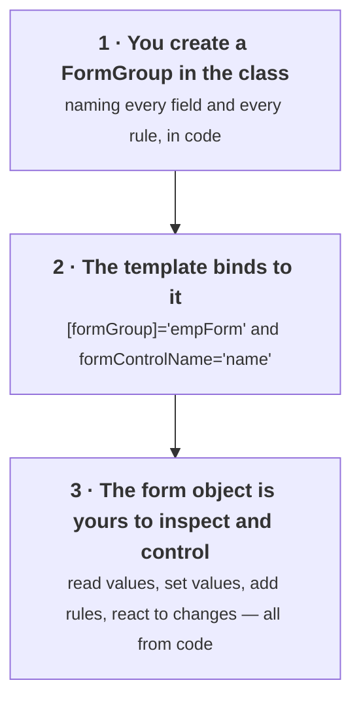
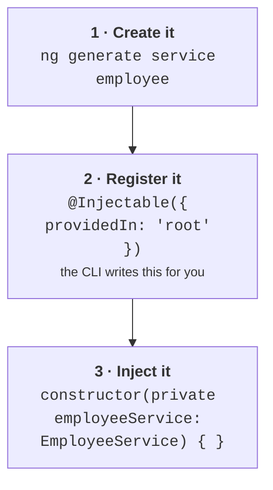
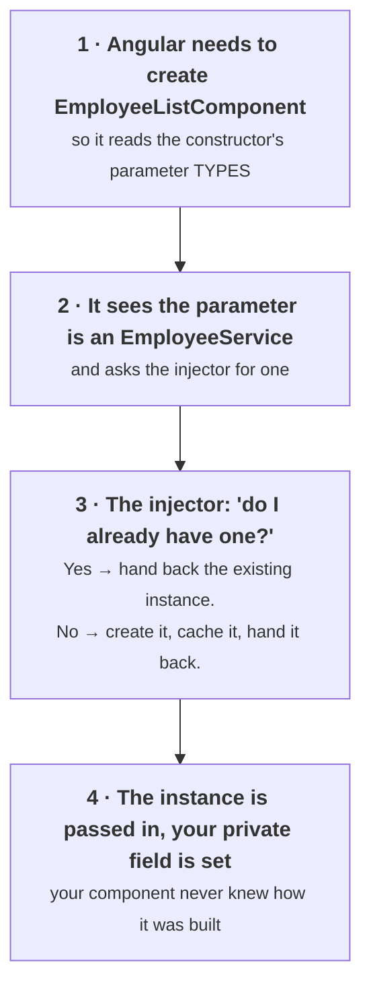
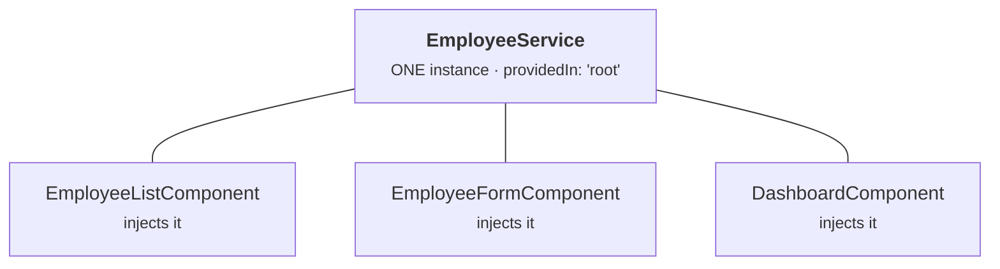
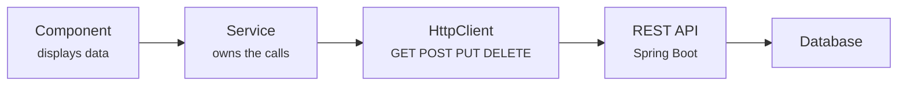
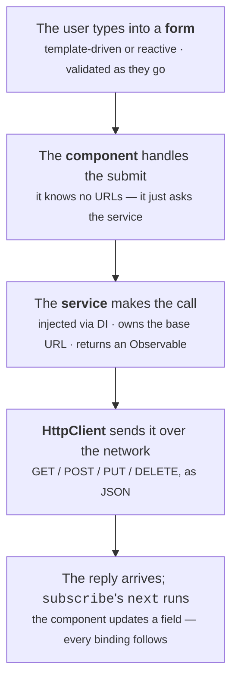

# Angular Session 3 — Study Guide

## Forms, Services & HTTP

**Learn it first, then teach it.**

This guide pairs with `angular-session3-theory.html` (40 slides) and `angular-session3-lab.html`.

| | |
|---|---|
| **Who this is for** | Anyone who has finished Session 2 and can build components with bindings |
| **What you'll be able to do after** | Build validated forms, organise code into services, and fetch real data over HTTP |
| **Time to read and absorb** | About 2 hours, plus 2 hours building |
| **Time to deliver as a session** | 3 hours including the lab |

---

## How to use this document

**First pass — learn it.** Read in order, building in your `hello-world` project as you go. You'll need internet access for §10 onwards, and you should keep your browser's **Network tab** open (<kbd>F12</kbd> → Network → Fetch/XHR) from that point on.

**Second pass — prepare to teach it.** Read the 🎓 **Teaching notes** and the [Delivery plan](#delivery-plan).

> **On the diagrams.** Mermaid, rendered automatically by GitHub. If you see raw code, the surrounding text explains the same thing.

**This session's golden rule, and it explains most confusion in it:**

> **No `subscribe`, no request.** Observables are lazy. If you call an HTTP method and never subscribe, absolutely nothing happens — no network traffic, no error, no warning.

---

## Contents

1. [Why `ngModel` isn't enough](#1-why-ngmodel-isnt-enough)
2. [Angular's two form systems](#2-angulars-two-form-systems)
3. [Template-driven forms](#3-template-driven-forms)
4. [Reactive forms](#4-reactive-forms)
5. [Which form system to choose](#5-which-form-system-to-choose)
6. [What a service is, and why](#6-what-a-service-is-and-why)
7. [Dependency injection](#7-dependency-injection)
8. [The refactor that changes nothing](#8-the-refactor-that-changes-nothing)
9. [HttpClient](#9-httpclient)
10. [Observables](#10-observables)
11. [The four HTTP verbs](#11-the-four-http-verbs)
12. [Loading and error states](#12-loading-and-error-states)
13. [The async pipe](#13-the-async-pipe)
14. [CORS](#14-cors)
15. [Cheat sheet](#cheat-sheet)
16. [Errors you'll hit](#errors-youll-hit)
17. [Check yourself](#check-yourself)
18. [Delivery plan](#delivery-plan)

---

## 1. Why `ngModel` isn't enough

In Session 2 you built a login form with `[(ngModel)]`, and it worked. So why is there a whole topic called "forms"?

Because a real form has to answer questions your login form cannot:

| Question | Why it's hard |
|---|---|
| **Is this field valid?** | Is the email actually an email? Is the salary a number? Is the name long enough? |
| **When do I show the error?** | Not immediately — nobody wants "name is required" before they've had a chance to type. Only after they've touched it and left it empty. |
| **Can I submit yet?** | Submit should be disabled until *every* field is valid — not just non-empty. |
| **Has anything changed?** | "You have unsaved changes" needs to know whether the user actually edited anything. |

You could answer all of those with your own fields and `if` statements. It would be a hundred lines of fiddly code per form, and you'd get the edge cases wrong. Angular tracks all of it for you — that's what a **form system** is.

**Analogy.** `ngModel` on its own is a **plain notepad** — it holds whatever you write. A form system is a **proper application form** that knows which boxes are compulsory, checks your entries, marks problems in red, and refuses to be submitted until it's right.

> 🎓 **Teaching notes**
>
> **Start from their own Session 2 login form**, on screen. It looks finished. Then interrogate it: *"what happens if I type 'x' as the username? What if I leave the email blank? How does the user know what's wrong?"*
>
> Let them notice it does nothing useful. Now the session has a reason to exist, and you haven't had to assert that forms are important.
>
> The four-question table is the actual content here. The one worth dwelling on is **"when do I show the error?"**, because it's the one nobody anticipates and it's what separates a form that feels considerate from one that feels like it's shouting. Everyone has used an aggressive form; ask them how it felt.

---

## 2. Angular's two form systems

This surprises people and feels like a design flaw. It isn't — they solve the same problem from opposite ends, and each is genuinely better for different work.

| | Template-driven | Reactive |
|---|---|---|
| Who's in charge | The **HTML** | The **TypeScript** |
| How rules are declared | HTML attributes: `required`, `minlength` | `Validators` in code |
| Where the form model lives | Angular builds it from your template, behind the scenes | You build it as an object in your class |
| Amount of TypeScript | Very little | More |
| Module needed | `FormsModule` | `ReactiveFormsModule` |

**The one-line difference:**

- **Template-driven:** *"write the HTML, and Angular will work out the form."*
- **Reactive:** *"define the form in code, then point the HTML at it."*

**Which will you use at work?** Reactive, most likely — it's what the Angular team recommends for anything non-trivial, and what you'll find in serious codebases. But template-driven is quicker to read and write, so we teach it first: you'll build the **same form both ways** and see the trade-off yourself rather than taking anyone's word for it.

> 🎓 **Teaching notes**
>
> Head off the obvious objection immediately: *"yes, there are two. No, one isn't deprecated. They're genuinely different tools."* Otherwise someone spends the session wondering which one is the "real" one.
>
> **The pedagogical decision here is worth being explicit about with your learners:** they will build the identical form twice. Tell them that up front and tell them why — *"you'll have an opinion about which you prefer by 3pm, and that opinion will be based on having written both, not on me telling you."* Adults respond well to being trusted with a comparison.
>
> Do say honestly that reactive is what they'll most likely use professionally. Don't pretend the two are equally common in modern codebases, because that's not true and they'll discover it.

---

## 3. Template-driven forms

### Setup: `FormsModule` and `ngForm`

You already added `FormsModule` in Session 2 for `ngModel`. It also brings the rest of the template-driven machinery — the key piece being an invisible directive that attaches itself to every `<form>` tag.

```html
<form #empForm="ngForm" (ngSubmit)="onSubmit()">
```

| Part | What it does |
|---|---|
| `#empForm` | Creates a **template reference variable** — a name you can use elsewhere in this template. Call it whatever you like. |
| `="ngForm"` | Says "set that variable to the **form object Angular built**", not to the HTML element. This is what gives you `empForm.valid`. |
| `(ngSubmit)` | Angular's submit event. Use this rather than `(submit)` — it stops the browser's default behaviour of reloading the page, which would wipe your app. |

Once you have that reference, the whole form's state is available in the template:

```html
<button type="submit" [disabled]="empForm.invalid">Save</button>

<p>Form valid? {{ empForm.valid }}</p>
<pre>{{ empForm.value | json }}</pre>   <!-- everything the user has typed -->
```

> **That last line is worth using immediately.** `{{ empForm.value | json }}` shows the entire form as an object, live, updating as you type. When a form "isn't working", put that on the page and you'll usually see the problem in five seconds. Same `| json` trick from Session 2.

### The fields: `name` + `ngModel`

For Angular to include a field in the form, it needs **two things**. Miss either and the field is invisible to the form.

```html
<input type="text"
       name="empName"                  <!-- 1. a name attribute -->
       [(ngModel)]="employee.name">    <!-- 2. ngModel -->
```

**Why `name`?** It becomes the **key** in the form's value object. Without it Angular throws *"If ngModel is used within a form tag, either the name attribute must be set…"*

**Why `ngModel`?** It registers the field with the parent form *and* binds it to your data. Both jobs, one directive.

Given three fields named `empName`, `empEmail` and `empSalary`, `empForm.value` is exactly this:

```json
{
  "empName": "Anoop Kumar",
  "empEmail": "anoop@example.com",
  "empSalary": 25000
}
```

### The state flags Angular tracks for you

This is the part that makes a form system worth having. For **every single field**, and for the form as a whole, Angular maintains these flags continuously, for free.

| Flag | True when | You use it to… |
|---|---|---|
| `valid` | Every validation rule passes | Enable the Submit button |
| `invalid` | At least one rule fails | Disable Submit |
| `touched` | The user has focused the field and then left it | **Decide when to show an error** |
| `untouched` | The user has never visited the field | Stay quiet — don't nag yet |
| `dirty` | The value has been changed | "You have unsaved changes" |
| `pristine` | Nothing has been changed | Disable a "Reset" button |
| `errors` | — | An object naming *which* rules failed |

> **`touched` is the flag that makes forms feel polite.** Showing *"Name is required"* the instant an empty form loads is aggressive and confusing. The professional pattern is **"invalid *and* touched"** — complain only once the user has actually visited the field and left it in a bad state.

**Remember the pairs:** `valid`/`invalid` · `touched`/`untouched` · `dirty`/`pristine`. Three questions: *is it correct?*, *have they visited it?*, *have they changed it?*

### Validation

You declare the rules as **ordinary HTML attributes**. Angular notices them and starts enforcing them.

```html
<input type="text"
       name="empName"
       [(ngModel)]="employee.name"
       #nameField="ngModel"        <!-- a reference to THIS FIELD's state -->
       required
       minlength="3"
       maxlength="30">

<!-- Show errors only once the user has been here and left -->
<div *ngIf="nameField.invalid && nameField.touched" class="error">
  <small *ngIf="nameField.errors?.['required']">
    Name is required.
  </small>
  <small *ngIf="nameField.errors?.['minlength']">
    Name must be at least 3 characters.
  </small>
</div>
```

| Part | What it does |
|---|---|
| `#nameField="ngModel"` | Same trick as the form, one level down: gives you *this field's* flags. Note it's `="ngModel"`, not `="ngForm"`. |
| `required minlength="3"` | Plain HTML attributes. Angular reads them and builds the rules. |
| `invalid && touched` | The politeness condition. |
| `errors?.['required']` | Which rule failed, so you can write a specific message. The `?.` is needed because `errors` is `null` when the field is valid. |

**The validators you get out of the box:**

| Attribute | Checks |
|---|---|
| `required` | Not empty |
| `minlength="3"` / `maxlength="30"` | Text length |
| `min="0"` / `max="100"` | Numeric range |
| `email` | Looks like an email address |
| `pattern="[0-9]{10}"` | Matches a regular expression |

### A complete template-driven form

```typescript
export class RegisterComponent {
  // one object holding the whole form
  employee = { name: '', email: '', salary: 0, designation: '' };
  submitted = false;

  onSubmit(): void {
    this.submitted = true;
    console.log(this.employee);
  }

  onReset(): void {
    this.employee = { name: '', email: '', salary: 0, designation: '' };
    this.submitted = false;
  }
}
```

```html
<form #f="ngForm" (ngSubmit)="onSubmit()">

  <label>Name</label>
  <input name="name" [(ngModel)]="employee.name" #n="ngModel"
         required minlength="3">
  <small *ngIf="n.invalid && n.touched">Name must be 3+ characters.</small>

  <label>Email</label>
  <input name="email" type="email" [(ngModel)]="employee.email" #e="ngModel"
         required email>
  <small *ngIf="e.invalid && e.touched">Enter a valid email.</small>

  <label>Salary</label>
  <input name="salary" type="number" [(ngModel)]="employee.salary"
         required min="1000">

  <button type="submit" [disabled]="f.invalid">Save</button>
  <button type="button" (click)="onReset()" [disabled]="f.pristine">Reset</button>
</form>
```

**Notice the balance — it's the defining characteristic.** The class is almost empty; the template does everything. That's exactly the appeal of template-driven forms, and exactly their limitation: all your validation logic lives in HTML, where it can't be unit-tested, reused, or changed at runtime.

**One free feature worth knowing:** Angular automatically adds classes like `ng-valid`, `ng-invalid`, `ng-touched` and `ng-dirty` to every form control as its state changes. You write no code for it — just style them:

```css
input.ng-invalid.ng-touched { border-color: #dd0031; background: #fff8f9; }
input.ng-valid.ng-touched   { border-color: #28c840; }
```

> 🎓 **Teaching notes**
>
> **`touched` is the concept to teach by breaking.** Remove `&& nameField.touched` from the error condition, save, and reload. The form now shouts "Name is required" before anyone has typed a character. Ask: *"would you enjoy using this?"* No. Put it back.
>
> That thirty-second demo teaches a genuine professional standard that most tutorials skip entirely.
>
> **Then show the flags live.** Put the debug panel (`{{ f.value | json }}` plus the three flags) on screen and narrate as you interact: click into a field and out without typing → `touched` true, `dirty` false. Type one character → `dirty` true. *"Touched means visited. Dirty means changed."* Seeing the flags flip is far better than reading the table.
>
> **The `ng-invalid` CSS classes are a genuine delight** and almost always taught as a footnote. Inspect an input with dev tools and watch the classes change as you type. Then show that four lines of CSS gives you red and green borders across every form in the app, for free.
>
> **Do demo the missing-`name` error**, because the message is unusually clear and it reinforces that *both* attributes are needed.

---

## 4. Reactive forms

Now the same problem, inverted. In a **reactive form** you build the form as a **real object in your TypeScript**, and the template merely connects to it.



First, a different module. This is the second time this session's error pattern appears:

```typescript
import { ReactiveFormsModule } from '@angular/forms';

@NgModule({
  imports: [
    BrowserModule,
    FormsModule,            // template-driven
    ReactiveFormsModule     // reactive  ← add this
  ]
})
```

**You may keep both.** They coexist happily — you need both today because your Session 2 login form and search box still use `ngModel`. What you must **not** do is mix the two styles *on the same form*: never put `[(ngModel)]` and `formControlName` on the same input.

### `FormGroup` and `FormControl`

Two classes, and the relationship is simple: a **`FormControl` is one field**, a **`FormGroup` is a collection of them**.

```typescript
import { FormGroup, FormControl } from '@angular/forms';

export class RegisterComponent {
  empForm = new FormGroup({
    name:        new FormControl(''),          // '' is the starting value
    email:       new FormControl(''),
    salary:      new FormControl(0),
    designation: new FormControl('Software Engineer')
  });

  onSubmit(): void {
    console.log(this.empForm.value);
    // { name: '...', email: '...', salary: 0, designation: '...' }
  }
}
```

**Analogy.** A `FormControl` is **one box on a paper form** — it knows its own contents and whether they're acceptable. A `FormGroup` is **the whole sheet of paper** — valid only when every box on it is valid.

**What you gain immediately:** `empForm` is a genuine object in your class. You can `console.log` it, inspect it in a debugger, write a unit test against it without rendering any HTML, and read or change any field from code. None of that is possible with a template-driven form, where the form only exists once the HTML has rendered.

### Connecting the template

Two new attributes, and that's the entire template side.

```html
<form [formGroup]="empForm" (ngSubmit)="onSubmit()">

  <label>Name</label>
  <input formControlName="name">

  <label>Email</label>
  <input formControlName="email" type="email">

  <label>Salary</label>
  <input formControlName="salary" type="number">

  <button type="submit" [disabled]="empForm.invalid">Save</button>
</form>
```

| Part | Note |
|---|---|
| `[formGroup]="empForm"` | Property binding on the `<form>`: "this form **is** that object in my class". Square brackets, because `empForm` is an expression. |
| `formControlName="name"` | **No brackets** — it's a plain string naming a key inside the group. Must match the property name exactly. |

Compare what each style needs per field:

| Template-driven needed | Reactive needs |
|---|---|
| `name="empName"` | `formControlName="name"` |
| `[(ngModel)]="employee.name"` | …and that's it |
| `#n="ngModel"` | the rules live in the class |
| `required minlength="3"` | |

**The mistake that produces a very confusing error:** writing `[formControlName]="name"` *with* brackets makes Angular look for a class field called `name` to use as the control's name. It isn't there, and the error talks about a null value. **`formControlName` takes a plain string, so no brackets.**

### Validation with `Validators`

In a reactive form the rules are the **second argument** to each `FormControl` — an array of validator functions.

```typescript
import { FormGroup, FormControl, Validators } from '@angular/forms';

empForm = new FormGroup({
  name: new FormControl('', [
    Validators.required,
    Validators.minLength(3),
    Validators.maxLength(30)
  ]),
  email: new FormControl('', [
    Validators.required,
    Validators.email
  ]),
  salary: new FormControl(0, [
    Validators.required,
    Validators.min(1000),
    Validators.max(500000)
  ]),
  phone: new FormControl('', [
    Validators.pattern('[0-9]{10}')       // exactly ten digits
  ])
});
```

| Validator | Equivalent HTML attribute |
|---|---|
| `Validators.required` | `required` |
| `Validators.minLength(3)` | `minlength="3"` |
| `Validators.maxLength(30)` | `maxlength="30"` |
| `Validators.min(1000)` | `min="1000"` |
| `Validators.email` | `email` |
| `Validators.pattern('...')` | `pattern="..."` |

**Watch the capitalisation — it differs from the HTML.** It's `Validators.minLength` with a capital **L**, but the HTML attribute is `minlength` all lower case. Also note `Validators.required` has **no brackets** (you're passing the function itself), while `Validators.minLength(3)` **does** (you're calling it to build a function).

### Showing the errors

Same politeness rule — *invalid **and** touched* — but you reach the field through the form object:

```html
<div *ngIf="empForm.get('name')?.invalid && empForm.get('name')?.touched">
  <small *ngIf="empForm.get('name')?.errors?.['required']">Name is required.</small>
</div>
```

That's correct but repetitive. Tidy it with a **getter** on the class:

```typescript
// in the class
get name() { return this.empForm.get('name'); }
```

```html
<!-- in the template — much easier to read -->
<div *ngIf="name?.invalid && name?.touched">
  <small *ngIf="name?.errors?.['required']">Name is required.</small>
  <small *ngIf="name?.errors?.['minlength']">At least 3 characters, please.</small>
</div>
```

**Why all the `?.` marks?** `empForm.get('name')` returns `AbstractControl | null` — it has to allow for you passing a name that doesn't exist. Strict mode then insists you handle the null case, and `?.` is the concise way. Same operator as Session 1, doing the same job.

### `FormBuilder` — less typing, same result

Writing `new FormControl(...)` for every field gets noisy. `FormBuilder` is a service that builds the same structure with far less ceremony — and it's what you'll find in most real code, so you need to recognise it.

```typescript
import { FormBuilder, Validators } from '@angular/forms';

export class RegisterComponent {
  empForm;

  constructor(private fb: FormBuilder) {
    this.empForm = this.fb.group({
      name:   ['', [Validators.required, Validators.minLength(3)]],
      email:  ['', [Validators.required, Validators.email]],
      salary: [0,  [Validators.min(1000)]]
    });
  }
}
```

**How to read the shorthand:** each field becomes an **array of two things** — `fieldName: [ startingValue, [validators] ]`. That's all there is to it.

> **Look at that constructor — you've seen it before.** `constructor(private fb: FormBuilder) { }` is the exact shorthand from Session 1, and it's **dependency injection**, which is §7. You asked for a `FormBuilder` and Angular handed you one. Note also that with `FormBuilder` the form must be built *in* the constructor, because `this.fb` doesn't exist until then.

### Reading and setting values from code

Here's where reactive forms earn their keep. Because the form is an object, you can drive it programmatically.

```typescript
// ── READ ────────────────────────────────────────────────
console.log(this.empForm.value);                // the whole form
console.log(this.empForm.get('name')?.value);   // one field
console.log(this.empForm.valid);                // true / false

// ── WRITE all fields (every field must be supplied) ─────
this.empForm.setValue({ name: 'Anoop Kumar', email: 'anoop@example.com',
                        salary: 25000, designation: 'Software Engineer' });

// ── WRITE some fields (this is the one you'll use) ──────
this.empForm.patchValue({ name: 'Ajay Sharma' });

// ── CLEAR the form and reset every flag ─────────────────
this.empForm.reset();

// ── Reveal every error at once, on a failed submit ──────
this.empForm.markAllAsTouched();

// ── REACT to every change as it happens ─────────────────
this.empForm.get('name')?.valueChanges.subscribe(value => {
  console.log('name is now:', value);
});
```

> **Remember `patchValue` — Session 4 depends on it.** In Session 4 you build an "edit customer" screen: the user clicks a row and the form fills in with that row's data. That's one line — `this.form.patchValue(selectedCustomer)`. Doing the same in a template-driven form means manually assigning every property.

And note that last one. `valueChanges.subscribe(...)` gives you a live stream of every keystroke. That word **subscribe** is about to become very important — it's how Observables work, and it's the same mechanism `HttpClient` uses.

> 🎓 **Teaching notes**
>
> **The demo that sells reactive forms is `patchValue`.** Add a "Fill sample" button that populates all four fields in one call. Click it. Then ask: *"how would you do that in the template-driven version?"* Answer: assign every property by hand, and add another line every time someone adds a field.
>
> Then connect it forward: *"in Session 4 you'll click a table row and the form fills in with that customer. That's this one line. This is why we're learning reactive forms."* A concrete future payoff is much more motivating than "it's more powerful".
>
> **Two errors worth causing deliberately:**
> 1. Add brackets — `[formControlName]="name"` — and read the confusing error. Reinforces "plain string, no brackets".
> 2. Rename a key in the `FormGroup` but not the template, and get `Cannot find control with name: 'name'`. Reinforces that the string must match exactly.
>
> **On `FormBuilder`:** show the long form first, then the shorthand, and let them see the same form in 40% less code. Don't lead with `FormBuilder` — the long form is what makes the structure visible, and the shorthand only reads as an improvement once you've seen what it's shortening.
>
> **Point at the constructor deliberately.** *"You've now used dependency injection and I haven't taught it yet. That's the next topic."* It makes §7 feel like an explanation of something they've already done rather than a new abstraction.
>
> **`valueChanges.subscribe` is a deliberate forward reference to Observables.** Add it, type in the box, and let them watch the console fill up. Then say: *"that word `subscribe` — hold onto it. It's the next big idea."*

---

## 5. Which form system to choose

| Aspect | Template-driven | Reactive |
|---|---|---|
| Module needed | `FormsModule` | `ReactiveFormsModule` |
| Where the form is defined | In the HTML | In the TypeScript class |
| Where validation lives | HTML attributes | `Validators` in code |
| Binding used | `[(ngModel)]` | `formControlName` |
| Amount of code | Very little | More upfront |
| Unit testable? | Hard — needs the template rendered | Easy — it's a plain object |
| Change rules at runtime? | No | Yes — add or remove validators any time |
| Set values from code? | Awkward | `patchValue` / `setValue` |
| Dynamic fields | Very difficult | `FormArray` handles it |
| Best for | Login, search, a contact form | Anything with real rules, or an edit screen |

**The practical rule:**

- **Two or three simple fields → template-driven.** Genuinely faster and easier to read.
- **Anything else → reactive.** Real validation, edit screens, conditional rules, fields the user can add or remove, or anything you want to test.

> 🎓 **Teaching notes**
>
> By this point they've built both, so **ask them before showing the table**: *"you've written the same form twice. Which did you prefer, and why?"* You'll get real answers, and the table then confirms or refines their instinct instead of replacing it.
>
> The rows that matter most in practice are **unit testable** and **set values from code**. Those two are why reactive dominates professional codebases.
>
> **Good discussion question:** *"An insurance quote form shows different questions depending on the policy type, and the number of 'dependants' rows grows as the user clicks Add. Which system?"* Reactive — the field set changes at runtime, which template-driven can't express, and `FormArray` exists precisely for repeating rows.

---

## 6. What a service is, and why

A **service** is an ordinary TypeScript class that holds reusable logic and data access. It has no template and no UI — its job is to let components focus on one thing: **presentation**.

Right now your `employees` array lives inside `EmployeeListComponent`. Here's what that costs you:

| ❌ Without a service | ✅ With a service |
|---|---|
| The array lives inside `EmployeeListComponent` | The data lives in `EmployeeService` |
| Need the same data in a dropdown? **Copy the array.** | Any component injects it and gets **the same** data |
| Search logic sits next to display logic | Component = display. Service = data. |
| Switching to a real API means rewriting the component | Swap the array for an HTTP call — **components don't change** |
| Testing the data logic requires rendering a template | Test the service as a plain class |
| Two components with two copies drift apart | One source of truth, always |

**Analogy.** A component is a **shop window** — its job is to display things attractively. A service is the **warehouse** — it owns the stock. You wouldn't store your entire inventory in the window, and you wouldn't want ten windows each keeping their own separate stock.

**You've already done this on the backend.** Your Spring Boot `@RestController` doesn't contain SQL — it delegates to a `@Service`, which delegates to a `@Repository`. An Angular service is that same separation, on the front end. Same reasoning, same benefits, same shape.

### Three steps to use a service — that's all there is



Step 2 is done automatically. Step 1 is one command. So in practice using a service is **one command and one constructor line**.

**The Spring Boot comparison, line for line:** `@Injectable` is Angular's `@Service`. `providedIn: 'root'` is "make it a singleton bean in the application context". `constructor(private employeeService: EmployeeService)` is constructor injection — *exactly* what you write in a Spring `@RestController`.

> **The one rule that surprises people:** you **never** write `new EmployeeService()`. Angular creates it and hands it to you. If you find yourself typing `new` in front of a service, stop — you're about to create a second, separate copy, and your two components will silently stop sharing data.

### Creating and filling it in

```bash
ng generate service employee

# short form
ng g s employee

# better — put it in a folder
ng g s services/employee
```

Note what's **not** in the output: no `UPDATE app.module.ts`. Unlike a component, a service doesn't need registering in the module — the decorator handles it.

```typescript
import { Injectable } from '@angular/core';
import { Employee } from '../models/employee';

@Injectable({
  providedIn: 'root'      // ← ONE instance, shared by the whole app
})
export class EmployeeService {

  // PRIVATE — the outside world can only reach this through my methods
  private employees: Employee[] = [
    { id: 1001, name: 'anoop kumar', designation: 'Software Engineer',
      salary: 25000, status: 'Active' },
    { id: 1002, name: 'ajay sharma', designation: 'Team Lead',
      salary: 45000, status: 'Inactive' }
  ];

  getEmployees(): Employee[] {
    return this.employees;
  }

  getById(id: number): Employee | undefined {
    return this.employees.find(e => e.id === id);
  }

  searchByName(term: string): Employee[] {
    const t = term.trim().toLowerCase();
    if (t === '') { return this.employees; }
    return this.employees.filter(e => e.name.toLowerCase().includes(t));
  }

  addEmployee(emp: Employee): void {
    this.employees.push(emp);
  }

  deleteEmployee(id: number): void {
    const i = this.employees.findIndex(e => e.id === id);
    if (i !== -1) { this.employees.splice(i, 1); }
  }
}
```

**Two decisions in there worth copying:**

1. **The array is `private`.** Nothing outside can reassign or corrupt it — every access goes through a method you control. Same discipline as a private field with getters in Java.
2. **Those are the six array methods from Session 1** — `find`, `filter`, `push`, `findIndex`, `splice`. This service is a complete in-memory CRUD layer, and Session 4 will swap its innards for HTTP calls without touching a single component.

### Injecting it into a component

```typescript
import { Component, OnInit } from '@angular/core';
import { EmployeeService } from '../services/employee.service';

export class EmployeeListComponent implements OnInit {

  employees: Employee[] = [];

  // ← the constructor shorthand from Session 1
  constructor(private employeeService: EmployeeService) { }

  ngOnInit(): void {
    this.employees = this.employeeService.getEmployees();
  }

  onSearch(term: string): void {
    this.employees = this.employeeService.searchByName(term);
  }
}
```

**"Why not fetch the data in the constructor?"** For a synchronous array it would technically work — and it's still the wrong habit. The constructor runs before Angular has finished setting the component up, and mixing *wiring* with *work* makes components harder to test. The rule from Session 2 stands: **constructor for dependencies, `ngOnInit` for work.**

> 🎓 **Teaching notes**
>
> **Teach this as a problem before a solution.** Ask: *"the dashboard also needs this employee list. What do you do?"* Someone will say "copy the array". Take it seriously, then ask what happens when a record is added on one screen. Now the need for a shared owner is theirs, not yours.
>
> **The Spring Boot mapping is the highest-value thing you can say here.** For a room of Java developers, `@Injectable` ≈ `@Service`, `providedIn: 'root'` ≈ a singleton bean, and constructor injection being literally identical means this whole topic collapses from "new concept" to "same concept, new syntax". Put the two code blocks side by side if you can.
>
> **Say the `new` rule loudly and early.** *"You will never write `new EmployeeService()`. If you do, you get a second copy and your data silently stops being shared."* Freshers reach for `new` instinctively.
>
> **Point out the absent `UPDATE app.module.ts` line.** It's a small thing that pre-empts the reasonable question "don't I have to register this?"

---

## 7. Dependency injection

You asked for an `EmployeeService` in a constructor parameter and one appeared. No `new` anywhere. That's **dependency injection**, and here's the mechanism — worth understanding rather than treating as magic.



The **injector** is a registry that knows how to build every registered service and hands out instances on request.

**Why this is worth having, in two points:**

1. **Your component is decoupled.** It declares *what* it needs, never *how* to build it. If `EmployeeService` later needs an `HttpClient` and a logger, the component doesn't change one character.
2. **It's testable.** In a test, hand the component a fake service that returns two known employees. Because the component never called `new`, it can't tell the difference.

### Singletons and `providedIn`

With `providedIn: 'root'` there is exactly **one instance** of your service for the entire application. Ten components injecting `EmployeeService` all receive the *same object*.



**Why the singleton behaviour is the point, not a side effect.** In Session 4, a form component will add a customer and the list component will immediately show it — with no code connecting them. That works **only** because both are talking to the same service instance. Genuinely shared state, for free.

**Two ways to register a service:**

| How | Effect |
|---|---|
| `@Injectable({ providedIn: 'root' })` | **The modern default**, and what the CLI generates. One shared instance; unused services are dropped from the build. |
| `providers: [EmployeeService]` in `app.module.ts` | The older style. Still valid, and what you'll see in legacy projects. |
| `providers: [EmployeeService]` in a `@Component` | Gives *that component* its own private instance. Occasionally what you want; usually a bug. |

**How many services should an app have?** As many as it has feature areas — there's no "one service per app" rule. A banking app would naturally have a `CustomerService`, a `TransactionService` and an `AuthService`. **One service, one responsibility** — the same instinct that stops your Spring services becoming a dumping ground.

> 🎓 **Teaching notes**
>
> **The singleton demo is the one that makes this real, and it's in the lab.** Create a second, tiny component that injects the *same* service and shows a count. Delete an employee from the list, and the count in the other component updates — with no `@Input`, no `@Output`, no shared parent code.
>
> Do it live and then ask *why*. The answer — one object, two references — is what "singleton" actually means, and it's far more convincing than the word.
>
> This also **answers the question left hanging in Session 2**: "what if two components need to talk but aren't parent and child?" Call back to it explicitly. People appreciate a loop being closed.
>
> Keep the injector walkthrough brief. The mechanism is interesting but the *consequences* — decoupling and testability — are what they need. Don't turn it into a lecture on DI theory.

---

## 8. The refactor that changes nothing

You've just moved your data out of the component and into a service. Now look at the template from Session 2:

```html
<!-- Session 2's template -->
<tr *ngFor="let emp of employees">
  <td>{{ emp.name | titlecase }}</td>
  <td>{{ emp.salary | currency }}</td>
</tr>
```

```html
<!-- Session 3's template -->
<tr *ngFor="let emp of employees">
  <td>{{ emp.name | titlecase }}</td>
  <td>{{ emp.salary | currency }}</td>
</tr>
```

They are **identical**. Not similar — identical.

> **This is what good architecture feels like.** The data now arrives from a completely different place, and the view neither knows nor cares. The template's contract is *"there is an array called `employees`"* — and how it got there is somebody else's business.

Hold onto this, because in a few sections the data will start arriving from a **server, over the network, asynchronously** — and this template **still** won't change. That's the whole reason we bothered with the refactor.

> 🎓 **Teaching notes**
>
> **This deserves a genuine pause, and most trainers rush past it.** Put the two templates side by side and say nothing for a few seconds. Then: *"what's different?"* Nothing.
>
> This is the single most transferable idea in the entire four-session series, and it's about to be demonstrated twice more. Start a **visible count** — write "template unchanged: 2" on the board and add to it in §11 and again in Session 4. By the fourth time the point is unarguable.
>
> Then connect it to something they already believe: *"this is the same reason you don't put SQL in a controller. Each layer knows only about the one beneath it."* They've already accepted that principle on the backend; you're just showing them it applies here too.

---

## 9. HttpClient

Everything so far has been in memory. `HttpClient` is Angular's built-in way to send HTTP requests and receive JSON — the piece that finally connects your Angular app to the Spring Boot API you already know how to build.



> **The rule about where HTTP calls belong:** `HttpClient` goes in your **service**, never in a component. The component asks the service for data; the service knows about URLs and HTTP. Put an HTTP call in a component and you've merged two layers you just spent an hour separating.

### Setup — third time you'll see this pattern

```typescript
// Step 1 — src/app/app.module.ts
import { HttpClientModule } from '@angular/common/http';   // ← note the package

@NgModule({
  imports: [
    BrowserModule,
    FormsModule,
    ReactiveFormsModule,
    HttpClientModule            // ← add this
  ]
})
export class AppModule { }
```

```typescript
// Step 2 — inject it into your service
import { HttpClient } from '@angular/common/http';

@Injectable({ providedIn: 'root' })
export class EmployeeService {
  private baseUrl = 'https://jsonplaceholder.typicode.com/users';

  constructor(private http: HttpClient) { }   // ← the shorthand again
}
```

**The error if you forget step 1** — and you know its shape by now:

```
NullInjectorError: No provider for HttpClient!
```

Same family as *"Can't bind to 'ngModel'"*: **a module is missing from `imports`**. Third time this series. Also note the package is `@angular/common/http`, **not** `@angular/core` — a genuinely easy import to get wrong.

### GET — reading from the server

```typescript
// in the service
getEmployees(): Observable<Employee[]> {
  return this.http.get<Employee[]>(this.baseUrl);
}
```

| Part | What it does |
|---|---|
| `this.http.get(...)` | Sends an HTTP GET to the URL. |
| `<Employee[]>` | A **generic type argument**: "the JSON coming back is an array of Employee". This is what gives you autocomplete on server data. |
| `Observable<Employee[]>` | The return type. **Not the data itself** — a *promise of future data*. |

```typescript
// in the component
employees: Employee[] = [];

constructor(private employeeService: EmployeeService) { }

ngOnInit(): void {
  this.employeeService.getEmployees().subscribe(data => {
    this.employees = data;              // runs LATER, when the reply arrives
  });
}
```

**The mistake absolutely everyone makes once:**

```typescript
// ✖ THIS DOES NOT WORK
this.employees = this.employeeService.getEmployees();
// Type 'Observable<Employee[]>' is not assignable to type 'Employee[]'
```

A `get()` does not return data — it returns an **Observable**, which is a description of data that will arrive later. You must `.subscribe()` to receive it.

> 🎓 **Teaching notes**
>
> **Before you write any code, get the Network tab open on the projector** and tell everyone to open theirs. From here to the end of the session, that panel is the source of truth. Half the bugs in the next hour are visible there in two seconds.
>
> **The `NullInjectorError` is worth causing on purpose** — it's the third instance of the pattern, so by now you can ask the room *"what does this kind of error mean?"* and get "a module is missing" shouted back. That's a genuine win: they're now debugging by pattern rather than by symptom.
>
> **Make a deliberate point of the wrong assignment.** Write `this.employees = this.service.getEmployees();` and let the red squiggle appear. Read the error aloud: *"Observable of Employee array is not assignable to Employee array."* Then ask *"so what is it giving us, if not the data?"* That question leads perfectly into the next section.
>
> **State the location rule firmly:** HTTP belongs in services. Freshers will otherwise put `http.get` straight in a component because it's fewer files, and it undoes everything from §6 and §8.

---

## 10. Observables

An HTTP request takes time — 50 milliseconds on a good day, several seconds on a bad one. Your app can't freeze while it waits, so the reply must be handled **asynchronously**: "carry on, and run this code when the answer turns up."

An **Observable** is Angular's way of representing "a value that will arrive later, possibly more than once".

> **The analogy worth remembering.** You order a coffee. The barista gives you a **numbered ticket**, not a coffee.
>
> The ticket is the **Observable**. It is not the drink — it's a promise that a drink is coming.
>
> **`subscribe()`** is you saying *"call my number when it's ready, and here's what I'll do when you do."*
>
> And crucially: **no subscribe, no coffee.** An Observable nobody subscribes to never even sends the request.

| | Promise | Observable |
|---|---|---|
| Values | Exactly one | One, many, or a continuous stream |
| Starts | Immediately, whether you want it or not | Only when subscribed ("lazy") |
| Cancellable? | No | Yes — `unsubscribe()` |
| Operators | Few | Many — `map`, `filter`, `debounceTime`… |
| Used for | One-off async work | HTTP, form changes, route changes, events |

**Where else you've already met them today:** `this.empForm.get('name')?.valueChanges.subscribe(...)` from §4 is an Observable too — a stream of every keystroke. **Observables are everywhere in Angular**: HTTP, form changes, route parameters. Learning `subscribe` once buys you all of them.

### `subscribe` — and always handle the error

`subscribe` takes an object with up to three handlers. Most tutorials show only the first, and that's why so many apps break silently when the network fails.

```typescript
this.employeeService.getEmployees().subscribe({

  next: (data) => {
    // ✅ the reply arrived
    this.employees = data;
  },

  error: (err) => {
    // ❌ something went wrong — DON'T SKIP THIS
    console.error('Request failed:', err);
    this.errorMessage = 'Could not load employees. Please try again.';
  },

  complete: () => {
    // 🏁 the Observable has finished. For HTTP, right after next.
  }
});
```

| Handler | Runs when | Optional? |
|---|---|---|
| `next` | A value arrives. For HTTP, exactly once. | You'll always want it |
| `error` | The request fails — network down, 404, 500, CORS blocked. | Technically yes. **Never omit it.** |
| `complete` | The stream has ended. | Usually omitted for HTTP |

> **What "no error handler" looks like to a user:** the screen stays permanently blank. No message, no spinner, nothing — the failure was reported only to the browser console, which the user will never open. **Handling errors isn't a polish task; it's the difference between an app and a demo.**

You'll also see the older style, `.subscribe(data => {...}, err => {...})` — two positional arguments instead of an object. It still works and is deprecated. Prefer the object form, but recognise the old one.

> 🎓 **Teaching notes**
>
> **The coffee-ticket analogy is the most important teaching tool in this session.** Use it, and use it repeatedly. It answers three questions at once: why the return type isn't the data, why `subscribe` exists, and why nothing happens without it.
>
> Say it slowly and let them repeat the key line back: **no subscribe, no coffee.**
>
> **Then prove the laziness, because it's counter-intuitive.** In the lab, remove the `.subscribe()` entirely so the line reads just `this.service.getEmployees();`. Save, click the button, and point at the Network tab: **nothing**. No request, no error, no warning.
>
> That demo prevents the single most common HTTP bug there is. Do it live, and do it slowly.
>
> **Be firm about the error handler.** Ask: *"if your app can't reach the server, what does your user see right now?"* A blank screen. Then: *"and where did the error go?"* A console they'll never open. Frame error handling as a professional minimum, not a nice-to-have.
>
> **Deliberately don't teach RxJS operators beyond `map`.** It's a deep, rewarding library and it will drown them today. Name it, say it's worth learning later, move on.

---

## 11. The four HTTP verbs

```typescript
// GET all
getEmployees(): Observable<Employee[]> {
  return this.http.get<Employee[]>(this.baseUrl);
}

// GET one — the id goes in the URL
getById(id: number): Observable<Employee> {
  return this.http.get<Employee>(this.baseUrl + '/' + id);
}

// POST — a second argument: the object to send
addEmployee(emp: Employee): Observable<Employee> {
  return this.http.post<Employee>(this.baseUrl, emp);
}

// PUT — replace an existing record
updateEmployee(emp: Employee): Observable<Employee> {
  return this.http.put<Employee>(this.baseUrl + '/' + emp.id, emp);
}

// DELETE — no body, just the URL
deleteEmployee(id: number): Observable<void> {
  return this.http.delete<void>(this.baseUrl + '/' + id);
}
```

Angular converts your object to JSON and sets the `Content-Type` header for you.

### Mapped to Spring Boot

| Action | Angular | Spring Boot |
|---|---|---|
| Read all | `http.get<Employee[]>(url)` | `@GetMapping("/employees")` |
| Read one | `http.get<Employee>(url + '/' + id)` | `@GetMapping("/employees/{id}")` |
| Create | `http.post<Employee>(url, emp)` | `@PostMapping("/employees")` |
| Update | `http.put<Employee>(url + '/' + id, emp)` | `@PutMapping("/employees/{id}")` |
| Delete | `http.delete<void>(url + '/' + id)` | `@DeleteMapping("/employees/{id}")` |

**The whole pattern in one sentence:** every method returns an `Observable`, so every call needs a `.subscribe()`. The only differences between the four are the HTTP verb, whether there's a body, and whether the id is in the URL.

### Two patterns worth copying

**On POST — use the server's object, not your own:**

```typescript
onSave(): void {
  const newEmp: Employee = {
    id: 0,                                   // the server assigns the real id
    name: this.empForm.value.name,
    /* ... */
  };

  this.employeeService.addEmployee(newEmp).subscribe({
    next: (saved) => {
      this.employees.push(saved);      // ← use what the SERVER returned
      this.empForm.reset();
    },
    error: (err) => { this.message = 'Save failed.'; }
  });
}
```

The reply usually differs from what you sent: the real database id, a server-generated timestamp, defaults you left out. Pushing your local copy leaves you with an employee whose id is `0`, and the delete button will then fail mysteriously.

**On DELETE — update the screen *inside* `next`:**

```typescript
onDelete(id: number): void {
  if (!confirm('Delete this employee?')) { return; }

  this.employeeService.deleteEmployee(id).subscribe({
    next: () => {
      // The SERVER has deleted it. Now update the local copy.
      this.employees = this.employees.filter(e => e.id !== id);
    },
    error: (err) => {
      this.message = 'Delete failed — the employee is still there.';
    }
  });
}
```

Removing the row *before* the server confirms means that when the delete fails, your screen is lying to the user — the row is gone locally but still in the database.

### Real APIs don't match your model

The public API used in the lab returns this shape:

```json
{
  "id": 1,
  "name": "Leanne Graham",
  "email": "Sincere@april.biz",
  "company": { "name": "Romaguera-Crona" }
}
```

There's no `designation`, no `salary`, no `status`. So describe the truth in its own interface, and convert:

```typescript
export interface ApiUser {
  id: number;
  name: string;
  email: string;
  company: { name: string };
}
```

```typescript
getEmployeesFromApi(): Observable<Employee[]> {
  return this.http.get<ApiUser[]>(this.apiUrl).pipe(
    map(users => users.map(u => this.toEmployee(u)))
  );
}

/** All the awkward conversion in one private place. */
private toEmployee(u: ApiUser): Employee {
  return {
    id: u.id,
    name: u.name.toLowerCase(),
    designation: u.company.name,          // the API has no job title
    salary: 20000 + (u.id * 2500),        // invented — no salary in the API
    status: u.id % 2 === 1 ? 'Active' : 'Inactive',
    email: u.email
  };
}
```

**Why bother with a separate interface?** Because your app's model shouldn't be dictated by whatever shape a third party happens to send. If the API changes, you fix **one mapping function** — not every component. This is exactly why your Spring Boot code has DTOs sitting between the outside world and your entities.

Note `.pipe(map(...))`: the outer `map` is an RxJS operator on the stream; the inner `users.map` is the ordinary array method from Session 1. Same word, two different things.

> 🎓 **Teaching notes**
>
> **The right-hand column of the Spring Boot table is the emotional payoff of the session.** They already know how to write every one of those annotations. Say it plainly: *"you now know both ends of the wire."* That's a genuinely motivating moment — use it.
>
> **The ApiUser/Employee mismatch is worth teaching properly rather than hiding.** It would be easier to invent an API that matches perfectly, but that would be a lie about professional work. Open the real API URL in a browser tab, show them the JSON, and ask *"where's the salary?"* There isn't one. That's what real integration feels like.
>
> Then connect it to something they know: *"this is why you have DTOs. Same reason, same place in the architecture."*
>
> **The `id: 0` / use-the-server's-reply point catches people out later**, so make it concrete: *"if you push your own object, its id is 0. Then someone clicks delete on it and you send `DELETE /employees/0`. Good luck debugging that in three weeks."*
>
> **Note the `map` collision explicitly.** RxJS `map` and array `map` are different things with the same name, and seeing `map(users => users.map(...))` confuses people badly if nobody flags it.

---

## 12. Loading and error states

A real request isn't instant, and sometimes it fails. Your screen needs **three** states, not one.

```typescript
employees: Employee[] = [];
isLoading = false;
errorMessage = '';

ngOnInit(): void {
  this.loadEmployees();
}

loadEmployees(): void {
  this.isLoading = true;         // 1. before the call
  this.errorMessage = '';

  this.employeeService.getEmployees().subscribe({
    next: (data) => {
      this.employees = data;
      this.isLoading = false;    // 2. on success
    },
    error: (err) => {
      this.errorMessage = 'Could not load employees. Is the server running?';
      this.isLoading = false;    // 3. on failure — easy to forget!
      console.error(err);
    }
  });
}
```

```html
<p *ngIf="isLoading">⏳ Loading employees…</p>

<div *ngIf="errorMessage" class="error">
  ⚠️ {{ errorMessage }}
  <button (click)="loadEmployees()">Retry</button>
</div>

<table *ngIf="!isLoading && !errorMessage">
  <tr *ngFor="let emp of employees">
    <td>{{ emp.name }}</td>
  </tr>
</table>

<p *ngIf="!isLoading && !errorMessage && employees.length === 0">
  No employees found.
</p>
```

> **The bug in every beginner's first version:** forgetting `isLoading = false` in the **error** handler. The request fails, and the user is left staring at "Loading…" forever. Set it in *both* branches, every time.

**Notice the Retry button.** Because the whole call lives in a method, offering a retry costs one line: `(click)="loadEmployees()"`. That's why you extract it into `loadEmployees()` rather than writing it inline in `ngOnInit`.

> 🎓 **Teaching notes**
>
> **Use network throttling to make this real.** In the Network tab, set throttling to "Slow 3G" and reload. Suddenly the loading message is visible for several seconds — which is exactly what a user on a train experiences, and exactly why the message exists. Without throttling, on a fast connection, the loading state flashes past and students conclude it's pointless.
>
> **Then cause the stranded spinner deliberately.** Delete `isLoading = false` from the error handler, break the URL, and watch it spin forever with no message. Ask *"what would a user do here?"* Wait. Then reload. Then give up.
>
> That's the most common HTTP bug freshers ship, and thirty seconds of watching it prevents it.
>
> Frame the four states — loading, loaded, empty, failed — as a **checklist for every data screen they ever build**. It's a genuinely professional habit and it's easy to adopt this early.

---

## 13. The async pipe

There's a way to skip `subscribe` entirely. Hand the **Observable itself** to the template and let the `async` pipe do the subscribing.

```typescript
// With subscribe
employees: Employee[] = [];

ngOnInit(): void {
  this.service.getEmployees().subscribe(d => this.employees = d);
}
```
```html
<tr *ngFor="let e of employees">
  <td>{{ e.name }}</td>
</tr>
```

```typescript
// With the async pipe
employees$!: Observable<Employee[]>;

ngOnInit(): void {
  this.employees$ = this.service.getEmployees();   // note: NO subscribe
}
```
```html
<ng-container *ngIf="employees$ | async as employees; else loading">
  <tr *ngFor="let e of employees">
    <td>{{ e.name }}</td>
  </tr>
</ng-container>

<ng-template #loading><p>⏳ Loading…</p></ng-template>
```

| Part | What it does |
|---|---|
| `employees$` | A naming **convention**: a trailing `$` means "this holds an Observable". Not required by Angular, universally used by Angular developers. |
| `\| async` | Subscribes, hands the value to the template, and **unsubscribes automatically** when the component is destroyed. |
| `as employees` | Captures the resolved value into a local name, so you subscribe **once** rather than every time you use it. |
| `else loading` | Your loading state, for free. |

**Why professionals prefer it: automatic cleanup.** A manual `subscribe` can leak — the subscription outlives the component unless you tidy up in `ngOnDestroy`. The `async` pipe cannot leak, because it manages its own lifecycle. Less code, and one entire class of bug removed.

**Which should you use?** Learn `subscribe` first — it makes the "data arrives later" idea concrete, and you need it whenever you must *do* something with the reply (show a message, navigate away, reset a form). Reach for `async` when you're only displaying data. Both are entirely correct.

> 🎓 **Teaching notes**
>
> **The `as employees` part is not optional, and the reason is worth demonstrating.** Remove it and use `employees$ | async` in both the `*ngIf` and the `*ngFor`. Now watch the Network tab: **two requests** for the same data, because each `| async` is a separate subscription.
>
> That's a real performance bug that appears in production code, and it's invisible unless you look at the network. Show it.
>
> **Don't oversell `async` at this stage.** They've just got comfortable with `subscribe`, and switching the mental model now will muddle them. Present it as *"the tidier option once you're only displaying data"*, and note that Session 4 uses `subscribe` throughout because every CRUD operation needs to *do* something afterwards.
>
> The `$` convention is worth mentioning because they'll see it everywhere in real code and wonder if it's syntax. It isn't — it's just a helpful naming habit.

---

## 14. CORS

You'll point Angular at your own Spring Boot API and see this. Your code is fine. The request never even reached your server.

```
Access to XMLHttpRequest at 'http://localhost:8080/api/employees'
from origin 'http://localhost:4200' has been blocked by CORS policy:
No 'Access-Control-Allow-Origin' header is present on the requested resource.
```

Your Angular app is served from **port 4200**. Your API is on **port 8080**. Different port means a *different origin*, and browsers block cross-origin requests by default. This is a **browser security rule**, not an Angular bug — and the server has to grant permission.

**Analogy.** The browser is a **security guard** at your office. A visitor from another building arrives, and the guard says "I'm not letting you in unless someone inside vouches for you." **The server must vouch.** Nothing the visitor says will change the guard's mind.

**The fix — on the Spring Boot side:**

```java
// Option 1 — quick, per controller
@CrossOrigin(origins = "http://localhost:4200")
@RestController
@RequestMapping("/api/employees")
public class EmployeeController { }
```

```java
// Option 2 — application-wide, and the better habit
@Configuration
public class CorsConfig implements WebMvcConfigurer {
  @Override
  public void addCorsMappings(CorsRegistry registry) {
    registry.addMapping("/**")
            .allowedOrigins("http://localhost:4200")
            .allowedMethods("GET", "POST", "PUT", "DELETE");
  }
}
```

**Option 3, which removes the problem entirely:** run `ng build` and copy the output into Spring Boot's `src/main/resources/static/`. Both are then served from port 8080 — *same origin, so CORS never applies*. This is how many teams actually deploy.

**How to recognise it instantly:** the tell is **the word CORS in the message**, plus a request that shows as failed in the Network tab with no response body. Do *not* start rewriting your Angular service — nothing in Angular can fix it.

> 🎓 **Teaching notes**
>
> **This will happen to them, so inoculate them now.** The reason to teach CORS before they hit it is that the error message is long, scary, and points in exactly the wrong direction — people spend hours changing Angular code.
>
> Give them the one-line diagnosis and make them repeat it: **"CORS is fixed on the server. Nothing in Angular will help."**
>
> The security-guard analogy is worth using because it explains *why* the browser does this, which stops it feeling like an arbitrary obstruction. It's protecting the user, not annoying the developer.
>
> **Mention the same-origin deployment option**, because it's genuinely how a lot of production Angular gets shipped and it's a satisfying "oh, so it just goes away" moment.


---

## How today's pieces fit together



**The layering you just built, and its Spring Boot twin:**

**Template** (what it looks like) → **Component** (screen logic) → **Service** (data access) → **HttpClient** (the wire).

That's the same discipline as **Controller → Service → Repository**. Each layer knows only about the one beneath it. This is why you can swap the bottom layer — array to HTTP — without the top layer noticing.

---

## Cheat sheet

### Template-driven forms

| Code | Purpose |
|---|---|
| `<form #f="ngForm" (ngSubmit)="save()">` | The form and its submit |
| `name="x" [(ngModel)]="obj.x"` | Both are required |
| `#xf="ngModel"` | A reference to one field's state |
| `required minlength="3" email` | Rules as HTML attributes |
| `xf.invalid && xf.touched` | When to show an error |
| `xf.errors?.['required']` | Which rule failed |
| `[disabled]="f.invalid"` | Guard the submit button |
| `{{ f.value \| json }}` | Live debug view |

### Reactive forms

| Code | Purpose |
|---|---|
| `new FormGroup({ x: new FormControl('') })` | Long form |
| `fb.group({ x: ['', [Validators.required]] })` | `FormBuilder` shorthand |
| `[formGroup]="empForm"` | On the `<form>` — brackets |
| `formControlName="x"` | On each input — **no** brackets |
| `get x() { return this.empForm.get('x'); }` | A getter, for readable templates |
| `patchValue({ ... })` | Fill some fields from code |
| `setValue({ ... })` | Fill **every** field |
| `reset()` | Clear it |
| `markAllAsTouched()` | Reveal all errors on a failed submit |

### State flags

| Flag | Meaning |
|---|---|
| `valid` / `invalid` | Do the rules pass? |
| `touched` / `untouched` | Has the user visited it? |
| `dirty` / `pristine` | Has the value changed? |
| `errors` | Which rules failed |

### Services & DI

| Code | Purpose |
|---|---|
| `ng g s services/employee` | Create one |
| `@Injectable({ providedIn: 'root' })` | Register it — one shared instance |
| `constructor(private svc: EmployeeService) { }` | Inject it |
| `private data: T[] = []` | Keep the data private |
| ~~`new EmployeeService()`~~ | **Never do this** |
| `ngOnInit()` | Where you call the service |

### HttpClient

| Code | Purpose |
|---|---|
| `HttpClientModule` in `imports` | From `@angular/common/http` |
| `http.get<T[]>(url)` | Read all |
| `http.get<T>(url + '/' + id)` | Read one |
| `http.post<T>(url, obj)` | Create |
| `http.put<T>(url + '/' + id, obj)` | Update |
| `http.delete<void>(url + '/' + id)` | Delete |
| `.pipe(map(x => ...))` | Reshape the response |
| `.subscribe({ next, error })` | **Required**, or nothing happens |
| `data$ \| async as data` | Subscribe in the template, once |

### Your `app.module.ts` imports should now read

```
BrowserModule · FormsModule · ReactiveFormsModule · HttpClientModule
```

---

## Errors you'll hit

**Two habits solve most of these:** keep the **Network tab** open, and put `{{ myThing | json }}` on the page when data looks wrong.

| Message / symptom | Cause and fix |
|---|---|
| `NullInjectorError: No provider for HttpClient!` | Add `HttpClientModule` to `imports`. Note the package is `@angular/common/http`, not `@angular/core`. |
| `Can't bind to 'formGroup' since it isn't a known property of 'form'` | `ReactiveFormsModule` missing from `imports`. Same error family as `ngModel`/`FormsModule`. |
| `If ngModel is used within a form tag, either the name attribute must be set…` | A template-driven field is missing `name="..."`. Both `name` and `ngModel` are required. |
| `Cannot find control with name: 'name'` | The `formControlName` string doesn't match a key in your `FormGroup`. Check spelling on both sides. |
| `Type 'Observable<Employee[]>' is not assignable to type 'Employee[]'` | **The classic.** You wrote `this.employees = service.getEmployees();`. HTTP methods return an Observable — you must `.subscribe()` and assign inside `next`. |
| Nothing happens. No request in the Network tab. No error. | **Missing `.subscribe()`.** Observables are lazy. Today's single most common bug. |
| The spinner never stops | You forgot `isLoading = false` in the **error** handler. Set it in both branches. |
| Blank screen, error only in the console | You have no `error` handler in `subscribe`. Always provide one. |
| `blocked by CORS policy` | A **browser security rule** — the request never reached your server. Fix it on the server with `@CrossOrigin`. Nothing in Angular will help. |
| `404 Not Found` in the Network tab | The URL is wrong. Copy it from the Network tab into a browser tab — if it fails there too, the URL is the problem, not your code. |
| Data arrives but the table is empty | The response shape doesn't match what you assumed. Add `{{ myData \| json }}` and compare with your interface. |
| `Cannot read properties of undefined` right after loading | The template rendered before the reply arrived. Guard with `*ngIf="data"` or use `?.` |
| Two identical requests for the same data | Two separate `\| async` subscriptions. Use `*ngIf="data$ \| async as data"`. |
| Errors appear before the user types anything | Missing `&& field.touched`. Always pair `invalid` with `touched`. |
| Save does nothing on an empty form, with no explanation | The form is invalid but nothing is `touched`. Call `markAllAsTouched()` before returning. |
| Confusing errors on a single input | You mixed the two form systems — `[(ngModel)]` and `formControlName` on the same element. |
| `Property 'employees$' has no initializer` | Strict mode. Write `employees$!: Observable<Employee[]>;` with the `!`. |
| Two components show different data | You wrote `new EmployeeService()` somewhere. Never use `new` for a service — inject it. |

---

## Check yourself

**1.** Name the two form systems, the module each needs, and where each keeps its validation rules. *(§2, §5)*

<details><summary>Answer</summary>

**Template-driven** needs `FormsModule`; rules live in HTML attributes (`required`, `minlength`). **Reactive** needs `ReactiveFormsModule`; rules live in the class as `Validators` passed to each `FormControl`.
</details>

**2.** Why show errors on `invalid && touched` rather than just `invalid`? *(§3)*

<details><summary>Answer</summary>

Because an empty form is invalid the moment it loads. Showing errors immediately means shouting "Name is required" before the user has had any chance to type. `touched` means "they visited this field and left it", so the complaint only appears once it's actually warranted.
</details>

**3.** What's the difference between `touched` and `dirty`? *(§3)*

<details><summary>Answer</summary>

`touched` means the user **visited** the field and left it — focus in, focus out. `dirty` means they **changed** its value. You can be touched without being dirty (clicked in, clicked out, typed nothing).
</details>

**4.** What **two** attributes must a template-driven field have to join the form? *(§3)*

<details><summary>Answer</summary>

`name="..."` and `ngModel`. The `name` becomes the key in the form's value object; `ngModel` registers the field with the parent form. Missing the `name` gives an explicit error.
</details>

**5.** Why does `formControlName` take no square brackets? *(§4)*

<details><summary>Answer</summary>

Because it's a plain **string** naming a key inside the `FormGroup`, not an expression. With brackets, Angular would look for a class field of that name to use as the control's name, find nothing, and produce a confusing null error.
</details>

**6.** Write a `FormBuilder` field with required and minimum-length-3 validators. *(§4)*

<details><summary>Answer</summary>

```typescript
name: ['', [Validators.required, Validators.minLength(3)]]
```
The pattern is `fieldName: [ startingValue, [validators] ]`. Note `minLength` has a capital L, unlike the HTML attribute.
</details>

**7.** Which method fills an existing form with data, and why does Session 4 need it? *(§4)*

<details><summary>Answer</summary>

`patchValue({ ... })` — sets some or all fields from code. Session 4 builds an edit screen where clicking a table row fills the form with that record. `patchValue(selectedCustomer)` does that in one line.
</details>

**8.** Give three reasons to move data out of a component and into a service. *(§6)*

<details><summary>Answer</summary>

Any three of: one source of truth shared by many components instead of copied arrays; the component becomes display-only and easier to read; you can swap the data source (array → HTTP) without touching components; the logic can be unit-tested without rendering a template; and derived data lives with the data rather than in a view.
</details>

**9.** What are the three steps to use a service, and which one does the CLI do for you? *(§6)*

<details><summary>Answer</summary>

Create it (`ng g s employee`), register it (`@Injectable({ providedIn: 'root' })`), inject it (`constructor(private svc: EmployeeService) { }`). The CLI writes **step 2** for you.
</details>

**10.** What does `providedIn: 'root'` mean, and what does it let two components do? *(§7)*

<details><summary>Answer</summary>

It registers the service application-wide as a **single shared instance** (a singleton). Two components that inject it hold a reference to the *same object*, so data one of them changes is immediately visible to the other — with no code connecting them.
</details>

**11.** Why should you never write `new EmployeeService()`? *(§6)*

<details><summary>Answer</summary>

Because it creates a **second, separate instance**. Angular's injector no longer manages it, and any component using your `new` copy silently stops sharing data with everything else. Always inject.
</details>

**12.** You refactored data into a service and then onto HTTP. How many times did the template change? *(§8)*

<details><summary>Answer</summary>

**Zero.** The template's only contract is "there is an array called `employees`". Where it comes from is another layer's business. That's the whole point of layering — the same reason SQL doesn't belong in a controller.
</details>

**13.** Why can't you write `this.employees = this.service.getEmployees();` with HttpClient? *(§9)*

<details><summary>Answer</summary>

Because `getEmployees()` returns an `Observable<Employee[]>`, not `Employee[]`. The data hasn't arrived yet — the Observable is a description of data that *will* arrive. You must `.subscribe()` and assign inside the `next` handler.
</details>

**14.** Explain an Observable using the coffee-shop analogy. What happens if you never subscribe? *(§10)*

<details><summary>Answer</summary>

You order a coffee and get a **numbered ticket**, not a drink. The ticket is the Observable — a promise something is coming. `subscribe()` is saying "call my number when it's ready, and here's what I'll do". If you never subscribe, **the request is never even sent** — no network traffic, no error, no warning. Observables are lazy.
</details>

**15.** Name the three `subscribe` handlers, and which must never be omitted. *(§10)*

<details><summary>Answer</summary>

`next` (a value arrived), `error` (it failed), `complete` (the stream ended). **`error` must never be omitted** — without it, a failure is reported only to the browser console and your user sees a permanently blank screen.
</details>

**16.** What three states does a real data screen need, and which does everyone forget to clear? *(§12)*

<details><summary>Answer</summary>

**Loading**, **loaded** and **failed** — plus arguably **empty** as a fourth. Everyone forgets `isLoading = false` in the **error** handler, which strands the spinner forever when a request fails.
</details>

**17.** What does the `async` pipe do that `subscribe` doesn't? *(§13)*

<details><summary>Answer</summary>

It **unsubscribes automatically** when the component is destroyed, so it can't leak a subscription. A manual `subscribe` outlives the component unless you clean up in `ngOnDestroy`.
</details>

**18.** What is a CORS error, and which side of the wire do you fix it on? *(§14)*

<details><summary>Answer</summary>

A **browser** security rule blocking a request to a different origin (different protocol, host or port) unless the server explicitly permits it. `localhost:4200` and `localhost:8080` are different origins. You fix it on the **server** — `@CrossOrigin(origins = "http://localhost:4200")` on your Spring controller. Nothing in Angular can fix it.
</details>

**19.** Map all four HTTP verbs to their Spring Boot annotations. *(§11)*

<details><summary>Answer</summary>

`http.get` ↔ `@GetMapping` · `http.post` ↔ `@PostMapping` with `@RequestBody` · `http.put` ↔ `@PutMapping("/{id}")` · `http.delete` ↔ `@DeleteMapping("/{id}")`, both with `@PathVariable`.
</details>

**20.** Why keep a separate `ApiUser` interface instead of making the API return `Employee` directly? *(§11)*

<details><summary>Answer</summary>

Because your app's model shouldn't be dictated by a third party's shape. Keeping them separate means an API change is fixed in **one mapping function** rather than in every component. It's the same reasoning as DTOs in Spring Boot.
</details>

---

## Delivery plan

A 3-hour session including the lab. This is the densest session of the four — protect the HTTP block at the end.

| Time | What | Slides | Lab |
|---|---|---|---|
| 0:00–0:10 | Recap Session 2 · why `ngModel` isn't enough · the two systems | 1–4 | Pre-requisites |
| 0:10–0:40 | Template-driven: setup · fields · state flags · validation | 5–9 | **Task 1** |
| 0:40–1:05 | Reactive: `FormGroup` · template · `Validators` · errors · `FormBuilder` | 10–16 | **Tasks 2, 3** |
| 1:05–1:10 | Which to choose | 17 | — |
| 1:10–1:20 | **Break** | — | — |
| 1:20–1:45 | Services: why · the three steps · creating · injecting | 18–22 | **Tasks 4, 5** |
| 1:45–2:00 | DI · the injector · singletons · **the refactor that changes nothing** | 23–25 | — |
| 2:00–2:15 | `HttpClient` setup · GET | 26–28 | **Task 6** (setup) |
| 2:15–2:35 | **Observables** · `subscribe` · POST/PUT/DELETE | 29–33 | **Task 6** (call it) |
| 2:35–2:50 | Loading & error states · the `async` pipe | 34–35 | **Task 7** |
| 2:50–3:00 | CORS · how it fits together · recap · what's next | 36–40 | — |

### Rules for running this session well

**Protect the HTTP block.** The forms material will overrun if you let it — there's a lot of it and it's comfortable to teach. But Session 4 depends entirely on `subscribe`, and a room that hasn't seen a real HTTP call will struggle. If you're behind at the break, cut from forms, not from HTTP.

**Open the Network tab before you write any HTTP code**, and keep it visible. Most of the second half's bugs are diagnosed there in seconds.

**Use network throttling.** On a fast connection the loading state flashes past and looks pointless. Set "Slow 3G" and it becomes obviously necessary.

**Repeat the golden rule until it's automatic:** *no `subscribe`, no request.* Then prove it by removing a `.subscribe()` and showing the empty Network tab.

**Count the unchanged templates.** You're at two by §8 and three by §11. Write it on the board. It becomes four in Session 4.

### If you're short on time

Cut in this order:

1. The `async` pipe (§13) — mention it exists; Session 4 uses `subscribe` throughout anyway
2. `setValue` vs `patchValue` detail (§4) — teach `patchValue` only
3. The `ApiUser` mapping (§11) — use a simpler shape and mention the real-world mismatch verbally
4. The injector walkthrough (§7) — keep the singleton consequence, drop the mechanism
5. Lab Task 7 — set as homework

**Never cut:** Observables and `subscribe` (§10), services and DI (§6–7), or the error handler discussion. Session 4 uses all of them in every single operation.

### Questions you should expect

| Question | Short answer |
|---|---|
| "Which form system should I actually use?" | Reactive for anything non-trivial. Template-driven for two or three simple fields. |
| "Is `ngModel` deprecated?" | No. It's the right tool for simple forms and it's not going anywhere. |
| "Can I use both form systems in one app?" | Yes, and you will. Just never on the same form. |
| "Why does `subscribe` exist? Why not just return the data?" | Because the data doesn't exist yet. The request takes time and the app can't freeze. The ticket, not the coffee. |
| "What's the difference between Observable and Promise?" | Promise: one value, starts immediately, can't be cancelled. Observable: many values, lazy, cancellable, with operators. |
| "Do I have to unsubscribe?" | For `HttpClient` calls, not really — they complete after one value. For long-lived streams, yes, or use the `async` pipe. |
| "Should services return Observables or plain data?" | Whatever the underlying source gives you. In-memory array → plain data. HTTP → Observable. |
| "Where do I put the API URL?" | In the service for now. In real projects, in an environment file so it differs between dev and production. |
| "Why is my new record gone after a reload?" | Because the practice API is fake — it validates and discards. Against your own Spring Boot API it persists. |

### Your own preparation checklist

- [ ] Build the whole lab yourself, including the POST stretch task
- [ ] Confirm the practice API is reachable from your training network **before the day** — this is the most likely thing to derail the session
- [ ] Have the `src/assets/employees.json` fallback ready in case it isn't
- [ ] Practise the Network-tab demos: the missing `subscribe`, the 404, the throttled loading state
- [ ] Prepare a Spring Boot API on port 8080 if you want to demo CORS live
- [ ] Re-read §10's teaching notes — Observables are where this session succeeds or fails

---

**Next:** `angular-session4-study-guide.md` — Routing & Full CRUD, where it all becomes a real application.
