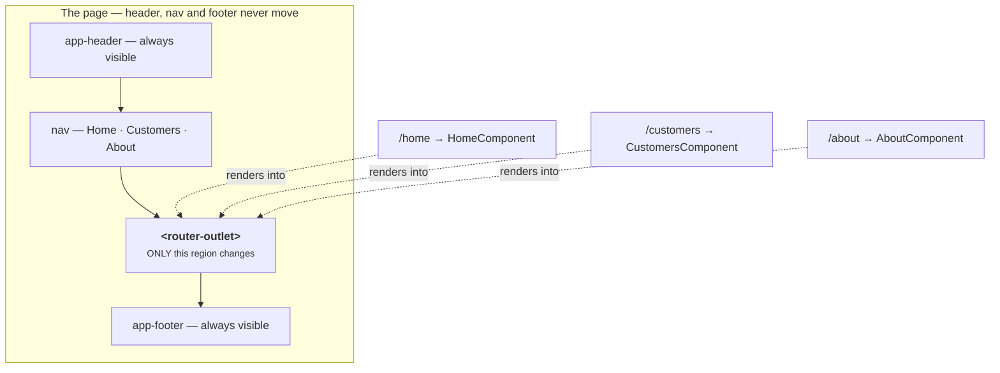
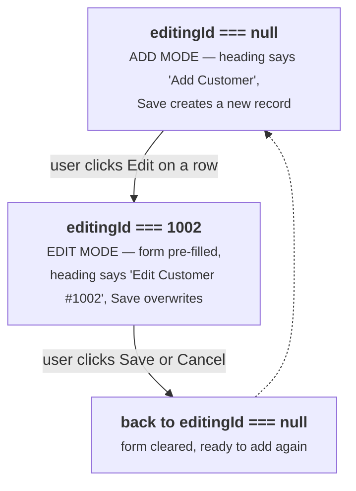
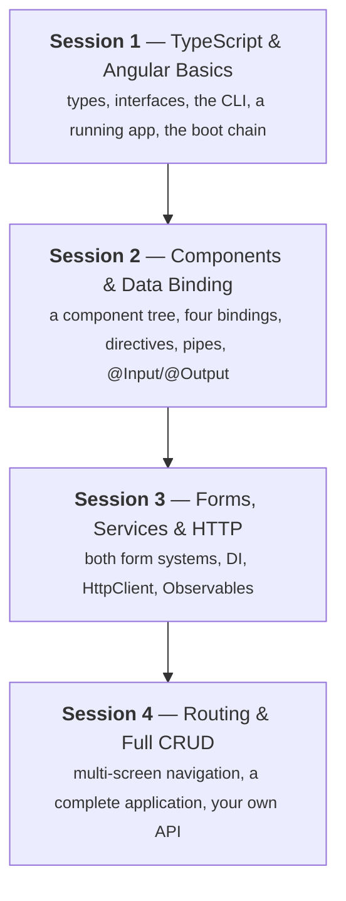

# Angular Session 4 — Study Guide

## Routing & Full CRUD

**Learn it first, then teach it.**

This guide pairs with `angular-session4-theory.html` (36 slides) and `angular-session4-lab.html`.

| | |
|---|---|
| **Who this is for** | Anyone who has finished Session 3 and is comfortable with services and `subscribe` |
| **What you'll be able to do after** | Build a multi-screen application with real URLs and a complete set of data operations |
| **Time to read and absorb** | About 2 hours, plus 2–3 hours building |
| **Time to deliver as a session** | 3 hours including the lab |

---

## How to use this document

**First pass — learn it.** Read in order, building as you go. This session assembles everything from the previous three, so there's very little new syntax — most of your effort goes into putting pieces together correctly.

**Second pass — prepare to teach it.** Read the 🎓 **Teaching notes** and the [Delivery plan](#delivery-plan).

**This session's two golden rules**, because they cause most of the confusion and both fail *silently*:

> **1. Route order matters.** Angular takes the **first** matching route, not the best one. The wildcard `**` goes last, and static paths go above dynamic ones.
>
> **2. Route parameters are always strings.** `/customers/1002` gives you `"1002"`, so `c.id === id` is `false`. Wrap it in `Number()`.

---

## Contents

1. [Why routing](#1-why-routing)
2. [What a route is](#2-what-a-route-is)
3. [Setting up routing](#3-setting-up-routing)
4. [router-outlet and the shell](#4-router-outlet-and-the-shell)
5. [routerLink, not href](#5-routerlink-not-href)
6. [Default and 404 routes](#6-default-and-404-routes)
7. [Route order](#7-route-order)
8. [Route parameters](#8-route-parameters)
9. [Navigating from code](#9-navigating-from-code)
10. [The CRUD case study](#10-the-crud-case-study)
11. [Read — list and search](#11-read--list-and-search)
12. [Create — insert](#12-create--insert)
13. [Delete — with confirmation](#13-delete--with-confirmation)
14. [Update — one form, two jobs](#14-update--one-form-two-jobs)
15. [The same CRUD through a service](#15-the-same-crud-through-a-service)
16. [CRUD over HTTP](#16-crud-over-http)
17. [Connecting to your Spring Boot API](#17-connecting-to-your-spring-boot-api)
18. [Building for production](#18-building-for-production)
19. [Best practices](#19-best-practices)
20. [Cheat sheet](#cheat-sheet)
21. [Errors you'll hit](#errors-youll-hit)
22. [Check yourself](#check-yourself)
23. [Delivery plan](#delivery-plan)
24. [Where to go next](#where-to-go-next)

---

## 1. Why routing

Look at the app you've built. Header, login form, two registration forms, a table, cards, stats — **all stacked on one endless page**. That isn't how applications work.

A real app has *screens*: a home page, a customer list, an add-customer form, an about page. The user moves between them, and — critically — the **URL changes to match**.

| Benefit | Why it matters |
|---|---|
| **Shareable URLs** | `/customers/1002` can be bookmarked, emailed, or pasted into a chat — and it opens the right screen. |
| **The Back button works** | Users expect it. Without routing, Back leaves your application entirely, which feels broken. |
| **Only one screen in memory** | Angular builds the current screen and discards the rest, instead of holding everything at once. |
| **Still no page reload** | The URL changes and the content swaps, but the browser never re-downloads the page. It stays a single-page application. |

**Analogy.** Without routing your app is **one very long scroll of paper**. With routing it's a **ring binder with tabbed dividers** — same binder, and you flip straight to the section you want.

**The trick that makes this possible:** the Angular **router** changes the URL *without asking the server for anything*. It updates the address bar, records an entry in the browser's history so Back works, and swaps which component is displayed.

> 🎓 **Teaching notes**
>
> **Start by scrolling their own app**, top to bottom, slowly, in silence. It's absurdly long by now — header, login, two forms, a table, cards, a stats bar. Then ask: *"would you ship this?"*
>
> Nobody says yes. You've established the need without asserting anything.
>
> Then ask what they'd expect instead. Someone will say "separate pages" or "a menu". Ask what should happen to the URL. That's routing, derived from them.
>
> **The Back button point lands harder than you'd expect.** Demo it: on the current single-page app, press Back — and you leave the application entirely. Users read that as a bug. It's a concrete, non-abstract reason routing exists.

---

## 2. What a route is

A **route** is just a pairing: **this URL path → show that component.** Nothing more.

```typescript
{ path: 'customers', component: CustomerListComponent }
```

Read it as: *"when the URL is `/customers`, display `CustomerListComponent`."* A routing configuration is simply an array of these pairings.

| URL the user is at | Component Angular displays |
|---|---|
| `localhost:4200/` | redirected to `/home` |
| `localhost:4200/home` | `HomeComponent` |
| `localhost:4200/customers` | `CustomerListComponent` |
| `localhost:4200/customers/add` | `CustomerFormComponent` |
| `localhost:4200/customers/1002` | `CustomerDetailComponent` — for customer 1002 |
| `localhost:4200/anything-else` | `NotFoundComponent` — your 404 page |

**Notice the paths have no leading slash.** You write `path: 'customers'`, not `path: '/customers'`. Angular adds the slash. Writing it yourself gives you a route that never matches.

**The Spring Boot parallel:** `{ path: 'customers', component: CustomerListComponent }` is Angular's `@GetMapping("/customers")`. One maps a URL to a *component*; the other maps a URL to a *method*. Same idea, different side of the wire.

> 🎓 **Teaching notes**
>
> Lead with the Spring Boot mapping — it makes routing feel immediately familiar rather than new. *"You already write URL-to-code mappings every day. This is the same thing, in the browser."*
>
> **Mention the leading-slash trap now**, before they write any routes. It's a thirty-second warning that saves a genuinely baffling debugging session, because a route with `'/customers'` simply never fires and nothing explains why.

---

## 3. Setting up routing

Routes live in their own file, by convention `app-routing.module.ts`. Create it with the CLI:

```bash
ng generate module app-routing --flat --module=app
```

| Flag | Meaning |
|---|---|
| `--flat` | Don't put it in its own folder |
| `--module=app` | **Register it in `AppModule` for me** — saves you the most-forgotten step |

```typescript
// src/app/app-routing.module.ts
import { NgModule } from '@angular/core';
import { RouterModule, Routes } from '@angular/router';

import { HomeComponent } from './pages/home/home.component';
import { CustomersComponent } from './pages/customers/customers.component';
import { AboutComponent } from './pages/about/about.component';
import { NotFoundComponent } from './pages/not-found/not-found.component';

const routes: Routes = [
  // 1. Default — what shows at the bare localhost:4200
  { path: '', redirectTo: '/home', pathMatch: 'full' },

  // 2. The real screens
  { path: 'home',      component: HomeComponent },
  { path: 'customers', component: CustomersComponent },
  { path: 'about',     component: AboutComponent },

  // 3. The wildcard 404 — ALWAYS LAST
  { path: '**', component: NotFoundComponent }
];

@NgModule({
  imports: [RouterModule.forRoot(routes)],   // forRoot — only in the root module
  exports: [RouterModule]                    // ← WITHOUT THIS, routerLink won't work
})
export class AppRoutingModule { }
```

| Line | Why it's there |
|---|---|
| `const routes: Routes = [ ]` | An array of route objects. `Routes` is Angular's type for it. |
| `RouterModule.forRoot(routes)` | "Set up the router for the whole application with these routes." Used **once**. |
| `exports: [RouterModule]` | **The most-forgotten line in Angular routing.** Re-exports the router's directives so *your* components can use `routerLink` and `<router-outlet>`. |

**Verify before continuing:** open `app.module.ts` and confirm `AppRoutingModule` is in the `imports` array. If it isn't, add it — routing fails in a very confusing way without it.

> 🎓 **Teaching notes**
>
> **The `exports: [RouterModule]` line deserves a deliberate callout**, because omitting it produces `Can't bind to 'routerLink'` — which sounds like a typo in the template and sends people looking in entirely the wrong file.
>
> Point at it and say: *"if `routerLink` ever says it isn't a known property, come back to this line."*
>
> **Also make them verify the `AppModule` import.** `--module=app` does it automatically, but if anyone generated the module a different way, or typed the flag wrong, they'll spend twenty minutes on a routing setup that was never registered. A ten-second check saves that.

---

## 4. `router-outlet` and the shell

You've told Angular *which* component to show. Now tell it *where*. That's `<router-outlet>` — a placeholder the router fills in.

```html
<!-- src/app/app.component.html — the entire root template -->
<app-header></app-header>

<nav>
  <a routerLink="/home">Home</a>
  <a routerLink="/customers">Customers</a>
  <a routerLink="/about">About</a>
</nav>

<!-- The routed component renders HERE, and swaps as the URL changes -->
<router-outlet></router-outlet>

<app-footer></app-footer>
```



**Notice what stays put.** The header, nav bar and footer are **outside** the outlet, so they never move, never flicker and never reload. Only the region inside the outlet changes. That's how every real application is laid out — a persistent shell around a swappable content area.

Two rules: it needs a closing tag, `<router-outlet></router-outlet>`. And if you forget it entirely, your URL will change correctly and **nothing will appear on screen** — with no error. Angular has a component to show and nowhere to put it.

### `routerLinkActive` — highlight the current page

Users need to see where they are. `routerLinkActive` adds a CSS class to a link **automatically** whenever its route is the active one.

```html
<nav>
  <a routerLink="/home"      routerLinkActive="active">Home</a>
  <a routerLink="/customers" routerLinkActive="active">Customers</a>
  <a routerLink="/about"     routerLinkActive="active">About</a>
</nav>
```

```css
nav a.active {
  color: #dd0031;
  font-weight: 700;
  border-bottom: 3px solid #dd0031;
}
```

**You write no logic for this at all.** No `*ngIf`, no "which page am I on" field, no click handler. The router already knows the active route, so it maintains the class for you. One attribute for a feature that would otherwise be twenty lines.

**The one gotcha:** `routerLinkActive` matches by *prefix* by default, so a link to `/` counts as active on every page. Fix it with an exact-match option:

```html
<a routerLink="/home"
   routerLinkActive="active"
   [routerLinkActiveOptions]="{ exact: true }">Home</a>
```

> 🎓 **Teaching notes**
>
> **The missing-outlet demo is essential and takes fifteen seconds.** Comment out `<router-outlet>`, save, then click through the menu. The URL changes each time. Nothing appears. No error anywhere.
>
> Ask: *"the URL is changing, so routing is working. Why is the screen empty?"* Someone will get it: Angular has the component but no instruction about where to put it. That's a much better route to understanding than being told.
>
> **`routerLinkActive` is a small delight worth showing off.** Add it live and click through the menu so they watch the highlight follow them. Then say: *"how much code did I write for that? One attribute."* It's the kind of thing that makes people like a framework.
>
> The `exact: true` gotcha is worth mentioning but not demoing in detail — just make sure they know where to look when their Home link is permanently lit up.

---

## 5. `routerLink`, not `href`

A small detail with a large consequence.

| ❌ `<a href="/customers">` | ✅ `<a routerLink="/customers">` |
|---|---|
| The **browser** handles it | The **Angular router** handles it |
| A full page reload — the whole app restarts | Only the outlet's contents change |
| Visible white flash | Instant, no flash |
| All in-memory state is lost | Services keep their data |
| Slow, and it defeats the point of an SPA | Back and Forward still work |

**Two forms of `routerLink`:**

```html
<!-- Static path — a plain string, no brackets -->
<a routerLink="/customers">Customers</a>

<!-- Dynamic path — an ARRAY of segments, with brackets -->
<a [routerLink]="['/customers', customer.id]">View</a>
<!-- produces /customers/1002 -->
```

**The bracket rule, one more time:** no brackets = a plain string; brackets = an expression Angular evaluates. Exactly the same rule as `src` versus `[src]` in Session 2.

**Prefer the array form** for dynamic paths. `['/customers', id]` lets Angular handle the slashes and URL-encode each segment properly. String concatenation breaks the moment a segment contains a space or a special character.

> 🎓 **Teaching notes**
>
> **Demo the difference, don't describe it.** Change one menu link to `href` and click it. The browser's reload spinner turns, the page flashes white, and — the detail worth pointing out — **any state they'd built up is gone**. If a service had data in it, it's been recreated from scratch.
>
> Then change it back and click again. Instant, no flash. The contrast is obvious and memorable.
>
> Connect it to the bracket rule from Session 2 explicitly. This is the third time that rule has appeared (`[src]`, `[employee]`, now `[routerLink]`), and naming the pattern helps it generalise.

---

## 6. Default and 404 routes

The two routes everyone forgets.

### The default redirect — what shows at `/`

```typescript
{ path: '', redirectTo: '/home', pathMatch: 'full' }
```

| Part | Meaning |
|---|---|
| `path: ''` | The empty path — bare `localhost:4200` with nothing after it. |
| `redirectTo: '/home'` | Send them to the home route instead of showing nothing. |
| `pathMatch: 'full'` | **Required here.** "Only redirect when the *whole* URL is empty." Without it, the empty path matches the *start* of every URL and redirects everything to home — an infinite loop. |

### The 404 — what shows for an unknown URL

```typescript
{ path: '**', component: NotFoundComponent }
```

`**` is the **wildcard**: it matches anything at all. So this route catches every URL that none of your other routes matched — a typo, a stale bookmark, a broken link.

```html
<!-- not-found.component.html — keep it helpful -->
<div class="not-found">
  <h2>404 — Page not found</h2>
  <p>We couldn't find the page you asked for.</p>
  <a routerLink="/home">← Back to home</a>
</div>
```

**Without a wildcard route**, a bad URL shows a blank page and a console error — `Cannot match any routes. URL Segment: 'customerz'` — visible only to you. Your user sees nothing at all. **Always add the wildcard.**

> 🎓 **Teaching notes**
>
> **The `pathMatch: 'full'` explanation is worth getting right**, because "it causes an infinite loop" sounds like superstition otherwise.
>
> Explain it concretely: *"without `pathMatch: 'full'`, the empty path matches the beginning of every URL. So `/customers` matches `''`, which redirects to `/home`, which matches `''`, which redirects to `/home`…"* Now it's mechanical rather than magical.
>
> **Have them add a deliberately broken menu link** — `routerLink="/nowhere"` — so the 404 page is reachable and visible during the whole session, not just theoretical. The lab does this. It's a nice touch because the 404 stops being an abstraction.

---

## 7. Route order

**Angular checks routes top to bottom and uses the first one that matches.** It does not look for the best match.

```typescript
// ❌ BROKEN — wildcard first
const routes: Routes = [
  { path: '**',        component: NotFoundComponent },
  { path: 'home',      component: HomeComponent },
  { path: 'customers', component: CustomerListComponent }
];
// Every URL matches ** first, so EVERY page shows the 404.
// No error is reported anywhere.
```

```typescript
// ✅ CORRECT — wildcard last
const routes: Routes = [
  { path: '',              redirectTo: '/home', pathMatch: 'full' },
  { path: 'home',          component: HomeComponent },
  { path: 'customers',     component: CustomerListComponent },
  { path: 'customers/add', component: CustomerFormComponent },   // static
  { path: 'customers/:id', component: CustomerDetailComponent },  // dynamic
  { path: '**',            component: NotFoundComponent }
];
```

> **The ordering rule, in one line:** most specific first, wildcard `**` always last. And put **static paths above dynamic ones** — `customers/add` must come before `customers/:id`.

**That last point is a real bug you will hit.** With `customers/:id` listed first, clicking "Add Customer" opens the *detail* screen looking for a customer whose id is the string `"add"`. You get an empty form or a crash, and nothing tells you why.

> 🎓 **Teaching notes**
>
> **Move the wildcard to the top and let them watch every page become a 404.** It's dramatic, instantaneous, and it produces no error message — which is the real lesson. This is the single most common routing bug there is.
>
> **Then do the static-vs-dynamic version**, because it's subtler and more insidious. Put `customers/:id` above `customers/add`, click Add Customer, and watch the detail screen open trying to find a customer called "add". Ask them to work out why.
>
> Give them the rule as something they can check mechanically: *"read your routes array top to bottom and ask 'would anything above this have already matched?'"*

---

## 8. Route parameters

You can't write one route per customer. Instead you declare a **placeholder** in the path with a colon:

```typescript
{ path: 'customers/:id', component: CustomerDetailComponent }
```

Now `/customers/1002`, `/customers/1003` and `/customers/9999` all match this one route, and the router hands you the value that filled the placeholder.

| URL | Matches | `id` is |
|---|---|---|
| `/customers/1002` | ✔ | `"1002"` — a **string** |
| `/customers/1003` | ✔ | `"1003"` |
| `/customers` | ✖ — no id segment | — |
| `/customers/1002/edit` | ✖ — one segment too many | — |

Linking to it:

```html
<tr *ngFor="let c of customers">
  <td>{{ c.name }}</td>
  <td><a [routerLink]="['/customers', c.id]">View</a></td>
</tr>
```

### Reading it with `ActivatedRoute`

To find out *which* id the user asked for, you inject `ActivatedRoute` — a service describing the currently active route. Dependency injection, once again.

```typescript
import { Component, OnInit } from '@angular/core';
import { ActivatedRoute, Router } from '@angular/router';

export class CustomerDetailComponent implements OnInit {

  customer: Customer | undefined;
  requestedId = 0;
  notFound = false;

  constructor(private route: ActivatedRoute,           // reads the URL
              private router: Router,                  // navigates
              private customerService: CustomerService) { }

  ngOnInit(): void {
    // 1. read the raw parameter — it is a STRING
    const raw = this.route.snapshot.paramMap.get('id');

    // 2. convert it to a number.  1002 === "1002" is FALSE without this.
    this.requestedId = Number(raw);

    // 3. look it up
    this.customer = this.customerService.getById(this.requestedId);

    // 4. handle "not found" — someone WILL type /customers/9999
    if (!this.customer) {
      this.notFound = true;
    }
  }

  goBack(): void {
    this.router.navigate(['/customers']);
  }
}
```

> **The trap that catches everybody: parameters are always strings.**
>
> `/customers/1002` gives you the string `"1002"`, never the number `1002`. So `c.id === id` is `false` — you're comparing a number with a string. **Always convert first:** `const id = Number(params.get('id'));`
>
> This fails *silently*. Nothing errors; the lookup just finds nothing, and every customer shows "not found".

**`snapshot` versus subscribing.** `snapshot` reads the value once, which is right the vast majority of the time. It is *not* enough if the user can go from `/customers/1002` to `/customers/1003` **without leaving the component** — Angular reuses the instance and `ngOnInit` doesn't run again. For that case, subscribe instead:

```typescript
this.route.paramMap.subscribe(p => {
  this.requestedId = Number(p.get('id'));
  this.customer = this.customerService.getById(this.requestedId);
});
```

Another Observable, same `subscribe` as Session 3.

> 🎓 **Teaching notes**
>
> **The string/number trap is the most valuable demo in this session.** Remove the `Number()` conversion, save, and click View on any customer. **Every single one shows "not found".** No error, no warning — the comparison just quietly returns false every time.
>
> Then ask them to explain it. When someone says *"it's comparing a string to a number"*, that understanding is permanent. Session 1's `===` lesson pays off here.
>
> **Also insist on the not-found branch.** Ask *"what happens if I type `/customers/9999`?"* and let them realise the template will crash on `undefined`. Handling it isn't defensive paranoia — it's a URL any user can type.
>
> **On `snapshot` vs subscribe:** teach `snapshot` as the default because it's simpler and almost always correct. Mention the limitation, and if you have time, demo it with a "Next customer" button — the URL changes and the content doesn't, which is a genuinely confusing bug to meet cold.

---

## 9. Navigating from code

`routerLink` is for things the user clicks. But sometimes *your code* needs to navigate: after a successful save, after a login, after a delete. For that you inject the `Router` service.

```typescript
import { Router } from '@angular/router';

constructor(private router: Router) { }

// simple navigation
goHome(): void {
  this.router.navigate(['/home']);
}

// with a parameter
viewCustomer(id: number): void {
  this.router.navigate(['/customers', id]);      // → /customers/1002
}

// the classic: navigate after a successful save
onSave(): void {
  this.customerService.add(this.form.value).subscribe({
    next: () => {
      this.router.navigate(['/customers']);      // ← inside next, on SUCCESS only
    },
    error: () => {
      this.message = 'Save failed — you are still on the form.';
    }
  });
}
```

> **Note where that `navigate` call sits: inside `next`.** Navigating immediately after calling `subscribe` would take the user away *before* the server had replied — so a failed save would look like a successful one. Navigate on confirmed success, exactly as you updated the screen inside `next` in Session 3.

### The three ways to navigate

| Way | Use it when |
|---|---|
| `routerLink="/customers"` | The user clicks something. Preferred — it renders a real, right-clickable link. |
| `[routerLink]="['/customers', id]"` | The same, with a dynamic segment. |
| `this.router.navigate([...])` | Your code decides — after a save, a login, a delete, or a timeout. |

**Query parameters, briefly.** `this.router.navigate(['/customers'], { queryParams: { search: 'anoop' } })` produces `/customers?search=anoop`, read back with `this.route.snapshot.queryParamMap.get('search')`. Use route *parameters* for "which record" and query *parameters* for optional extras like search terms, filters and page numbers.

> 🎓 **Teaching notes**
>
> **The placement of `navigate` inside `next` is the point worth making.** It's the same lesson as Session 3's "update the screen inside `next`", so call back to it — the repetition is what turns it into an instinct.
>
> Make the failure concrete: *"if you navigate right after calling subscribe, and the save fails, you've already sent the user to the list page with a cheerful message. Their data is gone and they don't know it."*
>
> **Prefer `routerLink` where possible** is worth stating as a principle. `routerLink` produces a real anchor tag, which means right-click-open-in-new-tab works, screen readers announce it as a link, and it's crawlable. `router.navigate` on a `<div>` gives you none of that. It's a small accessibility point that distinguishes a thoughtful developer.

---

## 10. The CRUD case study

One screen with a complete set of data operations. **CRUD** is the four things every business application does:

| Letter | Operation | In memory | Over HTTP |
|---|---|---|---|
| **C** | Create — a form adds a new customer | `push()` | `POST` |
| **R** | Read — a table lists them, with a live search | `filter()` | `GET` |
| **U** | Update — click a row, edit, save | `findIndex()` | `PUT` |
| **D** | Delete — confirm, then remove | `splice()` | `DELETE` |

**The plan — we build it three times, and that's deliberate:**

1. **Round 1:** everything inside one component, against a plain array. Simple, all in one place, easy to follow.
2. **Round 2:** move the data operations into a **service**. The component gets smaller.
3. **Round 3:** swap the service's array for **`HttpClient`**. The component barely changes at all.

Seeing the same feature three ways is what makes the value of layering obvious rather than theoretical.

**Everything here is something you already know.** The six array methods from Session 1. `*ngFor`, `*ngIf` and `ngClass` from Session 2. Reactive forms, services and `HttpClient` from Session 3. There is almost no new syntax in this case study — it's assembly, not new learning.

### The model and the state

```typescript
// src/app/models/customer.ts
export interface Customer {
  id: number;
  name: string;
  city: string;
  email: string;
  balance: number;
}
```

```typescript
export class CustomersComponent implements OnInit {

  // ── the data: TWO arrays, and this matters ──
  allCustomers: Customer[] = [];    // the master list — never filtered
  customers: Customer[] = [];       // what the table displays

  // ── screen state ──
  searchTerm = '';
  message = '';

  // ── edit mode: null = adding, a number = editing that id ──
  editingId: number | null = null;

  // ── the form (reactive, from Session 3) ──
  custForm: FormGroup;

  constructor(private fb: FormBuilder) {
    this.custForm = this.fb.group({
      name:    ['', [Validators.required, Validators.minLength(3)]],
      city:    ['', [Validators.required]],
      email:   ['', [Validators.required, Validators.email]],
      balance: [0,  [Validators.required, Validators.min(0)]]
    });
  }
}
```

**Two design decisions worth explaining:**

1. **Two arrays.** `allCustomers` is the master list; `customers` is what the table shows. If you filter the master list, clearing the search box can't bring the rows back — you destroyed them.
2. **`editingId: number | null`.** One field carries the whole insert-versus-update distinction: `null` means "adding a new one", a number means "editing that id". This single field is what lets one form do both jobs.

> 🎓 **Teaching notes**
>
> **Say explicitly that there's almost no new syntax today.** People arrive at session four expecting the hardest material and are often tense. Telling them *"today is assembly — you already know every piece"* changes how they approach it, and it's true.
>
> **Announce the build-it-three-times plan up front and explain why.** Otherwise Round 2 feels like pointless rework and someone will ask why they're redoing working code. Frame it as: *"you'll write this feature three ways and by the third you'll understand why professionals structure code the way they do."*
>
> **The two-arrays decision is worth pausing on**, because the bug it prevents is so common. Ask: *"if I filter the list I'm displaying, and then delete a character from the search box, where do the other rows come from?"* They don't. That's why there are two.

---

## 11. Read — list and search

```typescript
ngOnInit(): void {
  this.allCustomers = [
    { id: 1001, name: 'Anoop Kumar',  city: 'Ahmedabad', email: 'anoop@example.com',  balance: 15000 },
    { id: 1002, name: 'Ajay Sharma',  city: 'Pune',      email: 'ajay@example.com',   balance: 0 },
    { id: 1003, name: 'Rekha Nair',   city: 'Kochi',     email: 'rekha@example.com',  balance: 42500 }
  ];
  this.customers = this.allCustomers;
}

onSearch(): void {
  const t = this.searchTerm.trim().toLowerCase();

  if (t === '') {
    this.customers = this.allCustomers;
    return;
  }

  // ALWAYS filter the master list, never the displayed one
  this.customers = this.allCustomers.filter(c =>
    c.name.toLowerCase().includes(t) ||
    c.city.toLowerCase().includes(t) ||
    c.email.toLowerCase().includes(t)
  );
}

clearSearch(): void {
  this.searchTerm = '';
  this.onSearch();
}
```

```html
<input [(ngModel)]="searchTerm" (input)="onSearch()" name="searchTerm"
       placeholder="Search name, city or email…">
<button (click)="clearSearch()" [disabled]="!searchTerm">Clear</button>

<table *ngIf="customers.length > 0; else noResults">
  <thead>
    <tr><th>ID</th><th>Name</th><th>City</th><th>Balance</th><th>Actions</th></tr>
  </thead>
  <tbody>
    <tr *ngFor="let c of customers; trackBy: trackById"
        [ngClass]="{ 'editing-row': c.id === editingId }">
      <td>{{ c.id }}</td>
      <td>{{ c.name }}</td>
      <td>{{ c.city }}</td>
      <td [ngStyle]="{ 'color': c.balance === 0 ? 'red' : 'green' }">
        {{ c.balance | currency:'INR':'symbol':'1.0-0' }}
      </td>
      <td>
        <a [routerLink]="['/customers', c.id]">View</a>
        <button (click)="startEdit(c)">Edit</button>
        <button (click)="onDelete(c)">Delete</button>
      </td>
    </tr>
  </tbody>
</table>

<ng-template #noResults>
  <p>🔍 No customers match "{{ searchTerm }}".
     <button (click)="clearSearch()">Clear search</button></p>
</ng-template>

<p>Showing {{ customers.length }} of {{ allCustomers.length }}</p>
```

**All Session 2 material:** `*ngFor` with `trackBy`, `ngClass` to highlight the row being edited, the `currency` pipe, `*ngIf ... else` for the empty state, and `(click)` handlers passing the whole object.

**Why searching in the browser is instant.** The data is *already in memory*, so filtering costs nothing and needs no server round-trip. That's why an Angular search box feels instant next to a JSP page that reloads.

**The limit:** this only works because we have three customers. With fifty thousand you wouldn't download them all — you'd send the search term to the server (`GET /customers?search=anoop`) and let the database do the work. Knowing *which* approach a situation needs is the actual skill.

> 🎓 **Teaching notes**
>
> **Cause the irreversible-search bug deliberately.** Change `onSearch` to filter `this.customers` instead of `this.allCustomers`. Type `an`, then delete a character. The rows never come back.
>
> Then ask why. Because each keystroke narrowed an already-narrowed list. That's the two-arrays lesson, learned by consequence rather than instruction.
>
> **The scale caveat is worth a minute**, because it's the difference between a student and an engineer. Ask: *"this filters in the browser. When is that the wrong choice?"* Someone will say "lots of data". Exactly — and then the search term goes to the server. Teaching them to *ask* the question matters more than the answer.

---

## 12. Create — insert

```typescript
onSubmit(): void {
  if (this.custForm.invalid) {
    this.custForm.markAllAsTouched();      // reveal every error at once
    return;
  }

  if (this.editingId === null) {
    // ── ADD MODE ──
    const newCustomer: Customer = {
      id: this.getNextId(),                // generate an id locally
      name:    this.custForm.value.name,
      city:    this.custForm.value.city,
      email:   this.custForm.value.email,
      balance: this.custForm.value.balance
    };

    this.allCustomers.push(newCustomer);
    this.message = 'Added ' + newCustomer.name + '.';

  } else {
    // ── EDIT MODE — §14 ──
  }

  this.resetForm();
  this.onSearch();          // re-apply the filter so the table matches
}

private getNextId(): number {
  if (this.allCustomers.length === 0) { return 1001; }
  return Math.max(...this.allCustomers.map(c => c.id)) + 1;
}

resetForm(): void {
  this.custForm.reset({ name: '', city: '', email: '', balance: 0 });
  this.editingId = null;
}
```

**Three details worth copying:**

1. **Validate first and `markAllAsTouched()`**, so a user who clicks Save on an empty form is told why nothing happened.
2. **`getNextId()` takes the highest existing id and adds one** — never `length + 1`, which produces duplicates as soon as anything is deleted.
3. **Call `onSearch()` afterwards.** Without it, a new customer is added to `allCustomers` but the table — which shows `customers` — doesn't update, and the row appears to have vanished.

**Generating ids locally is temporary.** Once a real server is involved, the **database** assigns ids. You'll send `id: 0` and use the id that comes back — exactly as in Session 3.

> 🎓 **Teaching notes**
>
> **The vanishing-new-row bug is the best demo here.** Comment out `this.onSearch()`, add a customer, and watch the form clear and the confirmation appear while **no row shows up**.
>
> Then ask: *"did it save?"* Let them argue about it, then prove it — put `{{ allCustomers.length }}` on the page. It went up. The record exists; the *view* wasn't refreshed. That distinction between data and view is the whole lesson.
>
> **The duplicate-id bug is worth causing too.** Switch to `length + 1`, delete a customer, add one, and now two rows share an id — and Edit updates the wrong one. It's a satisfying demonstration of why the obvious approach is wrong.

---

## 13. Delete — with confirmation

```typescript
onDelete(customer: Customer): void {

  // Never delete on a single click. Always confirm.
  const ok = confirm('Delete ' + customer.name + '? This cannot be undone.');
  if (!ok) { return; }

  // find the position, then remove one item there
  const i = this.allCustomers.findIndex(c => c.id === customer.id);
  if (i !== -1) {
    this.allCustomers.splice(i, 1);
  }

  // if we were editing this very customer, get out of edit mode
  if (this.editingId === customer.id) {
    this.resetForm();
  }

  this.message = 'Deleted ' + customer.name + '.';
  this.onSearch();                       // refresh the displayed list
}
```

| Part | What it does |
|---|---|
| `confirm(...)` | The browser's built-in Yes/No dialog. Ugly but honest, and it takes one line. Real projects use a styled modal — the *logic* is identical. |
| `findIndex` + `splice` | Get the position, remove one item there. Straight out of Session 1. |
| `if (this.editingId === ...)` | An edge case people miss: deleting the customer you're currently editing would leave the form pointing at something that no longer exists. |

**Alternative:** `this.allCustomers = this.allCustomers.filter(c => c.id !== customer.id);` does the same job in one line and is arguably clearer. The difference: `splice` modifies the existing array, `filter` creates a new one. Both are correct — `filter` is the more modern style.

**Always confirm destructive actions.** A misplaced click that silently deletes a customer is the kind of thing that ends up in a support ticket. And once a server is involved, Session 3's rule applies: remove the row **inside `next`**, so a failed delete doesn't leave your screen lying to the user.

> 🎓 **Teaching notes**
>
> **The edge case is the teaching opportunity here**, and it's the kind of thing that separates working code from production code.
>
> Walk them into it: click Edit on a customer, then — without saving — delete that same customer. Ask *"what state is the form in now?"* It's still in edit mode, pointing at a record that no longer exists. Then comment out the `editingId` check and show it break.
>
> Say something honest about this: *"most of the difference between a demo and a product is handling cases like this one. Nobody will ever thank you for it, and its absence is what generates support tickets."*
>
> **On `confirm()`** — be clear it's a teaching shortcut, not what you'd ship. But note the *logic* is what matters: confirm, then act. Swapping in a styled modal later changes nothing structural.

---

## 14. Update — one form, two jobs

Update is two halves: **load** the row into the form, then **save** the changes back over the original.

```typescript
// ── Half 1: loading the row into the form ──
startEdit(customer: Customer): void {
  this.editingId = customer.id;            // remember WHICH one we're editing

  // ONE LINE fills the whole form. This is why we used a reactive form.
  this.custForm.patchValue({
    name:    customer.name,
    city:    customer.city,
    email:   customer.email,
    balance: customer.balance
  });

  this.message = 'Editing ' + customer.name + '.';
}

cancelEdit(): void {
  this.resetForm();                        // sets editingId back to null
}
```

```typescript
// ── Half 2: saving it back (the else branch from §12) ──
} else {
  const i = this.allCustomers.findIndex(c => c.id === this.editingId);

  if (i !== -1) {
    this.allCustomers[i] = {
      id: this.editingId,                // ← KEEP the original id!
      name:    this.custForm.value.name,
      city:    this.custForm.value.city,
      email:   this.custForm.value.email,
      balance: this.custForm.value.balance
    };
    this.message = 'Updated successfully.';
  } else {
    this.message = 'That customer no longer exists.';
  }
}
```

> **`patchValue` is the whole reason Session 3 taught reactive forms.** Filling an entire form from an object takes **one call**. In a template-driven form you'd assign every property by hand, one line each — and remember to add a line every time someone adds a field.

**Keep the id — always.** The form has no id field, so you must reuse `this.editingId`. Build the replacement object with a fresh or missing id and you've silently created a duplicate rather than updated a record.

### One form doing both jobs

You do **not** need an "add form" and an "edit form". One form, and a single field deciding which mode it's in.



```html
<h3>{{ editingId === null ? 'Add Customer' : 'Edit Customer #' + editingId }}</h3>

<form [formGroup]="custForm" (ngSubmit)="onSubmit()">
  <input formControlName="name" placeholder="Name">
  <input formControlName="city" placeholder="City">
  <input formControlName="email" placeholder="Email">
  <input formControlName="balance" type="number">

  <button type="submit" [disabled]="custForm.invalid">
    {{ editingId === null ? 'Add' : 'Save changes' }}
  </button>

  <!-- Cancel only makes sense while editing -->
  <button type="button" *ngIf="editingId !== null" (click)="cancelEdit()">
    Cancel
  </button>
</form>
```

**Read that template again — it's all Session 2.** Interpolation with a conditional expression for the heading and the button label, property binding on `[disabled]`, `*ngIf` to show Cancel only when relevant. **One field, `editingId`, drives all four of those.**

> 🎓 **Teaching notes**
>
> **This is where Session 3's investment pays off, so make it explicit.** Before showing `patchValue`, ask: *"the user clicks Edit. How does the form get filled in?"* Let them think about it. Someone will describe assigning each field.
>
> Then show one line. *"This is why we learned reactive forms."* That callback across sessions is genuinely satisfying for learners and it justifies earlier effort retrospectively.
>
> **The duplicate-on-edit bug is the essential demo.** Change `id: this.editingId` to `id: this.getNextId()`, edit a customer, save — and now there are two of them, with the original untouched. Ask what happened. It's a real production bug and causing it once is worth an hour of warnings.
>
> **The one-form-two-modes pattern is worth naming as a pattern**, because it generalises. A JSP app would have needed two pages. One field and four conditional expressions replace both.

---

## 15. The same CRUD through a service

Round 1 works, and it puts data logic inside a component — exactly what Session 3 taught you not to do. Round 2 fixes it.

```typescript
@Injectable({ providedIn: 'root' })
export class CustomerService {

  private customers: Customer[] = [ /* ...seed data... */ ];

  getAll(): Customer[] {
    return this.customers;
  }

  getById(id: number): Customer | undefined {
    return this.customers.find(c => c.id === id);
  }

  search(term: string): Customer[] {
    const t = term.trim().toLowerCase();
    if (t === '') { return this.customers; }
    return this.customers.filter(c =>
      c.name.toLowerCase().includes(t) ||
      c.city.toLowerCase().includes(t) ||
      c.email.toLowerCase().includes(t)
    );
  }

  add(customer: Customer): Customer {
    customer.id = this.getNextId();
    this.customers.push(customer);
    return customer;
  }

  update(customer: Customer): boolean {
    const i = this.customers.findIndex(c => c.id === customer.id);
    if (i === -1) { return false; }
    this.customers[i] = customer;
    return true;
  }

  delete(id: number): boolean {
    const i = this.customers.findIndex(c => c.id === id);
    if (i === -1) { return false; }
    this.customers.splice(i, 1);
    return true;
  }

  private getNextId(): number {
    if (this.customers.length === 0) { return 1001; }
    return Math.max(...this.customers.map(c => c.id)) + 1;
  }
}
```

**Look at the method names.** `getAll`, `getById`, `search`, `add`, `update`, `delete`. That's deliberately the shape of a **repository** — and it's why Round 3 can swap the array for HTTP calls without renaming anything. Note also that `update` and `delete` return a `boolean` — "did I find it?" — so the caller can react honestly instead of assuming.

### What changes in the component

```typescript
// ❌ Round 1 — inside the component
onDelete(c: Customer): void {
  if (!confirm('Delete?')) return;
  const i = this.allCustomers.findIndex(x => x.id === c.id);
  if (i !== -1) { this.allCustomers.splice(i, 1); }
  this.onSearch();
}

onSearch(): void {
  const t = this.searchTerm.trim().toLowerCase();
  if (t === '') { this.customers = this.allCustomers; return; }
  this.customers = this.allCustomers.filter(c =>
    c.name.toLowerCase().includes(t) || c.city.toLowerCase().includes(t));
}
```

```typescript
// ✅ Round 2 — via the service
constructor(private fb: FormBuilder,
            private customerService: CustomerService) { /* build the form */ }

onDelete(c: Customer): void {
  if (!confirm('Delete?')) return;
  this.customerService.delete(c.id);
  this.onSearch();
}

onSearch(): void {
  this.customers = this.customerService.search(this.searchTerm);
}
```

The component no longer knows *how* anything is stored. It asks, and displays the answer.

> **And once again — the template didn't change.** Not one character. That's now the **third** time in this series: hardcoded array → service → HTTP → service-based CRUD. If you've internalised why that keeps working, you've internalised the most valuable idea in these four sessions.

> 🎓 **Teaching notes**
>
> **Some students will resist Round 2** — "it already worked, why are we changing it?" That's a fair question and it deserves a real answer, not "because it's best practice".
>
> Give them a concrete scenario: *"the business now wants this customer list on a dashboard, and in a dropdown on the orders screen. With Round 1, how much code do you copy? With Round 2?"* Two lines per place, and all three views stay in sync automatically because it's a singleton.
>
> **Show the before/after side by side.** `onSearch` goes from eight lines to one. That visible shrinkage is more persuasive than any principle.
>
> **Add to the running count.** "Template unchanged: 3." One more to go.

---

## 16. CRUD over HTTP

Now replace the array with network calls. **The method names stay identical** — only the bodies and the return types change.

```typescript
@Injectable({ providedIn: 'root' })
export class CustomerService {

  // ONE line to change when you switch backends
  private baseUrl = 'http://localhost:8080/api/customers';

  constructor(private http: HttpClient) { }

  getAll(): Observable<Customer[]> {
    return this.http.get<Customer[]>(this.baseUrl);
  }

  getById(id: number): Observable<Customer> {
    return this.http.get<Customer>(this.baseUrl + '/' + id);
  }

  add(customer: Customer): Observable<Customer> {
    return this.http.post<Customer>(this.baseUrl, customer);
  }

  update(customer: Customer): Observable<Customer> {
    return this.http.put<Customer>(this.baseUrl + '/' + customer.id, customer);
  }

  delete(id: number): Observable<void> {
    return this.http.delete<void>(this.baseUrl + '/' + id);
  }
}
```

**The one real difference:** every method now returns an `Observable` instead of a value. So every caller must `.subscribe()`. That's the only structural change — and it's exactly why Session 3 spent time on Observables before we got here.

**The `search` method is gone.** With a real backend, searching is either done locally on already-fetched data, or handed to the database with `?search=term` for large datasets. Don't download fifty thousand rows to filter three.

### The component, with `subscribe`

```typescript
ngOnInit(): void {
  this.loadCustomers();
}

loadCustomers(): void {
  this.isLoading = true;
  this.errorMessage = '';

  this.customerService.getAll().subscribe({
    next: (data) => {
      this.allCustomers = data;
      this.onSearch();
      this.isLoading = false;
    },
    error: (err) => {
      this.errorMessage = 'Could not load customers. Is the API running?';
      this.isLoading = false;
      console.error(err);
    }
  });
}

onDelete(c: Customer): void {
  if (!confirm('Delete ' + c.name + '?')) { return; }

  this.customerService.delete(c.id).subscribe({
    next: () => {
      this.loadCustomers();          // reload so the screen matches the server
      this.message = 'Deleted.';
    },
    error: () => { this.message = 'Delete failed — the customer is still there.'; }
  });
}

onSubmit(): void {
  if (this.custForm.invalid) { this.custForm.markAllAsTouched(); return; }

  const customer: Customer = {
    id: this.editingId ?? 0,                // 0 for a new one; server assigns it
    name:    this.custForm.value.name,
    city:    this.custForm.value.city,
    email:   this.custForm.value.email,
    balance: this.custForm.value.balance
  };

  // Build the right call, then subscribe ONCE.
  // Safe because Observables are lazy — nothing is sent until subscribe.
  const call = this.editingId === null
    ? this.customerService.add(customer)
    : this.customerService.update(customer);

  call.subscribe({
    next: () => { this.resetForm(); this.loadCustomers(); },
    error: () => { this.message = 'Save failed.'; }
  });
}
```

**Two patterns to take away:**

1. **Reload after a change.** After a successful add, update or delete, call `loadCustomers()` again. It guarantees the screen matches the server — including anything a colleague changed a moment ago. Slower than patching locally; far more trustworthy.
2. **Choose the call, then subscribe once.** `const call = condition ? a() : b();` then one `.subscribe()`. Remember Observables are lazy, so building it without subscribing sends nothing — which makes this pattern safe.

> 🎓 **Teaching notes**
>
> **Point out that the method names didn't change**, because that's the payoff for how the service was designed in Round 2. Put the two service files side by side: same six methods, different bodies. *"That's why we chose those names."*
>
> **Add the fourth tally mark.** "Template unchanged: 4." Then ask them to explain *why*. By this point they should be able to, and hearing one of them articulate it is worth more than you saying it a fifth time.
>
> **The lazy-Observable point makes the ternary pattern safe**, and it's worth noting explicitly — otherwise `const call = ...` looks like it might fire a request early. It doesn't. Nothing happens until `.subscribe()`.
>
> **Be honest about the reload-vs-patch trade-off.** Reloading is a round-trip you didn't strictly need. Patching locally is faster but trusts your copy over the server's. Say which you'd choose and why, and note that real teams differ on this. Presenting it as a judgement call rather than a rule is more useful and more honest.

---

## 17. Connecting to your Spring Boot API

This is the payoff for eight sessions of work. On the Angular side it's **one line**.

```typescript
private baseUrl = 'http://localhost:8080/api/customers';
```

```java
// The Spring Boot side — everything here is Spring Boot Session 2 material
@CrossOrigin(origins = "http://localhost:4200")   // ← REQUIRED, or CORS blocks you
@RestController
@RequestMapping("/api/customers")
public class CustomerController {

    @Autowired
    private CustomerRepository repo;

    @GetMapping
    public List<Customer> getAll() {
        return repo.findAll();
    }

    @GetMapping("/{id}")
    public Customer getById(@PathVariable Long id) {
        return repo.findById(id).orElseThrow();
    }

    @PostMapping
    public Customer create(@RequestBody Customer c) {
        c.setId(null);                 // let the database assign it
        return repo.save(c);
    }

    @PutMapping("/{id}")
    public Customer update(@PathVariable Long id, @RequestBody Customer c) {
        c.setId(id);
        return repo.save(c);
    }

    @DeleteMapping("/{id}")
    public void delete(@PathVariable Long id) {
        repo.deleteById(id);
    }
}
```

**Read the two code blocks side by side:**

| Angular | Spring Boot |
|---|---|
| `http.get(baseUrl)` | `@GetMapping` |
| `http.get(baseUrl + '/' + id)` | `@GetMapping("/{id}")` + `@PathVariable` |
| `http.post(baseUrl, c)` | `@PostMapping` + `@RequestBody` |
| `http.put(baseUrl + '/' + id, c)` | `@PutMapping("/{id}")` |
| `http.delete(baseUrl + '/' + id)` | `@DeleteMapping("/{id}")` |

**Five methods on each side, matching one for one. You now know both ends of the wire.**

### Three things to check when it doesn't work first time

1. **CORS.** Without `@CrossOrigin` the browser blocks the request and the message says CORS. Fix it on the *server*, and **restart Spring Boot**.
2. **Field names must match exactly.** Java's `customerName` arrives as `customerName` — if your TypeScript interface says `name`, you get `undefined`. Check with `{{ data | json }}`.
3. **Is the API actually running?** Open `http://localhost:8080/api/customers` directly in a browser tab first. If it fails there, the problem isn't in Angular.

> 🎓 **Teaching notes**
>
> **This is the emotional finale of the whole programme, so give it room.** Don't rush it into the last five minutes.
>
> If you possibly can, **have a Spring Boot API running and do this live.** Change one line, save, and show real data from a real database appearing in the Angular table. Then add a customer, press F5, and it's still there. That moment — *persistence* — is what eight sessions were building to.
>
> Put the two files side by side on screen and let them trace the five pairs themselves. Ask *"which Angular method talks to which annotation?"* They'll get all five, and realising that is a genuine confidence moment.
>
> **Give them the three-point checklist as a debugging routine**, because they will need it: is the API up (check in a browser), is CORS configured (check the message), do the field names match (check with `| json`). In that order.
>
> If you can't demo live, at least show the two code blocks together and be explicit: *"this is your homework, and it's the most valuable thing you'll do this week."*

---

## 18. Building for production

Everything so far has run under `ng serve`, which is a **development** server — unoptimised, on your machine only. To deploy, you build.

```bash
ng build
```

```
dist/hello-world/browser/
├── index.html            the one page
├── main-A1B2C3.js        your whole app, compiled and minified
├── polyfills-D4E5F6.js   browser compatibility shims
└── styles-G7H8I9.css     your global styles
```

| What the build does | Why it matters |
|---|---|
| **Compiles** TypeScript → JavaScript | Browsers can't run TypeScript. No `.ts` file reaches the user. |
| **Minifies** | Strips comments, whitespace and long names. Far smaller download. |
| **Tree-shakes** | Removes code nothing uses — including services you never injected. |
| **Hashes filenames** | `main-A1B2C3.js` — when you redeploy, the name changes, so browsers can't serve a stale cached copy. |

**Deploying is genuinely simple.** The contents of that folder are **plain static files**. Copy them to any web server — Apache, Nginx, S3, GitHub Pages, or your Spring Boot app's `src/main/resources/static` folder, which then serves your Angular app and your API from the same origin and **eliminates the CORS problem entirely**.

**One deployment gotcha:** your server must send **unknown URLs to `index.html`**. Otherwise a user who bookmarks `/customers` and revisits it gets a server 404 — the server looks for a *file* called "customers", which doesn't exist. Angular's router only runs once `index.html` has loaded. On Nginx that's `try_files $uri /index.html;`.

> 🎓 **Teaching notes**
>
> **Run `ng build` live and open one of the output files.** The minified JavaScript is completely unreadable, which is both funny and instructive — it's a good moment to mention source maps, which is how dev tools still show them their original code.
>
> **The deployment gotcha is worth teaching even though it's an ops concern**, because it's the first thing that breaks when their app goes to a real server, and the symptom (bookmarked URLs 404) looks like an Angular bug. Knowing the cause will make them look competent in front of an ops team.
>
> **The same-origin deployment option is the neatest ending** for the CORS thread that's run through two sessions: put the built files inside Spring Boot and the problem simply ceases to exist.

---

## 19. Best practices

| ✅ Do | ❌ Avoid |
|---|---|
| Put HTTP calls and data logic in a **service** | `HttpClient` directly inside a component |
| Use `ng generate` for everything | `new EmployeeService()` — always inject |
| Type everything — **interfaces** for all API data | `any` as a habit rather than a note |
| Always provide an `error` handler in `subscribe` | Forgetting `.subscribe()` — nothing happens |
| Show loading, error *and* empty states | Updating the screen *before* the server confirms |
| Confirm before anything destructive | `document.getElementById` — bind instead |
| Keep components small and single-purpose | Heavy work inside `{{ method() }}` |
| `trackBy` on any list that changes | Secrets or passwords in front-end code |
| Reactive forms for anything with real rules | Fetching data in the `constructor` |
| Wildcard `**` route last, always | `href` for internal links — use `routerLink` |
| Read the error message before reacting | Trying to fix a CORS error in Angular |

**If you remember only three things from this series:**

1. **Data flows down, events flow up.**
2. **Components display; services fetch.**
3. **Change the data and let Angular update the screen — never touch the DOM yourself.**

---

## Cheat sheet

### Routing

| Code | Purpose |
|---|---|
| `ng g m app-routing --flat --module=app` | Create + register the routing module |
| `{ path: 'home', component: HomeComponent }` | A basic route. No leading slash. |
| `{ path: '', redirectTo: '/home', pathMatch: 'full' }` | The default screen |
| `{ path: 'customers/:id', component: DetailComponent }` | A route parameter |
| `{ path: '**', component: NotFoundComponent }` | 404 — **always last** |
| `RouterModule.forRoot(routes)` | In `imports` |
| `exports: [RouterModule]` | **Don't forget this** |
| `<router-outlet></router-outlet>` | Where screens render |
| `routerLink="/home"` | Static link |
| `[routerLink]="['/customers', id]"` | Dynamic link |
| `routerLinkActive="active"` | Auto-highlight |
| `[routerLinkActiveOptions]="{ exact: true }"` | Exact match only |
| `Number(route.snapshot.paramMap.get('id'))` | Read a param — **convert it** |
| `router.navigate(['/customers', id])` | Navigate from code |

### CRUD patterns

| Code | Purpose |
|---|---|
| `allItems` + `items` | Master list + displayed list |
| `editingId: number \| null` | `null` = add, number = edit |
| `allItems.filter(...)` | Search — filter the **master** |
| `Math.max(...ids) + 1` | Next id — never `length + 1` |
| `items.push(x)` | Insert |
| `findIndex` then `splice(i, 1)` | Delete |
| `items[i] = { id: editingId, ... }` | Update — **keep the id** |
| `form.patchValue(item)` | Load a row into the form |
| `confirm('Delete?')` | Before anything destructive |
| `markAllAsTouched()` | On a failed submit |

### HTTP ↔ Spring Boot

| Angular | Spring Boot |
|---|---|
| `http.get<T[]>(url)` | `@GetMapping` |
| `http.get<T>(url + '/' + id)` | `@GetMapping("/{id}")` |
| `http.post<T>(url, obj)` | `@PostMapping` + `@RequestBody` |
| `http.put<T>(url + '/' + id, obj)` | `@PutMapping("/{id}")` |
| `http.delete<void>(url + '/' + id)` | `@DeleteMapping("/{id}")` |
| `.subscribe({ next, error })` | **Required** — or nothing is sent |
| `@CrossOrigin(origins = "...")` | Fixes CORS — on the **server** |

### Your `app.module.ts` imports, complete

```
BrowserModule · FormsModule · ReactiveFormsModule · HttpClientModule · AppRoutingModule
```

---

## Errors you'll hit

Today's bugs cluster into three families: **route order** problems, **string-versus-number** problems, and **forgot-to-refresh-the-view** problems. Almost all fail *silently*.

| Message / symptom | Cause and fix |
|---|---|
| The URL changes but **nothing appears** | Missing `<router-outlet></router-outlet>`. Angular has a component and nowhere to put it. **No error.** |
| `'router-outlet' is not a known element`<br>`Can't bind to 'routerLink'` | Either `AppRoutingModule` isn't in `AppModule`'s `imports`, or your routing module is missing `exports: [RouterModule]`. Check both. |
| **Every** page shows the 404 | The `**` wildcard isn't last. Angular takes the *first* match. |
| Clicking a menu link reloads the whole app | You used `href` instead of `routerLink`. |
| Infinite redirect at startup, or a frozen tab | `{ path: '', redirectTo: '/home' }` is missing `pathMatch: 'full'`. |
| Clicking "Customers" opens the *detail* screen | `customers/:id` is listed above `customers`. Static routes before dynamic ones. |
| The Home link is highlighted on every page | `routerLinkActive` matches by prefix. Add `[routerLinkActiveOptions]="{ exact: true }"`. |
| **Every** customer shows "not found" | **Route parameters are strings.** `1002 === "1002"` is `false`. Wrap it in `Number()`. Fails silently. |
| The URL changes but the detail screen shows the old customer | You navigated within the same component, so `ngOnInit` didn't re-run. Use `this.route.paramMap.subscribe(...)` instead of `snapshot`. |
| A new row is added but doesn't appear | You changed `allCustomers` but the table shows `customers`. Call `onSearch()` or `loadCustomers()`. |
| Deleting a search character doesn't restore rows | You filtered `customers` instead of `allCustomers`. |
| Saving an edit creates a duplicate | You lost the original id. Use `id: this.editingId`. |
| The edit form opens empty | `patchValue()` is missing, or its keys don't match the `FormGroup`'s keys. |
| Two customers share an id | `getNextId()` uses `length + 1`. Use `Math.max(...ids) + 1`. |
| Nothing happens on save or delete, no request sent | **Missing `.subscribe()`.** Observables are lazy. |
| The spinner never stops | `isLoading = false` is missing from the `error` handler. |
| `blocked by CORS policy` | Add `@CrossOrigin(origins = "http://localhost:4200")` and **restart Spring Boot**. Nothing in Angular can fix it. |
| Data arrives but the columns are blank | Field names don't match between your API and your interface. Check with `{{ data \| json }}`. |
| A bookmarked URL 404s after deployment | Your web server must send unknown URLs to `index.html`. On Nginx: `try_files $uri /index.html;`. |

---

## Check yourself

**1.** Why must the `**` route be last, and what happens if it isn't? *(§7)*

<details><summary>Answer</summary>

Because Angular uses the **first** matching route, not the best one, and `**` matches everything. If it's first, every URL matches it and **every page shows the 404** — with no error reported anywhere.
</details>

**2.** Route parameters are always strings. What bug does forgetting that cause, and how do you fix it? *(§8)*

<details><summary>Answer</summary>

`/customers/1002` gives you `"1002"`, so `c.id === id` compares a number with a string and is always `false` — every lookup silently finds nothing and every record shows "not found". Fix it with `Number(route.snapshot.paramMap.get('id'))`.
</details>

**3.** What's the difference between `routerLink` and `href`? *(§5)*

<details><summary>Answer</summary>

`routerLink` is handled by the Angular router: only the outlet's contents change, it's instant, and services keep their data. `href` is handled by the browser: a full page reload, a visible flash, and all in-memory state is lost.
</details>

**4.** What does `pathMatch: 'full'` do, and why does the default redirect need it? *(§6)*

<details><summary>Answer</summary>

It means "only match when the **entire** URL is this". Without it, the empty path `''` matches the *beginning* of every URL, so `/customers` matches `''`, redirects to `/home`, which matches `''` again — an infinite redirect loop.
</details>

**5.** You've added `<router-outlet>`, your routes are correct, and clicking a link changes the URL but shows nothing. What's wrong? *(§4)*

<details><summary>Answer</summary>

If the URL is genuinely changing, routing works — so the outlet is the problem. Either it's missing, commented out, or written self-closing. Angular has a component to render and nowhere to put it, and reports no error.
</details>

**6.** Why does the CRUD screen keep **two** arrays? *(§10, §11)*

<details><summary>Answer</summary>

`allCustomers` is the untouched master list; `customers` is the filtered list the table displays. If you filtered the displayed list, each keystroke would narrow an already-narrowed list, and deleting a search character could never bring rows back.
</details>

**7.** Why `Math.max(...ids) + 1` rather than `length + 1` for a new id? *(§12)*

<details><summary>Answer</summary>

Because `length + 1` produces duplicates as soon as anything is deleted — delete one of three records and the next id collides with an existing one. Then editing updates the wrong row.
</details>

**8.** How does one form handle both insert and update? Which field drives it? *(§14)*

<details><summary>Answer</summary>

`editingId: number | null`. When it's `null` the form is in add mode; when it holds an id it's editing that record. That one field drives the heading text, the button label, whether Cancel appears, and which branch `onSubmit` takes.
</details>

**9.** When saving an edit, why must you reuse `this.editingId` for the id? *(§14)*

<details><summary>Answer</summary>

The form has no id field, so the object you build from `form.value` has no id. If you generate a new one you've silently **created a duplicate** instead of updating — and the original record is still there.
</details>

**10.** Why do `update` and `delete` in the service return a `boolean`? *(§15)*

<details><summary>Answer</summary>

To report whether the record was actually found. It lets the component tell the user honestly — "Updated" versus "That customer no longer exists" — rather than assuming success.
</details>

**11.** After switching the service to `HttpClient`, what's the one structural change every caller must make? *(§16)*

<details><summary>Answer</summary>

Every method now returns an `Observable` instead of a plain value, so every call must `.subscribe()` and do its work inside the `next` handler.
</details>

**12.** Why is `const call = condition ? add() : update();` safe, given it looks like it fires a request? *(§16)*

<details><summary>Answer</summary>

Because Observables are **lazy** — building one sends nothing. No request happens until `.subscribe()` is called on it, which is why you can construct it, hold it in a variable, and subscribe once afterwards.
</details>

**13.** Why reload from the server after a successful delete instead of just removing the row locally? *(§16)*

<details><summary>Answer</summary>

Because a reload guarantees the screen matches the server, including anything a colleague changed moments earlier. Removing it locally is faster but trusts your copy over the server's. Both are defensible — it's a judgement call.
</details>

**14.** What does `ng build` produce, and what must the web server be configured to do? *(§18)*

<details><summary>Answer</summary>

Plain static files in `dist/` — compiled, minified, tree-shaken, with hashed filenames. The server must send **unknown URLs to `index.html`**, or bookmarked routes like `/customers` return a server 404 because no such file exists.
</details>

**15.** **The big one:** you swapped the data layer four times across this series — hardcoded array, service, HTTP, service-based CRUD. How many times did the template change, and *why*? *(§15, §16)*

<details><summary>Answer</summary>

**Zero.** Because each layer only knows about the one beneath it. The template's contract is "there is an array called `customers`" — how it got there is another layer's business. It's the same reason SQL doesn't belong in a Spring Boot controller, and it's the most valuable idea in these four sessions.
</details>

---

## Delivery plan

A 3-hour session including the lab. This session has the largest lab of the four — the CRUD build takes real time.

| Time | What | Slides | Lab |
|---|---|---|---|
| 0:00–0:10 | Recap Session 3 · why routing · what a route is | 1–4 | Pre-requisites |
| 0:10–0:35 | Setup · `router-outlet` · `routerLink` · `routerLinkActive` | 5–8 | **Tasks 1, 2** |
| 0:35–0:50 | Default redirect · 404 · **route order** · adding a route end to end | 9–11 | Task 2 experiments |
| 0:50–1:00 | **Break** | — | — |
| 1:00–1:15 | The CRUD plan · the model · the state | 15–16 | — |
| 1:15–1:50 | Read · search · create · delete | 17–20 | **Task 3** |
| 1:50–2:10 | Update · one form two jobs | 21–23 | **Task 4** |
| 2:10–2:25 | **Route parameters** · `ActivatedRoute` · navigating from code | 12–14 | **Task 5** |
| 2:25–2:40 | CRUD via a service · then over HTTP | 24–27 | **Tasks 6, 7** |
| 2:40–2:55 | Your Spring Boot API · `ng build` · best practices | 28–32 | Stretch |
| 2:55–3:00 | Four sessions in review · where to go next | 33–36 | — |

**Note the ordering:** route parameters come *after* the CRUD list is built, because the detail screen needs data to link to. The theory deck presents them earlier; the lab and this plan reorder them deliberately, and it works much better.

### Rules for running this session well

**Announce the three-rounds plan up front.** Otherwise Round 2 feels like pointless rework and you'll get pushback.

**Keep the running tally visible.** "Template unchanged: 4" by the end. Then make one of *them* explain why. It's the thread that ties all four sessions together.

**Protect the last twenty minutes.** The Spring Boot connection and the "where next" material are the payoff for the whole programme. If you overrun on CRUD, cut the HTTP round (set it as homework) rather than cutting the finale.

**Demo the two golden-rule failures.** Wildcard-first, and the missing `Number()`. Both are silent, both are common, and both take thirty seconds to show.

### If you're short on time

Cut in this order:

1. Query parameters (§9) — one sentence
2. `ng build` and deployment (§18) — mention `ng build` exists, skip the gotcha
3. `snapshot` vs subscribe (§8) — teach `snapshot` only
4. Round 3, CRUD over HTTP (§16) — set as homework; they have all the pieces from Session 3
5. The Spring Boot stretch (§17) — set as homework **but still show the two files side by side**

**Never cut:** route order (§7), route parameters and the `Number()` conversion (§8), or the one-form-two-modes pattern (§14).

### Questions you should expect

| Question | Short answer |
|---|---|
| "Can I have nested routes?" | Yes — child routes with their own `<router-outlet>`. Useful for tabs within a screen. Worth learning next. |
| "How do I stop someone reaching a page unless logged in?" | A **route guard** — `canActivate`. It's the first thing to learn after this series. |
| "Should search filter in the browser or on the server?" | Small datasets: browser, instant. Large: server, with `?search=`. Knowing which is the actual skill. |
| "Why reload after saving instead of patching locally?" | Trust. A reload matches the server, including other people's changes. Patching is faster. Teams differ. |
| "Do I need a separate page for add and edit?" | No — one form and one `editingId` field. That's §14. |
| "How do I show a nice dialog instead of `confirm()`?" | Angular Material's dialog, or your own component. The logic is identical: confirm, then act. |
| "Where do I put the API URL for dev vs production?" | An environment file — `environment.ts` and `environment.prod.ts`. The build swaps them. |
| "My bookmarked URL 404s on the server." | The server must fall back to `index.html`. Not an Angular bug. |

### Your own preparation checklist

- [ ] Build the whole lab, including the HTTP round
- [ ] **Have a Spring Boot API running on 8080 with `@CrossOrigin`** — this demo is the highlight of the session
- [ ] Practise the wildcard-first and missing-`Number()` demos
- [ ] Have `ng build` output ready to open, so you don't wait for a build live
- [ ] Decide what you'll cut if you're twenty minutes behind at the 2:10 mark
- [ ] Prepare something to say about where *you* would go next — a genuine opinion lands better than a list

---

## Where to go next

You have the foundation. Here's a sensible order, roughly easiest first — and every one builds on something you already know.

| Topic | Why it's next |
|---|---|
| **Route guards** (`canActivate`) | Block a route unless the user is logged in. Pure routing plus a service — you have both. |
| **HTTP interceptors** | Attach an auth token to every request in one place, instead of on every call. |
| **Lazy loading** | Load a feature's code only when its route is first visited. Much faster startup on large apps. |
| **Angular Material** | Google's component library — proper tables, dialogs, date pickers, all accessible out of the box. |
| **Testing** | Those `.spec.ts` files we ignored. Reactive forms and services are easy to test — that was one reason to prefer them. |
| **More RxJS** | `debounceTime` for search-as-you-type, `switchMap`, `catchError`. Deep, and very rewarding. |
| **Signals** | Angular 16+'s newer reactivity model. Everything you learned still applies; this is an addition, not a replacement. |
| **Standalone components** | Skipping `NgModule` entirely. Now that you understand *why* modules exist, this will make sense. |

**The honest advice:** don't learn all eight. **Build something.** Pick a small real problem — a leave tracker, an expense log, a reading list — put it in front of your own Spring Boot API, and finish it. You'll pick up four of the items above because you *needed* them, which is the only way any of it sticks.

---

## The whole series, in one diagram



Four sessions ago the question was *"what even is a framework?"* You now have a routed, validated, service-backed, API-connected single-page application — and, more importantly, you understand **why** each layer exists rather than just how to type it.

That understanding is the part that transfers to React, to Vue, and to whatever comes next.

---

**Series complete.** Guides: [Session 1](angular-session1-study-guide.md) · [Session 2](angular-session2-study-guide.md) · [Session 3](angular-session3-study-guide.md) · Session 4 (this file)
