# Session 1 — Spring Boot Foundations

> **Study notes for the Spring Boot training series**
> Companion to `springboot-session1-theory.html` (slides) and `springboot-session1-lab.html` (hands-on).
> Written to be read on its own — you should be able to learn from this file alone, then teach from it.

---

## How to use this file

**If you're learning this for the first time:** read it top to bottom, in order. Don't skip Part 1 even if you think you know Java — it defines four words that the rest of the file leans on constantly, and being fuzzy on them is the single biggest reason Spring feels confusing.

**If you're preparing to teach it:** read it once end to end, then jump to [Teaching this session](#teaching-this-session) at the bottom for timing, emphasis, and the questions your associates will actually ask.

**Notation used throughout:**

| Marker | Meaning |
|---|---|
| 💡 **Idea** | The plain-English concept, before any jargon |
| 📖 **The word for it** | The official term, once you understand the idea |
| 🔬 **Try it** | A hands-on experiment — do these, they're where understanding sticks |
| ⚠️ **Trap** | A mistake beginners genuinely make |
| 🎓 **Teach this** | A note for when you're the one explaining it |

---

## Contents

1. [Groundwork — four things to be clear on first](#part-1--groundwork)
2. [Why Spring Boot exists](#part-2--why-spring-boot-exists)
3. [What Spring Boot gives you](#part-3--what-spring-boot-gives-you)
4. [How a request flows through your app](#part-4--how-a-request-flows)
5. [The entry point and the Golden Rule](#part-5--the-entry-point-and-the-golden-rule)
6. [Beans, Dependency Injection and the container](#part-6--beans-dependency-injection-and-the-container)
7. [REST basics and your first endpoints](#part-7--rest-basics)
8. [The project — Initializr, structure, properties](#part-8--the-project)
9. [Reading errors like a professional](#part-9--reading-errors)
10. [Recap and self-test](#recap-and-self-test)
11. [Glossary](#glossary)
12. [Teaching this session](#teaching-this-session)

---

## What you'll be able to do by the end

- Explain **in your own words** what Spring Boot does for you, and why anyone bothers using it.
- Generate a brand-new Spring Boot project and have it running in under two minutes.
- Write a class that answers a web request at a URL like `/hello`.
- Explain what a **bean** is, and let Spring hand one object to another automatically.
- Read the first three lines of a Spring Boot error and know exactly where to look.

That's it. Four sessions build on this one, so the goal today is a small number of ideas held *firmly* rather than a large number held loosely.

---

# Part 1 — Groundwork

Four things to be clear on before we touch Spring. Each takes two minutes and saves an hour later.

## 1.1 A 60-second Java refresher

Spring's documentation uses these four words constantly. Being vague about them is what makes Spring feel like magic.

| Term | What it is | Example |
|---|---|---|
| **Class** | A **blueprint**. Describes what something looks like and can do — but isn't a thing yet. | `class Car { }` |
| **Object** (instance) | An **actual thing** built from the blueprint, living in memory. | `new Car()` |
| **Interface** | A **contract**. A list of method names with no bodies. Says "whoever implements me must be able to do these things" without saying *how*. | `interface Engine { void start(); }` |
| **Annotation** | A **label** you stick on a class, method or field, written with `@`. | `@Service` |

### The one that matters most today: annotations

💡 **Idea:** An annotation is **a note to a tool, not an instruction to Java**.

Writing `@RestController` above a class does *not* change what the class does if you run it by hand. It means:

> "Spring, when you scan my code at startup, notice this class and treat it as a web request handler."

Almost all of Spring Boot works this way. **You leave labels; the framework reads them and reacts.** Once that clicks, Spring stops feeling magical and starts feeling mechanical — which is exactly what you want.

🎓 **Teach this:** This is the highest-leverage two minutes of the whole session. If your associates don't internalise "annotation = label a tool reads", every later topic feels arbitrary. Make them say it back to you.

---

## 1.2 What exactly is a "framework"?

People use *library* and *framework* loosely, but the difference explains almost everything about how it feels to write Spring code.

| | **Library** — you're in charge | **Framework** — it's in charge |
|---|---|---|
| Who writes the main flow? | **You** do | The **framework** does |
| Who calls whom? | *You call it* when you need something | *It calls your code* at the right moment |
| Example | You call `Math.sqrt(16)` when you want a square root. Nothing happens unless you ask. | Spring receives a web request, decides your method is the right one, and calls it. You never write the code that listens for requests. |

💡 **Analogy:** A library is a **toolbox** — you pick up the tool you need, when you need it. A framework is a **building already under construction with slots left for you to fill**. You don't decide where the walls go; you fill in the rooms.

That trade — giving up control of the overall flow — is what buys you all the free functionality.

📖 **The word for it:** "The framework calls your code instead of your code calling the framework" is called **Inversion of Control** (IoC). The control of program flow has been *inverted* — handed from you to the framework.

Remember that phrase. It comes back as one of the central ideas of this session.

---

## 1.3 How the web actually talks

Everything we build is a **server**: a program that sits waiting and answers when asked. The asker is the **client** — a browser, a mobile app, Postman, or another server.

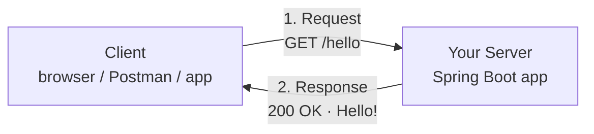

The rules for that conversation are called **HTTP**. It is strictly **one question, one answer** — the client asks, the server replies, and the exchange is over.

### A request always carries at least two things

| Part | What it means | Examples |
|---|---|---|
| **Method** (or verb) | The *kind* of thing you want done | `GET` = read, `POST` = create, `PUT` = update, `DELETE` = remove |
| **Path** | *What* you want it done to | `/hello`, `/students`, `/students/5` |

### A response always carries a status code

A three-digit number saying how it went. `200` means fine, `404` means not found. Plus, usually, a **body** — the actual content.

### Reading a URL

```
http://localhost:8080/hello
└─┬─┘  └───┬───┘ └┬─┘└─┬──┘
  │        │      │    │
scheme   host   port  path
```

| Piece | Meaning |
|---|---|
| `localhost` | "this same computer" |
| `8080` | the **port** — a numbered door on that computer where your program is listening |
| `/hello` | the path |

⚠️ **Trap:** Two programs cannot listen on the same port. This is the cause of the very common `Port 8080 was already in use` error — usually a previous run of your own app that you forgot to stop.

---

## 1.4 Who actually listens for requests?

Plain Java has no idea how to receive an HTTP request. Something has to hold the port open, read raw bytes off the network, work out that they form a `GET /hello`, and hand that to your code as a tidy Java object.

That something is a **web server**. In the Java world, the usual one is **Apache Tomcat**.

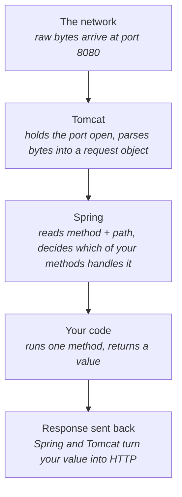

**Why this matters:** historically, Tomcat was a **separate program you installed on the machine**. You had to package your app up and hand it over to Tomcat to run. One of Spring Boot's headline features is that Tomcat now comes *inside* your application, so you just run your app like any other Java program.

We'll come back to this — but now you know what it's actually replacing.

---

# Part 2 — Why Spring Boot exists

You can't appreciate the solution without feeling the problem. This part is short but it's the "why" behind everything else.

## 2.1 Life before Spring Boot

The **Spring Framework** arrived in 2003 and genuinely improved Java backend development — it introduced dependency injection and a clean way to structure applications.

But while Spring made well-organised code *possible*, **starting and assembling** a Spring project stayed slow and error-prone. Before you could write a single line of business logic you had to:

- **Write reams of XML** to declare every object your app used and describe how they connect.
- **Manually wire dependencies** — explicitly state which object should be handed to which other object.
- **Install and configure an external Tomcat**, then build a WAR file and deploy it into that server.
- **Hand-pick compatible library versions** — Spring MVC, Jackson, the logging library, the servlet API — and hope they agreed with each other.
- **Copy the same boilerplate** into every new project, every single time.

⚠️ **The real cost:** teams routinely spent **a day or more just getting an empty project to start up correctly**. The framework was powerful, but the setup ceremony stood between developers and the actual work.

Spring Boot was released in **2014** to delete exactly this friction.

---

## 2.2 Pain point #1 — XML configuration hell

In classic Spring, the framework had no way to discover your objects on its own. You described every single one by hand:

```xml
<beans xmlns="http://www.springframework.org/schema/beans">
    <bean id="greetingService" class="com.example.GreetingServiceImpl" />

    <bean id="helloController" class="com.example.HelloController">
        <property name="greetingService" ref="greetingService" />
    </bean>

    <bean class="org.springframework.web.servlet.view.InternalResourceViewResolver">
        <property name="prefix" value="/WEB-INF/views/" />
        <property name="suffix" value=".jsp" />
    </bean>
</beans>
```

Three problems with this:

1. Every new class meant another `<bean>` entry, added and maintained **by hand**.
2. A typo in a class name or a `ref` was **not caught by the compiler** — it failed only at runtime, often deep into startup, with an unhelpful message.
3. On real projects this XML grew into hundreds of lines — frequently larger and harder to maintain than the Java it was wiring together.

**What replaced it:** Spring Boot swaps nearly all of this for **annotations** and **auto-configuration**. The XML above becomes two short annotations — `@Service` and `@RestController` — that the framework finds by itself.

> **You will never write Spring XML in this course.** We show it only so you appreciate what was removed.

---

## 2.3 Pain points #2, #3 and #4

| Pain point | What went wrong |
|---|---|
| 🔌 **Manual wiring** | You connected every dependency yourself in XML. Forget one and you discovered it only when the app crashed at runtime — not at compile time. |
| 🖥️ **No embedded server** | Build a WAR → install Tomcat → configure it → deploy the WAR into it. Four slow manual steps before the app answered a single request. |
| 🧩 **Version conflicts** | You aligned versions of Spring, Jackson, logging and the servlet API by hand. Mismatches produced cryptic crashes — the infamous "dependency hell". |
| 📝 **Repeated boilerplate** | The same scaffolding copied into every project before any feature work could begin. |

### The pattern behind all four

Every one of these is **configuration work that is the same for almost every project**.

Spring Boot's insight was simple but powerful:

> If 95% of projects configure these things identically, the framework should just do it by default — and let you override only the 5% that is genuinely different.

📖 **The word for it:** **convention over configuration**. It is the heart of Spring Boot.

---

## 2.4 So what *is* Spring Boot?

**Spring Boot is a layer built on top of the Spring Framework** that lets you create stand-alone, production-grade applications you can simply *run*.

⚠️ **The thing most beginners get wrong:** Spring Boot does **not** replace Spring. You still write Spring beans, controllers and services exactly as before. Boot removes the manual setup that used to surround them.

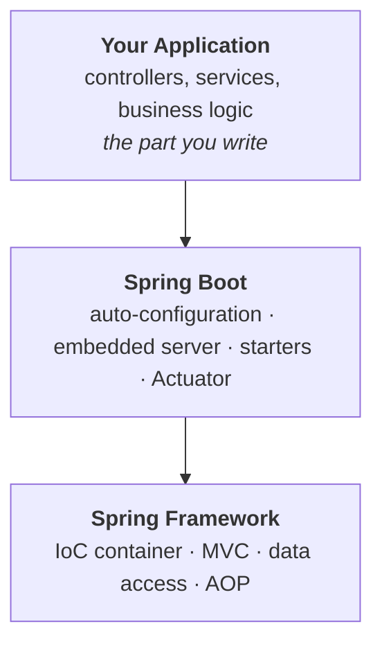

💡 **Mental model:** Spring is the **engine**. Spring Boot is the **ignition key and the auto-tuning** that gets the engine running instantly.

Everything you learn about core Spring — beans, dependency injection, MVC — still applies, unchanged. Boot just means you spend your time on features instead of setup.

🎓 **Teach this:** Associates often arrive thinking Spring Boot is "a different framework from Spring". Kill that idea early with the engine/ignition analogy. It prevents a lot of confusion when they read Spring documentation that doesn't mention Boot at all.


---

# Part 3 — What Spring Boot gives you

Everything Spring Boot does groups under four headings. **Understanding these four *is* understanding Spring Boot.**

| # | Pillar | What it does |
|---|---|---|
| 1 | ⚙️ **Auto-configuration** | Inspects which libraries you've added and configures sensible objects automatically — this is what replaced all the XML. |
| 2 | 🚀 **Embedded server** | Tomcat lives *inside* your application. Run it as an ordinary Java program; no separate server to install. |
| 3 | 📦 **Starter dependencies** | One curated entry brings in everything needed for a capability, at versions guaranteed to fit together. |
| 4 | 📊 **Production-ready** | Health checks, metrics and monitoring one dependency away, via Actuator. |

Together, these turn *"a day of setup"* into *"run the main method"*.

---

## 3.1 Convention over configuration, concretely

Rather than forcing you to describe every detail, Spring Boot assumes the **most common sensible setup** and lets you override only what's genuinely different.

It makes informed guesses from what it can see:

| Boot sees… | Boot assumes… |
|---|---|
| `spring-boot-starter-web` on the classpath | "This is a web app" → starts embedded Tomcat on port **8080** |
| An H2 database driver | "In-memory database" → configures a connection for you |
| A class annotated `@RestController` | "This handles web requests" → registers it automatically |

**What this means day to day:** you write configuration *only* where your needs differ from the convention — e.g. adding `server.port=9090` to change the port. If you're happy with the defaults (usually you are), **you write nothing at all**.

### A word you'll see constantly: *classpath*

📖 **The classpath** is simply **the list of all code available to your program when it runs** — your own classes plus every library JAR that was downloaded for you.

So "Boot scans the classpath" just means "Boot looks at which libraries are present". Adding a dependency to `pom.xml` is how a library gets onto the classpath.

---

## 3.2 Pillar 1 — Auto-configuration, step by step

This is the mechanism that replaced XML. At startup, Spring Boot runs a decision process across **hundreds** of pre-written configuration classes that ship inside the framework. Each asks itself: *"given this particular project, should I activate?"*

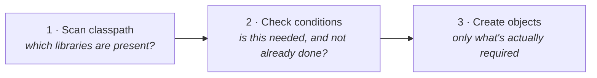

Each auto-configuration is **conditional**. It activates only if:

- the relevant library is genuinely on the classpath — `@ConditionalOnClass`, **and**
- you haven't already created that object yourself — `@ConditionalOnMissingBean`

This is exactly why *adding a starter* is enough to get working features: the matching auto-configuration notices the new library and wires everything up.

And if you *do* define your own object of the same type, Boot detects it and **backs off**, using yours instead. **You are never locked out of taking control.**

> **The sentence to remember:** auto-configuration is *"sensible defaults, applied only when they're needed, and always overridable."*

### 🔬 Try it — auto-configuration isn't a black box

A healthy instinct when a framework does things for you is to ask *"how do I see what it did?"* Boot has a built-in answer. Add one line to `application.properties`:

```properties
debug=true
```

Restart, and Boot prints a **conditions evaluation report** — every auto-configuration it considered, split into matched and not-matched, **with the reason**:

```text
============================
CONDITIONS EVALUATION REPORT
============================

Positive matches:
-----------------
   DispatcherServletAutoConfiguration matched:
      - @ConditionalOnClass found required class
        'org.springframework.web.servlet.DispatcherServlet'

Negative matches:
-----------------
   DataSourceAutoConfiguration:
      Did not match:
      - @ConditionalOnClass did not find required class
        'javax.sql.DataSource'
```

Read that last one carefully. `DataSourceAutoConfiguration` is the piece that would set up a database connection. It says **"did not match — couldn't find the DataSource class"**, which is correct: we haven't added a database library yet.

In **Session 3** you'll add one, and this exact entry moves up into the positive matches. That's auto-configuration, in the open, explaining itself.

🎓 **Teach this:** Run this live. Watching the report scroll past converts "auto-configuration is magic" into "auto-configuration is a big list of if-statements" faster than any slide can.

---

## 3.3 Pillar 2 — The embedded server

Remember the four-step deployment from the "before" picture? Boot deletes it by packaging Tomcat **inside your application** as just another library.

| Before — external server | After — embedded server |
|---|---|
| Download and install Tomcat on the machine | Run the `main` method |
| Configure it (ports, paths, contexts) | Tomcat starts itself, in-process |
| Build your app into a `.war` file | Build produces one runnable `.jar` |
| Copy the WAR into Tomcat's folder | `java -jar myapp.jar` and it's live |
| Restart Tomcat and hope | — |
| Every machine needs the same setup | Nothing to install anywhere |

**Why this changed the industry:** because the app now carries its own server, **the artifact you test is the artifact you ship** — one self-contained JAR with no assumptions about the machine it lands on.

That property is precisely what makes Spring Boot apps easy to put inside Docker containers and run on cloud platforms — which is where Session 4 heads.

> Tomcat is the default; Boot also supports Jetty and Undertow if you swap one dependency. You will almost never need to.

---

## 3.4 Pillar 3 — Starter dependencies

📖 A **starter** is a single dependency that exists purely to pull in a whole coherent set of other dependencies, at versions already tested together. It contains almost no code of its own — it's a **curated shopping list**.

| Without starters | With one starter |
|---|---|
| `spring-web` — pick a version | `spring-boot-starter-web` |
| `spring-webmvc` — must match | |
| `jackson-databind` — for JSON | That's the whole list. Every item on the left arrives automatically, at versions the Spring team verified work together. |
| `tomcat-embed-core` — the server | |
| `validation-api` + an implementation | No `<version>` tag needed — the parent POM decides it. |
| `slf4j` + `logback` — logging | |
| …then debug the version clashes | |

### Where the versions come from

Your `pom.xml` inherits from `spring-boot-starter-parent`. That parent holds a giant list of *"if you use library X, use version Y"* decisions.

It's why your dependency entries have a `groupId` and `artifactId` but usually **no version at all** — and why you should resist the urge to add one manually.

### The starters you'll meet in this course

| Starter | What it gives you | Used in |
|---|---|---|
| `spring-boot-starter-web` | REST endpoints, Spring MVC, JSON conversion, embedded Tomcat | Sessions 1 & 2 |
| `spring-boot-starter-data-jpa` | Database access via JPA/Hibernate and repositories | Session 3 |
| `h2` *(driver, not a starter)* | Zero-setup in-memory SQL database | Session 3 |
| `spring-boot-starter-validation` | Bean Validation — `@NotBlank`, `@Size`, `@Valid` | Session 3 |
| `spring-boot-starter-security` | Authentication and authorisation, on by default | Session 3 |
| `spring-boot-starter-actuator` | Health, metrics and info endpoints | Session 1 bonus |
| `spring-cloud-starter-netflix-eureka-*` | Service registry & discovery | Session 4 |
| `spring-boot-starter-test` | JUnit 5, Mockito, assertions | added to every project by default |

💡 **The naming convention is a gift.** Official starters are always `spring-boot-starter-<something>`. Third-party ones conventionally put their own name first — `mybatis-spring-boot-starter`. If you can guess the capability, you can usually guess the starter name.

---

## 3.5 Supporting cast — Maven in plain English

Spring Boot leans on a build tool. Ours is **Maven**, and beginners often treat it as mysterious. It only does three jobs:

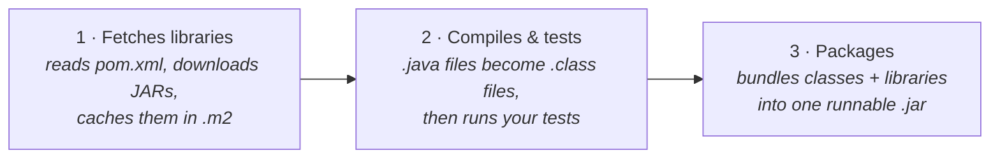

| Command | What it does |
|---|---|
| `mvn spring-boot:run` | Compile and start the application (usual way to run from a terminal) |
| `mvn clean package` | Delete old output, build a runnable JAR into `target/` |
| `mvn clean install` | Same as package, plus copy the JAR into your local `.m2` cache |
| `mvn dependency:tree` | Print every library actually in use — invaluable when versions clash |

💡 **You may not even need Maven installed.** Every Initializr project ships a **Maven wrapper** — the files `mvnw` (Mac/Linux) and `mvnw.cmd` (Windows). Run `./mvnw spring-boot:run` and the wrapper downloads the exact right Maven version for you. This is why a project builds identically on every teammate's machine.

---

## 3.6 `pom.xml`, section by section

This is the file that defines your project. Every generated project has the same four meaningful parts:

```xml
<project>
  <!-- 1. PARENT: inherits Spring Boot's tested library versions -->
  <parent>
    <groupId>org.springframework.boot</groupId>
    <artifactId>spring-boot-starter-parent</artifactId>
    <version>3.5.0</version>
  </parent>

  <!-- 2. COORDINATES: your project's unique identity -->
  <groupId>com.tcs.training</groupId>      <!-- your organisation -->
  <artifactId>demo</artifactId>            <!-- this project's name -->
  <version>0.0.1-SNAPSHOT</version>        <!-- SNAPSHOT = in development -->

  <!-- 3. DEPENDENCIES: the libraries you want. Note: no versions! -->
  <dependencies>
    <dependency>
      <groupId>org.springframework.boot</groupId>
      <artifactId>spring-boot-starter-web</artifactId>
    </dependency>
  </dependencies>

  <!-- 4. BUILD: the plugin that makes the runnable JAR -->
  <build>
    <plugins>
      <plugin>
        <groupId>org.springframework.boot</groupId>
        <artifactId>spring-boot-maven-plugin</artifactId>
      </plugin>
    </plugins>
  </build>
</project>
```

⚠️ **Remember this pair — it comes back and it matters enormously:**

`groupId` + `artifactId` are what Spring Initializr uses to **guess your Java package name**. That guess is the single most common cause of a broken first project. It gets its own section in [Part 5](#part-5--the-entry-point-and-the-golden-rule).

---

## 3.7 Pillar 4 — Production-ready features

Real applications need to answer operational questions: *are you alive? how much memory are you using? what version is deployed?* Writing that yourself is tedious. Add `spring-boot-starter-actuator` and you get it free, as ordinary HTTP endpoints.

| Endpoint | What it tells you |
|---|---|
| `/actuator/health` | `{"status":"UP"}` — is the app (and its database) healthy? **Used by load balancers and Kubernetes** to decide whether to send you traffic. |
| `/actuator/info` | Build version, git commit, anything else you choose to expose |
| `/actuator/metrics` | Memory use, thread counts, request timings, garbage collection |
| `/actuator/env` | Every configuration property in effect, and where it came from |
| `/actuator/beans` | **A list of every object Spring is managing** — a great learning tool |
| `/actuator/mappings` | **Every URL your app answers** — the definitive "is my endpoint registered?" check |

⚠️ **Security note:** only `/health` and `/info` are exposed over HTTP by default, precisely because the others reveal internal detail. You opt the rest in explicitly:

```properties
management.endpoints.web.exposure.include=health,info,beans,mappings,env
management.endpoint.health.show-details=always
```

In a real deployment you'd put them behind authentication.

💡 **Why `/beans` and `/mappings` are the best debugging tools you'll learn today:**
- `/actuator/mappings` answers *"is my endpoint actually registered?"*
- `/actuator/beans` answers *"did Spring actually find my class?"*

Those two questions are behind nearly every Whitelabel 404 and every "required a bean" failure. **Next time you're stuck, look here before guessing.**


---

# Part 4 — How a request flows

**This is the most important diagram of the session.** When a request arrives at `GET /students/5`, it travels along a fixed path. Knowing this path is how you know *where to put code* and *where to look when something breaks*.

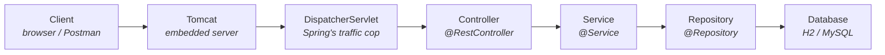

**The response travels back the same way, in reverse:** Repository → Service → Controller → DispatcherServlet → Tomcat → Client. Each layer hands its result up to whoever called it. **Nothing skips a layer.**

## 4.1 The DispatcherServlet

Worth a name-check because it appears in error messages.

📖 The **DispatcherServlet** is a single object Spring creates for you that receives *every* request, then asks: *"which method in this application has a mapping matching `GET /students/5`?"* It calls that method, takes the returned value, converts it to JSON, and sends it back.

**You never write it and never call it** — but it's the thing that makes `@GetMapping` work.

---

## 4.2 The four layers, and why they exist

Those middle three boxes are *your* code. Splitting them this way is the single most valuable habit in backend development. Each layer has **one job** and talks only to its neighbour.

| Layer | Job | Must NOT contain |
|---|---|---|
| **Controller** | Handles the web. Reads the URL and request body, calls the service, returns a result and status code. | Business rules |
| **Service** | Holds the thinking. Business rules, validation, calculations, coordinating repositories. | Anything about HTTP |
| **Repository** | Talks to the database. Saving, finding, deleting rows. | Business rules |
| **Model / Entity** | Carries the data. A plain Java class representing a Student, Post, Order. Passed between all layers. | Logic |

### 💡 Analogy — a restaurant

- The **waiter** (controller) takes your order and brings your food, but doesn't cook.
- The **chef** (service) cooks and decides the recipe, but never talks to customers.
- The **storeroom keeper** (repository) fetches ingredients, and neither cooks nor serves.

If the waiter started cooking at the table, the restaurant would descend into chaos — and so does a codebase where controllers contain business logic.

### Why bother, honestly?

**Because requirements change.** If the business rule *"students must be over 16"* lives in the service, you change it in **one** place and every entry point gets the new rule. If it's copy-pasted into three controllers, you will fix two of them and ship the bug in the third.

🎓 **Teach this:** The restaurant analogy lands with everyone. But add the "requirements change" argument too — junior developers often see layering as bureaucracy until you show them the maintenance cost of *not* doing it.

---

# Part 5 — The entry point and the Golden Rule

> ⚠️ **This is the most important part of this file.** The Golden Rule below is the single biggest cause of lost time for beginners, and it produces an error with *no error message*.

## 5.1 `@SpringBootApplication`

Every Spring Boot app has exactly one main class, generated for you. It's remarkably short:

```java
package com.tcs.training.demo;

import org.springframework.boot.SpringApplication;
import org.springframework.boot.autoconfigure.SpringBootApplication;

@SpringBootApplication
public class DemoApplication {

    public static void main(String[] args) {
        SpringApplication.run(DemoApplication.class, args);
    }
}
```

Two lines do the work:

- `SpringApplication.run(...)` **boots everything**: creates the container, runs auto-configuration, scans for your classes, starts Tomcat.
- `@SpringBootApplication` is the label that tells it *how*.

⚠️ **Leave this class where it is.** Don't move the main class into a sub-package, and don't create a second one. Its **package location** determines which of your classes Spring can find — which is the next two sections.

---

## 5.2 `@SpringBootApplication`, unpacked

That one annotation is shorthand for **three** separate annotations. You'll occasionally see all three written out in older code — they mean exactly the same thing.

| Annotation | What it does |
|---|---|
| `@SpringBootConfiguration` | Marks this class as a **source of configuration** — a place where beans may be declared. A specialised form of `@Configuration`. |
| `@EnableAutoConfiguration` | Switches on **auto-configuration** — the classpath-scanning, condition-checking process from Part 3. Without this, Boot behaves like plain Spring. |
| `@ComponentScan` | Tells Spring to **search for your annotated classes** — starting in this class's own package and going down through every sub-package. |

**Focus on the third one.** `@ComponentScan` has **no arguments here**. So where does it search?

> It defaults to *"the package this class lives in, and everything below it."*

That default is entirely reasonable — and it is the reason the next section exists.

---

## 5.3 ⚠️ THE GOLDEN RULE

Spring only manages classes it can **find**. It finds them by scanning **downward** from the main class's package. It never looks sideways or upward.

> ## 🔑 The Golden Rule
>
> **Every class you create must live in the same package as the main class, or in a sub-package of it.**

### What that looks like

Suppose your main class sits in `com.tcs.training.demo`:

```text
com.tcs.training
 └── demo                  ← main class DemoApplication lives here
      ├── controller       ✅ FOUND — inside demo
      │    └── HelloController.java
      ├── service          ✅ FOUND — inside demo
      │    └── GreetingService.java
      └── model            ✅ FOUND — inside demo
           └── Student.java

com.tcs.training
 └── controller            ❌ NOT FOUND — sibling of demo, not inside it
      └── HelloController.java   Spring never sees this class.
```

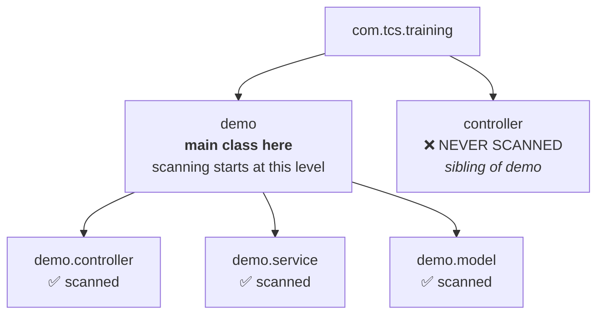

### ⚠️ What "not found" looks like when you run it

**This is the cruel part.** The app starts **perfectly — no error at all** — but every request to your endpoint returns:

```text
Whitelabel Error Page
There was an unexpected error (type=Not Found, status=404).
```

That's what makes it so confusing. Nothing appears broken. The URL simply isn't registered, because Spring never noticed the class.

If a **service** is involved instead, you get a louder failure at startup:

```text
required a bean of type 'com.tcs.training.demo.service.GreetingService'
that could not be found.
```

🎓 **Teach this:** Demonstrate the failure live. Create a controller in the wrong package, start the app (it starts fine!), hit the URL, get the 404. *Then* move the file and watch it work. Five minutes here saves your associates hours. The silence of the failure is the lesson.

---

## 5.4 How to know your base package — always

The rule is easy. **The mistake people make is *assuming* what the base package is instead of checking.**

Here's the check, and it takes five seconds:

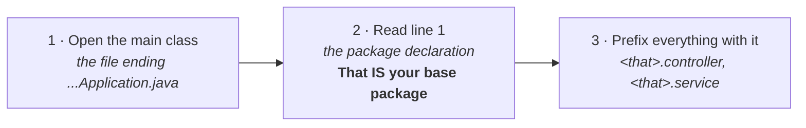

### Why the assumption goes wrong

Spring Initializr **builds the package name by joining your Group and Artifact**, stripping out hyphens. So **the two fields you type produce a third value you didn't type**:

| Group you type | Artifact you type | Package Initializr actually generates |
|---|---|---|
| `com.tcs.training` | `demo` | ✅ `com.tcs.training.demo` |
| `com.tcs.training` | `student-api` | ⚠️ `com.tcs.training.studentapi` — **not** `com.tcs.training`! |
| `com.tcs.training` | `springboot-demo` | ⚠️ `com.tcs.training.springbootdemo` |
| `com.tcs.training` | `eureka-server` | ⚠️ `com.tcs.training.eurekaserver` — hyphen dropped |

⚠️ **This is exactly the bug that broke the old version of these labs.** The lab text said "create `com.tcs.training.controller`" while the real base package was `com.tcs.training.springbootdemo`. Result: silent 404s on every endpoint.

**Two defences:**

1. **On the Initializr page, read the `Package name` field before clicking Generate.** You may have to expand *"Options"* to see it. You can also edit it directly.
2. **After importing, open the main class and read line 1.** Whatever it says *is* your base package — regardless of what you expected.

💡 **Practical shortcut:** if the new package folder appears **next to** `DemoApplication.java` in the IDE tree, you're safe.


---

# Part 6 — Beans, Dependency Injection and the container

## 6.1 What is a "bean", really?

"Bean" sounds mysterious. It isn't. Read this slowly:

> ## 📖 A **bean** is just an ordinary Java object that **Spring** created and is keeping hold of for you.

That's all. There is no special `Bean` class to extend and no interface to implement.

The **only** difference between a bean and any other object is **who called `new`**:

**An ordinary object — *you* own it:**

```java
GreetingService s = new GreetingService();
// You created it. You decide when to make it, how many to make,
// and you must pass it to everyone who needs it.
```

**A bean — *Spring* owns it:**

```java
@Service
public class GreetingService { }
// Spring found this at startup, created ONE instance, and holds it.
// Anyone who needs it gets that one, handed over automatically.
```

### Two immediate consequences

1. **By default there is exactly one instance** of each bean for the whole application. 📖 That's called **singleton scope**.
2. **Because Spring created it, Spring can do extra work around it** — wrap it in a transaction, add security checks, publish metrics — without you writing that code.

💡 **Handing over the `new` is what buys you those features.** That's the trade, and it's the same trade as Inversion of Control from Part 1.2.

---

## 6.2 Dependency Injection — the problem it solves

First, the word. 📖 A **dependency** is simply **an object that another object needs in order to do its job**. A controller that must produce greetings *depends on* a greeting service. That's it.

So we have one question: **who gives the controller its service?** There are only two answers, and they lead to very different codebases.

### ❌ The object fetches its own

```java
public class HelloController {

    private GreetingService service = new GreetingService();
    //                               ↑ hard-wired, permanently
}
```

The controller is now **welded** to that exact class. To use a different implementation, you must edit and recompile the controller.

### ✅ The object is given one

```java
@RestController
public class HelloController {

    private final GreetingService service;

    public HelloController(GreetingService service) {
        this.service = service;   // handed in from outside
    }
}
```

The controller **states what it needs and receives it**. It never names a concrete class, so what it receives can change freely.

> ## 📖 **Dependency Injection** means an object does not create the things it needs — they are handed to it from outside.

Spring is the "outside": it builds every bean, works out who needs whom, and passes them in. **That's why you'll write very few `new` keywords from here on.**

---

## 6.3 Why we care: tight vs loose coupling

*"Because it's cleaner"* is not a good enough reason. Here's the concrete pay-off, using a realistic change:

> Your app sends notifications by email, and now it must send SMS instead.

| | Tightly coupled (`new` inside) | Loosely coupled (injected) |
|---|---|---|
| **Swap the implementation** | Edit the controller's source and recompile it | Point Spring at a different bean. The controller isn't touched. |
| **Test it in isolation** | Nearly impossible — every test really sends an email | Pass in a fake in the test's constructor. Fast, and no email leaves the building. |
| **Reuse elsewhere** | The class drags its dependency along wherever it goes | Reusable anywhere, because it only asks for an interface |
| **Who controls the lifecycle** | Scattered across your code, invisibly | One place: the container |

### 💡 Testability is the argument that wins

Notice row two. **Injection is what makes unit testing practical**: you can hand a class a harmless stand-in instead of the real database or the real email server.

Teams that adopt DI usually do it for testability first, and enjoy the flexibility as a bonus.

### Depend on interfaces for the full benefit

The pay-off is largest when the type you inject is an **interface** (`NotificationService`) rather than a concrete class (`EmailService`). Then the injected object can be swapped for *any* implementation without the receiving class knowing.

You'll do exactly this in **Session 3** with a service interface and its implementation.

---

## 6.4 Telling Spring "manage this class"

Spring won't manage a class unless you label it. 📖 The labels are called **stereotype annotations**.

Technically `@Component` is the only one that matters — **the others *are* `@Component`, renamed to communicate the class's role.**

| Annotation | Meaning | Adds real behaviour? |
|---|---|---|
| `@Component` | The generic one. "This is a Spring-managed bean." Use when no other label fits. | No |
| `@Service` | A bean containing **business logic**. Same behaviour as `@Component`, but documents intent for the next reader. | No |
| `@Repository` | A bean that **talks to the database**. | **Yes** — Spring translates vendor-specific database exceptions into its own consistent types |
| `@Controller` | A bean that **handles web requests** and returns view names (for HTML pages). | Yes |
| `@RestController` | `@Controller` + `@ResponseBody`. Returns **data** (JSON) rather than a page. | Yes |

> **`@RestController` is what we use for APIs — in all four sessions.**

### Then how does Spring know what to inject?

**By type.** When Spring builds `HelloController` and sees its constructor asks for a `GreetingService`, it looks through its beans for one of that type and passes it in.

**You never write the connection anywhere** — it's matched automatically.

⚠️ If two beans share a type, Spring can't choose, and asks you to disambiguate with `@Qualifier`.

---

## 6.5 The IoC container

All those beans live somewhere. 📖 That somewhere is the **IoC container** (also called the **application context**) — one big object Spring creates at startup that holds every bean and knows how they connect.

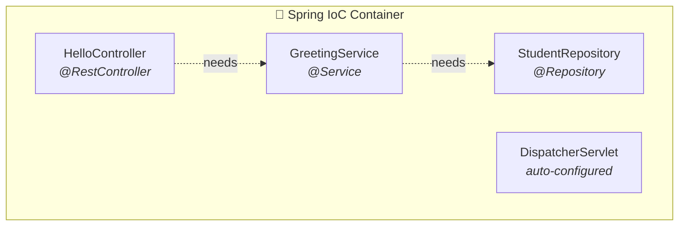

### Its startup sequence, in order

| Step | What happens |
|---|---|
| **1 · Scan** | Walk the base package and all sub-packages looking for stereotype annotations. **← The Golden Rule lives here.** |
| **2 · Instantiate** | Create one instance of each class it found. |
| **3 · Inject** | Work out the dependency graph and hand each bean what it asked for. |
| **4 · Serve** | Start Tomcat and begin accepting requests. |

⚠️ **Steps 1 and 3 are where startup failures happen.**

`A component required a bean of type 'X' that could not be found` means **step 3 failed**: something asked for X, and step 1 never found an X to give it.

Nine times out of ten the cause is:
- a missing stereotype annotation, **or**
- a class sitting outside the scanned packages (the Golden Rule again)

---

## 6.6 Three ways to inject — and which to use

Spring supports three mechanisms. **Recognise all three** (you'll meet them in existing code), but **write only one.**

| Style | How it looks | Verdict |
|---|---|---|
| **Constructor** | `public Ctrl(Service s) { this.s = s; }` | ✅ **Recommended.** Field can be `final`, object can never exist half-built, trivially testable with plain `new`. |
| **Field** | `@Autowired private Service s;` | ⚠️ Works, very common in older code and tutorials. But the field can't be `final`, and you cannot construct the class in a test without Spring. |
| **Setter** | `@Autowired public void setS(Service s)` | Only for genuinely **optional** dependencies — rare. |

### 💡 The convenience that surprises people

Since Spring 4.3, if a class has **exactly one constructor**, you can **omit `@Autowired` entirely** — Spring uses that constructor automatically.

So the recommended style is also the shortest:

```java
@RestController
public class HelloController {

    private final GreetingService service;

    // No @Autowired needed — one constructor, so Spring just uses it.
    public HelloController(GreetingService service) {
        this.service = service;
    }
}
```

🎓 **Teach this:** Associates who've seen older tutorials will default to `@Autowired` on fields. Don't just tell them it's discouraged — show them the test. Try to write a unit test for a field-injected class with plain `new` and watch the NullPointerException. Then do it with constructor injection and watch it work.

---

## 6.7 Dependency injection, end to end

Two small files. This is the complete pattern you'll write in the lab, and the pattern every remaining session builds on.

### 1 · The service — the bean being injected

```java
package com.tcs.training.demo.service;

import org.springframework.stereotype.Service;

@Service   // ← "Spring, manage me"
public class GreetingService {

    public String greet(String name) {
        return "Hello, " + name + "!";
    }
}
```

### 2 · The controller — the bean receiving it

```java
package com.tcs.training.demo.controller;

import com.tcs.training.demo.service.GreetingService;
import org.springframework.web.bind.annotation.GetMapping;
import org.springframework.web.bind.annotation.PathVariable;
import org.springframework.web.bind.annotation.RestController;

@RestController
public class GreetController {

    private final GreetingService service;

    public GreetController(GreetingService service) {
        this.service = service;   // injected
    }

    @GetMapping("/greet/{name}")
    public String greet(@PathVariable String name) {
        return service.greet(name);
    }
}
```

### What Spring does at startup, precisely

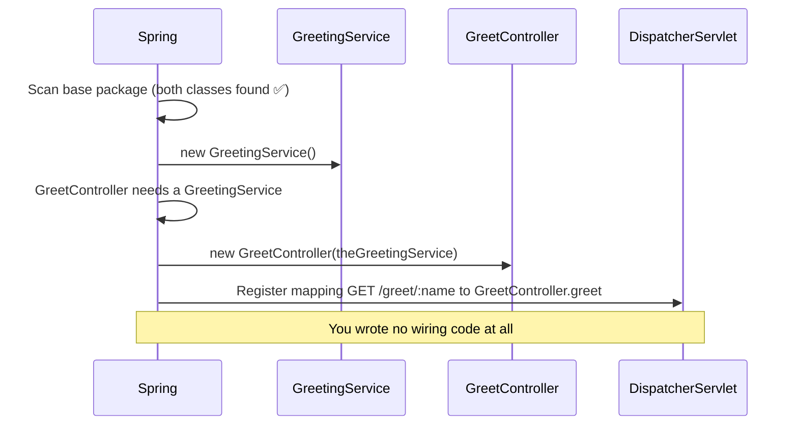

### 🔬 Try it — delete one annotation and watch it break

Remove `@Service` from `GreetingService` and the app **refuses to start**:

```text
***************************
APPLICATION FAILED TO START
***************************

Description:

Parameter 0 of constructor in
com.tcs.training.demo.controller.GreetController required a bean of type
'com.tcs.training.demo.service.GreetingService' that could not be found.

Action:

Consider defining a bean of type
'com.tcs.training.demo.service.GreetingService' in your configuration.
```

**Deliberately breaking things is the fastest way to understand what an annotation was doing.** Put it back and it starts again.


---

# Part 7 — REST basics

## 7.1 What is REST?

📖 **REST** (Representational State Transfer) is not a technology or a library — it is a **style of designing web APIs**.

Its central idea: your application exposes **resources** (the nouns — students, posts, orders) at URLs, and you act on them using HTTP's existing verbs.

| Principle | What it means |
|---|---|
| **URLs name things, not actions** | `/students` is the collection; `/students/5` is one student. The URL says *what*, never *what to do*. |
| **The verb says the action** | Same URL, different meaning: `GET /students/5` reads, `DELETE /students/5` removes. |
| **Stateless** | Every request carries everything needed to understand it. The server remembers nothing between requests — which is what lets you run many copies of it (Session 4). |
| **JSON as the format** | Data goes back and forth as JSON text. Spring converts your Java objects automatically. |

⚠️ **The most common design mistake:** putting verbs in URLs — `/getStudent?id=5` or `/deleteStudent/5`. HTTP already *has* verbs; using them twice is redundant. The REST way is `GET /students/5` and `DELETE /students/5`.

Session 2 covers URI design properly. For now: **use nouns in paths**.

---

## 7.2 HTTP methods and their Spring annotations

Each HTTP verb has a matching Spring annotation. Put it on a method, and that method answers that kind of request at that path.

| Verb | Meaning | Spring annotation | Example |
|---|---|---|---|
| **GET** | Read data. Changes nothing. | `@GetMapping` | `GET /students` |
| **POST** | Create something new. | `@PostMapping` | `POST /students` |
| **PUT** | Replace/update an existing thing. | `@PutMapping` | `PUT /students/5` |
| **DELETE** | Remove a thing. | `@DeleteMapping` | `DELETE /students/5` |
| **PATCH** | Update part of a thing. | `@PatchMapping` | `PATCH /students/5` |

---

## 7.3 `@PathVariable` vs `@RequestParam`

Two annotations for pulling values *out* of the request. **The difference trips up almost everyone**, so look carefully at *where* each value sits in the URL.

### `@PathVariable` — part of the path

```java
// GET /hello/Purvam
@GetMapping("/hello/{name}")
public String hi(@PathVariable String name) {
    return "Hello, " + name;
}
// name = "Purvam"
// Used to identify WHICH resource.
```

### `@RequestParam` — after the `?`

```java
// GET /hello?name=Purvam
@GetMapping("/hello")
public String hi(@RequestParam String name) {
    return "Hello, " + name;
}
// name = "Purvam"
// Used to filter, sort or paginate.
```

### 💡 The test for which to use

Ask: **"is this value required to identify the thing?"**

- **Yes** → **path variable**. `/students/5` — without the `5` there's no request to make.
- **It just narrows or sorts a list** → **query parameter**. `/students?grade=A` — still meaningful without it.

### 🔬 Try it — free type validation

```java
@GetMapping("/add/{a}/{b}")
public String add(@PathVariable int a, @PathVariable int b) {
    return a + " + " + b + " = " + (a + b);
}
```

A URL is **always just text** — `"7"` arrives as characters, not a number. You declared the parameter as `int`, and **Spring converted it for you**.

Now request `/add/seven/5`: you get a **400 Bad Request**, because `"seven"` can't become an `int`. **Spring validated the input type without you writing a single check.**

---

# Part 8 — The project

## 8.1 Spring Initializr — `start.spring.io`

The official project generator. Fill a short form, get a ZIP containing a complete, correctly-configured project.

| Field | What to choose | What it controls |
|---|---|---|
| **Project** | `Maven` | The build tool. (Gradle is the alternative.) |
| **Language** | `Java` | Also offers Kotlin and Groovy. |
| **Spring Boot** | the default stable `3.x` | **Avoid anything marked SNAPSHOT, M1 or RC** — those are unreleased. |
| **Group** | `com.tcs.training` | Your organisation's identifier — reversed domain name by convention. |
| **Artifact** | `demo` | This project's name. Becomes the folder name and the JAR name. |
| 🔑 **Package name** | `com.tcs.training.demo` | **Your base package.** Auto-filled as Group + Artifact — **always read it**, and you may edit it. |
| **Packaging** | `Jar` | Jar = self-contained with embedded Tomcat. Choose this, not War. |
| **Java** | `17` or `21` | Must be ≤ the JDK installed on your machine. |
| **Dependencies** | `Spring Web` | The starters to include. Session 1: just this one. |

⚠️ **The highlighted row is the one that matters.** `Package name` is filled in for you by joining Group and Artifact, and beginners never look at it. It *is* your base package, so it's what the Golden Rule applies to.

On the Initializr page you may need to click **"Options"** to see the field. **Read it. Note it down. Every class you create goes underneath it.**

---

## 8.2 What's inside the generated project

```text
demo/
├── src/
│   ├── main/
│   │   ├── java/
│   │   │   └── com/tcs/training/demo/
│   │   │       └── DemoApplication.java    ← main class · YOUR BASE PACKAGE
│   │   └── resources/
│   │       ├── application.properties      ← all your settings
│   │       ├── static/                     ← css, js, images
│   │       └── templates/                  ← HTML templates (unused for APIs)
│   └── test/
│       └── java/…/DemoApplicationTests.java ← a starter test
├── target/                                 ← build output (git-ignored)
├── pom.xml                                 ← dependencies & build config
├── mvnw  /  mvnw.cmd                       ← Maven wrapper
└── .gitignore
```

**The mental split — only three of these need your attention today:**

| Path | Contains |
|---|---|
| `src/main/java` | **Code** — every class you write |
| `src/main/resources` | **Configuration and static files** |
| `pom.xml` | **Which libraries you want** |

💡 **Where your new folders go:** you'll create `controller` and `service` packages **next to `DemoApplication.java`**, inside `com/tcs/training/demo/`. That satisfies the Golden Rule automatically.

---

## 8.3 `application.properties`

One file, `src/main/resources/application.properties`, holds all your settings as simple `key=value` lines.

It arrives **empty**, and an empty file is a perfectly valid one — it means *"every default is fine."*

```properties
# --- The server ---
server.port=8080                    # which port to listen on (default 8080)
spring.application.name=demo        # app's name, shown in logs

# --- Logging ---
logging.level.root=INFO             # global log level
logging.level.org.springframework.web=DEBUG   # chattier, just for web code

# --- Diagnostics ---
debug=true                          # print the auto-config report at startup
```

### Two things worth knowing early

| Concept | What it does |
|---|---|
| **Profiles** | A file named `application-dev.properties` is loaded only when the `dev` profile is active — that's how one codebase carries different settings for development and production. |
| **Precedence** | Command-line arguments and environment variables **beat** this file. That's how deployment platforms inject real passwords without editing your code — and how you'll run three copies of one app on different ports in Session 4. |

> You may see `application.yml` instead — the same settings written as an indented tree. Both are equally valid. We stay with `.properties` because there's no indentation to get wrong. **Never keep both files for the same setting.**

---

# Part 9 — Reading errors

You *will* see errors. That's normal and expected. What separates a confident developer from a stuck one is knowing that **Spring Boot errors are unusually well written** — the answer is nearly always in the first few lines.

## 9.1 The startup failure format

Boot prints startup failures in a fixed, friendly format. **Read the `Action` line first.**

```text
***************************
APPLICATION FAILED TO START
***************************

Description:

Field service in com.tcs.training.demo.controller.GreetController
required a bean of type 'com.tcs.training.demo.service.GreetingService'
that could not be found.

Action:

Consider defining a bean of type
'com.tcs.training.demo.service.GreetingService' in your configuration.
```

## 9.2 The four errors you'll actually hit

| What you see | What it means | Where to look first |
|---|---|---|
| `required a bean … could not be found` | Something asked for a bean that doesn't exist | Missing `@Service`/`@Component`, **or** the class is outside the base package |
| **Whitelabel Error Page**, 404 | App is running fine; that URL simply isn't registered | Typo in the path, missing `@RestController`, or **the Golden Rule was broken** |
| `Port 8080 was already in use` | Another program holds that port | Stop the old run, or set `server.port=8081` |
| `Caused by: …` (at the bottom) | The *real* cause of a long stack trace | Always scroll to the **last** `Caused by` — that's the origin |

## 9.3 The 30-second checklist for any "it doesn't work"

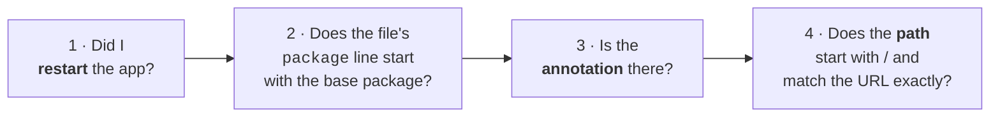

**These four questions resolve the overwhelming majority of Session 1 problems.**

⚠️ **Number 1 catches more people than the other three combined.** Spring scans for classes **only at startup**. A new controller is invisible until you restart.

## 9.4 Common beginner mistakes

| Mistake | What happens | Fix |
|---|---|---|
| Class created **outside** the main class's package | Silent 404 / bean not found. **The #1 cause of lost time.** | Apply the Golden Rule — read the main class's `package` line and go underneath it |
| Forgetting the stereotype annotation | "required a bean … could not be found" | Add `@Service` / `@Component` / `@RestController` |
| Using `@Controller` instead of `@RestController` | Spring treats your returned text as a *view name* and can't find a page | Use `@RestController` for APIs |
| Missing the leading `/` in a mapping | Path doesn't match what you type in the browser | `@GetMapping("/hello")`, not `("hello")` |
| Two methods mapped to the same verb + path | Startup fails: "Ambiguous mapping" | Make each verb+path pair unique |
| Calling `new` on a service instead of injecting it | Compiles and runs, but that object's *own* dependencies are all `null` | Always inject via the constructor |
| `@PathVariable` name doesn't match `{}` | Error about a missing path variable | `@GetMapping("/hi/{name}")` must pair with `@PathVariable String name` |
| Not restarting after a change | Nothing seems to happen | Stop and re-run. (Adding `spring-boot-devtools` gives automatic restarts.) |


---

# Recap and self-test

## The one-page summary

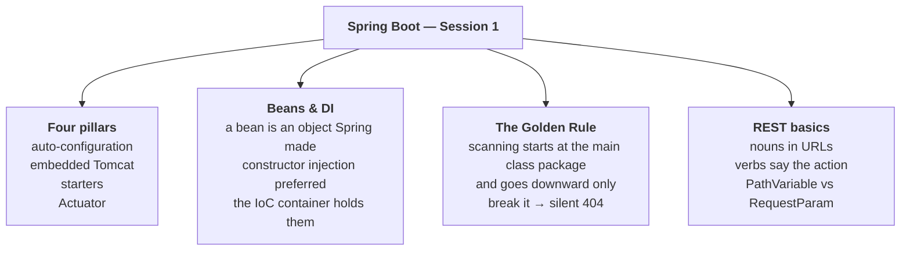

## Annotation cheat sheet

| Annotation | What it does |
|---|---|
| `@SpringBootApplication` | Main class. Config + auto-config + component scan |
| `@RestController` | Handles web requests; returns data, not a view |
| `@RequestMapping("/api")` | Class-level path prefix for every method inside |
| `@GetMapping("/x")` | Maps HTTP GET `/x` to this method |
| `@PathVariable` | Reads a value from **inside** the path |
| `@RequestParam` | Reads a value from **after the `?`** |
| `@Service` | A business-logic bean |
| `@Component` | A generic Spring-managed bean |
| `@Repository` | A data-access bean |
| `@Autowired` | Inject here (optional on a sole constructor) |

## Self-test — answer these out loud

Cover the answers. If you can explain all nine without looking, you're ready for Session 2 — and ready to teach this.

<details>
<summary><b>1. What are the four things Spring Boot gives you?</b></summary>

**Auto-configuration** (sensible beans based on your classpath), an **embedded server** (Tomcat inside the app), **starter dependencies** (curated, version-aligned bundles), and **production-ready features** (Actuator health & metrics).
</details>

<details>
<summary><b>2. What three annotations does <code>@SpringBootApplication</code> combine?</b></summary>

`@SpringBootConfiguration`, `@EnableAutoConfiguration` and `@ComponentScan` — the last of which scans this class's own package and everything below it.
</details>

<details>
<summary><b>3. What is a bean, in one sentence?</b></summary>

An ordinary Java object that **Spring** created and holds on to — rather than one you created with `new`. By default there is one instance per application (singleton scope).
</details>

<details>
<summary><b>4. Where must your controllers live, and what exactly goes wrong if they don't?</b></summary>

In the main class's package or a **sub-package** of it, because `@ComponentScan` only searches *downward* from there. Break this and the app **starts with no error** but every request returns a **404 Whitelabel Error Page** — the endpoint was never registered.
</details>

<details>
<summary><b>5. What happens if you remove <code>@Service</code> from an injected class?</b></summary>

The app **refuses to start**, with `required a bean of type '...' that could not be found`. The controller asked for it, and Spring never created one because the label was gone.
</details>

<details>
<summary><b>6. <code>@PathVariable</code> vs <code>@RequestParam</code>?</b></summary>

`@PathVariable` reads a value from *inside* the path — `/hello/`**`Purvam`**. `@RequestParam` reads one from after the `?` — `/hello?name=`**`Purvam`**.

The test: if the value **identifies** the resource → path. If it just **filters** a list → query.
</details>

<details>
<summary><b>7. Why is constructor injection preferred over field injection?</b></summary>

Fields can be `final`, the object can never exist in a half-built state, and the class can be created with plain `new` in a test — no Spring required.
</details>

<details>
<summary><b>8. You added one dependency (Actuator) and got working endpoints with no Java. Which feature made that possible?</b></summary>

**Auto-configuration.** Boot saw the new library on the classpath, a matching conditional configuration activated, and it registered the endpoints for you.
</details>

<details>
<summary><b>9. You visit a URL you just wrote and get a Whitelabel 404. Name the four things you'd check, in order.</b></summary>

1. Did I **restart**? 2. Does the file's `package` line start with the base package? 3. Is the **annotation** there? 4. Does the **path** start with `/` and match exactly?
</details>

---

# Glossary

| Term | Plain-English meaning |
|---|---|
| **Framework** | Code that runs your code. It owns the main flow and calls your methods at the right moments (unlike a library, which you call). |
| **Inversion of Control (IoC)** | The framework calls your code instead of your code calling the framework. Control of the flow is inverted. |
| **Bean** | An ordinary Java object that *Spring* created and holds on to. One instance per app by default. |
| **IoC container** | The single big object Spring builds at startup that holds every bean and knows how they connect. Also called the *application context*. |
| **Dependency** | An object that another object needs to do its job. A controller depends on a service. |
| **Dependency Injection (DI)** | Objects don't create what they need — it's handed to them from outside (by Spring), usually through the constructor. |
| **Component scanning** | Spring's startup search for annotated classes, starting at the main class's package and going *downward*. The Golden Rule comes from this. |
| **Base package** | The package your main class sits in. Everything you write must live in it or below it. |
| **Auto-configuration** | Boot inspecting which libraries are present and creating sensible beans for them — always overridable by defining your own. |
| **Classpath** | The full list of code available at runtime: your classes plus every library JAR. |
| **Starter** | One dependency that pulls in a whole coherent set of libraries at versions verified to work together. |
| **Embedded server** | Tomcat living inside your application, so you *run* the app instead of *deploying to* a server. |
| **DispatcherServlet** | Spring's traffic cop. Receives every request and decides which of your methods should handle it. |
| **Endpoint** | One combination of HTTP verb + path that your app answers, e.g. `GET /hello`. |
| **REST** | A style of API design: URLs name resources (nouns), HTTP verbs say what to do, server keeps no session state. |
| **JSON** | The text format APIs use to exchange data. Spring converts your objects to and from it automatically. |
| **Jackson** | The library that does that JSON conversion. Included with `spring-boot-starter-web`. |
| **POM** | "Project Object Model" — the `pom.xml` file listing dependencies and build settings. |
| **Whitelabel Error Page** | Spring Boot's plain default error page. On a URL you just wrote, it almost always means the endpoint isn't registered. |
| **Actuator** | A starter adding ready-made health, metrics, beans and mappings endpoints. |
| **Singleton scope** | Spring's default: exactly one instance of a bean for the whole application. |

---

# Teaching this session

## Suggested timing (2.5 hours including lab)

| Minutes | Part | Notes |
|---|---|---|
| 0–10 | Part 1 groundwork | **Don't skip.** Annotations = labels a tool reads. Make them say it back. |
| 10–25 | Part 2 why Boot exists | Show the XML. Let them groan. That groan *is* the motivation. |
| 25–50 | Part 3 four pillars | Run `debug=true` live during auto-configuration. |
| 50–60 | Part 4 request flow + layers | Restaurant analogy. Draw the flow on a whiteboard yourself. |
| 60–80 | **Part 5 Golden Rule** | ⚠️ **Spend real time here.** Demo the silent 404 live. |
| 80–105 | Part 6 beans & DI | Delete `@Service` live and read the error together. |
| 105–115 | Parts 7–9 REST, project, errors | Lighter — they'll meet all of it again in the lab. |
| 115+ | Lab | Circulate. Most questions will be package-related. |

## The three demos that matter most

1. **`debug=true`** → the conditions report. Converts "auto-configuration is magic" into "it's a big list of if-statements".
2. **The silent 404.** Put a controller in the wrong package. Start the app — *it starts fine*. Hit the URL — 404. Move the file. Works. **This is the single most valuable five minutes of the session.**
3. **Delete `@Service`.** App won't start. Read the error out loud together, then restore it. Teaches both DI *and* how to read Spring errors.

## Questions your associates will actually ask

<details>
<summary><b>"Is Spring Boot a different framework from Spring?"</b></summary>

No — it's a layer *on top* of Spring. Use the engine/ignition analogy. This misconception causes real confusion later when they read Spring docs that never mention Boot.
</details>

<details>
<summary><b>"Why don't I need to write <code>new</code> anymore?"</b></summary>

Because Spring calls `new` for you and hands the object over. That handover is what lets Spring wrap the object in transactions, security and metrics — features you'd otherwise write yourself.
</details>

<details>
<summary><b>"Do I have to use <code>@Autowired</code>?"</b></summary>

Not on a constructor, if the class has only one. Show them the short form. Then show them why field injection makes testing painful.
</details>

<details>
<summary><b>"Why did my endpoint 404 when the app started fine?"</b></summary>

**Golden Rule.** Have them read line 1 of their main class out loud, then line 1 of their controller. The mismatch is usually obvious the moment they say it aloud.
</details>

<details>
<summary><b>"What's the difference between <code>@Component</code>, <code>@Service</code> and <code>@Repository</code>?"</b></summary>

Behaviourally almost nothing — `@Service` and `@Repository` *are* `@Component` with a role-specific name. `@Repository` alone adds real behaviour (database exception translation). Use them to communicate intent to the next reader.
</details>

<details>
<summary><b>"Where does the port 8080 come from? I never set it."</b></summary>

Convention over configuration. `spring-boot-starter-web` is on the classpath, so Boot assumes a web app and picks the conventional port. Override with `server.port=`.
</details>

## Emphasis guide

| Spend more time on | Spend less time on |
|---|---|
| 🔑 The **Golden Rule** (Part 5.3–5.4) | The XML example — one look is enough |
| What a **bean** actually is (6.1) | The full starter table — it's reference material |
| **Constructor injection** and why (6.6) | Actuator endpoint details — they'll explore in the lab |
| **Reading errors** (Part 9) | Maven internals beyond the three jobs |

## Common teaching pitfalls

- ⚠️ **Don't introduce beans before annotations.** If they don't have "annotation = label a tool reads", beans feel arbitrary.
- ⚠️ **Don't let them skip the restart.** Half of all lab problems are "I didn't restart". Say it three times.
- ⚠️ **Don't explain the Golden Rule with words alone.** Demo the silent failure. Words don't convey how *quiet* the failure is.
- ⚠️ **Resist teaching too much.** Spring is enormous. This session is deliberately a small number of ideas held firmly. Depth beats coverage.

---

## Where next

**Session 2 — REST Web Services.** You'll turn today's single endpoint into a complete CRUD API: all four HTTP verbs, JSON travelling in *both* directions with `@RequestBody`, correct status codes via `ResponseEntity`, and proper testing with Postman and Swagger.

📄 [`session-2-rest-apis.md`](session-2-rest-apis.md)
