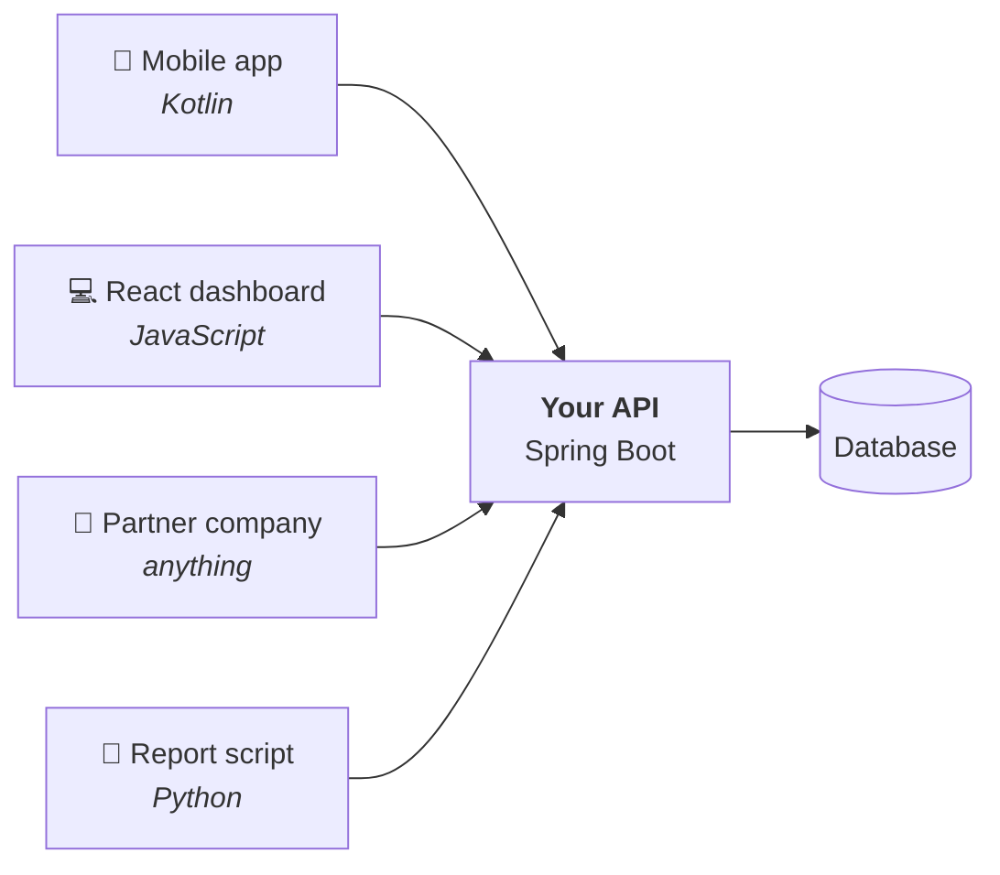
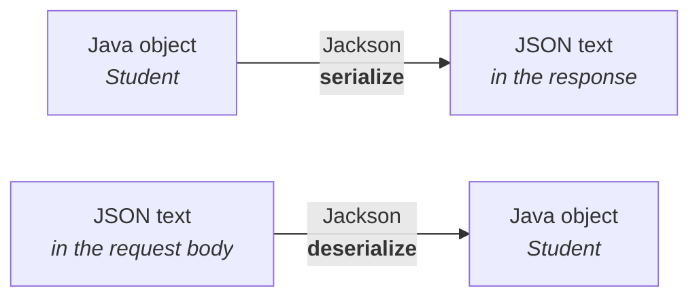
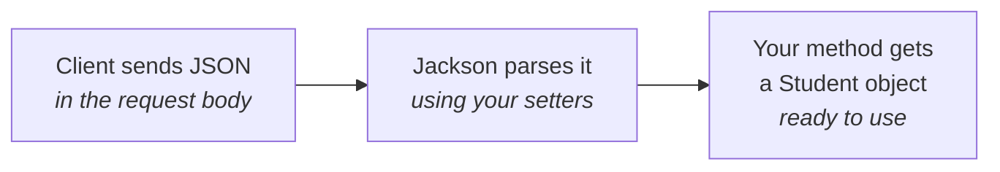
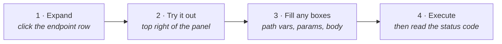
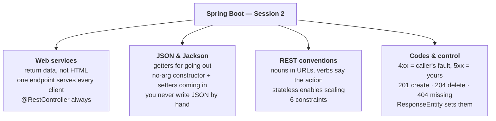

# Session 2 — REST APIs & Web Services

> **Study notes for the Spring Boot training series**
> Companion to `springboot-session2-theory.html` (slides) and `springboot-session2-lab.html` (hands-on).
> Written to be read on its own — learn from this file, then teach from it.

---

## How to use this file

Session 1 was mostly **concepts** — how the framework works. Session 2 is mostly **conventions** — agreements the whole industry has settled on.

That changes how you should read it. There's less machinery to understand and more vocabulary to absorb, so this file leans on **tables you'll come back to as a reference**. Don't try to memorise the status-code table on first read; know where it is.

**Notation:**

| Marker | Meaning |
|---|---|
| 💡 **Idea** | The plain-English concept, before any jargon |
| 📖 **The word for it** | The official term, once you understand the idea |
| 🔬 **Try it** | A hands-on experiment |
| ⚠️ **Trap** | A mistake beginners genuinely make |
| 🎓 **Teach this** | A note for when you're the one explaining it |

---

## Contents

1. [Why APIs exist at all](#part-1--why-apis-exist)
2. [JSON — the language APIs speak](#part-2--json)
3. [REST, properly](#part-3--rest-properly)
4. [Verbs, CRUD, and getting them right](#part-4--verbs-and-crud)
5. [Status codes](#part-5--status-codes)
6. [Designing URLs](#part-6--designing-urls)
7. [The code](#part-7--the-code)
8. [Where does the data live?](#part-8--where-does-the-data-live)
9. [Testing an API properly](#part-9--testing-an-api-properly)
10. [Calling someone else's API](#part-10--calling-someone-elses-api)
11. [Recap and self-test](#recap-and-self-test)
12. [Glossary](#glossary)
13. [Teaching this session](#teaching-this-session)

---

## Session 1 recap — the four things you must still have

Before starting, make sure these are solid. Everything today builds on them.

| | Idea |
|---|---|
| ⚙️ | **Boot removes setup.** Auto-configuration, embedded Tomcat, starters, Actuator. You run a `main` method and a web server appears. |
| 🫘 | **Beans live in a container.** A bean is an object *Spring* created. Annotate a class `@Service`, ask for it in a constructor, and Spring hands it over. |
| 📁 | **The Golden Rule.** Every class must sit in the main class's package **or below it**, or component scanning never finds it. |
| 🌐 | **Mappings answer requests.** `@RestController` + `@GetMapping("/hello")` is a working endpoint. `@PathVariable` and `@RequestParam` read input. |

⚠️ **Today's project base package** is `com.tcs.training.students` (Group `com.tcs.training`, Artifact `students`). The Golden Rule hasn't gone anywhere — it applies in all four sessions.

---

## What you'll be able to do by the end

- Explain what a web service is and why returning **data** beats returning HTML.
- Read and write JSON confidently, and explain how Spring converts it to Java objects.
- Choose the **right HTTP verb** and the **right status code** for any operation.
- Design URLs that other developers will thank you for.
- Build a complete **CRUD API** — create, read, update, delete.
- Test an API with **Swagger UI** — a page your own app generates, with `curl` as a fallback.

---

# Part 1 — Why APIs exist

## 1.1 The problem

In Session 1 your endpoint returned text to a *browser*. But a browser is only one possible caller.

Consider a company with a single database of students, and four different things that need it:

| Caller | Written in | Problem |
|---|---|---|
| 📱 A mobile app | Kotlin or Swift | Can't talk to your database directly, and shouldn't |
| 💻 A web dashboard | React | Runs in the user's browser — nowhere near your server |
| 🏢 A partner company | Who knows | Different language, different servers, definitely no database access |
| 🤖 A nightly report script | Python | Written by someone in the analytics team |

Four callers, four languages, none able to reach into your database.

**So you put one program in the middle** that owns the data and exposes a set of agreed URLs. Everyone talks to *that*. It's the only thing that has to know about the database.



> ## 📖 Definitions
>
> An **API** (Application Programming Interface) is **a contract that lets one program use another program's functionality**.
>
> A **web service** is an API you reach **over the network using HTTP**.

That's the whole distinction: **all web services are APIs; not all APIs are web services.**

---

## 1.2 Web application vs web service

Both live on a server and answer HTTP requests. The difference is **who the answer is for** — and it changes everything about what you return.

| | **Web application** → for humans | **Web service** → for programs |
|---|---|---|
| Returns | **HTML** — a page with layout, colours, buttons | **Data** — usually JSON |
| Meant to be | Looked at | Parsed |
| Who decides presentation | You, the server | The caller |
| Spring annotation | `@Controller` (returns a view name) | `@RestController` (returns the body itself) |

**Web application response:**

```html
<h1>Student List</h1>
<table>
  <tr><td>Amit</td><td>A</td></tr>
</table>
```

**Web service response:**

```json
[
  { "name": "Amit", "grade": "A" }
]
```

### 💡 Why "data, not layout" is the smarter choice

Return JSON and the *same* endpoint serves the mobile app, the React dashboard, the partner company and the Python script — each rendering it however suits them.

Return HTML and you've baked in one presentation that only a browser can use.

This separation is why **virtually all modern backends are built as web services**. Everything in this course uses `@RestController`.

---

## 1.3 One request, one response — in full

Let's look at an actual HTTP exchange, so the vocabulary that follows has something concrete to attach to. Here a client creates a new student.

### ⬆️ The request the client sends

```http
POST /api/students HTTP/1.1        ← verb + path
Host: localhost:8080
Content-Type: application/json     ← "my body IS json"
Accept: application/json           ← "send json back"

{                                  ← the BODY starts here
  "name": "Amit Shah",
  "email": "amit@tcs.com",
  "grade": "A"
}
```

### ⬇️ The response your server sends

```http
HTTP/1.1 201 Created               ← status code
Content-Type: application/json

{                                  ← the BODY
  "id": 4,                         ← server assigned this
  "name": "Amit Shah",
  "email": "amit@tcs.com",
  "grade": "A"
}
```

### The five parts

| Part | What it is |
|---|---|
| **Method / verb** | The kind of operation: `POST` here, meaning "create" |
| **Path** | Which resource: `/api/students` |
| **Headers** | Metadata *about* the message — its format, what format you want back, credentials |
| **Body** | The actual data. `GET` and `DELETE` normally have none; `POST` and `PUT` do |
| **Status code** | Three digits summarising the outcome. `201` = created successfully |

🎓 **Teach this:** Show this raw exchange before any Java. Associates who've only seen `@GetMapping` often don't realise headers exist — and then can't debug a `415` error. Ten minutes on the raw protocol pays for itself.

---

## 1.4 The vocabulary you'll hear all day

| Term | Meaning | Example |
|---|---|---|
| **Resource** | A "thing" your API exposes. Always a *noun*. | a student, a post, an order |
| **Collection** | All resources of one type | `/api/students` |
| **Endpoint** | One verb + path combination your app answers | `GET /api/students/5` |
| **Payload / body** | The data carried inside a request or response | the JSON block above |
| **Header** | Metadata about the message, not the data itself | `Content-Type: application/json` |
| **Query parameter** | An extra value after the `?`, usually to filter or sort | `/api/students?grade=A` |
| **Stateless** | The server remembers nothing between requests | every request re-sends its token |
| **Idempotent** | Doing it repeatedly has the same effect as doing it once | `DELETE` ✅, `POST` ❌ |
| **Safe** | Changes nothing on the server. Read-only. | `GET` ✅ |

### 💡 Idempotent — worth a second look (it comes up in interviews)

Delete student 5, and student 5 is gone. Delete student 5 **again** — still gone, nothing extra happened. That's **idempotent**.

But `POST /api/students` twice creates **two** students. That's **not** idempotent.

**Why it matters practically:** a mobile app on a flaky connection can safely **retry** a failed `DELETE` or `PUT`, but must be careful retrying a `POST` — it might create a duplicate.


---

# Part 2 — JSON

## 2.1 The two structures

📖 **JSON** (JavaScript Object Notation) is just **text in an agreed shape**. Every language can read and write it, which is exactly why it won.

There are only **two** structures to learn.

### An object — curly braces

```json
{
  "id": 1,
  "name": "Amit Shah",
  "active": true
}
```

A set of **key: value** pairs. Maps to a Java **object**.

### An array — square brackets

```json
[
  { "id": 1, "name": "Amit" },
  { "id": 2, "name": "Neha" }
]
```

An ordered list. Maps to a Java **`List`**.

## 2.2 The rules are strict

Breaking any of these causes a **400 Bad Request**:

| Rule | ✅ Right | ❌ Wrong |
|---|---|---|
| Keys must be in double quotes | `{"name": "Amit"}` | `{name: "Amit"}` |
| Strings use **double** quotes only | `"Amit"` | `'Amit'` |
| No trailing comma after the last pair | `{"a":1}` | `{"a":1,}` |
| No comments — JSON has no `//` or `/* */` | | `{"a":1} // nope` |

⚠️ **These four cause most of the `400`s you'll see in the lab.** When you get a 400 on a POST, check this list before anything else.

## 2.3 Data types, and how they map to Java

| JSON type | Example | Java equivalent |
|---|---|---|
| **String** | `"Amit Shah"` | `String` |
| **Number** | `42` · `3.14` | `int`, `long`, `double`, `BigDecimal` |
| **Boolean** | `true` · `false` *(lower-case)* | `boolean` |
| **Null** | `null` | `null` |
| **Object** | `{ "city": "Ahmedabad" }` | a class, e.g. `Address` |
| **Array** | `[ "A", "B", "C" ]` | `List<String>` |

Objects and arrays nest freely, and **Java classes mirror that nesting exactly**:

```json
{
  "id": 1,
  "name": "Amit Shah",
  "address": {                       ← a nested OBJECT  → an Address field
    "city": "Ahmedabad",
    "pincode": "380015"
  },
  "subjects": ["Java", "SQL"],       ← an ARRAY  → List<String>
  "active": true
}
```

⚠️ **Dates are the one awkward case.** JSON has no date type, so dates travel as strings. The convention is **ISO-8601**: `"2026-09-05"` or `"2026-09-05T10:32:14"`. Spring handles `LocalDate` and `LocalDateTime` in that format by default — **stick to it and everything just works.**

---

## 2.4 You never write JSON by hand

This is the part beginners find surprising. **You do not build JSON strings in your code.**

You return a Java object, and a library called **Jackson** — already included with `spring-boot-starter-web` — converts it. The conversion runs automatically in both directions.



### ⚠️ Two rules make it work — and forgetting them causes most JSON bugs

| Direction | What Jackson needs on your class | If it's missing |
|---|---|---|
| **Java → JSON** (going out) | **Getters.** The JSON key comes from the getter name: `getName()` → `"name"` | Field silently missing from the JSON, or an empty `{}` |
| **JSON → Java** (coming in) | A **no-argument constructor** plus **setters** | A `400` error, or all fields arrive `null` |

### 💡 The practical takeaway

Your data classes need a **no-arg constructor, getters and setters**. Every IDE generates these for you:

| IDE | How |
|---|---|
| IntelliJ IDEA | <kbd>Alt</kbd>+<kbd>Insert</kbd> → "Getter and Setter" |
| Eclipse | Right-click → Source → "Generate Getters and Setters" |
| VS Code | Right-click → Source Action → "Generate Getters and Setters" |

**Never type them by hand.** It's slow and typo-prone.

🎓 **Teach this:** The "empty `{}` response" bug is a great teaching moment. Have them delete a getter and watch that field vanish from the JSON. It makes the getter → key relationship concrete in a way explanation doesn't.

---

# Part 3 — REST, properly

## 3.1 The definition

📖 **REST** — Representational State Transfer — is an **architectural style** described by Roy Fielding in 2000. It is **not** a library, a protocol or a Spring feature. It's a set of design agreements that, if you follow them, make your API predictable to anyone who has used any other REST API.

> ## The core idea, in one sentence
> Expose your data as **resources at URLs**, and use **HTTP's existing verbs** to act on them.

Look at what that buys you. **One URL, four completely different operations** — and no reader has to guess:

| Request | What it means |
|---|---|
| `GET /api/students/5` | Give me student 5 |
| `PUT /api/students/5` | Update student 5 with the data in my body |
| `DELETE /api/students/5` | Remove student 5 |
| `POST /api/students` | Create a new student from the data in my body |

The path never changes meaning — it always identifies **which** data. The verb carries the **intent**. That's REST.

---

## 3.2 The six REST constraints

Fielding listed six rules. An API that follows them is called "RESTful". Spring Boot gives you most for free — but you should know what they are.

| # | Constraint | What it means |
|---|---|---|
| 1 | **Client–Server** | The client (UI) and server (data) are separate and can be developed, deployed and scaled independently |
| 2 | **Stateless** | Every request carries everything needed to understand it. The server stores no session between calls |
| 3 | **Cacheable** | Responses say whether they may be cached, so repeated reads needn't hit the server |
| 4 | **Uniform Interface** | The same small set of verbs and conventions everywhere, so an unfamiliar API still feels familiar |
| 5 | **Layered System** | Gateways, load balancers and caches may sit in between; the client can't tell and doesn't care |
| 6 | **Code on Demand** *(optional)* | The server may send executable code (e.g. JavaScript). Rarely used |

### 💡 Number 2 matters most — and here's why

Because the server keeps **no memory of you**, **any copy of the server can handle any request**. That means you can run ten identical copies behind a load balancer, and requests can land on any of them.

> **Statelessness is what makes horizontal scaling possible.**

This is precisely what **Session 4** exploits when we run three instances of one service and watch requests distributed between them. **Stateless design today is what lets you scale tomorrow.**

🎓 **Teach this:** Plant this flag now. When Session 4 arrives and you run three instances, call back to this slide explicitly — "remember constraint 2?" The payoff lands much harder when they saw it coming.

---

## 3.3 REST vs SOAP

Before REST won, the standard was **SOAP** — a heavyweight, XML-based protocol. You'll still meet it in banking, telecom and older enterprise systems.

| | **REST** | **SOAP** |
|---|---|---|
| **What it is** | An architectural *style* — a set of conventions | A strict *protocol* with a formal specification |
| **Data format** | JSON (usually), or anything | XML only |
| **Message size** | Small and light | Large — envelope, header and body wrappers |
| **Readability** | Easy to read by eye | Verbose and hard to scan |
| **Contract** | Optional (OpenAPI / Swagger) | **Mandatory** and machine-readable (WSDL) |
| **Transport** | HTTP only | HTTP, SMTP, JMS, TCP… |
| **Built-in transactions** | No | **Yes** (WS-* standards) |
| **Best suited to** | Web & mobile apps, microservices, public APIs | Banking, telecom, formal enterprise integration |

### The honest summary

REST won because it is **simpler and lighter**, and because mobile apps and browsers handle JSON effortlessly.

**SOAP is not "bad."** Its rigidity is a genuine advantage when you need guaranteed contracts and built-in transaction support. But for new projects REST is the default, and it's what we build on.

---

# Part 4 — Verbs and CRUD

## 4.1 The mapping table

📖 **CRUD** stands for **C**reate, **R**ead, **U**pdate, **D**elete — the four things you do to almost any data.

Each maps to one HTTP verb and one Spring annotation. **Learn this table; the lab is literally this table.**

| CRUD | Verb | Spring annotation | Path | Body? | Success code |
|---|---|---|---|---|---|
| **Create** | `POST` | `@PostMapping` | `/api/students` | ✅ Yes | `201 Created` |
| **Read all** | `GET` | `@GetMapping` | `/api/students` | No | `200 OK` |
| **Read one** | `GET` | `@GetMapping("/{id}")` | `/api/students/5` | No | `200 OK` |
| **Update** | `PUT` | `@PutMapping("/{id}")` | `/api/students/5` | ✅ Yes | `200 OK` |
| **Delete** | `DELETE` | `@DeleteMapping("/{id}")` | `/api/students/5` | No | `204 No Content` |

💡 **Notice the pattern in the paths.** Operations on the **collection** use `/api/students`. Operations on **one item** add its id — `/api/students/5`.

### PUT vs PATCH

| | Meaning |
|---|---|
| `PUT` | **Replace the whole thing.** Send every field — anything you omit gets wiped. |
| `PATCH` | **Change only these fields.** Send just what's different. |

`PUT` is simpler and far more common. **Default to `PUT`** until you have a reason not to.

---

## 4.2 Safe and idempotent — and why it matters

Two properties of each verb decide whether a browser may pre-fetch it, whether a proxy may cache it, and whether a mobile app may safely retry it.

| Verb | Safe? *(changes nothing)* | Idempotent? *(repeat = same result)* | Consequence |
|---|---|---|---|
| `GET` | ✅ Yes | ✅ Yes | Cacheable; safe to retry or pre-fetch freely |
| `POST` | ❌ No | ❌ No | **Retrying creates a duplicate.** This is why browsers warn "confirm form resubmission" |
| `PUT` | ❌ No | ✅ Yes | Safe to retry — you'd just set the same values again |
| `DELETE` | ❌ No | ✅ Yes | Safe to retry — already-deleted stays deleted |
| `PATCH` | ❌ No | ⚠️ Depends | Idempotent if you set absolute values; not if you say "add 1" |

### ⚠️ The real-world rule this gives you

> **Never use `GET` for anything that changes data.**

A URL like `GET /deleteStudent/5` looks harmless but is genuinely dangerous:

- browsers **pre-fetch** links
- crawlers **follow** them
- proxies **cache** them

**People have wiped production data this way.** If it changes something, use `POST`, `PUT`, `PATCH` or `DELETE`.


---

# Part 5 — Status codes

## 5.1 The five families

Every response carries a three-digit code. **You don't need to memorise all of them** — you need to know what the **first digit** means, because that alone tells you *who has the problem*.

| Family | Meaning | Examples |
|---|---|---|
| **1xx** | **Informational** — "still working on it". You'll rarely see these | `100 Continue` |
| **2xx** | **Success** — it worked | `200 OK`, `201 Created`, `204 No Content` |
| **3xx** | **Redirection** — "it lives somewhere else now" | `301`, `304 Not Modified` |
| **4xx** | **Client error** — *the caller* did something wrong. **Fix the request.** | `400`, `404`, `415` |
| **5xx** | **Server error** — *your code* broke. **Fix the server.** | `500`, `503` |

### 💡 4xx vs 5xx — the most useful distinction in debugging

> **4xx means it's the caller's fault. 5xx means it's yours.**

When a client reports "your API returned 400", the answer is usually *"check what you sent me."* When it returns 500, **that's your bug and it belongs in your logs.**

⚠️ Getting this right saves enormous amounts of finger-pointing. **Returning `500` for bad user input is a genuine API design fault**, not a cosmetic one.

---

## 5.2 The codes you'll actually use

| Code | Name | Use it when |
|---|---|---|
| `200` | OK | A `GET` or `PUT` succeeded and you're returning data |
| `201` | Created | A `POST` created something new. **Best practice: also return the new object** |
| `204` | No Content | It worked but there's nothing to send back — the classic `DELETE` response |
| `400` | Bad Request | The body is malformed, or a required field is missing/invalid |
| `401` | Unauthorized | You haven't logged in. *(Badly named — it means **unauthenticated**)* |
| `403` | Forbidden | You **are** logged in, but you're not allowed to do this |
| `404` | Not Found | No resource at that path — wrong URL, or that id doesn't exist |
| `405` | Method Not Allowed | The path exists but not for that verb — e.g. POST to a `@GetMapping` |
| `409` | Conflict | It clashes with existing state — a duplicate email, for instance |
| `415` | Unsupported Media Type | ⚠️ **The `Content-Type: application/json` header is missing.** Swagger UI sets it for you, so you'll only meet this with other tools |
| `500` | Internal Server Error | An unhandled exception escaped your code. Always a bug worth fixing |

### ⚠️ 401 vs 403, since everyone mixes them up

| Code | Means | Fix |
|---|---|---|
| `401` | *"I don't know who you are"* | Log in |
| `403` | *"I know exactly who you are, and you're not allowed"* | **No amount of logging in will help** |

---

# Part 6 — Designing URLs

Your URLs are your API's **public face**. They're read by other developers, hard to change once published, and a good set makes an API feel obvious.

| Rule | ❌ Avoid | ✅ Prefer |
|---|---|---|
| **Nouns, not verbs** — HTTP already has the verb | `/getStudent/5`<br>`/createStudent` | `GET /students/5`<br>`POST /students` |
| **Plural for collections** — consistent, reads naturally | `/student` | `/students` |
| **Lower-case with hyphens** | `/StudentRecords`<br>`/student_records` | `/student-records` |
| **Nest to show ownership** | `/getCoursesForStudent?id=5` | `GET /students/5/courses` |
| **Query params filter; paths identify** | `/students/gradeA` | `/students?grade=A` |
| **No file extensions** — headers handle format | `/students.json` | `/students` |
| **Version your API** | `/students` *(then break it later)* | `/api/v1/students` |

### 💡 Path or query parameter? The test

Ask: **"is this value required to identify the thing?"**

| Answer | Use | Example |
|---|---|---|
| **Yes** — without it there's no request to make | **Path** | `/students/5` |
| **No** — it merely narrows or sorts a list | **Query** | `/students?grade=A&sort=name` |

This maps exactly onto `@PathVariable` and `@RequestParam`.

---

# Part 7 — The code

## 7.1 Annotations you'll use today

| Annotation | Purpose | New today? |
|---|---|---|
| `@RestController` | Marks the class as a REST handler. Methods return data, not view names | |
| `@RequestMapping("/api/students")` | Class-level base path. Every method's path is appended to it | |
| `@GetMapping` | Handle HTTP GET — read data | |
| `@PostMapping` | Handle HTTP POST — create something | |
| `@PutMapping` | Handle HTTP PUT — update something | |
| `@DeleteMapping` | Handle HTTP DELETE — remove something | |
| `@PathVariable` | Read a value from inside the path: `/students/`**`5`** | |
| `@RequestParam` | Read a value from after the `?`: `?grade=`**`A`** | |
| `@RequestBody` | Convert the JSON body into a Java object | ✅ **New** |
| `ResponseEntity<T>` | *(Not an annotation)* a return type that lets you set the status code and headers | ✅ **New** |

💡 **Only two genuinely new things today.** You already know six of these from Session 1. Today adds **`@RequestBody`** (data coming *in*) and **`ResponseEntity`** (control over what goes *out*). Everything else is repetition — which is exactly how it should feel.

---

## 7.2 `@RestController`, unpacked

Like `@SpringBootApplication`, this is shorthand. It is exactly **two** annotations combined:

| Annotation | What it does |
|---|---|
| `@Controller` | Makes it a **bean** that handles web requests — so component scanning picks it up and the DispatcherServlet can route to it |
| `@ResponseBody` | Says **"my return value IS the response body"** — convert it to JSON and send it — rather than "my return value is the name of an HTML page to render" |

### ⚠️ That second one explains a classic beginner error

**❌ `@Controller` alone:**

```java
@Controller
public class StudentController {

    @GetMapping("/hello")
    public String hello() {
        return "Hello!";
    }
}
```

Spring reads `"Hello!"` as **the name of a page**, hunts for a template called `Hello!`, fails, and you get a **500 error** or a Whitelabel page.

**✅ `@RestController`:**

```java
@RestController
public class StudentController {

    @GetMapping("/hello")
    public String hello() {
        return "Hello!";
    }
}
```

Spring sends `Hello!` as the response body. Correct — and the same reasoning applies to objects, which become JSON.

> **Rule of thumb:** building an **API**? `@RestController`, always. Rendering **HTML pages** server-side (Thymeleaf, JSP)? `@Controller`. **We use `@RestController` exclusively in this course.**

---

## 7.3 `@RequestMapping` at class level

Every endpoint for one resource shares a path prefix. Rather than repeating it, declare it once on the class — method paths are then **appended** to it.

**❌ Repetitive:**

```java
@RestController
public class StudentController {

    @GetMapping("/api/students")
    @GetMapping("/api/students/{id}")
    @PostMapping("/api/students")
    @PutMapping("/api/students/{id}")
    @DeleteMapping("/api/students/{id}")
    // /api/students typed 5 times.
    // Change the prefix → edit 5 lines.
}
```

**✅ Prefix declared once:**

```java
@RestController
@RequestMapping("/api/students")
public class StudentController {

    @GetMapping             // → /api/students
    @GetMapping("/{id}")    // → /api/students/5
    @PostMapping            // → /api/students
    @PutMapping("/{id}")    // → /api/students/5
    @DeleteMapping("/{id}") // → /api/students/5
    // One place to change the prefix.
}
```

### ⚠️ Two things that catch people out

1. **The full path is always *class prefix + method path*.** If your class says `/api/students` and your method *also* says `/api/students/{id}`, the real URL becomes `/api/students/api/students/5` — and you'll get a confusing 404.
2. **A bare `@GetMapping` with no value maps to the class path exactly** — which is precisely what you want for "get all".

---

## 7.4 `@RequestBody` — data coming in

Until now every input arrived through the URL. That's fine for an id but hopeless for a whole student record.

To *create* something, the client sends JSON in the **request body**, and `@RequestBody` turns that JSON into a Java object.

```java
@PostMapping
public Student create(@RequestBody Student student) {
    // 'student' is a fully-populated Java object.
    // Jackson parsed the JSON body and filled it in — you wrote no parsing code.
    return service.save(student);
}
```



The JSON keys are matched to your class's fields **by name**:

| The JSON sent | The object you receive |
|---|---|
| `"name": "Amit Shah"` | `student.getName()` → `"Amit Shah"` |
| `"email": "amit@tcs.com"` | `student.getEmail()` → `"amit@tcs.com"` |
| `"grade": "A"` | `student.getGrade()` → `"A"` |
| *(not sent)* | `student.getId()` → `null` |

### ⚠️ Two failure modes you will definitely hit in the lab

| Error | Cause | Fix |
|---|---|---|
| **415** Unsupported Media Type | The `Content-Type: application/json` header is missing | Swagger UI sets it automatically. With curl: `-H "Content-Type: application/json"` |
| **400** Bad Request | Your JSON is malformed — trailing comma, single quotes, missing brace | Check the four JSON rules from Part 2.2 |

**Both are *client* errors**, which is why they're 4xx.

---

## 7.5 `ResponseEntity` — control what goes out

Returning a plain object **always produces `200 OK`**. But we established that:

- a `POST` should return `201`
- a `DELETE` should return `204`
- a missing id should return `404`

`ResponseEntity<T>` is the wrapper that lets you set **status code, headers and body** yourself.

**Plain return — always 200:**

```java
@PostMapping
public Student create(@RequestBody Student s) {
    return service.save(s);
}
// Works, but returns 200 OK.
// A creation should say 201 Created.
```

**With `ResponseEntity`:**

```java
@PostMapping
public ResponseEntity<Student> create(@RequestBody Student s) {
    Student saved = service.save(s);
    return ResponseEntity
            .status(HttpStatus.CREATED)
            .body(saved);
}
// 201 Created + the new object.
```

### The shortcuts for common cases

| Code | Produces | Typical use |
|---|---|---|
| `ResponseEntity.ok(obj)` | `200` + body | A successful GET or PUT |
| `ResponseEntity.status(HttpStatus.CREATED).body(obj)` | `201` + body | A successful POST |
| `ResponseEntity.noContent().build()` | `204`, no body | A successful DELETE |
| `ResponseEntity.notFound().build()` | `404`, no body | That id doesn't exist |
| `ResponseEntity.badRequest().body(msg)` | `400` + message | Invalid input |

### 💡 The classic pattern: found or not found

```java
@GetMapping("/{id}")
public ResponseEntity<Student> getById(@PathVariable int id) {
    Student found = service.findById(id);
    if (found == null) {
        return ResponseEntity.notFound().build();   // 404
    }
    return ResponseEntity.ok(found);                // 200 + the student
}
```

You'll write exactly this in the lab. **In Session 3 we replace the `if` with something cleaner** — a custom exception and a global handler.

### 💡 Why `404` and not an empty `200`?

A status code is a **promise to the caller**. `200` means *"here is what you asked for"* — so returning `200` with nothing forces every client to write *"if the body is empty, it probably didn't exist"* guesswork.

`404` says it plainly, and the client can branch on the code alone. **Getting this right is much of what separates a usable API from an annoying one.**

### And the flip side — when *is* empty a success?

| Request | Response | Why |
|---|---|---|
| `GET /students/99` *(no such student)* | **`404`** | The question *"give me student 99"* has **no valid answer** |
| `GET /students?grade=Z` *(none match)* | **`200`** + `[]` | The question *"which students have grade Z?"* has a **perfectly valid answer: none** |

> **Empty collection → 200. Missing single item → 404.**

---

## 7.6 A complete CRUD controller

Everything from the last several sections, in one class. **This is the shape of the file you'll build across the lab** — read it as a map of where you're going.

```java
@RestController
@RequestMapping("/api/students")          // shared prefix
public class StudentController {

    private final StudentService service;

    public StudentController(StudentService service) {   // constructor injection
        this.service = service;
    }

    // READ ALL   ·  GET /api/students
    @GetMapping
    public List<Student> getAll() {
        return service.findAll();
    }

    // SEARCH     ·  GET /api/students/search?grade=A
    // Declared BEFORE /{id} so the literal path is unambiguous to readers.
    @GetMapping("/search")
    public List<Student> search(@RequestParam String grade) {
        return service.findByGrade(grade);
    }

    // READ ONE   ·  GET /api/students/5
    @GetMapping("/{id}")
    public ResponseEntity<Student> getById(@PathVariable int id) {
        Student s = service.findById(id);
        return (s == null) ? ResponseEntity.notFound().build()
                           : ResponseEntity.ok(s);
    }

    // CREATE     ·  POST /api/students  + JSON body
    @PostMapping
    public ResponseEntity<Student> create(@RequestBody Student student) {
        return ResponseEntity.status(HttpStatus.CREATED).body(service.save(student));
    }

    // UPDATE     ·  PUT /api/students/5  + JSON body
    @PutMapping("/{id}")
    public ResponseEntity<Student> update(@PathVariable int id,
                                          @RequestBody Student student) {
        Student updated = service.update(id, student);
        return (updated == null) ? ResponseEntity.notFound().build()
                                 : ResponseEntity.ok(updated);
    }

    // DELETE     ·  DELETE /api/students/5
    @DeleteMapping("/{id}")
    public ResponseEntity<Void> delete(@PathVariable int id) {
        return service.delete(id) ? ResponseEntity.noContent().build()
                                  : ResponseEntity.notFound().build();
    }
}
```

⚠️ **Order matters: put `/search` above `/{id}`.** `@GetMapping("/{id}")` is a wildcard — it would happily match the literal path `/search` too, then fail trying to turn `"search"` into an `int`. Spring's matching normally prefers the more specific literal path, but declaring `/search` first makes the intent obvious and avoids surprises.


---

# Part 8 — Where does the data live?

We have no database yet — that's Session 3. So today the students live in an ordinary **`ArrayList` held in memory**, inside a `@Service` bean.

```java
@Service
public class StudentService {

    // Just a list in memory. Remember: the @Service bean is a SINGLETON,
    // so there is ONE list shared by every request — which is what makes
    // it behave like a tiny database for the duration of the run.
    private final List<Student> students = new ArrayList<>();
    private int nextId = 1;
    // ...
}
```

### ⚠️ The consequence — and it's the whole motivation for Session 3

> **Restart the app and every student you created is gone.**

The list lived in memory, and memory is wiped when the process ends. **That's not a bug in the lab; it's the honest limit of what we've built.**

Session 3 fixes it with a real database — and you'll appreciate *why* we need one far more having felt this.

### 💡 The good news: the controller won't change

Because the controller only talks to `StudentService` and **never to the list**, swapping the list for a real database means:

- **rewriting the service** ✏️
- **leaving the controller completely untouched** ✅

That is the layered architecture from Session 1 paying off — **and you'll watch it happen for real next session.**

🎓 **Teach this:** Make them feel the data loss. Have them create three students, restart, and hit `GET`. The empty array is a better motivation for JPA than any explanation of persistence.

---

# Part 9 — Testing an API properly

## 9.1 Why a browser isn't enough

Here's a problem: **typing a URL into a browser can only ever send a `GET`.**

There is no way to send a `POST` with a JSON body, or a `DELETE`. So from today you need a proper API client.

## 9.2 Swagger UI — our choice

There are two common API clients. We use **Swagger UI**, and it's worth understanding why.

| | Postman | **Swagger UI** *(our choice)* |
|---|---|---|
| **What it is** | A separate desktop application | A page **your own app** generates and serves |
| **Install** | Download and set up | One dependency in `pom.xml` — nothing to install |
| **Knows your endpoints?** | ❌ No — you type every URL by hand | ✅ Yes — it reads your controllers automatically |
| **Request body** | ❌ You write the JSON yourself | ✅ Pre-filled from your Java class |
| **`Content-Type` header** | ❌ You must set it (Body → raw → JSON) | ✅ Set for you |
| **Doubles as documentation** | ❌ No | ✅ Yes — that's its main job |

### Setting it up — one dependency

```xml
<dependency>
    <groupId>org.springdoc</groupId>
    <artifactId>springdoc-openapi-starter-webmvc-ui</artifactId>
    <version>2.8.6</version>
</dependency>
```

⚠️ **That version matters.** springdoc is **not** managed by the Spring Boot parent POM, so it needs an explicit `<version>`. Use **2.8.6** (or newer 2.8.x) with Spring Boot 3.5.x — older versions such as 2.5.x *fail at startup* on Boot 3.5.

Restart, then open **`http://localhost:8080/swagger-ui.html`**.

### The four-click rhythm



**Learn that rhythm — every test you run is the same loop with different values.**

### What the response panel gives you

| Item | Why it's useful |
|---|---|
| **Status code**, in large text | Read this *before* the body. It tells you whether to debug your request or your server |
| **Response body** | Formatted JSON |
| **Response headers** | Including `content-type` |
| **A `curl` box** | The exact equivalent command — copy it to script the call or share a reproduction |

### 💡 The form is generated from your method signature

This is the part that makes Swagger UI more than a convenience:

| Your code | What Swagger shows |
|---|---|
| no parameters | just an Execute button |
| `@PathVariable int id` | an `id` input box |
| `@RequestParam(defaultValue = "A")` | a `grade` box, **pre-filled with `A`** |
| `@RequestBody Student` | a request-body editor, pre-filled from the `Student` class |
| `@PathVariable` + `@RequestBody` | **both** an id box and a body editor |

You configure none of that. Which also means **a wrong annotation shows up here as a wrong-looking form** — a free sanity check on your own code.

### ⚠️ Two things that trip people up

1. **New endpoints don't appear until you restart.** Swagger reads your controllers *at startup*. Restart the app, then **hard-refresh** the page (<kbd>Ctrl</kbd>+<kbd>Shift</kbd>+<kbd>R</kbd>).
2. **The pre-filled body contains `"id": 0`.** That's a placeholder generated from the schema, not real data. Replace the values; the `id` is ignored because the server assigns it.

### 💡 Swagger UI is also a diagnostic

If an endpoint **isn't listed on the page**, Spring never registered it — so the problem is your class (missing annotation, or wrong package), not your URL. That's often the fastest way to distinguish the two.

## 9.3 `curl` — if you prefer the terminal

Works everywhere, needs no install:

```bash
# GET — the -i flag shows response headers, including the status line
curl -i http://localhost:8080/api/students/2

# POST — note the -H flag: that's the Content-Type header, set by hand
curl -i -X POST http://localhost:8080/api/students \
     -H "Content-Type: application/json" \
     -d '{"name":"Amit Shah","email":"amit@tcs.com","grade":"A"}'

# PUT
curl -i -X PUT http://localhost:8080/api/students/2 \
     -H "Content-Type: application/json" \
     -d '{"name":"Neha Patel","email":"neha.patel@tcs.com","grade":"A"}'

# DELETE
curl -i -X DELETE http://localhost:8080/api/students/3
```

## 9.4 The other half of the job — it's documentation too

Everything in 9.2 was about Swagger UI as a *test client*. But that page is really a **documentation** page that happens to be executable, and that second role is why the industry uses it.

### Make it read like real documentation

Out of the box the labels are guessed from your method names and the title is a generic *"OpenAPI definition"*. Two annotations fix that:

```java
import io.swagger.v3.oas.annotations.Operation;
import io.swagger.v3.oas.annotations.tags.Tag;

@RestController
@RequestMapping("/api/students")
@Tag(name = "Students", description = "Create, read, update and delete students")
public class StudentController {

    @Operation(summary = "Get all students")
    @GetMapping
    public List<Student> getAllStudents() { ... }

    @Operation(summary = "Create a new student")
    @PostMapping
    public ResponseEntity<Student> createStudent(@RequestBody Student student) { ... }
}
```

⚠️ **Watch the import** — it's `io.swagger.v3.oas.annotations`. Your IDE may also offer `io.swagger.annotations`, which is the **old Swagger 2** package. Pick the `v3` one.

The result:

| Verb | Path | Summary |
|---|---|---|
| `GET` | `/api/students` | Get all students |
| `POST` | `/api/students` | Create a new student |
| `GET` | `/api/students/search` | Search students by grade |
| `GET` | `/api/students/{id}` | Get one student by id |
| `PUT` | `/api/students/{id}` | Update an existing student |
| `DELETE` | `/api/students/{id}` | Delete a student |

…all grouped under a **"Students"** heading with your description.

> 📌 The rows are grouped **by path**, not in the order you declared them, so the three `/{id}` operations sit together. That's Swagger organising by resource — nothing is wrong with your code.

### Document the status codes too

By default Swagger claims every endpoint returns `200`. You know better — say so:

```java
@ApiResponses({
    @ApiResponse(responseCode = "200", description = "Student found"),
    @ApiResponse(responseCode = "404", description = "No student with that id")
})
@GetMapping("/{id}")
public ResponseEntity<Student> getStudentById(@PathVariable int id) { ... }
```

Now a caller knows to handle the `404` **before writing a line of code**.

### 📖 OpenAPI — the standard underneath

Swagger UI is only the *renderer*. The actual artefact is an **OpenAPI** specification, served as JSON at **`/v3/api-docs`**:

```json
{
  "openapi": "3.1.0",
  "paths": { "/api/students": { "get": { "summary": "Get all students", ... } } },
  "components": { "schemas": { "Student": {
      "type": "object",
      "properties": {
        "id":    { "type": "integer", "format": "int32" },
        "name":  { "type": "string" },
        "email": { "type": "string" },
        "grade": { "type": "string" }
      } } } }
}
```

Notice the `Student` schema lists exactly the four fields of your Java class — **that's where Swagger's pre-filled request body comes from.**

### 💡 Why teams care about that JSON file

| Benefit | What it means |
|---|---|
| **Can't drift out of date** | It's generated from the code, every startup |
| **Self-service for consumers** | A front-end developer can explore and try your whole API without asking you anything |
| **Machine-readable** | Feed it to a code generator and get a fully typed client (TypeScript, Java, Python) **automatically** |
| **Contract testing** | Tools can verify your API still matches the agreed spec |

That last-but-one point is the real payoff of documenting from code: the docs aren't just readable, they're **executable**.

---

# Part 10 — Calling someone else's API

So far your app has **answered** requests. Often it also needs to **make** them — fetching an exchange rate, or (in Session 4) calling another microservice.

```java
@Service
public class StudentLookupService {

    private final RestTemplate restTemplate = new RestTemplate();

    public Student fetchStudent(int id) {
        String url = "http://localhost:8081/api/students/" + id;

        // Sends a GET, receives JSON, and converts it straight into a
        // Student object — the same Jackson conversion, in reverse.
        return restTemplate.getForObject(url, Student.class);
    }
}
```

| Method | What it does |
|---|---|
| `getForObject(url, Class)` | GET, and give me the body as this type |
| `postForObject(url, body, Class)` | POST my object as JSON, give me the reply |
| `put(url, body)` | PUT my object |
| `delete(url)` | DELETE |
| `exchange(...)` | Full control — custom headers, any verb, full response |

### 📌 A note on what's current

`RestTemplate` is in **maintenance mode** — still fully supported and everywhere in existing code, which is why you must recognise it. For **new** code, Spring recommends:

| Client | When |
|---|---|
| **`RestClient`** | Modern, same synchronous style. The default choice for new code |
| **`WebClient`** | For reactive / async work |

💡 **Look ahead to Session 4:** `RestTemplate` gains a superpower there. Add `@LoadBalanced` and it can call a service **by name** instead of by URL, letting the service registry find the address for it — and load balance across several copies.

---

## Common mistakes in REST APIs

| Mistake | Symptom | Fix |
|---|---|---|
| Missing `Content-Type: application/json` | **415** Unsupported Media Type | Swagger UI sets it for you. With curl: add `-H "Content-Type: application/json"` |
| Malformed JSON — trailing comma, single quotes | **400** Bad Request | Double quotes on keys and strings; no comma after the last pair |
| Sending POST to a `@GetMapping` | **405** Method Not Allowed | Match the annotation to the verb |
| Class prefix repeated in the method path | **404** on a URL that looks right | Real path is class + method. Use `@GetMapping("/{id}")`, not the full path again |
| Data class has no getters | Response is `{}` or fields go missing | Generate getters — Jackson reads values through them |
| Data class has no no-arg constructor | **400**, or every field `null` | Add a public no-argument constructor |
| Returning `200` for everything | Works, but misleads callers | Use `ResponseEntity`: `201` create, `204` delete, `404` missing |
| Returning `500` for bad user input | Callers think your server is broken | `4xx` is *their* mistake; `5xx` is yours. Choose deliberately |
| Verbs in the URL — `/getStudent/5` | Works, but isn't REST | `GET /students/5`. The verb is the HTTP method |
| `/{id}` declared before `/search` | Odd **400** on `/api/students/search` | Declare literal paths above wildcard paths |

---

# Recap and self-test

## The one-page summary



## Your API at a glance

| Operation | Request | Returns |
|---|---|---|
| Read all | `GET /api/students` | `200` + JSON array |
| Read one | `GET /api/students/5` | `200` + object, or `404` |
| Filter | `GET /api/students/search?grade=A` | `200` + JSON array |
| Create | `POST /api/students` + body | `201` + the new object |
| Update | `PUT /api/students/5` + body | `200` + updated, or `404` |
| Delete | `DELETE /api/students/5` | `204`, or `404` |

## Self-test — answer these out loud

<details>
<summary><b>1. What's the difference between a web application and a web service?</b></summary>

A web **application** returns **HTML** for humans to look at (`@Controller`). A web **service** returns **data**, usually JSON, for other programs to consume (`@RestController`).
</details>

<details>
<summary><b>2. Which HTTP verbs are idempotent, and why does it matter?</b></summary>

`GET`, `PUT` and `DELETE` — repeating them has the same effect as doing them once. `POST` is **not**, which is why calling it twice creates two records and why retries after a dropped connection are risky.
</details>

<details>
<summary><b>3. What do 4xx and 5xx tell you?</b></summary>

**4xx = the caller's fault** (bad JSON, wrong id, no permission) — fix the request. **5xx = your server's fault** (an unhandled exception) — fix the code. Never return 5xx for bad user input.
</details>

<details>
<summary><b>4. What two things does <code>@RestController</code> combine?</b></summary>

`@Controller` (makes it a request-handling bean) + `@ResponseBody` (my return value *is* the response body, converted to JSON — not the name of a page).
</details>

<details>
<summary><b>5. You send valid JSON and get 415. What did you forget?</b></summary>

The `Content-Type: application/json` header. Swagger UI sets it automatically — so if you hit 415 you're using a tool that doesn't, and must add it yourself.
</details>

<details>
<summary><b>6. What must a class have for Jackson to convert it both ways?</b></summary>

**Getters** for going out (Java → JSON), and a **no-argument constructor plus setters** for coming in (JSON → Java).
</details>

<details>
<summary><b>7. Path variable or query parameter?</b></summary>

If the value is needed to **identify** the resource → path (`/students/5`). If it merely **filters or sorts** a list → query (`/students?grade=A`).
</details>

<details>
<summary><b>8. Why does searching grade Z return <code>200</code> with <code>[]</code>, but <code>/students/99</code> returns <code>404</code>?</b></summary>

*"Which students have grade Z?"* has a valid answer — **none**. The collection exists, it's just empty. That's a success.
*"Give me student 99"* has **no valid answer**; that resource doesn't exist. Hence `404`.

**Empty collection → 200. Missing single item → 404.**
</details>

<details>
<summary><b>9. Why does today's data vanish on restart, and which layer fixes it next session?</b></summary>

It lives in an `ArrayList` in memory inside a singleton bean, and memory is wiped when the process ends. **Session 3 replaces the service's storage** with a real database — the controller doesn't change at all.
</details>

<details>
<summary><b>10. The class says <code>@RequestMapping("/api/students")</code> and a method says <code>@GetMapping("/{id}")</code>. What's the full URL?</b></summary>

`/api/students/{id}` — the class prefix plus the method path. If the method *also* said the full path you'd get `/api/students/api/students/5`.
</details>

---

# Glossary

| Term | Plain-English meaning |
|---|---|
| **API** | A contract that lets one program use another program's functionality |
| **Web service** | An API you reach over the network using HTTP |
| **Resource** | A "thing" your API exposes. Always a noun — a student, an order |
| **Collection** | All resources of one type, e.g. `/api/students` |
| **Endpoint** | One verb + path combination your app answers |
| **Payload / body** | The data carried inside a request or response |
| **Header** | Metadata *about* the message, not the data itself |
| **REST** | A style of API design: resources at URLs, HTTP verbs for actions, no server-side session |
| **CRUD** | Create, Read, Update, Delete — the four basic data operations |
| **Stateless** | The server remembers nothing between requests. What makes horizontal scaling possible |
| **Safe** | A verb that changes nothing on the server (`GET`) |
| **Idempotent** | Doing it repeatedly has the same effect as doing it once (`GET`, `PUT`, `DELETE`) |
| **JSON** | Text in an agreed shape — objects in `{}`, arrays in `[]`. The format APIs exchange |
| **Jackson** | The library that converts Java objects ↔ JSON. Ships with `spring-boot-starter-web` |
| **Serialize** | Java object → JSON text (needs getters) |
| **Deserialize** | JSON text → Java object (needs a no-arg constructor and setters) |
| **Content-Type** | The header saying what format the body is in. Missing it causes `415` |
| **Status code** | Three digits summarising the outcome. First digit says who has the problem |
| **`ResponseEntity`** | A return type letting you set the status code, headers and body yourself |
| **SOAP** | The older, XML-based, heavyweight alternative to REST. Still found in banking and telecom |
| **OpenAPI** | The standard for describing an API's shape. **Swagger UI** renders it as a browsable page |
| **Swagger UI** | An interactive page generated from your controllers, for sending any HTTP verb with any body. Needed because a browser address bar only sends GET |
| **springdoc** | The library that generates Swagger UI and the OpenAPI spec for a Spring Boot app |

---

# Teaching this session

## Suggested timing (2.5 hours including lab)

| Minutes | Part | Notes |
|---|---|---|
| 0–5 | Session 1 recap | Just the four boxes. Confirm the Golden Rule is remembered. |
| 5–20 | Part 1 why APIs exist | The four-callers story. Show the raw HTTP exchange. |
| 20–35 | Part 2 JSON & Jackson | ⚠️ Delete a getter live and watch the field vanish. |
| 35–50 | Part 3 REST & constraints | Flag constraint 2 (stateless) for Session 4. |
| 50–65 | Parts 4–5 verbs & status codes | The two big reference tables. Don't drill; point at them. |
| 65–75 | Part 6 URL design | Fast — it's mostly common sense once stated. |
| 75–95 | Part 7 the code | `@RequestBody` and `ResponseEntity` are the only new things. |
| 95–105 | Parts 8–10 data, testing, clients | ⚠️ Demo the restart-and-lose-everything moment. |
| 105+ | Lab | Circulate. Most questions will be **415**. |

## The three demos that matter most

1. **Delete a getter.** Watch that field silently disappear from the JSON response. Makes the getter → JSON-key relationship concrete.
2. **Show the pre-filled request body.** Click "Try it out" on the POST and point out that Swagger built the JSON from their `Student` class — including the placeholder `"id": 0` they should ignore. Saves a dozen questions.
3. **Create three students, restart, `GET`.** Empty array. That felt loss is the best possible motivation for Session 3.

## Questions your associates will actually ask

<details>
<summary><b>"Why can't I test POST in the browser?"</b></summary>

The address bar can only issue `GET`. There's no UI for choosing a verb or attaching a body. Hence Swagger UI (or curl).
</details>

<details>
<summary><b>"Why 201 instead of 200 for create? It worked either way."</b></summary>

Both "work", but `201` tells the caller *specifically* that a new resource was created — and lets them read the new id from the body without guessing. Status codes are a contract, not decoration.
</details>

<details>
<summary><b>"What's the difference between 401 and 403 again?"</b></summary>

`401` = *"I don't know who you are"* → log in. `403` = *"I know who you are and you're still not allowed"* → logging in won't help.
</details>

<details>
<summary><b>"Should empty search results be 404?"</b></summary>

No. The collection exists; it's just empty. `200` + `[]`. Reserve `404` for a *single* resource that doesn't exist. This one genuinely confuses people — it's worth the two minutes.
</details>

<details>
<summary><b>"Why put the list in the service instead of the controller?"</b></summary>

So that Session 3 can swap the list for a database by rewriting **only** the service. Show them the controller and point out it never mentions `ArrayList`.
</details>

<details>
<summary><b>"Do I need <code>ResponseEntity</code> everywhere?"</b></summary>

No — only where you need a non-`200` status or custom headers. `GET`-all returning a plain `List` is perfectly fine. In Session 3 a global exception handler removes most of the need for it.
</details>

## Emphasis guide

| Spend more time on | Spend less time on |
|---|---|
| **4xx vs 5xx** — who fixes what | The full status-code list (reference material) |
| **Jackson's two rules** (getters / no-arg + setters) | REST vs SOAP — 5 minutes of context is plenty |
| **`@RequestBody`** and the `415` trap | The six constraints in detail — flag #2, skim the rest |
| **Empty-collection vs missing-item** status choice | `RestTemplate` — it's a Session 4 setup, not today's focus |

## Common teaching pitfalls

- ⚠️ **Don't skip the raw HTTP exchange.** If they've never seen a header, they cannot debug `415` — and they *will* hit `415`.
- ⚠️ **Don't let "it returns 200 so it works" pass.** Push on correct status codes now; it's much harder to retrofit the habit.
- ⚠️ **Do make them feel the data loss.** It's the whole bridge into Session 3.
- ⚠️ **Watch for the doubled path.** `@RequestMapping("/api/students")` + `@GetMapping("/api/students/{id}")` produces a baffling 404. Mention it before the lab.

---

## Where next

**Session 3 — Databases, DTOs & Exception Handling.** Two things about today's API are unsatisfying, and next session fixes both:

1. **The data vanishes on restart** → Spring Data JPA and an H2 database.
2. **Those `if (x == null) return notFound()` checks are repetitive** → a custom exception and one global handler.

Along the way: **DTOs** (why exposing your database classes directly is a bad idea), a proper **service interface**, and validation.

📄 [`session-3-data-jpa-dtos-exceptions.md`](session-3-data-jpa-dtos-exceptions.md)
