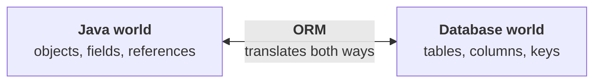
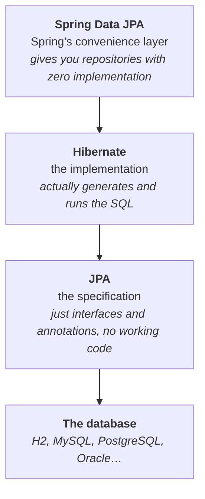
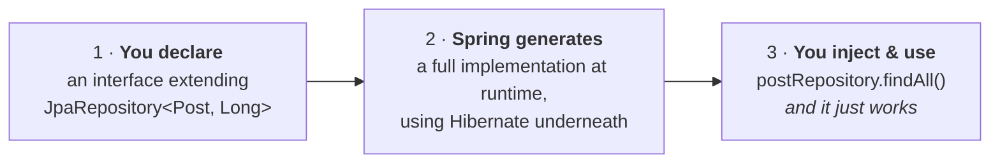
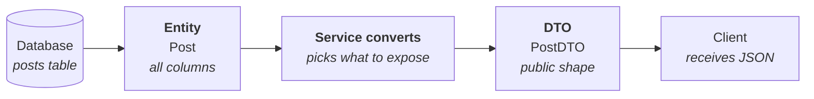
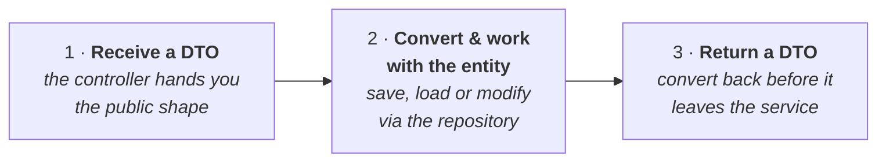
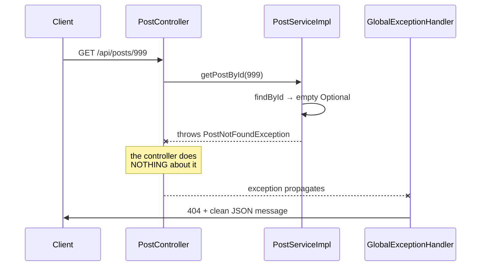
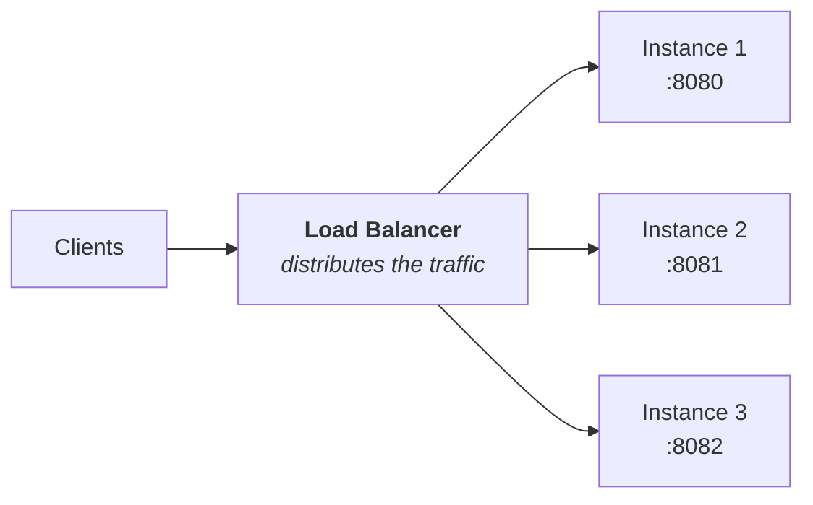
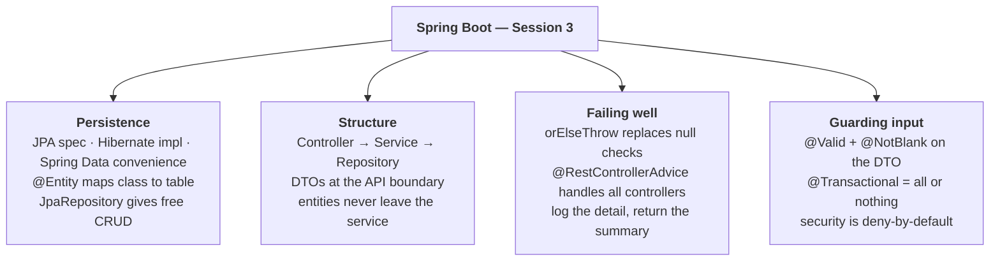

# Session 3 — Databases, DTOs & Exception Handling

> **Study notes for the Spring Boot training series**
> Companion to `springboot-session3-theory.html` (slides) and `springboot-session3-lab.html` (hands-on).
> Written to be read on its own — learn from this file, then teach from it.

---

## How to use this file

**This is the session where the code starts to look *professional*.** Sessions 1 and 2 were about *making things work*. Today is about **making things well-built** — separating concerns, hiding internals, and failing gracefully.

It's also the longest session, because it fixes the two things that were unsatisfying about Session 2:

1. **The data vanished on restart.** → We add a real database.
2. **Error handling was a pile of `if (x == null)`.** → We replace it with one global handler.

Read it in order — the layers build on each other and the lab creates the files in exactly this sequence.

**Notation:**

| Marker | Meaning |
|---|---|
| 💡 **Idea** | The plain-English concept, before any jargon |
| 📖 **The word for it** | The official term, once you understand the idea |
| 🔬 **Try it** | A hands-on experiment |
| ⚠️ **Trap** | A mistake beginners genuinely make |
| 🎓 **Teach this** | A note for when you're the one explaining it |

---

## Contents

1. [The problem with Session 2](#part-1--the-problem-with-session-2)
2. [From JDBC pain to ORM](#part-2--from-jdbc-pain-to-orm)
3. [JPA vs Hibernate vs Spring Data JPA](#part-3--jpa-vs-hibernate-vs-spring-data-jpa)
4. [Entities — a class becomes a table](#part-4--entities)
5. [Repositories — the best trick in Spring](#part-5--repositories)
6. [`Optional` and `orElseThrow`](#part-6--optional-and-orelsethrow)
7. [Layers, and why DTOs exist](#part-7--layers-and-why-dtos-exist)
8. [The service layer](#part-8--the-service-layer)
9. [Exception handling done properly](#part-9--exception-handling-done-properly)
10. [Validation](#part-10--validation)
11. [`@Transactional`](#part-11--transactional)
12. [Spring Security — a first look](#part-12--spring-security--a-first-look)
13. [Looking ahead to microservices](#part-13--looking-ahead-to-microservices)
14. [Recap and self-test](#recap-and-self-test)
15. [Glossary](#glossary)
16. [Teaching this session](#teaching-this-session)

---

## Session 2 recap

| | Idea |
|---|---|
| 🌐 | **REST conventions.** Resources as nouns in URLs, HTTP verbs for actions, statelessness so the server can be replicated. |
| 🔁 | **Full CRUD.** `@GetMapping`, `@PostMapping`, `@PutMapping`, `@DeleteMapping` — plus `@RequestBody` for incoming JSON. |
| 🔢 | **Status codes matter.** `201` on create, `204` on delete, `404` when missing. `4xx` is the caller's fault; `5xx` is yours. |
| 📦 | **Jackson does the JSON.** Getters for going out, a no-arg constructor plus setters for coming in. |

⚠️ **Today's project base package** is `com.tcs.training.posts` (Group `com.tcs.training`, Artifact `posts`).

You'll create **six** sub-packages under it — `entity`, `repository`, `dto`, `service`, `controller`, `exception` — so **the Golden Rule matters more than ever**. And today the failure is *louder* than a 404: put an entity outside the base package and the app won't even start.

---

## What you'll be able to do by the end

- Explain the difference between **JPA, Hibernate and Spring Data JPA** without hesitating.
- Map a Java class to a database table with annotations, and let Hibernate create the table.
- Get **full CRUD** from an interface with no implementation.
- Explain **why returning entities directly is a security risk**, and use DTOs instead.
- Replace every `if (x == null)` with a **custom exception and one global handler**.
- Reject bad input with **validation** before your code ever runs.

---

# Part 1 — The problem with Session 2

Our Student API worked beautifully. Then someone restarted it, and every student ever created was **gone**. Here's why:

```java
@Service
public class StudentService {
    // This list lives in RAM — inside the running process.
    private final List<Student> students = new ArrayList<>();
}
```

RAM is **volatile**: when the process ends, the operating system reclaims that memory and the contents are simply gone. **There is nothing to recover.**

## Three separate problems, not one

| # | Problem | Consequence |
|---|---|---|
| 1 | **No persistence** | Restart, deploy, or crash → all data lost |
| 2 | **No sharing** | Run two copies of the app (as Session 4 does) and each has its *own* list. Create a student on copy A and copy B doesn't know about it |
| 3 | **No capacity** | A million students would exhaust your memory. A database keeps data on disk and loads only what's asked for |

### 💡 The fix

Move the data **out of the application** and into a 📖 **database** — a separate program built for storing data permanently, safely, and shared between many callers.

⚠️ **Problem 2 is the one that matters for Session 4.** You cannot run three copies of a service that keeps its data in memory — they'd disagree with each other. A shared database is what makes horizontal scaling possible.

---

## 1.1 A quick database refresher

A **relational database** stores data in 📖 **tables** — a grid, much like a spreadsheet. The vocabulary maps neatly onto Java:

| Database term | What it is | Java equivalent |
|---|---|---|
| **Table** | A collection of records of one kind | A class, e.g. `Post` |
| **Row** (record) | One single item | One object |
| **Column** | One named field with a fixed type | A field |
| **Primary key** | The column that uniquely identifies each row | The `id` field |
| **SQL** | The language used to query and modify data | — |

A `posts` table might look like this:

| id *(PK)* | title | content | author |
|---|---|---|---|
| 1 | Learning Spring Boot | Today I built my first API… | Amit |
| 2 | Understanding JPA | ORM makes database work… | Neha |

And the four SQL statements matching our four CRUD operations:

```sql
INSERT INTO posts (title, content, author) VALUES ('...', '...', 'Amit');  -- Create
SELECT * FROM posts WHERE id = 1;                                        -- Read
UPDATE posts SET title = '...' WHERE id = 1;                             -- Update
DELETE FROM posts WHERE id = 1;                                          -- Delete
```

---

# Part 2 — From JDBC pain to ORM

## 2.1 Why we don't write JDBC by hand

📖 **JDBC** is Java's built-in, low-level way to talk to a database. It works — and it is exhausting.

Here is what fetching **one** post costs you:

```java
public Post findById(int id) {
    String sql = "SELECT * FROM posts WHERE id = ?";

    try (Connection conn = dataSource.getConnection();                // 1. open a connection
         PreparedStatement ps = conn.prepareStatement(sql)) {         // 2. prepare the SQL

        ps.setInt(1, id);                                             // 3. bind the parameter
        try (ResultSet rs = ps.executeQuery()) {                      // 4. execute
            if (rs.next()) {
                Post post = new Post();                               // 5. build the object
                post.setId(rs.getInt("id"));                          //    field...
                post.setTitle(rs.getString("title"));                 //    by field...
                post.setContent(rs.getString("content"));             //    by hand
                post.setAuthor(rs.getString("author"));
                return post;
            }
            return null;
        }
    } catch (SQLException e) {                                        // 6. handle checked exceptions
        throw new RuntimeException(e);
    }
}
```

### ⚠️ Twenty lines for one read — and that's the *easy* case

Now consider:

- Write the other three operations. **~80 lines.**
- Add a fifth column → update **every** method.
- The SQL is a plain `String`, so **a typo compiles fine and fails at runtime**.
- Multiply by twenty tables.

This is genuine, repetitive, error-prone work — **and it's why ORM was invented.**

🎓 **Teach this:** Show this method in full and let it sink in. Then show `repository.findById(1)` on the next slide. The contrast does the teaching for you.

---

## 2.2 What is ORM?

📖 **ORM** stands for **Object-Relational Mapping**. The name describes the gap it bridges: **Java thinks in *objects*, databases think in *relations* (tables).** ORM automates the translation.



You declare the mapping **once**, and the ORM generates the SQL and fills in your objects for you.

| Without ORM (JDBC) | With ORM (JPA/Hibernate) |
|---|---|
| Write every SQL statement by hand | Annotate the class once with `@Entity` |
| Copy each column into each field, manually | Mapping is automatic, by field name |
| Manage connections and resources yourself | Connections managed for you |
| Handle `SQLException` everywhere | Runtime exceptions, no boilerplate catches |
| SQL is a String → typos fail at runtime | Methods are **type-checked by the compiler** |
| ~20 lines per operation | `repository.findById(1)` — **one line** |

### 💡 Analogy

ORM is a **translator in a meeting between two people who don't share a language**. You speak Java; the database speaks SQL.

You *could* learn to say every sentence yourself — or you could state your intent once and let the translator handle the grammar, every time, without mistakes.

---

# Part 3 — JPA vs Hibernate vs Spring Data JPA

Three names that get used interchangeably and confuse every beginner. **They are three different layers stacked on each other** — and once you see the stack, the confusion disappears.



| Name | What it actually is | Analogy |
|---|---|---|
| **JPA** | A **specification** — a standard set of interfaces and annotations (`@Entity`, `@Id`). Contains **no working code** | The **rules** of the road |
| **Hibernate** | An **implementation** of JPA. Real code that generates SQL and runs it. The default in Spring Boot | The **car** that obeys them |
| **Spring Data JPA** | A layer **on top** that removes even more code — you declare an interface and Spring writes the implementation | The **self-driving** feature |

### 💡 What this means in practice

You add **one** starter — `spring-boot-starter-data-jpa` — and **all three arrive together**.

- You write JPA **annotations**
- Spring Data gives you the **repositories**
- Hibernate quietly **does the work**

And because you code against the JPA *standard*, swapping Hibernate for another implementation wouldn't change your code at all.

🎓 **Teach this:** This slide prevents a *lot* of confusion. Associates who don't have this stack clear in their heads will misread every Stack Overflow answer, because answers freely mix all three names. Draw the four boxes on a whiteboard and leave them up all session.

---

## 3.1 H2 — a database with zero setup

Installing MySQL or PostgreSQL in a two-hour session would eat the whole session. So we use **H2**: a complete SQL database written in Java that runs *inside* your application.

| | |
|---|---|
| ✅ **Nothing to install** | It's just a JAR. Add the dependency and it exists |
| ✅ **Real SQL** | Genuine tables, real SQL, actual constraints. Not a fake |
| ✅ **Web console built in** | Browse your tables and run queries at `/h2-console` |
| ⚠️ **In-memory by default** | Data is *still* lost on restart — but for a much better reason (see below) |

### ⚠️ "So we haven't actually fixed persistence?"

Fair challenge. With in-memory H2, data still resets on restart. **But everything you write today — entities, repositories, SQL, transactions — is *exactly* what you'd write against MySQL in production.**

Moving there means changing four lines in `application.properties` and **zero lines of Java**.

💡 H2 also supports **file-based** storage if you want the data to survive:

```properties
spring.datasource.url=jdbc:h2:file:./data/postsdb
```

That one-line change makes your data survive restarts. **Try it** — it's a genuinely satisfying moment.

### The full configuration

```properties
spring.datasource.url=jdbc:h2:mem:postsdb      # mem = in memory
spring.datasource.driver-class-name=org.h2.Driver
spring.datasource.username=sa
spring.datasource.password=

spring.h2.console.enabled=true                 # the web console
spring.h2.console.path=/h2-console

spring.jpa.hibernate.ddl-auto=update           # create tables from entities
spring.jpa.show-sql=true                       # print the generated SQL
spring.jpa.properties.hibernate.format_sql=true
```

| Property | What it does |
|---|---|
| `spring.datasource.url` | Use H2 **in memory**, database named `postsdb`. Nothing written to disk |
| `spring.h2.console.enabled` | Switches on the browser-based SQL console |
| `spring.jpa.hibernate.ddl-auto=update` | Hibernate creates missing tables/columns from your entities at startup. **Development only** |
| `spring.jpa.show-sql=true` | Prints generated SQL to the console — **the best way to see that ORM isn't magic** |

### H2 console login

| Field | Value |
|---|---|
| URL | `http://localhost:8080/h2-console` |
| JDBC URL | `jdbc:h2:mem:postsdb` ⚠️ **must match `spring.datasource.url` exactly** |
| User Name | `sa` |
| Password | *(leave empty)* |

⚠️ **The default JDBC URL shown in the console is `jdbc:h2:~/test` — you must change it.** Connecting with the wrong URL silently opens a *different, empty* database rather than failing, which is why "my table is empty" is the #1 H2 console complaint.


---

# Part 4 — Entities

## 4.1 `@Entity` — a class becomes a table

📖 An **entity** is a Java class that **represents a database table**. Each object of that class is one **row**.

You mark it with annotations and **Hibernate builds the table for you**.

```java
package com.tcs.training.posts.entity;

import jakarta.persistence.Column;
import jakarta.persistence.Entity;
import jakarta.persistence.GeneratedValue;
import jakarta.persistence.GenerationType;
import jakarta.persistence.Id;
import jakarta.persistence.Table;

@Entity                       // "this class maps to a database table"
@Table(name = "posts")        // the table will be called 'posts'
public class Post {

    @Id                                                   // the PRIMARY KEY
    @GeneratedValue(strategy = GenerationType.IDENTITY)   // the DB assigns it
    private Long id;          // Long (not long) so an unsaved Post can be null

    @Column(nullable = false, length = 200)               // NOT NULL, VARCHAR(200)
    private String title;

    @Column(nullable = false, length = 2000)
    private String content;

    @Column(nullable = false, length = 100)
    private String author;

    // ---- No-argument constructor: REQUIRED by JPA/Hibernate ----
    public Post() {
    }

    // ---- Convenience constructor (note: no id — the DB supplies it) ----
    public Post(String title, String content, String author) {
        this.title = title;
        this.content = content;
        this.author = author;
    }

    // ---- Getters and setters: needed by Hibernate AND by Jackson ----
    // (generate these with your IDE — never type them by hand)
}
```

## ⚠️ 4.2 The single most common copy-paste error: `jakarta` vs `javax`

> In Spring Boot **3.x** the imports are **`jakarta.persistence.*`**

Older tutorials and most Stack Overflow answers say `javax.persistence.*` — that was correct for Boot **2.x** and **will not compile** today.

| Spring Boot version | Import package |
|---|---|
| **3.x** *(what we use)* | `jakarta.persistence.*` ✅ |
| 2.x *(older tutorials)* | `javax.persistence.*` ❌ |

**If your IDE offers both when auto-importing, always pick `jakarta`.** The same applies to validation: `jakarta.validation.*`.

🎓 **Teach this:** Say this out loud twice and put it on the whiteboard. It will still catch two people. The error message (`package javax.persistence does not exist`) is at least clear once they know what it means.

---

## 4.3 The entity annotations in detail

| Annotation | What it does | Required? |
|---|---|---|
| `@Entity` | Marks the class as mapping to a table. Without it, JPA ignores the class entirely | ✅ Yes |
| `@Id` | Marks the primary-key field. Every entity must have exactly one | ✅ Yes |
| `@GeneratedValue` | The database generates the value — you never set the id yourself | Effectively yes |
| `@Table(name="posts")` | Sets the table name. Defaults to the class name if omitted | Optional |
| `@Column(...)` | Controls the column's name, nullability and length | Optional |
| `@Transient` | "Do **not** store this field" — a computed value, for instance | Optional |

### The four `@GeneratedValue` strategies

| Strategy | How the id is produced | Use when |
|---|---|---|
| `IDENTITY` | An auto-increment column in the database | **MySQL, H2, SQL Server — our choice today** |
| `SEQUENCE` | A database sequence object | PostgreSQL, Oracle — best performance for batches |
| `AUTO` | Let the provider decide | Convenient, but less predictable |
| `TABLE` | A separate table holding counters | Portable, but slow. **Avoid** |

### 💡 Why `Long` rather than `long` for the id?

Because a **new** `Post` that hasn't been saved yet has **no id**, and only the *object* type `Long` can hold `null` to represent that.

A primitive `long` would default to `0`, which JPA can't distinguish from a real id of zero. **Always use the wrapper type for entity ids.**

---

## 4.4 Who creates the table? `ddl-auto`

You never wrote a `CREATE TABLE` statement — yet the table exists. That's **Hibernate reading your entity classes at startup** and building the schema.

`spring.jpa.hibernate.ddl-auto` controls how aggressively:

| Value | What it does at startup | Use in |
|---|---|---|
| `none` | Nothing. You manage the schema yourself | **Production** |
| `validate` | Checks the schema matches your entities; **fails fast** if not | **Production** |
| `update` | Adds missing tables and columns. Never deletes anything | Development — **our choice today** |
| `create` | **Drops and recreates all tables** on every start | Testing |
| `create-drop` | Same, plus drops everything on shutdown | Automated tests |

### ⚠️ Never use `create` or `update` in production

`create` would **delete your entire production database on every deployment**. This has genuinely happened to people.

Even `update` is risky: it makes **silent schema changes nobody reviewed**.

> **Real teams use `validate` plus a migration tool** — **Flyway** or **Liquibase** — where every schema change is a reviewed, version-controlled file.

### 🔬 Try it — watch Hibernate build your table

With `spring.jpa.show-sql=true`, Hibernate prints every statement it runs. At startup you'll see:

```sql
create table posts (
    id bigint generated by default as identity,
    author varchar(100) not null,
    content varchar(2000) not null,
    title varchar(200) not null,
    primary key (id)
)
```

**Read that SQL against your Java — every piece came from an annotation:**

| SQL | Came from |
|---|---|
| `create table `**`posts`** | `@Table(name = "posts")` |
| `id bigint `**`generated by default as identity`** | `@GeneratedValue(IDENTITY)` |
| `title varchar(`**`200`**`) `**`not null`** | `@Column(nullable = false, length = 200)` |
| **`primary key (id)`** | `@Id` |

**You wrote annotations; Hibernate wrote SQL.** That is ORM, visible in the console.

---

# Part 5 — Repositories

## 5.1 The best trick in Spring

Remember those twenty lines of JDBC for a single read? Here is the **entire data-access layer** for our `Post` entity — **full CRUD, and it's an interface with no methods in it**:

```java
package com.tcs.training.posts.repository;

import com.tcs.training.posts.entity.Post;
import org.springframework.data.jpa.repository.JpaRepository;

//                                      <entity type, primary key type>
public interface PostRepository extends JpaRepository<Post, Long> {
}
```

**That's the whole file.** You write **no implementation**.



💡 **You don't even need `@Repository`.** Spring Data detects any interface extending `JpaRepository` automatically. Adding `@Repository` is harmless and some teams do it for clarity, but it's genuinely optional here.

---

## 5.2 What you get for free

By extending `JpaRepository`, these methods exist immediately — **no code written**:

| Method | What it does | Replaces the SQL |
|---|---|---|
| `save(entity)` | Inserts if the id is null, updates if it isn't | `INSERT` / `UPDATE` |
| `findAll()` | Returns every row as a `List` | `SELECT *` |
| `findById(id)` | Returns an `Optional<Post>` | `SELECT … WHERE id = ?` |
| `deleteById(id)` | Deletes that row | `DELETE … WHERE id = ?` |
| `existsById(id)` | `true` / `false` | `SELECT COUNT(*) …` |
| `count()` | How many rows | `SELECT COUNT(*)` |
| `saveAll(list)` | Saves many at once | batched inserts |
| `findAll(Pageable)` | One page of results, sorted | `LIMIT` / `OFFSET` |

### 💡 `save()` does double duty — and that's deliberate

One method for both create and update:

- If `post.getId()` is **`null`** → Hibernate issues an **`INSERT`**
- If it **holds a value** → an **`UPDATE`**

This is why our update logic will be *"load the existing row, change its fields, save it"* — **the same `save()` call handles it.**

---

## 5.3 Custom queries from method names alone

This is where Spring Data becomes genuinely surprising. **Declare a method whose *name* describes the query**, and Spring Data parses the name and writes the SQL:

```java
public interface PostRepository extends JpaRepository<Post, Long> {

    // SELECT * FROM posts WHERE author = ?
    List<Post> findByAuthor(String author);

    // SELECT * FROM posts WHERE lower(title) LIKE %?%
    List<Post> findByTitleContainingIgnoreCase(String keyword);

    // SELECT * FROM posts WHERE author = ? ORDER BY title ASC
    List<Post> findByAuthorOrderByTitleAsc(String author);

    // SELECT COUNT(*) FROM posts WHERE author = ?
    long countByAuthor(String author);

    // SELECT * FROM posts WHERE title = ? AND author = ?
    List<Post> findByTitleAndAuthor(String title, String author);
}
```

**Still no implementation.** Spring Data reads the method name at startup, splits it into keywords, and generates the query.

### The keyword vocabulary

| Keyword | Becomes |
|---|---|
| `findBy…` / `readBy…` | `SELECT … WHERE …` |
| `And` / `Or` | `AND` / `OR` |
| `Containing` / `Like` | `LIKE %value%` |
| `GreaterThan` / `LessThan` / `Between` | `>` / `<` / `BETWEEN` |
| `OrderBy…Asc` / `Desc` | `ORDER BY … ASC/DESC` |
| `IgnoreCase` | case-insensitive comparison |
| `Top3` / `First` | `LIMIT` |

### 🔬 Try it — break it deliberately (30 seconds, very instructive)

Rename `findByAuthor` to `findByWriter` and restart. The app **refuses to start**:

```text
org.springframework.data.repository.query.QueryCreationException:
Could not create query for public abstract java.util.List
  com.tcs.training.posts.repository.PostRepository.findByWriter(java.lang.String);
Reason: Failed to create query for method ...;
  No property 'writer' found for type 'Post'
```

Read the last line: **"No property 'writer' found for type 'Post'"**.

Spring Data checked your method name against the entity's fields and found no match. **That's a *good* failure — caught at startup, not in production.**

⚠️ For anything too complex to express in a name, use `@Query` with real JPQL.

---

# Part 6 — `Optional` and `orElseThrow`

Notice that `findById()` doesn't return a `Post` — it returns **`Optional<Post>`**.

📖 An **`Optional`** is a small box that either contains a value or is explicitly empty. Its purpose is to make *"there might be nothing here"* **impossible to ignore**.

### ❌ The old way — returning null

```java
Post post = repo.findByIdOldStyle(5);

// Nothing forces you to check.
// Forget, and you get a NullPointerException later —
// far from the real cause.
post.getTitle();
```

### ✅ With `Optional`

```java
Optional<Post> maybe = repo.findById(5L);

// You CANNOT call getTitle() directly.
// The compiler forces you to deal with the empty case first.
Post post = maybe.orElseThrow(() -> new PostNotFoundException(5L));
```

| Method | Behaviour when empty |
|---|---|
| `orElseThrow(() -> new X())` | Throws your exception. **The pattern we use today** |
| `orElse(defaultValue)` | Returns the fallback you supply |
| `isPresent()` / `isEmpty()` | Returns `true`/`false` so you can branch |
| `get()` | ⚠️ Throws `NoSuchElementException` — **avoid; it defeats the point** |

## 💡 The one line to remember

```java
Post post = postRepository.findById(id)
        .orElseThrow(() -> new PostNotFoundException(id));
```

Read it as: *"get the post with this id — and if there isn't one, throw my exception."*

**After this line, `post` is guaranteed to be non-null**, so the rest of the method needs no defensive checks.

> **This single line replaces every `if (x == null)` you wrote in Session 2.**

---

# Part 7 — Layers, and why DTOs exist

## 7.1 The full layered architecture

In Session 1 we introduced layers as a diagram. **Today you actually build all of them.** Each layer talks **only to its neighbour** — never skipping.

| Layer | Job | Knows nothing about |
|---|---|---|
| **Controller** | Handles HTTP. Reads the request, calls the service, sets the status code | The database |
| **Service** | Business logic. Rules, validation, DTO↔entity conversion, transactions | HTTP |
| **Repository** | Talks to the database. Nothing but data access | Business rules |
| **Entity / DTO** | Carries the data. Entity mirrors the table; DTO is what crosses the API boundary | Everything |

Today's project has **one package per responsibility**, all under the base package:

```text
com.tcs.training.posts          ← base package (main class here)
 ├── controller     PostController          — HTTP
 ├── service        PostService (interface)
 │                  PostServiceImpl         — business logic
 ├── repository     PostRepository          — data access
 ├── entity         Post                    — the table
 ├── dto            PostDTO                 — the API shape
 └── exception      PostNotFoundException
                    GlobalExceptionHandler  — error handling
```

### 💡 Why the strict one-way flow?

**Because it makes change *local*.**

| Change | What you touch |
|---|---|
| Swap H2 for MySQL | Only the repository layer's *configuration* |
| Add a rule: "titles must be unique" | Only the service |
| Move from REST to a message queue | Only the controller |

> A layer you can change without touching the others is a layer that doesn't cost you anything to maintain.

---

## 7.2 Why not just return the entity?

It would be simpler. In Session 2 we returned `Student` objects directly and everything worked. **So why add another class?**

Consider a realistic `User` entity:

```java
@Entity
public class User {
    @Id private Long id;
    private String username;
    private String email;
    private String passwordHash;     // 🚨 a password hash!
    private String panNumber;        // 🚨 sensitive personal data
    private boolean isAdmin;         // 🚨 internal privilege flag
    private LocalDateTime lastLogin;
    private int failedLoginAttempts; // 🚨 internal security detail
}
```

Return that from a `@GetMapping` and **Jackson serialises every field it can reach.** Your public API has just published **password hashes and PAN numbers** to anyone who calls it.

### The five problems, ranked

| # | Problem | What goes wrong |
|---|---|---|
| 1 | **Security leak** | Every field is exposed, including ones you'd never intend to publish. **The most serious of the five** |
| 2 | **Tight coupling** | Your API's shape becomes your table's shape. Rename a column and every client breaks |
| 3 | **Over-fetching** | A list page needs a title and an author; you send twenty fields per row |
| 4 | **Wrong shape** | Clients often want combined or computed values (`fullName`, `commentCount`) that no single table holds |
| 5 | **Lazy-loading errors** | Entities with relationships can throw `LazyInitializationException` during serialisation, or recurse infinitely |

> ## 📖 The principle
> Your **database schema is an internal implementation detail**. Your **API is a public contract**.
> Tying them together means you can never change one without breaking the other.

---

## 7.3 What is a DTO?

📖 A **DTO** — Data Transfer Object — is a simple class whose only job is to **carry data across a boundary**. Fields, getters and setters, no logic.

**It defines exactly the shape your API exposes: no more, no less.**



Applied to that dangerous `User`:

| ❌ The entity — internal | ✅ The DTO — public |
|---|---|
| `id`, `username`, `email` | `id`, `username`, `email` |
| `passwordHash` 🚨 | *(doesn't exist here)* |
| `panNumber` 🚨 | *(doesn't exist here)* |
| `isAdmin` 🚨 | *(doesn't exist here)* |
| `failedLoginAttempts` 🚨 | *(doesn't exist here)* |

### 💡 The safety property that makes this worth the extra class

The DTO is safe **by construction**, not by discipline.

Someone adds a `creditCardNumber` field to the entity next year — **it does *not* appear in the API**, because the DTO doesn't mention it.

Compare the alternative (`@JsonIgnore` on each sensitive field), which relies on **every future developer remembering**.

> **Allow-lists beat block-lists.**

🎓 **Teach this:** The `passwordHash` example is what makes DTOs click. Before showing the solution, ask: *"what happens if I return this User from a controller?"* Let someone work out that the hash goes over the wire. The horror on their face is the lesson.

---

## 7.4 Entity vs DTO — side by side

| | **Entity** | **DTO** |
|---|---|---|
| **Represents** | A database table | The API's public shape |
| **Annotations** | `@Entity`, `@Id`, `@Column` | None (or validation annotations) |
| **Lives in package** | `…posts.entity` | `…posts.dto` |
| **Which layers see it** | Repository & service only | Service & controller only |
| **Contains all fields?** | Yes — mirrors the table | No — only what's safe to expose |
| **Changes when…** | The database schema changes | The API contract changes |
| **Reaches the client?** | **Never** | **Always** |

> ## 🔑 The boundary rule — commit this to memory
> **Entities never leave the service layer. DTOs never enter the repository layer.**

The service is the **only** place that knows about both, and its job is to convert between them.

⚠️ **If you find yourself importing an entity class into a controller, something has gone wrong.**

### Is this overkill for a small project?

Honest answer: for a two-table hobby project, arguably yes — and plenty of small apps skip DTOs.

**But** the habit costs little and the failure mode is severe (leaked credentials, or an API you can't evolve). Every professional codebase you join will use them, so **learn the pattern here where the stakes are zero**.

---

## 7.5 Converting between entity and DTO

Something has to copy the fields across, and that something is the **service layer** — the only layer that legitimately knows about both types.

Two small private methods do all the work:

```java
// ---- Entity → DTO : going OUT to the client ----
private PostDTO toDTO(Post post) {
    PostDTO dto = new PostDTO();
    dto.setId(post.getId());
    dto.setTitle(post.getTitle());
    dto.setContent(post.getContent());
    dto.setAuthor(post.getAuthor());
    return dto;
}

// ---- DTO → Entity : coming IN from the client ----
private Post toEntity(PostDTO dto) {
    Post post = new Post();
    // Note: we deliberately do NOT copy the id.
    // The DATABASE assigns ids — never the client.
    post.setTitle(dto.getTitle());
    post.setContent(dto.getContent());
    post.setAuthor(dto.getAuthor());
    return post;
}
```

⚠️ **Why `toEntity` doesn't copy the id:** if it did, a client could send `"id": 7` in a POST and **silently overwrite somebody else's row**. The database owns ids.

Every service method then follows the same three-step shape:



### 📌 Yes, this is repetitive — and there are tools for that

Hand-written mapping is honest and completely transparent, which is why we do it today: **you can see exactly what's happening.**

Real projects often use:

| Tool | How it works |
|---|---|
| **MapStruct** | Generates the mapping code at **compile time** — fast and type-safe |
| **ModelMapper** | Reflection-based — less code but slower |

**Learn the manual version first**; then the tools are obviously just shortcuts for it.


---

# Part 8 — The service layer

## 8.1 Why an interface *plus* an implementation?

Today you write **two** files where Session 2 had one: `PostService` (an interface) and `PostServiceImpl` (the class that implements it). This is standard practice in Spring projects.

### The interface — the contract

```java
package com.tcs.training.posts.service;

import com.tcs.training.posts.dto.PostDTO;
import java.util.List;

// WHAT the service can do. No hint of HOW.
// Notice every type here is a DTO — the entity is never mentioned,
// because callers must not see it.
public interface PostService {

    List<PostDTO> getAllPosts();
    PostDTO getPostById(Long id);
    PostDTO createPost(PostDTO postDTO);
    PostDTO updatePost(Long id, PostDTO postDTO);
    void deletePost(Long id);
    List<PostDTO> getPostsByAuthor(String author);
}
```

### The implementation — the how

```java
@Service                                    // ← goes on the IMPL, not the interface
public class PostServiceImpl implements PostService {

    private final PostRepository repo;
    // ... the actual logic, using JPA
}
```

⚠️ **`@Service` goes on the implementation** — that's the class Spring instantiates. The interface is just a type.

### The controller depends on the *interface*

```java
public PostController(PostService postService) {   // the interface
    this.postService = postService;                // Spring injects the Impl
}
```

| Benefit | Why it matters |
|---|---|
| **Swap implementations** | Write `CachedPostServiceImpl` later; the controller doesn't change a line |
| **Testable** | Pass a fake implementation into the controller in a test — no database needed |
| **Readable contract** | The interface is a one-screen summary of everything the service does |
| **Enables AOP** | Spring can wrap the bean in a proxy to add transactions, security or logging |

### 📌 A fair counter-argument

Some experienced developers argue that an interface with exactly one implementation is **unnecessary ceremony**, and they have a point.

But because it's near-universal in the Spring codebases you'll join — and because it makes the *"depend on abstractions"* idea from Session 1 concrete — we use it here.

---

## 8.2 The implementation, annotated

This is the heart of the application. Read the comments carefully — three details matter more than the rest.

```java
@Service
public class PostServiceImpl implements PostService {

    private final PostRepository postRepository;

    // Constructor injection. Spring passes in the repository implementation
    // it generated for us at startup.
    public PostServiceImpl(PostRepository postRepository) {
        this.postRepository = postRepository;
    }

    // ================= READ ALL =================
    @Override
    @Transactional(readOnly = true)
    public List<PostDTO> getAllPosts() {
        List<PostDTO> result = new ArrayList<>();
        for (Post post : postRepository.findAll()) {
            result.add(toDTO(post));          // convert every entity to a DTO
        }
        return result;
    }

    // ================= READ ONE =================
    @Override
    @Transactional(readOnly = true)
    public PostDTO getPostById(Long id) {
        // ★ THE key line of today's session: get it, or throw.
        // After this line 'post' is guaranteed non-null — no if needed.
        Post post = postRepository.findById(id)
                .orElseThrow(() -> new PostNotFoundException(id));
        return toDTO(post);
    }

    // ================= CREATE =================
    @Override
    @Transactional
    public PostDTO createPost(PostDTO postDTO) {
        Post saved = postRepository.save(toEntity(postDTO));
        // 'saved' now has the id the database assigned.
        return toDTO(saved);
    }

    // ================= UPDATE =================
    @Override
    @Transactional
    public PostDTO updatePost(Long id, PostDTO postDTO) {
        // 1. Load the existing row (or throw a clean 404)
        Post existing = postRepository.findById(id)
                .orElseThrow(() -> new PostNotFoundException(id));

        // 2. Change its fields — note we never touch the id
        existing.setTitle(postDTO.getTitle());
        existing.setContent(postDTO.getContent());
        existing.setAuthor(postDTO.getAuthor());

        // 3. save() issues an UPDATE, because the id is already set
        return toDTO(postRepository.save(existing));
    }

    // ================= DELETE =================
    @Override
    @Transactional
    public void deletePost(Long id) {
        // Check first, so a missing id gives a clean 404 rather than
        // an obscure framework exception.
        if (!postRepository.existsById(id)) {
            throw new PostNotFoundException(id);
        }
        postRepository.deleteById(id);
    }
}
```

### 💡 The three details worth understanding, not just copying

| # | Detail | Why |
|---|---|---|
| 1 | **`.orElseThrow(...)`** | Replaces every `if (x == null)` from Session 2. After it, the variable cannot be null, so the rest reads as a clean happy path |
| 2 | **`toEntity` never copies the id** | Otherwise a client could send `"id": 7` in a POST and silently overwrite another row |
| 3 | **Update *loads first*, then modifies** | We don't build a new `Post` — we fetch the existing row and change its fields, so `save()` issues an `UPDATE` rather than an `INSERT` |

---

# Part 9 — Exception handling done properly

## 9.1 What happens *without* custom handling

Suppose the service does the naive thing and lets a missing post blow up. A client requests `GET /api/posts/999` and receives:

```http
HTTP/1.1 500 Internal Server Error

{
  "timestamp": "2026-09-05T10:32:14.882+00:00",
  "status": 500,
  "error": "Internal Server Error",
  "trace": "java.util.NoSuchElementException: No value present
     at java.base/java.util.Optional.get(Optional.java:143)
     at com.tcs.training.posts.service.PostServiceImpl.getPostById(PostServiceImpl.java:41)…",
  "path": "/api/posts/999"
}
```

### Four things are wrong with that

| Problem | Why it matters |
|---|---|
| ❌ **Wrong status code** | `500` says *"my server is broken."* It isn't — the caller asked for something that doesn't exist. **That's a `404`** |
| ❌ **Useless message** | "No value present" tells the client nothing actionable. Which value? Which post? |
| ❌ **Leaks internals** | The stack trace publishes your **package names, class names, line numbers and framework versions** — a genuine gift to an attacker |
| ❌ **Unusable by clients** | A mobile app can't show "No value present" to a user, and can't reliably branch on it |

### ✅ What we want instead

```http
HTTP/1.1 404 Not Found

{
  "timestamp": "2026-09-05T10:32:14",
  "status": 404,
  "error": "Not Found",
  "message": "Post not found with id: 999",
  "path": "/api/posts/999"
}
```

Correct status code, a message a human can read, and **nothing** about your internals. **Two small classes get us there.**

---

## 9.2 Step 1 — a custom exception

An exception that means one specific thing. It's a tiny class:

```java
package com.tcs.training.posts.exception;

// extends RuntimeException (UNCHECKED), so we don't have to write
// "throws" on every method between the service and the handler.
public class PostNotFoundException extends RuntimeException {

    public PostNotFoundException(Long id) {
        // This message is what the client will eventually see.
        super("Post not found with id: " + id);
    }
}
```

Now the service can be blunt about failure, and it reads like a sentence:

```java
@Override
public PostDTO getPostById(Long id) {
    Post post = postRepository.findById(id)
            .orElseThrow(() -> new PostNotFoundException(id));
    return toDTO(post);
}
```

### 💡 Look at what disappeared

- No `if`
- No `null` check
- No `ResponseEntity.notFound()` in the controller

The method states the **happy path**, and the failure case is one clause. Compare Session 2, where *every* controller method carried an `if (x == null)` branch.

### ⚠️ Why `RuntimeException` rather than `Exception`?

| Type | Consequence |
|---|---|
| **Checked** (extends `Exception`) | Must be declared with `throws` on **every** method that might propagate it, and caught or re-declared all the way up. **That noise would spread through your whole codebase** |
| **Unchecked** (extends `RuntimeException`) | Travels up silently until something handles it — **exactly what we want**, because the handler is a single global class |

---

## 9.3 Step 2 — one global handler

Throwing the exception isn't enough by itself — something must turn it into a proper HTTP response.

That's **`@RestControllerAdvice`**: one class that catches exceptions from **every controller in the application**.

```java
package com.tcs.training.posts.exception;

import org.springframework.http.HttpStatus;
import org.springframework.http.ResponseEntity;
import org.springframework.web.bind.MethodArgumentNotValidException;
import org.springframework.web.bind.annotation.ExceptionHandler;
import org.springframework.web.bind.annotation.RestControllerAdvice;

import java.time.LocalDateTime;
import java.util.HashMap;
import java.util.LinkedHashMap;
import java.util.Map;

@RestControllerAdvice     // "watch EVERY controller in this application"
public class GlobalExceptionHandler {

    // ---- 404: our custom exception ----
    @ExceptionHandler(PostNotFoundException.class)
    public ResponseEntity<Map<String, Object>> handlePostNotFound(
            PostNotFoundException ex) {

        Map<String, Object> body = new LinkedHashMap<>();
        body.put("timestamp", LocalDateTime.now());
        body.put("status", 404);
        body.put("error", "Not Found");
        body.put("message", ex.getMessage());          // our friendly text

        return new ResponseEntity<>(body, HttpStatus.NOT_FOUND);
    }

    // ---- 400: @Valid failed on a @RequestBody ----
    @ExceptionHandler(MethodArgumentNotValidException.class)
    public ResponseEntity<Map<String, Object>> handleValidationErrors(
            MethodArgumentNotValidException ex) {

        // Collect every field error into a { fieldName: message } map
        Map<String, String> fieldErrors = new HashMap<>();
        ex.getBindingResult().getFieldErrors().forEach(error ->
                fieldErrors.put(error.getField(), error.getDefaultMessage()));

        Map<String, Object> body = new LinkedHashMap<>();
        body.put("timestamp", LocalDateTime.now());
        body.put("status", 400);
        body.put("error", "Validation Failed");
        body.put("fieldErrors", fieldErrors);

        return new ResponseEntity<>(body, HttpStatus.BAD_REQUEST);
    }

    // ---- 500: the safety net for anything we didn't anticipate ----
    @ExceptionHandler(Exception.class)
    public ResponseEntity<Map<String, Object>> handleEverythingElse(Exception ex) {

        // Log the FULL detail on the server, for us to debug...
        ex.printStackTrace();

        // ...but return only a generic message. Never leak a stack trace.
        Map<String, Object> body = new LinkedHashMap<>();
        body.put("timestamp", LocalDateTime.now());
        body.put("status", 500);
        body.put("error", "Internal Server Error");
        body.put("message", "An unexpected error occurred");

        return new ResponseEntity<>(body, HttpStatus.INTERNAL_SERVER_ERROR);
    }
}
```

### The flow, end to end



> **The controller contains no error-handling code at all** — the whole point of the exercise.

### 💡 Why `LinkedHashMap` rather than `HashMap` for the body?

Because `LinkedHashMap` **preserves insertion order**, so the JSON always comes out as `timestamp, status, error, message` — predictable and pleasant to read.

A plain `HashMap` would order the keys arbitrarily. A small detail, but it's the kind of thing that makes an API feel considered.

---

## 9.4 Three ways to map exceptions to statuses

You'll see all three in real code. **Know when each is appropriate.**

| Approach | How | Scope | Verdict |
|---|---|---|---|
| **1 · `@ResponseStatus` on the exception** | `@ResponseStatus(HttpStatus.NOT_FOUND)` above the exception class | Wherever it's thrown | Simplest. But **you can't customise the response body** |
| **2 · `@ExceptionHandler` in a controller** | A handler method inside the controller itself | ⚠️ That one controller only | Leads to duplication across controllers |
| **3 · `@RestControllerAdvice`** | A separate class holding all handlers | ✅ **Every controller** | ✅ **Recommended.** One place, full control of the body. **What we use** |

### A realistic handler class maps several types

| Exception | Maps to | Meaning |
|---|---|---|
| `PostNotFoundException` | `404` | No such resource |
| `MethodArgumentNotValidException` | `400` | `@Valid` checks failed |
| `DuplicateResourceException` | `409` | Clashes with existing data |
| `AccessDeniedException` | `403` | Authenticated, but not permitted |
| `Exception` *(catch-all)* | `500` | Something unexpected — **log it fully, expose nothing** |

### ⚠️ Log the detail, return the summary

In the catch-all handler, **log the full stack trace on the server** (so you can debug it) but return only a generic message to the client.

> **Detailed errors are for your logs; opaque errors are for the outside world.**

🎓 **Teach this:** Show the ugly 500 *first*, with the stack trace visible. Point out the package names and line numbers. Ask "would you want an attacker to see this?" Then build the two classes. The motivation has to come before the solution.

---

# Part 10 — Validation

Right now a client can POST a post with an empty title and we'd store it happily. Rather than writing `if` checks, **declare the rules as annotations on the DTO** and let Spring enforce them.

```java
public class PostDTO {

    private Long id;

    @NotBlank(message = "Title is required")
    @Size(min = 3, max = 200, message = "Title must be 3–200 characters")
    private String title;

    @NotBlank(message = "Content is required")
    private String content;

    @NotBlank(message = "Author is required")
    private String author;
}
```

Then add **`@Valid`** in the controller, and Spring checks the rules **before your method even runs**:

```java
@PostMapping
public ResponseEntity<PostDTO> create(@Valid @RequestBody PostDTO dto) {
    // If validation fails, this method is NEVER entered.
    // Spring throws MethodArgumentNotValidException instead.
    return ResponseEntity.status(HttpStatus.CREATED).body(postService.createPost(dto));
}
```

## The annotations you'll use

| Annotation | Rule |
|---|---|
| `@NotNull` | Must not be null (but `""` is allowed) |
| `@NotBlank` | Must not be null, empty, or only whitespace — **usually what you want for text** |
| `@Size(min=, max=)` | Length of a String or size of a collection |
| `@Email` | Must look like an email address |
| `@Min` / `@Max` | Numeric bounds |
| `@Pattern(regexp=)` | Must match a regular expression |

## ⚠️ Two things to remember

1. You need the **`spring-boot-starter-validation`** dependency, and the imports are **`jakarta.validation.constraints.*`**.
2. **`@Valid` in the controller is what triggers the check.** The annotations on the DTO **do nothing on their own**.

## The result — a genuinely useful 400

Add a handler for `MethodArgumentNotValidException` (as in 9.3) and you get:

```json
{
  "timestamp": "2026-09-05T10:33:02.117",
  "status": 400,
  "error": "Validation Failed",
  "fieldErrors": {
    "title": "Title is required",
    "author": "Author is required"
  }
}
```

💡 Those messages are the **exact text you wrote** in `@NotBlank(message = "…")`. And **your service was never called** — `@Valid` rejected the request first.

---

# Part 11 — `@Transactional`

📖 A **transaction** is a group of database operations that must **all succeed or all be undone**.

The classic example is a bank transfer:

```java
@Transactional
public void transfer(Long fromId, Long toId, BigDecimal amount) {
    Account from = accountRepo.findById(fromId).orElseThrow();
    Account to   = accountRepo.findById(toId).orElseThrow();

    from.setBalance(from.getBalance().subtract(amount));   // step 1
    to.setBalance(to.getBalance().add(amount));            // step 2

    accountRepo.save(from);
    accountRepo.save(to);
}
```

### ⚠️ What happens if the app crashes between step 1 and step 2?

| | Result |
|---|---|
| **Without** `@Transactional` | The money has left the first account and **never arrived** in the second. It has simply vanished |
| **With** `@Transactional` | Spring **rolls the whole thing back**, and both balances return to how they were. Nobody loses money |

## Usage

| Form | Effect |
|---|---|
| `@Transactional` | Commit at the end; **roll back automatically** if a `RuntimeException` escapes |
| `@Transactional(readOnly = true)` | A hint for read-only methods. Lets the database and Hibernate optimise (skips dirty-checking) |
| On the class | Applies to every method in it |

## Where to put it — and one gotcha

**Put it on *service* methods**, not on controllers or repositories — the service is where a complete business operation lives.

💡 Spring Data already wraps each *individual* repository call in its own transaction, so single-call methods are fine without it.

### ⚠️ The gotcha that surprises everyone once

`@Transactional` works via a **proxy**. So calling one `@Transactional` method **from another method in the same class** bypasses it entirely — the proxy is never involved.

If you need that, extract the method into a separate bean.


---

# Part 12 — Spring Security — a first look

Right now **anyone who can reach your API can delete every post.** Add **one dependency** and that changes immediately:

```xml
<dependency>
    <groupId>org.springframework.boot</groupId>
    <artifactId>spring-boot-starter-security</artifactId>
</dependency>
```

Restart, and with **zero lines of configuration**:

- ✅ **Every endpoint now requires authentication.** An unauthenticated request gets `401 Unauthorized`
- ✅ A login form appears at `/login` for browser requests
- ✅ A user named `user` is created, with a **random password printed in the startup console**
- ✅ CSRF protection and secure default headers are switched on

```text
Using generated security password: 8f2a1c4e-9b3d-4a7f-b2e1-6c8d9a0f3b5c

This generated password is for development use only.
```

## The two words people mix up

| Concept | Question it answers | Example |
|---|---|---|
| **Authentication** | *Who are you?* | Username + password, or a JWT token |
| **Authorization** | *What are you allowed to do?* | Only `ADMIN` may call `DELETE` |
| **Filter chain** | Where the checks happen | **Before your controller is ever called** |

## 💡 Notice the default: deny, not allow

Spring Security's default is **"deny unless authenticated"**, not "allow unless protected".

That ordering is deliberate: **forgetting to protect an endpoint can't accidentally expose it.** Secure by default.

## 🔬 Try it — then remove it

In the lab you'll add the dependency, watch every endpoint start returning `401`, log in with the generated password through the form Spring Security generates (user `user`), and then **remove it again**.

⚠️ **Do remove it** — security interferes with the rest of the lab and with Session 4.

Feeling that "secure by default" behaviour is the goal today; **configuring it properly deserves its own session** (JWT, OAuth2, role hierarchies, method-level rules).

---

# Part 13 — Looking ahead to microservices

Session 4 is entirely about many services working together. These four ideas set it up — and they explain *why* today's work was necessary.

## 13.1 The monolith, and where it starts hurting

Everything we've built is a 📖 **monolith**: **one application, one deployable unit, one database.** And that is genuinely the right choice for most projects.

| ✅ Where a monolith wins | ⚠️ Where it starts hurting |
|---|---|
| Simple to build, run and debug | One bug can bring down *everything* |
| One deployment, one thing to monitor | A one-line fix means redeploying the whole app |
| No network calls between components | Can't scale one busy part independently |
| Transactions across the whole app are easy | The whole codebase is locked to one language and framework version |
| **The right default for a small team** | 50 developers editing one codebase → constant conflicts |

### ⚠️ A concrete example of the scaling problem

Imagine an e-commerce monolith where **Search** handles a thousand requests a second while **Invoicing** handles ten a day.

They're in the same application, so to give Search more capacity you must run **more copies of everything** — including nine idle Invoicing modules per copy.

> **You're paying for capacity you can't direct where it's needed.**

---

## 13.2 Microservices — the alternative

📖 A **microservices** architecture splits the application into **several small, independent services**, each owning one business capability and its own data, and each deployable on its own.

| **Monolith** — one unit | **Microservices** — many units |
|---|---|
| One JAR containing everything | User Service · own DB · own deploy |
| Users + Products + Orders + Payments | Product Service · own DB |
| One shared database | Order Service · own DB |
| Deploy all of it, or none of it | Payment Service · own DB |
| Scale all of it, or none of it | Scale and release each one separately |

| Benefit | What it gives you |
|---|---|
| **Independent deployment** | Fix Payments without touching, testing or redeploying Search |
| **Targeted scaling** | Run five copies of Search and one of Invoicing. Pay only for what's busy |
| **Fault isolation** | Payments failing shouldn't stop people browsing products |
| **Technology freedom** | Each service can use the language and database that suits it |
| **Team autonomy** | Small teams own a service end to end and release on their own schedule |

### ⚠️ The honest trade-off — please remember this one

> **Microservices don't remove complexity; they *move* it** out of your code and into the **spaces between** your services.

You inherit a new set of problems: network failures, service discovery, distributed transactions, tracing a request across five hops, and far more deployment machinery.

**Session 4 is entirely about the tools that manage those new problems.**

> **Start with a monolith. Split it when the pain is real** — not because microservices sound modern.

---

## 13.3 Horizontal vs vertical scaling

"Scaling" means handling more load. There are exactly two ways, and the difference explains why *statelessness* kept coming up in Session 2.

| | ⬆️ **Vertical** — a bigger machine | ➡️ **Horizontal** — more machines |
|---|---|---|
| **What you do** | Add CPU/RAM to the *one* server. 4 cores → 32 | Run *more copies* behind a load balancer. 1 → 10 |
| | ✅ Simple — no code changes at all | ✅ Effectively unlimited |
| | ❌ There's always a physical ceiling | ✅ Cost scales linearly |
| | ❌ Cost rises steeply, not linearly | ✅ Add/remove copies with no downtime |
| | ❌ Usually needs downtime to resize | ✅ **No single point of failure** |
| | ❌ Still a **single point of failure** | ⚠️ Requires the app to be **stateless** |

### 💡 Why that last point ties everything together

Horizontal scaling only works if **any copy can serve any request**. That requires the app to hold no per-user state in memory — **exactly the REST *stateless* constraint from Session 2**.

**And it explains today's session:** with the data in a **shared database** rather than an in-memory list, ten copies of your app all see the same posts.

> **You could not scale Session 2's app horizontally. You can scale today's.**

---

## 13.4 Load balancing & high availability

If you're running ten copies of a service, something must decide **which copy gets each request**. 📖 That's a **load balancer**.



It does two jobs at once:

| Job | How it works |
|---|---|
| **Distribute load** | Spread requests so none is overwhelmed. The simplest strategy is **round robin** — take each in turn, then start again |
| **Provide high availability** | **Health checks:** it periodically asks each instance "are you alive?" — *this is what `/actuator/health` is for*. An instance that stops answering is removed from rotation, and users never notice |

### 📖 High availability, defined

**No single failure takes the system down.**

- With **one** instance, one crash = total outage.
- With **three** plus health checks, one crash = degraded capacity, but **the service stays up**.

In Session 4 you'll run three instances of one service and **watch requests round-robin between them live**.

---

# Recap and self-test

## The one-page summary



## Annotation cheat sheet

| Annotation | Purpose |
|---|---|
| `@Entity` | This class maps to a database table |
| `@Table(name=)` | Sets the table name |
| `@Id` | Marks the primary-key field |
| `@GeneratedValue(IDENTITY)` | The database assigns the id |
| `@Column(nullable=, length=)` | Column constraints |
| `@Transient` | Don't persist this field |
| `JpaRepository<T, ID>` | Extend it and get full CRUD free |
| `@Service` | On the **Impl** class, not the interface |
| `@Transactional` | All-or-nothing database work |
| `@Valid` + `@NotBlank` | Reject bad input before your method runs |
| `@RestControllerAdvice` | One handler for every controller's exceptions |
| `@ExceptionHandler(X.class)` | Handle exception type X |
| `.orElseThrow(...)` | Unwrap an `Optional` or throw |

## Your API at a glance

| Endpoint | Success | Failure |
|---|---|---|
| `GET /api/posts` | `200` + array | — |
| `GET /api/posts/{id}` | `200` + object | `404` clean message |
| `GET /api/posts/search?author=` | `200` + array | — |
| `POST /api/posts` | `201` + object | `400` field errors |
| `PUT /api/posts/{id}` | `200` + object | `404` / `400` |
| `DELETE /api/posts/{id}` | `204` | `404` |

## Self-test — answer these out loud

<details>
<summary><b>1. What are JPA, Hibernate and Spring Data JPA, and how do they relate?</b></summary>

**JPA** is the *specification* (interfaces and annotations, no working code). **Hibernate** is the *implementation* that actually generates SQL. **Spring Data JPA** sits *on top* and gives you repositories with no implementation of your own. One starter brings all three.
</details>

<details>
<summary><b>2. You wrote <code>PostRepository</code> as an empty interface. Where does the implementation come from?</b></summary>

Spring Data **generates it at runtime** and registers it as a bean. It reads the interface (and any derived query method names) at startup to work out what to build.
</details>

<details>
<summary><b>3. Why not return the <code>Post</code> entity straight from the controller?</b></summary>

It leaks every field (including things like password hashes), ties your API contract to your database schema, over-fetches, and can trigger lazy-loading errors. A DTO exposes only what's safe — **and stays safe when someone adds a sensitive field later.**
</details>

<details>
<summary><b>4. What single line replaces every <code>if (x == null)</code> check?</b></summary>

`repository.findById(id).orElseThrow(() -> new PostNotFoundException(id));` — after it, the variable is guaranteed non-null, and the global handler turns the exception into a clean 404.
</details>

<details>
<summary><b>5. Which class turns <code>PostNotFoundException</code> into a 404, and how does it see exceptions from every controller?</b></summary>

`GlobalExceptionHandler`, annotated **`@RestControllerAdvice`** — which registers it to advise *all* controllers. Its `@ExceptionHandler(PostNotFoundException.class)` method builds the 404 response.
</details>

<details>
<summary><b>6. Why is <code>@Service</code> on <code>PostServiceImpl</code> and not on <code>PostService</code>?</b></summary>

Because the **implementation** is the real class Spring instantiates. The interface is just a type — there's nothing to create.
</details>

<details>
<summary><b>7. Why does <code>toEntity()</code> deliberately not copy the id?</b></summary>

Because the **database owns ids**. If it copied the id, a client could send `"id": 7` in a POST and silently overwrite somebody else's row.
</details>

<details>
<summary><b>8. What would <code>ddl-auto=create</code> do to a production database?</b></summary>

**Drop and recreate every table on each startup** — deleting all production data. Use `validate` or `none` with Flyway/Liquibase migrations instead.
</details>

<details>
<summary><b>9. Which layers would change if you moved from H2 to MySQL?</b></summary>

**None of the Java.** You'd swap the dependency and change four lines in `application.properties`. Entity, repository, service and controller are untouched — that's the portability JPA bought you.
</details>

<details>
<summary><b>10. What does <code>@Valid</code> do, and what happens to the service method when validation fails?</b></summary>

It triggers the DTO's constraint annotations. If they fail, Spring throws `MethodArgumentNotValidException` **before the controller method body runs** — so the service is **never called**.
</details>

<details>
<summary><b>11. What does <code>@Transactional</code> guarantee?</b></summary>

That a group of database operations either **all commit or all roll back**. If a `RuntimeException` escapes the method, Spring undoes everything — so a half-finished bank transfer can't leave money in limbo.
</details>

<details>
<summary><b>12. Why can today's app be scaled horizontally when Session 2's could not?</b></summary>

Because the data now lives in a **shared database** instead of each copy's own memory. Any instance can serve any request and they all see the same data — which is what the load balancer requires.
</details>

---

# Glossary

| Term | Plain-English meaning |
|---|---|
| **JDBC** | Java's low-level, built-in way to talk to a database. Works, but ~20 lines per operation |
| **ORM** | Object-Relational Mapping — automates translating between Java objects and database tables |
| **JPA** | The *specification*: standard interfaces and annotations. **No working code** |
| **Hibernate** | The *implementation* of JPA that actually generates and runs SQL. Spring Boot's default |
| **Spring Data JPA** | Spring's layer on top — gives you repositories with no implementation of your own |
| **Entity** | A Java class that maps to a database table. Each object is one row |
| **Repository** | The data-access layer. Extend `JpaRepository` and get CRUD free |
| **Derived query** | A repository method whose *name* describes the query, e.g. `findByAuthor` |
| **DTO** | Data Transfer Object — a class defining exactly what your API exposes. No more, no less |
| **`Optional`** | A box that either holds a value or is explicitly empty. Makes "might be nothing" impossible to ignore |
| **`orElseThrow`** | Unwrap an `Optional`, or throw your exception if it's empty |
| **H2** | A complete SQL database written in Java that runs inside your app. Zero install |
| **`ddl-auto`** | Controls whether Hibernate creates/updates tables from your entities. **Never `create` in production** |
| **Primary key** | The column uniquely identifying each row. Your `@Id` field |
| **Transaction** | A group of database operations that must all succeed or all be undone |
| **`@RestControllerAdvice`** | One class that catches exceptions from **every** controller and converts them to HTTP responses |
| **Checked exception** | Extends `Exception`. Must be declared with `throws` everywhere it propagates |
| **Unchecked exception** | Extends `RuntimeException`. Travels up silently until handled. What we use |
| **Bean Validation** | Declaring input rules as annotations (`@NotBlank`, `@Size`) enforced by `@Valid` |
| **Authentication** | *Who are you?* |
| **Authorization** | *What are you allowed to do?* |
| **Monolith** | One application, one deployable unit, one database. The right default for small teams |
| **Microservices** | Several small independent services, each owning one capability and its own data |
| **Horizontal scaling** | Running more *copies* of the app. Requires statelessness |
| **Vertical scaling** | Making the one machine bigger. Simple, but has a ceiling |
| **Load balancer** | Decides which copy of a service handles each request; skips unhealthy ones |
| **High availability** | No single failure takes the system down |
| **Flyway / Liquibase** | Migration tools — the professional replacement for `ddl-auto` |
| **MapStruct** | Generates entity↔DTO mapping code at compile time |

---

# Teaching this session

## Suggested timing (3 hours including lab — this is the longest session)

| Minutes | Part | Notes |
|---|---|---|
| 0–5 | Session 2 recap | Confirm they remember the data-loss moment |
| 5–15 | Part 1 the problem | Emphasise problem #2 (no sharing) — it sets up Session 4 |
| 15–25 | Part 2 JDBC → ORM | ⚠️ Show the 20-line JDBC method in full. Let it land |
| 25–40 | **Part 3 JPA vs Hibernate vs Spring Data** | ⚠️ **Draw the 4-box stack and leave it on the whiteboard all session** |
| 40–55 | Part 4 entities | Show `create table` in the console. `jakarta` not `javax` — say it twice |
| 55–70 | Part 5 repositories | Break a derived query name live |
| 70–75 | Part 6 `Optional` | Short. Just the one-line pattern |
| 75–95 | **Part 7 layers & DTOs** | ⚠️ Use the `passwordHash` example. Ask before telling |
| 95–105 | Part 8 service layer | The three annotated details |
| 105–125 | **Part 9 exceptions** | ⚠️ Show the ugly 500 *before* the solution |
| 125–135 | Parts 10–11 validation, transactions | The bank-transfer example sells `@Transactional` |
| 135–145 | Parts 12–13 security & microservices | Preview only. Don't go deep |
| 145+ | Lab | Seven files. Circulate — `jakarta`/`javax` and package errors dominate |

## The four demos that matter most

1. **The 20-line JDBC method, then `repository.findById(1)`.** No commentary needed — the contrast teaches itself.
2. **`show-sql=true` and the `create table` output.** Map each SQL fragment back to its annotation. This is the moment ORM stops being magic.
3. **The `passwordHash` question.** Show the `User` entity and ask *"what happens if I return this from a controller?"* **Let them work it out.** Far more effective than telling.
4. **The ugly 500 with the stack trace.** Point at the package names and line numbers. Ask *"would you want an attacker to see this?"* Then build the handler.

## Questions your associates will actually ask

<details>
<summary><b>"If Spring Data writes the implementation, how do I debug it?"</b></summary>

You debug the **SQL**, not the Java. `show-sql=true` prints exactly what ran. For complex cases, `@Query` lets you write the JPQL yourself. Point them at the H2 console to run the same query by hand.
</details>

<details>
<summary><b>"Isn't a DTO just a copy of the entity? That seems like duplication."</b></summary>

Right now, yes — because `Post` happens to have nothing sensitive. Show the `User` example: the moment one field must not be public, the DTO earns its keep. And they diverge over time as the API and schema evolve independently.
</details>

<details>
<summary><b>"Why an interface if there's only one implementation?"</b></summary>

Acknowledge it's a fair criticism. Give the honest answer: testability, and it's the near-universal convention in Spring codebases they'll join. Don't oversell it.
</details>

<details>
<summary><b>"Why <code>Long</code> and not <code>long</code> for the id?"</b></summary>

An unsaved entity has **no** id. Only `Long` can be `null` to express that; `long` would be `0`, which JPA can't tell apart from a real id.
</details>

<details>
<summary><b>"My H2 console shows an empty table but my API returns data!"</b></summary>

The **JDBC URL**. They left the default `jdbc:h2:~/test` instead of `jdbc:h2:mem:postsdb`, so they're connected to a *different, empty* database. It doesn't error — it just silently opens another one. **This question comes up every single time.**
</details>

<details>
<summary><b>"Do I need <code>@Transactional</code> on every service method?"</b></summary>

No. Spring Data already wraps each individual repository call in its own transaction. You need it when **several** operations must succeed or fail together. `readOnly = true` on reads is a cheap optimisation.
</details>

<details>
<summary><b>"Why did my <code>javax.persistence</code> import fail?"</b></summary>

Spring Boot 3 moved to `jakarta.persistence`. Their tutorial was written for Boot 2. Same for `javax.validation` → `jakarta.validation`.
</details>

## Emphasis guide

| Spend more time on | Spend less time on |
|---|---|
| 🔑 **The JPA/Hibernate/Spring Data stack** — draw it | The full `@GeneratedValue` strategy table |
| 🔑 **Why DTOs** — the security argument | Hand-writing the mapping methods (they'll copy them) |
| 🔑 **The exception handling flow** end to end | The three-approaches comparison — just recommend #3 |
| **`jakarta` vs `javax`** | `@Transactional` propagation modes (way beyond scope) |
| **`ddl-auto` danger in production** | Spring Security details — it's a preview only |

## Common teaching pitfalls

- ⚠️ **Don't introduce DTOs before the security motivation.** Without the `passwordHash` moment it feels like pointless boilerplate and they'll skip it in their own code.
- ⚠️ **Don't let them build files out of order.** The lab sequence (entity → repository → DTO → exception → service → controller) exists because each file references the previous ones. Out of order produces a wall of red that looks catastrophic.
- ⚠️ **Do show the SQL.** `show-sql=true` is the single best antidote to "ORM is magic".
- ⚠️ **Warn about the H2 console JDBC URL before the lab**, not after. It will otherwise consume ten minutes of your time.
- ⚠️ **Don't go deep on Spring Security.** Add it, observe the 401, remove it. Going further will eat the rest of your session.

---

## Where next

**Session 4 — Microservices with Spring Cloud.** You now know how to build *one* well-structured service. Session 4 asks: **what happens when you have several, and they need to find and talk to each other?**

- **Eureka** — a service registry, so nobody hardcodes an address
- **API Gateway** — one front door for every service
- **Live load balancing** — three copies of one service, requests distributed between them
- Plus circuit breakers, config servers and distributed tracing

⚠️ **Heads-up on the format:** you'll run **four Spring Boot applications at once** (six, once we scale one). Make sure you have a few gigabytes of RAM free.

📄 [`session-4-microservices-spring-cloud.md`](session-4-microservices-spring-cloud.md)
