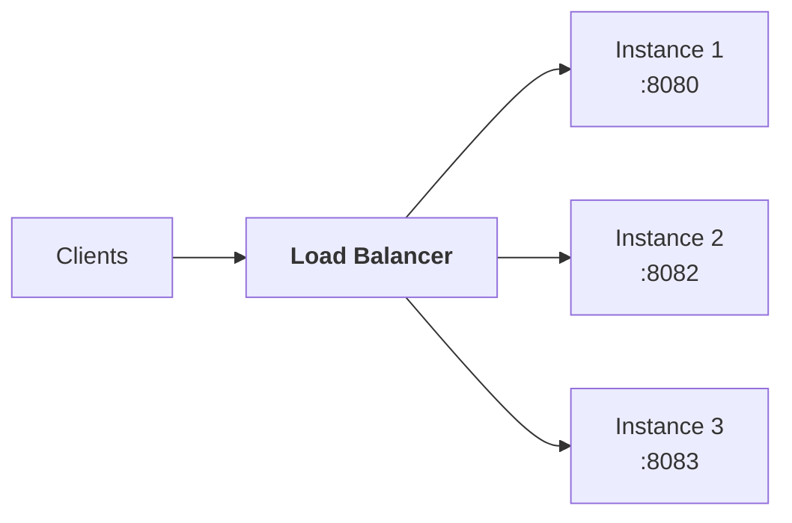
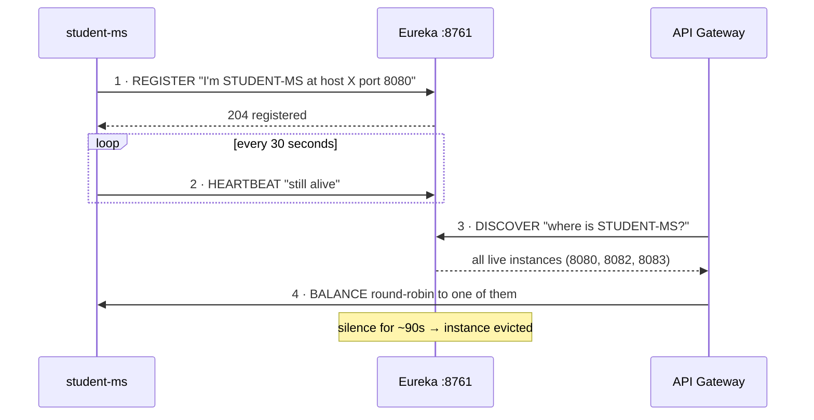
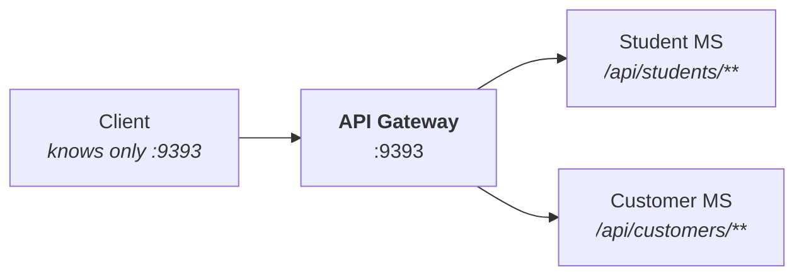
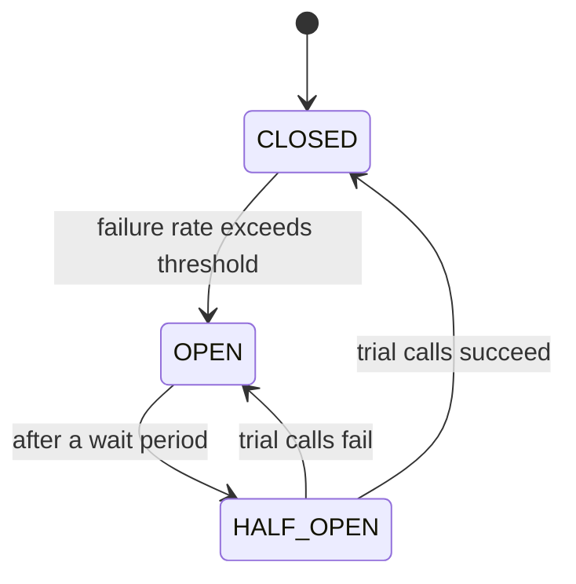
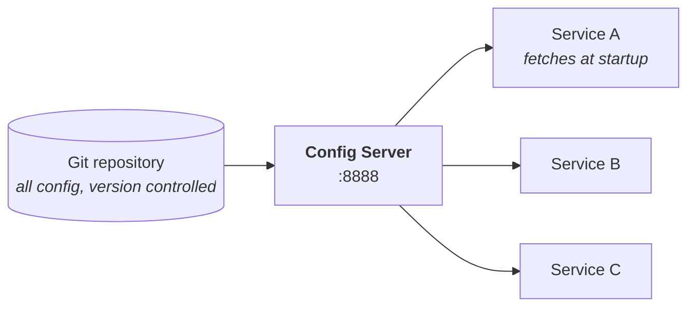
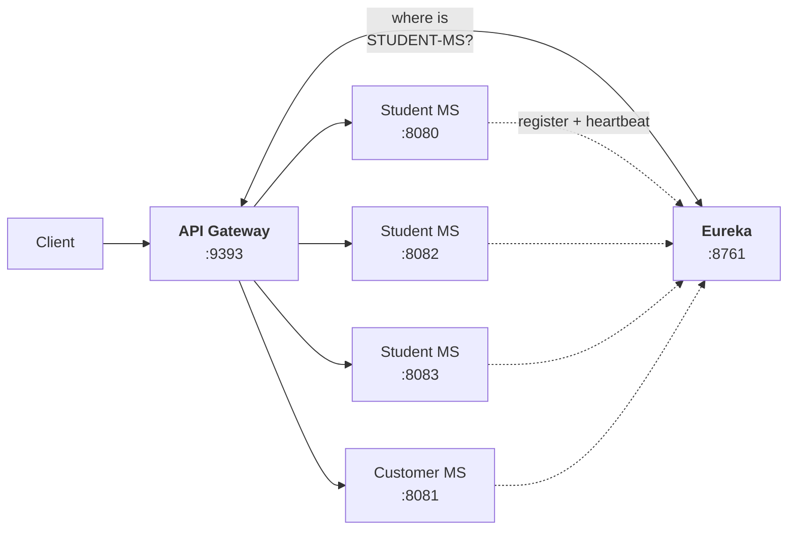
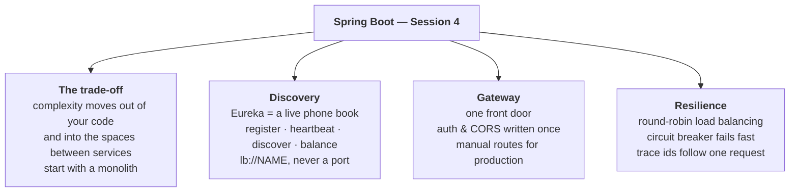

# Session 4 — Microservices with Spring Cloud

> **Study notes for the Spring Boot training series**
> Companion to `springboot-session4-theory.html` (slides) and `springboot-session4-lab.html` (hands-on).
> Written to be read on its own — learn from this file, then teach from it.

---

## How to use this file

Sessions 1–3 taught you to build **one** good service. Today: **what changes when you have several**, and the tools that keep it manageable.

⚠️ **This session has a strong opinion baked into it, and you should carry it into your teaching:** microservices are a **trade**, not an upgrade. Most of this file is about tools that manage costs you should only take on deliberately. If your associates leave thinking "microservices = better", the session has failed.

**Notation:**

| Marker | Meaning |
|---|---|
| 💡 **Idea** | The plain-English concept, before any jargon |
| 📖 **The word for it** | The official term, once you understand the idea |
| 🔬 **Try it** | A hands-on experiment |
| ⚠️ **Trap** | A mistake beginners genuinely make |
| 🎓 **Teach this** | A note for when you're the one explaining it |

---

## Contents

1. [Where one big application starts hurting](#part-1--where-one-big-application-starts-hurting)
2. [Monolith vs microservices — and the honest trade-off](#part-2--monolith-vs-microservices)
3. [Scaling and load balancing](#part-3--scaling-and-load-balancing)
4. [The five core patterns](#part-4--the-five-core-patterns)
5. [Service Registry — Eureka](#part-5--service-registry--eureka)
6. [API Gateway](#part-6--api-gateway)
7. [Services talking to each other](#part-7--services-talking-to-each-other)
8. [Circuit Breaker](#part-8--circuit-breaker)
9. [Config Server](#part-9--config-server)
10. [Distributed Tracing](#part-10--distributed-tracing)
11. [Spring Cloud — the toolbox](#part-11--spring-cloud--the-toolbox)
12. [The full picture](#part-12--the-full-picture)
13. [Recap and self-test](#recap-and-self-test)
14. [Glossary](#glossary)
15. [Teaching this session](#teaching-this-session)

---

## Session 3 recap

| | Idea |
|---|---|
| 🗄️ | **Real persistence.** `@Entity` maps a class to a table; `JpaRepository` gives full CRUD from an empty interface. |
| 🏗️ | **Four clean layers.** Controller → Service → Repository → Database, each with one responsibility. |
| 📦 | **DTOs at the boundary.** Entities never leave the service layer; DTOs define the public contract. |
| 🚨 | **Global error handling.** `@RestControllerAdvice` turns exceptions into clean status codes, once, for every controller. |

### 💡 The two ideas from Session 3 that today depends on

1. **Shared state lives in a database, not in memory.** That's what lets several copies of a service agree with each other.
2. **Services are stateless.** That's what lets a load balancer send any request to any copy.

> **Today we finally cash in on both.**

---

## What you'll be able to do by the end

- Explain the microservices **trade-off** honestly — what you gain and what you inherit.
- Explain why **hardcoded service URLs** always eventually break.
- Stand up a **Eureka service registry** and register services with it.
- Put an **API Gateway** in front of several services as a single front door.
- Run **three copies** of one service and watch requests load-balanced between them.
- Recognise **circuit breakers**, **config servers** and **distributed tracing**, and know when to reach for each.

---

## ⚠️ Today's lab is different — plan for it

Instead of one project you'll run **four Spring Boot applications at once**, then six.

Each one is *small* — smaller than what you built in Session 3 — but you'll be juggling several terminals or IDE run configurations.

| Project | Port(s) | Base package |
|---|---|---|
| `eureka-server` | `8761` | `com.tcs.training.eurekaserver` |
| `student-ms` | `8080` `8082` `8083` | `com.tcs.training.studentms` |
| `customer-ms` | `8081` | `com.tcs.training.customerms` |
| `api-gateway` | `9393` | `com.tcs.training.apigateway` |

⚠️ **Note the hyphens disappear** from the package names — `student-ms` → `studentms`. A Java package can't contain a hyphen, so Initializr strips it. **The Golden Rule still applies, four times over.**

💡 **Make sure you have a few gigabytes of RAM free.** Each Spring Boot app uses roughly 200–400 MB.

---

# Part 1 — Where one big application starts hurting

Everything you've built is a 📖 **monolith**: one application, one deployable JAR, one database. **For most projects that is genuinely the right choice.**

But picture a shopping site three years in, with 40 developers and one codebase:

| Situation | What actually happens |
|---|---|
| A one-line typo fix in Invoicing | Rebuild, retest and redeploy the **entire application** — including Search, Payments and Login |
| A memory leak in the PDF-report module | The whole process runs out of memory. **Customers can't even browse products** |
| Search takes 1000 req/sec, Invoicing takes 10/day | To scale Search you must run more copies of *everything* — paying for idle Invoicing modules |
| The team wants Python for a recommendation engine | Impossible. It's one Java codebase, on one framework version |
| 40 developers, one repository | Constant merge conflicts, and a release train everyone must wait for |

### 💡 Notice the common thread

**None of these are problems with the *code*.** They're problems with **everything being welded together**: one deployment unit, one process, one language, one release schedule.

> **Microservices attack the welding — not the code.**

---

# Part 2 — Monolith vs microservices

## 2.1 The two architectures

| **Monolith** — one unit | **Microservices** — many units |
|---|---|
| One JAR with everything inside | User Service · own DB · own deploy |
| Users + Products + Orders + Payments | Product Service · own DB · own deploy |
| One shared database | Order Service · own DB · own deploy |
| Deploy all of it, or none of it | Payment Service · own DB · own deploy |
| Scale all of it, or none of it | Release and scale each independently |
| One language, one framework version | Each may pick its own stack |
| One crash takes everything down | One crash affects one capability |

## 2.2 The scorecard

| | Monolith | Microservices |
|---|---|---|
| **Deployment** | One unit — simple | ✅ Independent per service |
| **Scaling** | ❌ All-or-nothing | ✅ Targeted where needed |
| **Fault isolation** | ❌ One failure can sink everything | ✅ Failures stay contained |
| **Technology choice** | ❌ Locked in | ✅ Free per service |
| **Local development** | ✅ Run one app — easy | ❌ Run many apps — harder |
| **Debugging a request** | ✅ One stack trace | ❌ Spans several services |
| **Transactions** | ✅ Straightforward | ❌ Genuinely hard (distributed) |
| **Operational overhead** | ✅ Low | ❌ Substantial |

---

## ⚠️ 2.3 The honest trade-off — read this before falling in love with microservices

Look at that scorecard again. **Microservices win the top four rows and lose the bottom four.** That is not an accident — it's the fundamental trade:

> ## 🔑 The trade-off, in one sentence
> Microservices don't **remove** complexity. They **move** it out of your code and into the *spaces between* your services.

Here's what appears in those spaces — **every one of them a problem you simply did not have last week:**

| New problem | In a monolith it was… | Now it is… |
|---|---|---|
| **Finding another component** | A method call. Guaranteed to work | A network call to an address that may have changed |
| **Failure** | An exception you catch | A timeout, a retry storm, or a cascading outage |
| **Debugging one request** | One stack trace | Five services, five log files, no shared thread |
| **A multi-step operation** | One `@Transactional` method | A distributed saga with compensating actions |
| **Configuration** | One properties file | Twelve services × three environments |
| **Running it locally** | Click Run | Start eight applications in the right order |

### The advice every experienced engineer gives

> **Start with a monolith. Split it when the pain is real** — when deployments genuinely block each other, or one component genuinely needs different scaling.

Teams that begin with microservices because they sound modern usually end up with a 📖 **"distributed monolith"**: all the operational cost, none of the independence.

**Everything in today's session exists to manage costs you should only take on deliberately.**

🎓 **Teach this:** This is the most important slide of the session and it's easy to rush. Do the opposite — slow down. Ask your associates to name a project they've worked on and whether it would actually have benefited. Usually the answer is no, and that realisation is more valuable than any Eureka config.

---

# Part 3 — Scaling and load balancing

## 3.1 Horizontal vs vertical

The main reason to accept those costs is **scaling**.

| | ⬆️ **Vertical** — a bigger machine | ➡️ **Horizontal** — more machines |
|---|---|---|
| **What you do** | More CPU/RAM in the *one* server. 4 cores → 32 | More *copies* behind a load balancer. 1 → 10 instances |
| | ✅ No code changes at all | ✅ Effectively unlimited |
| | ❌ There's always a physical ceiling | ✅ Cost scales linearly |
| | ❌ Cost rises steeply, not linearly | ✅ Add/remove copies with no downtime |
| | ❌ Usually needs downtime to resize | ✅ **No single point of failure** |
| | ❌ Still a **single point of failure** | ⚠️ Requires the app to be **stateless** |

### 💡 Why that warning is the thread running through this whole course

Horizontal scaling only works if **any copy can serve any request** — the REST *stateless* constraint from **Session 2**.

And the copies must all see the same data, which is why **Session 3** moved storage into a **shared database**.

> In today's lab you'll run **three instances of one service** and watch requests distributed between them. **That's only possible because of those two earlier decisions.**

---

## 3.2 Load balancing & high availability

Ten copies of a service raise an obvious question: **which copy gets each request?** 📖 A **load balancer** decides.



It does two jobs simultaneously:

| Job | How |
|---|---|
| **Distribute load** | Spread requests so no instance is overwhelmed. The simplest strategy is **round robin**: take each in turn, then start again |
| **Provide high availability** | **Health checks.** It asks each instance "are you alive?" — *this is exactly what `/actuator/health` from Session 1 is for*. An instance that stops answering is removed from rotation, and users never notice |

### 📖 High availability, defined

**No single failure takes the system down.**

- One instance = one crash is a **total outage**
- Three instances plus health checks = one crash means **reduced capacity**, but the service stays up

🔬 **In the lab you'll kill an instance mid-test and watch traffic carry on.**

---

## 3.3 Round robin, step by step

The default strategy in Spring Cloud, and the one you'll observe live. Six identical requests, distributed in turn:

| Request | :8080 | :8082 | :8083 |
|---|:---:|:---:|:---:|
| 1 | ✅ | | |
| 2 | | ✅ | |
| 3 | | | ✅ |
| 4 | ✅ | | |
| 5 | | ✅ | |
| 6 | | | ✅ |

### 💡 How you'll actually see this in the lab

Each instance returns **the port it's running on**. Call the same gateway URL six times and the response cycles `8080 → 8082 → 8083 → 8080 …`

**That visible cycle *is* load balancing** — and it's the most satisfying moment of the session.

### 📌 Other strategies exist

| Strategy | How it chooses |
|---|---|
| **Round robin** | Each in turn. The default |
| **Least connections** | Send to the least busy |
| **Weighted** | Bigger machines get more traffic |
| **IP hash** | The same client always reaches the same instance |

Round robin is the default because it's simple and works well when instances are identical and the service is stateless.

---

# Part 4 — The five core patterns

Every one of these exists to solve a problem from the "new problems" table in Part 2.3. **They aren't optional extras — they're what makes a distributed system workable.**

| # | Pattern | Problem | Solution | Tool |
|---|---|---|---|---|
| 1 | 📖 **Service Registry** | Addresses change constantly | A live phone book services register with | Eureka |
| 2 | 🚪 **API Gateway** | Clients shouldn't know about ten services | One front door that routes | Spring Cloud Gateway |
| 3 | ⚙️ **Config Server** | Settings scattered across services | One central, versioned source | Spring Cloud Config |
| 4 | 🔌 **Circuit Breaker** | One slow service freezes the rest | Fail fast and recover | Resilience4j |
| 5 | 🔍 **Distributed Tracing** | One request crosses five services | A shared id through all of them | Micrometer + Zipkin |
| + | ⚖️ **Load Balancing** | Which of three copies? | Distribute, and skip unhealthy ones | Spring Cloud LoadBalancer |

### What you'll build today

In the lab: **Service Registry**, **API Gateway** and **Load Balancing** — **the three you cannot manage without**.

Config Server, Circuit Breaker and Tracing we cover in theory so you recognise them and know what to reach for.

---

# Part 5 — Service Registry — Eureka

## 5.1 The problem: why hardcoded addresses fail

Order Service needs data from Product Service. The obvious approach:

```java
@Service
public class OrderService {

    private final RestTemplate restTemplate;

    public Product getProduct(Long id) {
        // Hardcoded address. Looks fine on your laptop...
        return restTemplate.getForObject(
                "http://localhost:8081/api/products/" + id, Product.class);
    }
}
```

It works perfectly — **until it doesn't**:

| What happens in reality | Result |
|---|---|
| Deployed to a server, so it isn't `localhost` any more | ❌ Broken. Edit and redeploy |
| You scale Product Service to **three** instances | ❌ Two are ignored entirely. **No balancing** |
| An instance crashes and restarts on a different port | ❌ Broken until someone notices |
| A cloud platform assigns IPs dynamically | ❌ You can't know the address in advance |
| Twelve services all reference each other this way | ❌ Change one address, redeploy several services |

### 💡 The insight

The caller shouldn't ask *"what is Product Service's address?"* — **that answer keeps changing.**

It should ask **"where is `PRODUCT-SERVICE` right now?"** and let something else keep track.

📖 That something is a **service registry**.

---

## 5.2 How Eureka works

**Eureka** is a service registry: a small Spring Boot application whose entire job is to keep a live list of *which services exist* and *where they currently are*.



| Step | What happens |
|---|---|
| **1 · Register** | On startup each service tells Eureka: "I'm `STUDENT-MS`, at host X port 8080" |
| **2 · Heartbeat** | Every **30 seconds** it says "still alive". Silence for **~90 seconds** and Eureka removes it |
| **3 · Discover** | A caller asks Eureka "where is `STUDENT-MS`?" and gets back **all** live addresses |
| **4 · Balance** | With several addresses returned, the client round-robins between them |

### The dashboard

Eureka ships a web page showing exactly this — **keep it open all lab**:

| Application | Availability Zones | Status |
|---|---|---|
| `STUDENT-MS` | 3 | **UP (3)** — `:8080`, `:8082`, `:8083` |
| `CUSTOMER-MS` | 1 | **UP (1)** — `:8081` |
| `API-GATEWAY` | 1 | **UP (1)** — `:9393` |

### 💡 The name in that first column

`STUDENT-MS` comes from **`spring.application.name=student-ms`**, upper-cased by Eureka.

**That *name* is what callers use instead of an address** — `lb://STUDENT-MS` rather than `http://localhost:8080`.

> **Nobody ever writes a port again.**

---

## 5.3 The code — server and client

### The server — the registry itself

```java
@SpringBootApplication
@EnableEurekaServer     // ← that's it
public class EurekaServerApplication {
    public static void main(String[] args) {
        SpringApplication.run(EurekaServerApplication.class, args);
    }
}
```

```properties
server.port=8761
spring.application.name=eureka-server

# A registry doesn't register with itself
eureka.client.register-with-eureka=false
eureka.client.fetch-registry=false
```

### A client — any normal service

```java
@SpringBootApplication
// No annotation needed at all!
// The dependency is enough — Boot auto-configures registration.
public class StudentMsApplication {
    public static void main(String[] args) {
        SpringApplication.run(StudentMsApplication.class, args);
    }
}
```

```properties
server.port=8080
spring.application.name=student-ms   # ← the registry name

eureka.client.service-url.defaultZone=http://localhost:8761/eureka/
eureka.instance.prefer-ip-address=true
```

### ⚠️ Two things people get wrong

1. **`register-with-eureka=false` on the *server* is essential.** Without it the registry tries to register with itself and floods the log with connection errors.
2. **`spring.application.name` is not cosmetic here.** It **is** the identity other services use to find you. Leave it out and your service appears as `UNKNOWN`.

### ⚠️ Startup order matters

> **Start Eureka first**, then the services, then the gateway.

A client that starts first will log `Connection refused` — harmless, since it retries every 30 seconds, but confusing while you're learning. **Give the registry 20–30 seconds before starting anything else.**

💡 **Notice the asymmetry:** the *server* needs an annotation (`@EnableEurekaServer`); the *client* needs none. Having the discovery-client dependency on the classpath is enough — **auto-configuration from Session 1 spots it and registers the app for you.**


---

# Part 6 — API Gateway

## 6.1 One front door

With ten services on ten ports, should a mobile app know all ten addresses? **Obviously not.**

📖 An **API Gateway** is a single entry point that routes each request to the right service behind it.

| ❌ Without a gateway | ✅ With a gateway |
|---|---|
| Client must know 10 addresses | Client knows **one** address |
| Authentication implemented 10 times | Authentication in one place |
| Rate limiting implemented 10 times | Rate limiting in one place |
| CORS configured 10 times | CORS in one place |
| Every internal port exposed publicly | Services stay private |
| Move a service → update every client | Move a service → change one route |



| Gateway responsibility | What it means |
|---|---|
| **Routing** | Match the path, forward to the right service |
| **Load balancing** | Pick one instance when several exist |
| **Cross-cutting concerns** | Auth, rate limits, CORS, request logging — **written once** |
| **Request shaping** | Add or strip headers and path prefixes on the way through |

---

## 6.2 Two ways to configure routes

You'll do both in the lab, because the contrast makes the value of the registry obvious.

### A · Manual routes — explicit

```properties
spring.cloud.gateway.server.webflux.routes[0].id=student-service
spring.cloud.gateway.server.webflux.routes[0].uri=lb://STUDENT-MS
spring.cloud.gateway.server.webflux.routes[0].predicates[0]=Path=/api/students/**

spring.cloud.gateway.server.webflux.routes[1].id=customer-service
spring.cloud.gateway.server.webflux.routes[1].uri=lb://CUSTOMER-MS
spring.cloud.gateway.server.webflux.routes[1].predicates[0]=Path=/api/customers/**
```

- ✅ **Full control** — you can rewrite paths, add filters, set order
- ❌ A new service means a new block of config

**Reading the three lines:**

| Property | Meaning |
|---|---|
| `.id` | A label for this route. Any unique name; used only in logs |
| `.uri=lb://STUDENT-MS` | ⭐ **The important line** — see below |
| `.predicates[0]=Path=/api/students/**` | The condition. Any incoming path matching `/api/students/…` uses this route. `**` matches everything after it |

### B · Discovery locator — automatic

```properties
spring.cloud.gateway.server.webflux.discovery.locator.enabled=true
spring.cloud.gateway.server.webflux.discovery.locator.lower-case-service-id=true
```

- ✅ **Every** registered service is routable instantly at `/{service-name}/**`. Zero config per service
- ❌ Less control, and it **exposes everything by default**

With this on, the URL becomes `http://localhost:9393/student-ms/api/students` — the service name is part of the path.

### Which should you actually use?

| | Manual routes | Discovery locator |
|---|---|---|
| Config per new service | A block each time | ✅ None |
| Clean public URLs | ✅ Yes — you choose them | Service name leaks into the path |
| Filters & path rewriting | ✅ Full control | Limited |
| Exposes services you didn't intend | ✅ No — opt-in | ❌ Yes — everything, by default |
| **Best for** | ✅ **Production** | Local development & demos |

> **Production systems overwhelmingly use manual routes**, because URLs are a public contract you want to *design*, and because "route everything automatically" quietly exposes internal services.

---

## 6.3 ⭐ `lb://` — where discovery and load balancing meet

The crucial part of a manual route is this:

```properties
spring.cloud.gateway.server.webflux.routes[0].uri=lb://STUDENT-MS
```

📖 The **`lb://` scheme** means:

> *"Ask the registry for this **name**, then **l**oad **b**alance across whatever instances come back."*

**No host. No port.** That one line is where service discovery and load balancing meet.

⚠️ Use `http://` instead and you lose both — the name won't resolve and there's no balancing.

---

## ⚠️ 6.4 The version trap that will cost you an hour

Spring Cloud **renamed the gateway properties** in the 2025.0 release train. **Both forms exist in the wild.**

| Spring Cloud version | Property prefix |
|---|---|
| **2025.0.x and later** *(Spring Boot 3.5+)* | `spring.cloud.gateway.`**`server.webflux`**`.routes[0]…` |
| **2024.0.x and earlier** *(Spring Boot 3.4 and below)* | `spring.cloud.gateway.routes[0]…` |

Find your version in the gateway's `pom.xml`, in the `<spring-cloud.version>` property.

### 🚨 How you'll know you picked wrong

**The gateway starts perfectly, with no error — but every request through it returns `404`.**

Because your route block was simply **ignored as an unknown property**. There is no warning. **If that happens, switch to the other prefix.**

💡 **The definitive check:** expose the gateway's own route list.

```properties
management.endpoints.web.exposure.include=health,info,gateway
management.endpoint.gateway.access=unrestricted
```

Then open `http://localhost:9393/actuator/gateway/routes`. **If your route isn't in that JSON, it was never parsed** — which points straight at the prefix.

*(On older Spring Boot versions the second property is `management.endpoint.gateway.enabled=true`.)*

### ⚠️ And one more gateway trap

> **Do NOT add Spring Web to the gateway project.**

Spring Cloud Gateway is built on **WebFlux** (reactive); Spring Web is servlet-based and incompatible. Add both and the gateway either fails at startup or **silently stops routing**.

**Two dependencies only: Gateway + Eureka Discovery Client.**

💡 You'll notice the gateway logs **"Netty started on port 9393"** — not Tomcat. Netty is non-blocking, which suits a gateway because it spends almost all its time *waiting on other services*. A blocking server would tie up one thread per waiting request.

---

# Part 7 — Services talking to each other

The gateway handles traffic coming **in**. But services often need to call **each other** directly — and thanks to the registry, they can do it **by name** instead of by address.

## Option 1 · `@LoadBalanced RestTemplate`

```java
@Configuration
public class AppConfig {

    @Bean
    @LoadBalanced          // ← the whole trick
    public RestTemplate restTemplate() {
        return new RestTemplate();
    }
}
```

```java
// "STUDENT-MS" is a REGISTRY NAME, not a hostname.
// Spring resolves it and balances across instances.
Student s = restTemplate.getForObject(
    "http://STUDENT-MS/api/students/" + id, Student.class);
```

## Option 2 · OpenFeign — declarative

```java
@FeignClient(name = "STUDENT-MS")
public interface StudentClient {

    @GetMapping("/api/students/{id}")
    Student getStudent(@PathVariable Long id);
}
// No implementation — Spring generates it, exactly like a JpaRepository.
// Then just inject and call it.
```

### 💡 Notice the pattern you've now seen three times

| Session | You declare | Spring generates |
|---|---|---|
| 3 | `JpaRepository` interface | The data-access implementation |
| 4 | `@FeignClient` interface | The HTTP-calling implementation |

Feign turns a remote HTTP call into what looks like an **ordinary method call** — which is elegant, but also **a little dangerous**, because it hides the fact that a network is involved.

> **That's precisely why circuit breakers exist.**

---

# Part 8 — Circuit Breaker

## 8.1 The problem: cascading failure

Payment Service becomes slow — every call takes 30 seconds before timing out.

1. Order Service calls it on every request, so **Order's threads all sit waiting**
2. Order Service becomes **unresponsive too**
3. Then everything calling Order **stalls**

> **One slow service has taken down the whole system.** 📖 That's a **cascading failure**.

## 8.2 The solution

📖 A **circuit breaker** — named after the electrical kind — watches the failure rate and, past a threshold, **stops even trying**.



| State | Behaviour |
|---|---|
| **CLOSED** | **Normal.** Calls pass through and the breaker counts failures |
| **OPEN** | **Tripped.** Too many failures, so calls fail *instantly* without touching the network. Returns a fallback |
| **HALF_OPEN** | **Testing.** After a wait, a few trial calls go through. Succeed → CLOSED. Fail → OPEN again |

```java
@CircuitBreaker(name = "paymentService", fallbackMethod = "paymentFallback")
public String processPayment(Order order) {
    return paymentClient.charge(order);     // the risky remote call
}

// Called instead, when the breaker is OPEN. Same signature + the exception.
public String paymentFallback(Order order, Throwable t) {
    return "Payment queued — we'll process it shortly";
}
```

### 💡 Why "fail fast" beats "wait and hope"

Failing in **1 millisecond** with a sensible fallback is far better than blocking a thread for **30 seconds**:

- ✅ Your service stays **responsive**
- ✅ The struggling service gets **breathing room to recover** instead of being hammered
- ✅ Users see **graceful degradation** rather than a dead site

📖 The library is **Resilience4j**.

---

# Part 9 — Config Server

Twelve services × three environments (dev, test, prod) = **36 properties files**. Change a shared database password and you must edit, rebuild and redeploy many services.

📖 A **Config Server** centralises this.



| Benefit | Why it matters |
|---|---|
| **One source of truth** | Change a shared setting once, not in twelve places |
| **Version controlled** | Config lives in Git — full history, reviews, and rollback |
| **No rebuild to change config** | Update the file, refresh the service. No redeployment |
| **Environment separation** | `service-dev.properties` vs `service-prod.properties`, same code |
| **Secrets handling** | Encrypted values, so passwords never sit in a service's repo |

### 📌 Not in today's lab — and here's why

A Config Server needs a **Git repository to read from**, which is a lot of setup for the payoff in a single session. We're spending that time on discovery, gateway and load balancing instead — **the three you genuinely cannot manage without**.

Recognise the pattern, and reach for `spring-cloud-config-server` when you have more than a couple of services.

---

# Part 10 — Distributed Tracing

A user reports *"checkout was slow."* That request went Gateway → Order → Product → Payment → Notification.

**Five services, five separate log files, and no way to tell which lines belong to that one request.**

> ⚠️ **This is the single most underestimated cost of microservices.**

📖 **Distributed tracing** fixes it by attaching a **trace id** at the entry point and passing it along every hop:

```text
# Gateway         [traceId=a1b2c3d4, spanId=001]
2026-09-05 10:32:14 [a1b2c3d4,001] INFO  Gateway     : routing POST /api/orders
2026-09-05 10:32:14 [a1b2c3d4,002] INFO  OrderMS     : creating order 5512
2026-09-05 10:32:14 [a1b2c3d4,003] INFO  ProductMS   : reserving stock for SKU-88
2026-09-05 10:32:16 [a1b2c3d4,004] WARN  PaymentMS   : gateway slow — 2100ms  ← 🚨
2026-09-05 10:32:16 [a1b2c3d4,005] INFO  NotifyMS    : queued confirmation email
```

Search your aggregated logs for `a1b2c3d4` and you get the **complete** story across all five services — in order, with timings. **The `WARN` line answers the question immediately.**

| Term | Meaning |
|---|---|
| **Trace** | The whole journey of one request. One trace id, shared by every hop |
| **Span** | One unit of work within the trace — usually one service's part |
| **Trace id** | The shared identifier propagated in HTTP headers between services |

### The modern tooling

| Tool | Job |
|---|---|
| **Micrometer Tracing** | Generates and propagates the ids *(it replaced Spring Cloud Sleuth)* |
| **Zipkin** or **Jaeger** | Collects them and draws a **waterfall diagram** of where the time went |

💡 Add the dependency and the ids appear in your logs automatically — **you write nothing**.

---

# Part 11 — Spring Cloud — the toolbox

**Spring Cloud** is a family of projects implementing these patterns for Spring Boot. It is **not** a single dependency — you pick the pieces you need.

| Pattern | Spring Cloud project | Initializr dependency |
|---|---|---|
| Service Registry (server) | Netflix Eureka Server | **Eureka Server** |
| Service Registry (client) | Netflix Eureka Client | **Eureka Discovery Client** |
| API Gateway | Spring Cloud Gateway | **Gateway** / **Reactive Gateway** |
| Load Balancing | Spring Cloud LoadBalancer | *arrives with Eureka Client* |
| Config Server | Spring Cloud Config | Config Server / Config Client |
| Circuit Breaker | Resilience4j | Resilience4j |
| Declarative REST client | OpenFeign | OpenFeign |
| Tracing | Micrometer Tracing | Zipkin / Distributed Tracing |

## ⚠️ Version alignment is not optional here

Spring Cloud ships as a 📖 **release train** that is tied to specific Spring Boot versions:

| Spring Cloud | Spring Boot |
|---|---|
| **2025.0.x** | 3.5.x |
| 2024.0.x | 3.4.x |
| 2023.0.x | 3.2.x / 3.3.x |

Mismatch them and you get baffling `NoSuchMethodError` or `ClassNotFoundException` failures at startup.

> **Always let Spring Initializr choose the version** by picking the dependencies there, and **never hand-edit** the `spring-cloud.version` property.

---

# Part 12 — The full picture

Every piece from this session, and where a request goes:



## Trace `GET /api/students/1` through it, step by step

| # | What happens |
|---|---|
| 1 | The client sends the request to the **gateway** — the only address it knows |
| 2 | The gateway matches the path `/api/students/**` to the route `lb://STUDENT-MS` |
| 3 | It asks **Eureka**: "where is `STUDENT-MS`?" |
| 4 | Eureka returns **all three** live instances |
| 5 | The load balancer picks one by **round robin** |
| 6 | The request is forwarded; the service reads its database and replies |
| 7 | The response travels back through the gateway to the client |

### 💡 What's remarkable about that list

> **No component ever needed a hardcoded address.**

- The **client** knows only the gateway
- The **gateway** knows only a service *name*
- The **addresses** come from the registry, live

**Add a fourth instance and it starts receiving traffic within seconds** — nothing to reconfigure, nothing to redeploy.

---

## Common microservices mistakes

| Mistake | Symptom | Fix |
|---|---|---|
| ⚠️ **Wrong gateway property prefix** | Routes silently ignored → **404** through the gateway | `spring.cloud.gateway.server.webflux.*` on 2025.0+; `spring.cloud.gateway.*` on 2024.0 and earlier |
| ⚠️ **Adding Spring Web to the gateway** | Gateway fails to start, or routing silently breaks | Gateway is reactive (WebFlux). **Do not add Spring Web** |
| Missing `spring.application.name` | Service shows as `UNKNOWN`; `lb://` routes fail | Always set it — it **is** the registry identity |
| Forgetting `register-with-eureka=false` on the server | Eureka spams its own log trying to register with itself | Set that **and** `fetch-registry=false` |
| `http://` instead of `lb://` in a route | No load balancing; name can't resolve | `lb://STUDENT-MS` — `lb` is what triggers discovery |
| Starting services before Eureka | `Connection refused` in the log | Harmless — they retry. But start Eureka first to keep output clean |
| Two services on the same port | `Port 8080 was already in use` | Distinct port per process; use `--server.port=` for extra instances |
| Mismatched Boot / Cloud versions | `NoSuchMethodError` at startup | Let Initializr pick versions |
| Expecting instances instantly | Dashboard looks incomplete | Registration takes up to ~30 seconds. **Wait, then refresh** |
| ⚠️ **Splitting into microservices too early** | All the operational cost, none of the benefit | **Start with a monolith. Split when the pain is real** |

## 🔬 Running extra instances of one service

You do **not** edit `application.properties`. Override the port at launch, so all three instances run the identical build:

```bash
# Mac / Linux
./mvnw spring-boot:run -Dspring-boot.run.arguments=--server.port=8082

# Windows
mvnw.cmd spring-boot:run -Dspring-boot.run.arguments=--server.port=8083

# Or build once, run many times — closer to production
./mvnw clean package -DskipTests
java -jar target/student-ms-0.0.1-SNAPSHOT.jar --server.port=8082
```

💡 The `--server.port=` argument **overrides** the properties file. That's the **configuration precedence** rule from Session 1 — and it's exactly how deployment platforms inject environment-specific settings.

## 🔬 The high-availability demo — do this one

1. **Kill the instance on port 8082.**
2. Hit the gateway several times. You may see **one or two failures or delays** while the system still believes 8082 is alive — *that's the real cost of distributed systems, and exactly why circuit breakers exist.*
3. **Wait 60–90 seconds** (Eureka needs missed heartbeats to evict it), refresh the dashboard → `STUDENT-MS` now shows **UP (2)**.
4. Call the gateway again: traffic cycles only between **8080 and 8083**. **The service never went down** — it just lost a third of its capacity.
5. **Restart the 8082 instance.** Within ~30 seconds it re-registers and **rejoins the rotation**, with nothing to reconfigure.


---

# Recap and self-test

## The one-page summary



## Annotation & property cheat sheet

| Annotation | Purpose |
|---|---|
| `@EnableEurekaServer` | Turns an app into the Eureka registry |
| *(none needed)* | Eureka **clients** need only the dependency + properties |
| `@LoadBalanced` | On a `RestTemplate` bean: resolve service names and balance |
| `@FeignClient(name=)` | Declarative HTTP client — Spring writes the implementation |
| `@EnableFeignClients` | On the main class, to activate Feign |
| `@CircuitBreaker(name=, fallbackMethod=)` | Fail fast and degrade gracefully |
| `@Value("${server.port}")` | Inject a property value |

| Property | Where |
|---|---|
| `spring.application.name` | **every app** — registry identity. Never omit |
| `eureka.client.register-with-eureka=false` | Eureka server |
| `eureka.client.fetch-registry=false` | Eureka server |
| `eureka.client.service-url.defaultZone` | every client |
| `eureka.instance.prefer-ip-address=true` | clients — avoids DNS oddities |
| `…routes[n].uri=lb://NAME` | gateway |
| `…routes[n].predicates[0]=Path=/x/**` | gateway |
| `…discovery.locator.enabled=true` | gateway — auto-route everything |
| `--server.port=8082` | command line — run another instance |

## Ports for the lab

| Application | Port(s) |
|---|---|
| Eureka | `8761` |
| Student MS | `8080` · `8082` · `8083` |
| Customer MS | `8081` |
| API Gateway | `9393` |

## Self-test — answer these out loud

<details>
<summary><b>1. What is the real trade-off of microservices?</b></summary>

They don't remove complexity — they **move it out of your code and into the spaces between services**. You gain independent deployment and targeted scaling; you inherit network failures, service discovery, distributed transactions and much harder debugging.
</details>

<details>
<summary><b>2. Why can't you just hardcode <code>http://localhost:8081</code> for another service?</b></summary>

Because addresses change — deployments, crashes, restarts on new ports, dynamic cloud IPs — **and** a single hardcoded address ignores every other instance, so there's no load balancing. A registry answers *"where is it **now**?"* instead.
</details>

<details>
<summary><b>3. What are Eureka's four steps, and how long until a dead instance is evicted?</b></summary>

**Register** (at startup) → **Heartbeat** (every 30s) → **Discover** (callers ask by name, get all live addresses) → **Balance** (round-robin between them).

An instance that goes quiet is evicted after roughly **90 seconds** of missed heartbeats.
</details>

<details>
<summary><b>4. What does <code>lb://STUDENT-MS</code> mean, and why does it have no port?</b></summary>

*"Ask the registry for the service named `STUDENT-MS`, then **l**oad **b**alance across whatever instances it returns."* No port, because the port is exactly the thing that keeps changing — the registry supplies it live.
</details>

<details>
<summary><b>5. Which annotation makes an app a Eureka <i>server</i>? Which makes it a <i>client</i>?</b></summary>

Server: **`@EnableEurekaServer`**. Client: **none at all** — the discovery-client dependency plus two properties is enough, because auto-configuration handles registration.
</details>

<details>
<summary><b>6. Why must you set <code>register-with-eureka=false</code> on the Eureka server?</b></summary>

Otherwise the registry tries to register **with itself**, flooding its own log with connection errors. Set `fetch-registry=false` for the same reason.
</details>

<details>
<summary><b>7. Name three things a gateway does that you'd otherwise repeat per service.</b></summary>

**Authentication**, **rate limiting** and **CORS** — plus request logging and header manipulation. Written once at the front door instead of ten times behind it.
</details>

<details>
<summary><b>8. Why must you <i>not</i> add Spring Web to the gateway project?</b></summary>

Spring Cloud Gateway is built on **WebFlux** (reactive, Netty); Spring Web is servlet-based (Tomcat). They conflict — the gateway either fails to start or silently stops routing.
</details>

<details>
<summary><b>9. You started three copies of one service. How did each get a different port, and why didn't you edit <code>application.properties</code>?</b></summary>

With `--server.port=8082` as a **command-line argument**, which overrides the properties file. Not editing the file means **all three run the identical build** — exactly as in production.
</details>

<details>
<summary><b>10. How exactly did you <i>see</i> load balancing happening?</b></summary>

Each instance returns its own port in the response (`servedByPort`). Calling the same gateway URL repeatedly makes that value **cycle** `8080 → 8082 → 8083 → 8080…`
</details>

<details>
<summary><b>11. You killed one instance and the service kept working. What is that property called?</b></summary>

**High availability** — no single failure takes the system down. Achieved by running several instances plus health checks that remove dead ones from rotation.
</details>

<details>
<summary><b>12. Manual routes vs discovery locator — which for production, and why?</b></summary>

**Manual routes.** URLs are a public contract you want to design deliberately, and discovery locator quietly exposes *every* registered service — including internal ones you never meant to publish.
</details>

<details>
<summary><b>13. Why must a service be stateless for any of this to work?</b></summary>

Because the load balancer sends each request to **any** instance. If one instance held user data in its own memory, a request routed elsewhere would find it missing. Shared state must live in a database — which is what Session 3 set up.
</details>

<details>
<summary><b>14. Your gateway returns 404 but direct calls work. What's the first thing you check?</b></summary>

**The gateway property prefix** — `spring.cloud.gateway.server.webflux.*` vs `spring.cloud.gateway.*` for your Spring Cloud version. Confirm with `/actuator/gateway/routes`: if your route isn't listed, it was never parsed.
</details>

---

# Glossary

| Term | Plain-English meaning |
|---|---|
| **Monolith** | One application, one deployable unit, one database. The right default for small teams |
| **Microservices** | Several small independent services, each owning one capability and its own data |
| **Distributed monolith** | The failure mode: split into services that still can't be deployed independently. All cost, no benefit |
| **Service registry** | A live phone book of which services exist and where they currently are. Ours is **Eureka** |
| **Service discovery** | Asking the registry "where is service X right now?" instead of hardcoding an address |
| **Heartbeat** | A service telling the registry "still alive", every 30s. Silence for ~90s → eviction |
| **`lb://`** | A URI scheme meaning "resolve this name via the registry, then load balance across the instances" |
| **API Gateway** | A single public entry point that routes requests to the right service behind it |
| **Route** | A gateway rule: *this path pattern* → *that service* |
| **Predicate** | The condition part of a route, e.g. `Path=/api/students/**` |
| **Discovery locator** | A gateway mode that auto-creates a route for every registered service. Dev-friendly, not production-friendly |
| **Load balancer** | Decides which instance handles each request, and skips unhealthy ones |
| **Round robin** | The simplest balancing strategy — each instance in turn, then repeat |
| **High availability** | No single failure takes the system down |
| **Horizontal scaling** | Running more *copies*. Requires statelessness |
| **Vertical scaling** | Making the one machine bigger. Simple, but has a ceiling |
| **Cascading failure** | One slow service exhausts its callers' threads, which exhausts *their* callers — until everything stalls |
| **Circuit breaker** | Stops calling a failing service and returns a fallback instead. States: CLOSED → OPEN → HALF_OPEN |
| **Fallback** | The alternative method called while the breaker is OPEN |
| **Resilience4j** | The library providing circuit breakers, retries and rate limiters |
| **Config Server** | One central, version-controlled source of configuration for every service |
| **Distributed tracing** | Tagging one request with a shared **trace id** passed to every service it touches |
| **Trace / Span** | A *trace* is the whole journey; a *span* is one service's part of it |
| **Micrometer Tracing** | Generates and propagates trace ids. Replaced Spring Cloud Sleuth |
| **Zipkin / Jaeger** | Collect traces and draw a waterfall of where the time went |
| **OpenFeign** | Declarative HTTP client — you write an interface, Spring generates the caller |
| **Release train** | Spring Cloud's versioning scheme, pinned to specific Spring Boot versions |
| **WebFlux / Netty** | The reactive, non-blocking web stack the gateway runs on. Conflicts with Spring Web |

---

# Teaching this session

## Suggested timing (3 hours including lab)

| Minutes | Part | Notes |
|---|---|---|
| 0–5 | Session 3 recap | Emphasise the two enablers: shared DB + statelessness |
| 5–15 | Part 1 where monoliths hurt | The 40-developer story. Let them recognise it |
| 15–35 | **Part 2 the honest trade-off** | ⚠️ **Slow down here. This is the most important part** |
| 35–50 | Part 3 scaling & load balancing | Call back to Session 2's stateless constraint explicitly |
| 50–55 | Part 4 the five patterns | Overview only — three get built, three get described |
| 55–75 | Part 5 Eureka | Show the empty dashboard, then watch it fill |
| 75–95 | Part 6 gateway | ⚠️ **Flag the property-prefix trap before the lab, not after** |
| 95–110 | Parts 7–8 inter-service calls, circuit breaker | The cascading-failure story sells it |
| 110–120 | Parts 9–11 config, tracing, toolbox | Awareness only |
| 120–130 | Part 12 the full picture | Trace one request through all seven steps out loud |
| 130+ | Lab | ⚠️ Budget generously. Six processes is a lot of moving parts |

## The four demos that matter most

1. **The empty Eureka dashboard → filling up.** Start Eureka, show "No instances available", start a service, refresh, watch it appear. **Zero registration code was written.**
2. **The port cycling through the gateway.** Six curl calls, six responses, ports rotating. This is the payoff moment of the whole session — don't rush it.
3. **Kill an instance.** Watch `UP (3)` become `UP (2)` and traffic continue. Then restart it and watch it rejoin. **High availability, made visible.**
4. **`/actuator/gateway/routes`.** Teach this as the *diagnostic*, not a curiosity. It's the difference between five minutes and an hour on the prefix trap.

## Questions your associates will actually ask

<details>
<summary><b>"Should we use microservices at work?"</b></summary>

**Almost certainly not yet.** Give the honest answer: start with a well-layered monolith (exactly what Session 3 built), and split only when deployments genuinely block each other or one component genuinely needs different scaling. Resist the temptation to say "it depends" and move on — this question deserves a real answer.
</details>

<details>
<summary><b>"Why does my service show as UNKNOWN in Eureka?"</b></summary>

Missing `spring.application.name`. It isn't cosmetic — it **is** the registry identity that `lb://` resolves.
</details>

<details>
<summary><b>"My gateway returns 404 but the service works directly!"</b></summary>

**The property prefix**, nine times out of ten. Have them open `/actuator/gateway/routes` — if the route isn't listed it was never parsed. This will be the most common lab question by a wide margin.
</details>

<details>
<summary><b>"Why is the port always the same when I refresh the browser?"</b></summary>

**Check the Swagger UI Servers dropdown** — if it still points at `:8080` they are hitting one instance directly and bypassing the gateway. It must be set to `:9393`. Also check Eureka shows `UP (3)` and that they executed at least six times.
</details>

<details>
<summary><b>"Why did I get an error right after killing an instance?"</b></summary>

**Excellent question — don't wave it away.** The gateway still believed 8082 was alive, because eviction needs ~90 seconds of missed heartbeats. That gap is a genuine property of distributed systems, and it is exactly the problem circuit breakers and retries exist to smooth over. This is the best possible lead-in to Part 8.
</details>

<details>
<summary><b>"Do I need Docker for this?"</b></summary>

Not today — six JVMs on a laptop is fine. But note that in production every one of these would be a container, and Kubernetes would handle the scaling and health checks that Eureka is doing here. That's the natural next step after this course.
</details>

<details>
<summary><b>"How do transactions work across services?"</b></summary>

They don't — not in the `@Transactional` sense. You need the **saga pattern**: a sequence of local transactions with compensating actions to undo them. Say clearly that this is genuinely hard, and it's one of the strongest arguments for *not* splitting prematurely.
</details>

## Emphasis guide

| Spend more time on | Spend less time on |
|---|---|
| 🔑 **The honest trade-off** (Part 2.3) | Config Server details — it's not in the lab |
| 🔑 **Why hardcoded addresses fail** (5.1) | Tracing tool comparison (Zipkin vs Jaeger) |
| 🔑 **The gateway property-prefix trap** | The full Spring Cloud project table |
| **`lb://` and what it actually does** | Alternative load-balancing strategies |
| **The kill-an-instance demo** | Feign vs RestTemplate — mention both, pick one |

## Common teaching pitfalls

- ⚠️ **Don't present microservices as an upgrade.** If they leave thinking "monolith = old, microservices = modern", you've taught them to make an expensive mistake. The trade-off slide is the point of the session.
- ⚠️ **Do flag the gateway property prefix *before* the lab.** It produces a **silent** 404 with no error message — the single worst debugging experience in the whole course.
- ⚠️ **Do warn about RAM and port conflicts up front.** Sessions 1–3 apps left running will hold port 8080 and cause confusing failures.
- ⚠️ **Don't let them start everything at once.** Eureka first, wait 30 seconds, then services, then gateway. Out-of-order startup produces alarming-looking (but harmless) connection errors.
- ⚠️ **Do teach the debugging order:** registry → service → gateway. Working outside-in isolates any problem in three checks:
  1. Is it in the **Eureka dashboard**? *(if not, it's registration, not routing)*
  2. Does the **direct call** work? *(if not, it's the service, not the gateway)*
  3. Does `/actuator/gateway/routes` **list my route**? *(if not → property prefix)*

---

# 🎓 The full journey — Sessions 1 to 4

Look at how much ground this series covers, and notice how each session made the next one possible.

| Session | What it taught | What it enabled |
|---|---|---|
| **1 · Foundations** | Auto-configuration, embedded Tomcat, starters. Beans, DI, the IoC container. The Golden Rule. A first REST endpoint | The vocabulary for everything else |
| **2 · REST APIs** | Web services & JSON, CRUD verbs, meaningful status codes, `@RequestBody`, `ResponseEntity`, Swagger UI | ⭐ **Statelessness** — which Session 4 needed |
| **3 · Data & structure** | JPA/Hibernate/H2, entities, repositories, DTOs, service interfaces, custom exceptions + global handler | ⭐ **A shared database** — which Session 4 needed |
| **4 · Microservices** | Service registry, API gateway, live load balancing, circuit breakers, config server, tracing | A system that scales and survives failure |

### 💡 The thread through all four

Session 2's **stateless** design and Session 3's **shared database** are exactly what made today's three-instance load balancing work.

**None of it was arbitrary** — each session removed a constraint the next one relied on. That's what a well-designed system feels like from the inside, and it's worth saying out loud to your associates at the end.

---

# Where to go from here

You now have a genuinely solid foundation. Here's the path most Spring backend developers take next, **roughly in order of value**:

| Priority | Topic | Why |
|---|---|---|
| 🥇 **1** | **Testing** — JUnit 5, Mockito, `@SpringBootTest`, `@WebMvcTest`, Testcontainers | **Start here.** It's what employers notice first, and it makes everything else safer |
| 🥈 2 | **Spring Security in depth** — JWT, OAuth2, role-based access, method-level security | You saw the door in Session 3; learn the locks |
| 🥉 3 | **Docker & Kubernetes** | Containerise each service, then orchestrate them. The natural home for microservices |
| 4 | **Kafka / RabbitMQ** | Asynchronous messaging — services communicate through events instead of blocking HTTP calls |
| 5 | **Observability** — Actuator + Prometheus + Grafana + Zipkin | You cannot operate what you cannot see |
| 6 | **Database migrations** — Flyway or Liquibase | The professional replacement for `ddl-auto` |
| 7 | **Caching** — Spring Cache with Redis | Often the cheapest large performance win available |
| 8 | **CI/CD** — GitHub Actions or Jenkins | Build, test and deploy automatically on every push |
| 9 | **Design & architecture** — DDD, event sourcing, the saga pattern | How to decide *where* the boundaries go |

## 💡 If you only do one thing

> **Learn to write tests.**

Everything else on that list is easier, safer and more enjoyable once you can change code with confidence. It's also the clearest signal to any team that you're ready for real work.

---

**← Back to** 📄 [`session-3-data-jpa-dtos-exceptions.md`](session-3-data-jpa-dtos-exceptions.md) &nbsp;·&nbsp; **Index:** 📄 [`README.md`](README.md)
